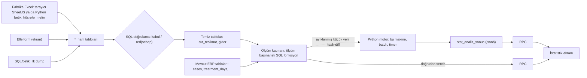
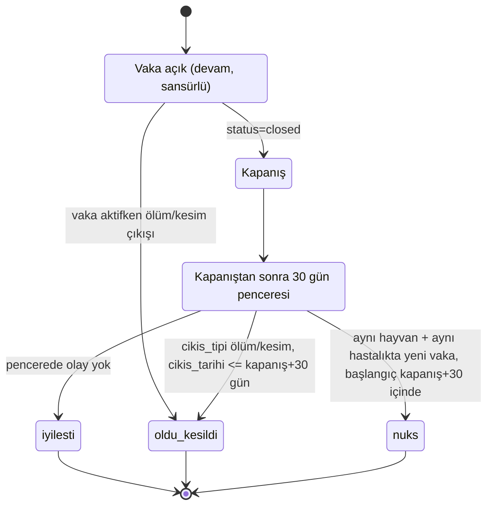
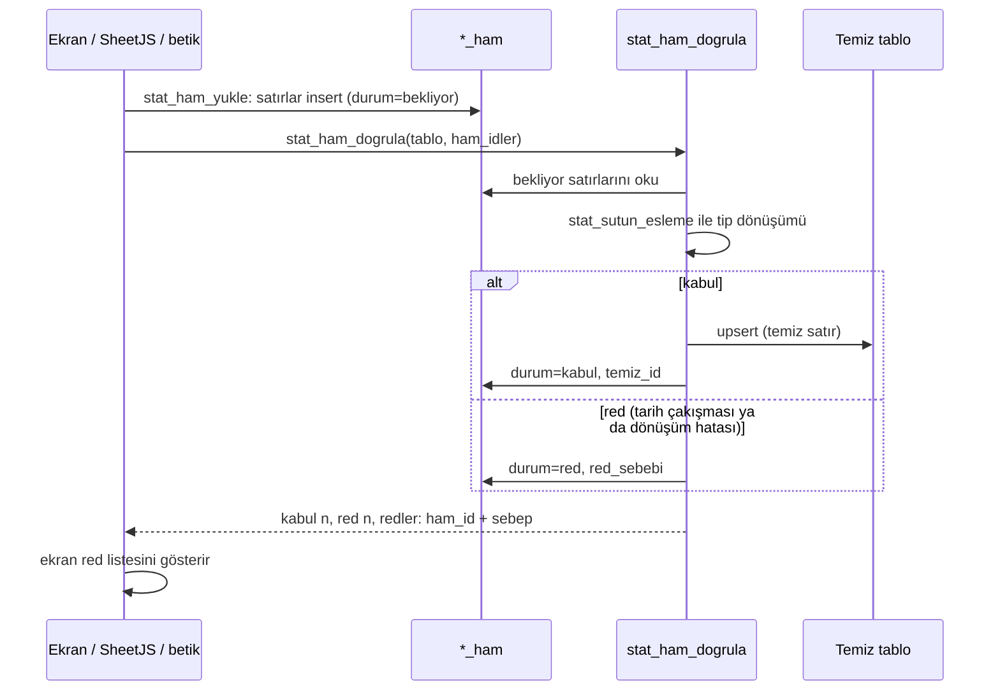
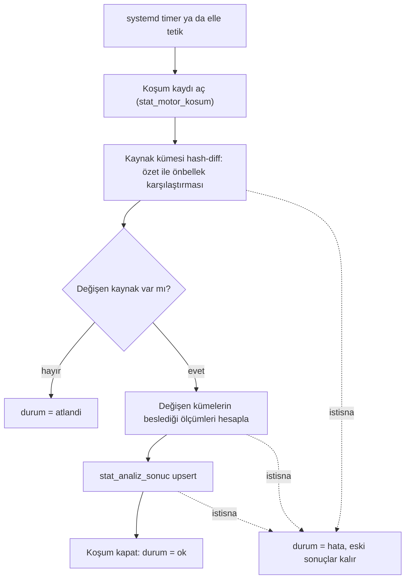
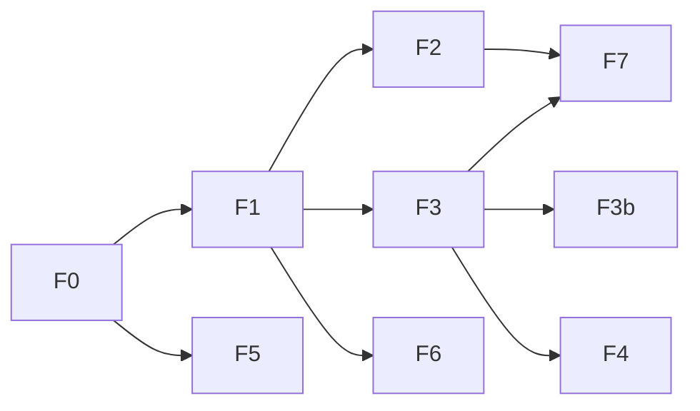

# İstatistik Modülü — Tasarım ve Roadmap (spec)

**Tarih:** 2026-10-05 · **Yazar:** ss-mimar (oturum 36aead15) · **Dal:** `istatistik-modülü` · **Durum:** ONAYLI v1 (sahip 2026-10-05; şekil 1-5 mermaid)
**Uygulayan:** root (sahip kararı; mimar yalnız spec + plan yazar)
**Kanıt etiketleri:** CONFIRMED (dosya:satır) · OBSERVED (komut/araştırma) · INFERRED (gerekçe) · SAHİP (sahip kararı, tarih) · UNKNOWN

> Domain kuralları okundu (`.harness/references/domain-rules.md` §4, §8, §9, §10, §14). Çelişen istek yok.

---

## 0. Tek cümle

Postgres hesaplar ve servis eder, Python yalnız Postgres'in yapamadığı modelleri kurar ve sonucu Postgres'e geri yazar, vanilla JS gösterir; her dil tek işte.

---

## 1. Amaç ve kapsam

**Amaç.** İşletmenin elindeki veriden karar destekleyici istatistik üretmek. Pilot alan **tedavi/ilaç sonuç istatistiği** ("x hastalığında y ilacı kaç günde, hangi oranda sonuç verdi"). Sonraki katmanlar: fabrika süt teslimatı (verim, kuru madde, mevsimsellik), gider/maliyet (litre başı maliyet ve kâr), sperma/boğa performansı.

**Kapsam içi (bu spec).** Veri modeli, ölçüm katmanı, yükleme kapısı, motor sözleşmesi, servis sözleşmesi, roadmap. Ekranın hangi RPC'leri çağıracağı.

**Kapsam dışı.**
- Ekranın görsel tasarımı ve grafik kütüphanesi seçimi → ayrı UI spec'i (bkz. §12 açık kalem A1).
- Hayvan bazlı süt verimi, laktasyon eğrisi, "mastit sonrası verim düşüşü" gibi tedavi×süt kesişimleri: fabrika verisi işletme-gün toplamıdır, hayvan bazı yoktur (SAHİP 2026-10-05, Excel örneği). Veri kaynağı değişirse ayrı spec.
- Mevcut `stat_suru_ozet` RPC'sinin yeniden yazılması: yerinde kalır (§3.4).
- Multi-tenant retrofit: domain-rules §14 gereği eski tablolara dokunulmaz.

**Başarı ölçütü.** Pilot sonunda ekranda, mevcut vaka verisinden üretilmiş "hastalık × protokol" tablosu ve en az bir sağkalım eğrisi görünür; her sayı tek bir SQL tanımına izlenebilir; hesap tarihi ekranda yazar.

---

## 2. Önceden cevaplanmış kararlar

Sormadan önce buraya bak; hepsi SAHİP 2026-10-05, kırıntı `.crumbs/istatistik-modul.jsonl`.

| # | Karar | Gerekçe/kaynak |
|---|---|---|
| K1 | Yaklaşım C: hesap + servis Postgres'te, Python yalnız modelleme | Araştırma md §4/§9; veri küçük (tek işletme, birkaç yüz hayvan) |
| K2 | Motor dili **Python** | Ayırt edici tek şey modelleme kütüphanesi (lifelines, statsmodels, scipy); Node'da olgun sağkalım/karışık model yok |
| K3 | Motor **yalnız Postgres'ten** beslenir; Excel önce DB'ye yüklenir, yerelden besleme yok (zehirlenme riski) | sahip |
| K4 | Motor her koşuda tüm çiftliği çekmez; yalnız elinde olmayan/değişen veriyi çeker (**hash-diff**, §7.2) | sahip; kaynak tablolarda updated_at yok (CONFIRMED) |
| K5 | Tazelik önemsiz; her sonuç **hesap tarihi + sürüm** taşır, UI gösterir; yeni veri yoksa motor koşmaz | sahip: "borsa trader istatistiği değil" |
| K6 | Eğrilerin baştan hesaplanması sorun değil; artımlılık tetik düzeyinde (değişen kaynağın beslediği modeller koşar) | veri küçük, saniyeler |
| K7 | Vaka sonucu: kapanış = iyileşti; istisna kapanıştan sonraki **30 gün** içinde ölüm/kesim ya da aynı hastalıktan nüks | sahip |
| K8 | Vaka sayısı **< 5** olan grup "yetersiz veri" gösterilir, sayı basılmaz | sahip |
| K9 | Tedavi süresi ve vaka süresi **ayrı** ölçümler; protokole uyum (plan gün vs fiili gün) üçüncü ölçüm | sahip: "3 günde sonuç almakla 13 günde almak bir değil" |
| K10 | İstatistik **ayrı, bağımsız ekran** (kayıt butonundan); aynı ekranda salt-okuma + veri girişi (Excel + elle). Diğer ekranları (sürü kartı) besleme ayrı iş | sahip |
| K11 | Elle giriş şart (silaj tonu, süt fiyatı vb.); ama UI dahil hiçbir giriş yolu doğrudan temiz tabloya yazamaz, hepsi ham tablo + SQL doğrulama kapısından geçer | sahip "UI girişine güvenmiyorum" + mimar |
| K12 | Grafik kütüphanesi UI spec'ine ertelendi; backend sözleşmesi: RPC **çizime hazır seri** döner | sahip |
| K15 | Görüntüden (png/jpeg) tabloya dönüşüm de bir giriş yolu; OCR **yerel** (bulut API yok), çıktısı ham tabloya düşer, dönüşüm SQL'de, kabul öncesi gözle onay zorunlu | sahip: "veri bazen fotoğraf/ekran görüntüsü olarak geliyor", "Claude API gereksiz" |
| K16 | Ölüm/kesim (ve nüks) uzun dönem modellerde olay gününde **sansür**; hayvan dışlanmaz, yaşarkenki verisi uzun dönem hesaplarına girer | SAHİP 2026-10-06: "ölenler takibi kesildi sayılsın ama sağlıklı süreçteki datalarını kullanalım yani yaşarkenki dataları uzun dönem hesaplarında"; domain-rules §19.1 |
| K17 | Aktif dönem (mevcut dönem hayvan başı / sürü kesiti) hesapları yalnız aktif hayvanlar üzerinden; vaka sonucu ölçümleri bu kesit değildir | SAHİP 2026-10-06: "aktif dönem hesaplamaları sadece aktif hayvanlar üzerinden yapılmalı zaten örn: mevcut dönemdeki hayvan başı süt ortalaması ve maliyetleri etc"; domain-rules §19.2; uygulama F3/F4 |
| K13 | `stat-hesapla` Edge Function emekli edilir | çağıranı yok, SQL ile çelişiyor (CONFIRMED) |
| K14 | Yeni tablolar `farm_id` alır (domain-rules §14), eski tablolar filtresiz | CONFIRMED: farm_id yalnız pedigree/semen'de |

---

## 3. Mimari

### 3.1 Şema

```
Fabrika Excel ─[tarayıcı SheetJS ya da bu makine Python: hücreler METİN olarak]─▶ *_ham tabloları
Elle form (ekran) ───────────────────────────────────────────────────────────────▶ *_ham tabloları
SQL/betik (bu makine, ilk dump) ─────────────────────────────────────────────────▶ *_ham tabloları
                                                   │
                               [SQL doğrulama fonksiyonu: kabul / red(sebep)]
                                                   ▼
                       TEMİZ TABLOLAR: sut_teslimat, gider  +  mevcut ERP tabloları (cases, treatment_days, …)
                                                   │
                       ÖLÇÜM KATMANI (Postgres): ölçüm başına bir SQL fonksiyon, tek tanım
                             │                                        │
                 ayıklanmış küçük veri (RPC, hash-diff)          doğrudan servis (RPC)
                             ▼                                        ▼
       PYTHON MOTOR (bu makine, batch, timer) ─▶ stat_analiz_sonuc (jsonb) ─▶ RPC ─▶ İstatistik ekranı
```

**Şekil 1 — Veri akışı (§3.1 şemasının mermaid eşdeğeri)**



### 3.2 Üç katman, üç sorumluluk

| Katman | Nerede | Sorumluluk | Asla yapmaz |
|---|---|---|---|
| Ham veri + temiz tablolar | Supabase Postgres | Kaynak gerçeği; doğrulama kapısı | Hesap |
| Ölçüm katmanı | Supabase Postgres (SQL/plpgsql) | Her ölçümün **tek** tanımı; UI'ya ve motora aynı tanımdan veri | Modelleme |
| Motor | Bu makine, Python, systemd user timer | Sağkalım, hipotez testi, zaman serisi; sonucu DB'ye upsert | Veri manipülasyonu (join/filtre/grup SQL'de), servis |

Servis her zaman Supabase (PostgREST/RPC, mevcut supabase-js kalıbı). Ayrı API sunucusu **yok** (K1).

### 3.3 Ortamlar

- Canlı ve demo aynı migration'ları alır. pg_cron canlıda var, demo/validation'da yok (CONFIRMED `20260925000002_sessiz_siniflandirma.sql:403`); cron isteyen her şey `pg_extension` kapısıyla koşullu, elle çağrılabilir RPC eşdeğeri zorunlu.
- Motor demo'ya da bağlanabilir (bağlantı dizesi parametre); demo verisi için ayrı önbellek dizini.

### 3.4 Mevcut kalıntının kaderi

| Nesne | Durum (CONFIRMED) | Karar |
|---|---|---|
| `supabase/functions/stat-hesapla/` | TS'de üreme istatistiği; js/'den çağıran yok; `config.toml:398` enabled | Emekli: config'de `enabled=false`, klasör `_archive`'e (K13) |
| `stat_suru_ozet` RPC | Canlı; sürü sekmesi kartı (`js/ui.js:5786`) | Dokunulmaz. İleride ölçüm katmanına taşınması ayrı iş |
| `stat_gebelik_ozet` RPC | js/'den çağrı yok | Bu spec'te dokunulmaz; ölü kod temizliği ayrı kalem |
| `gebelik_ozet_view`, `hastalik_istatistik_view` | legacy `hastalik_log` üstünde, çağrı yok | Kullanılmaz; yeni ölçümler `cases` zincirinden |

---

## 4. Veri modeli (yeni nesneler)

Adlandırma: Türkçe, snake_case, mevcut kalıp (`tohumlama`, `gorev_log`). Hepsi `farm_id uuid NOT NULL DEFAULT '<varsayılan farm_id>'` + `(farm_id, …)` index (domain-rules §14). RLS `USING(true)` (mevcut kalıp). Migration öncesi `scripts/db-validate.sh` zorunlu.

### 4.1 Ham kapı tabloları

`sut_teslimat_ham`
| kolon | tip | not |
|---|---|---|
| id | bigint identity | |
| farm_id | uuid | |
| kaynak | text | `excel` / `elle` / `betik` |
| dosya_adi | text | elle girişte NULL |
| satir_no | int | dosya içi; elle girişte NULL |
| hucreler | jsonb | `{"A":"ŞULE TOK…","B":"1.09.2026","D":"1.266","E":"3,97",…}` ham metin, dönüşüm YOK |
| guven | numeric(3,2) | OCR güveni (0-1); excel/elle/betik için NULL |
| gorsel_yolu | text | kaynak `goruntu` ise Storage/yerel yol |
| yuklenme_at | timestamptz | default now() |
| yukleyen | text | auth.uid() ya da betik adı |
| durum | text | `bekliyor` / `kabul` / `red` |
| red_sebebi | text | |
| temiz_id | bigint | kabulde `sut_teslimat.id` |

Tekillik: `UNIQUE (farm_id, dosya_adi, satir_no)` — aynı dosya ikinci kez yüklenince satırlar çakışır, yükleme reddedilir (K11, idempotent).

`gider_ham`: aynı iskelet (`hucreler` jsonb; elle formda alan adları anahtar).

### 4.2 Temiz tablolar

`sut_teslimat` (işletme-gün toplam; UNIQUE `(farm_id, tarih)`)
| kolon | tip | not |
|---|---|---|
| tarih | date | |
| litre | numeric(10,2) | `1.266` → 1266 (Türkçe binlik) |
| yag_pct | numeric(5,2) | `3,97` → 3.97 |
| protein_pct | numeric(5,2) | |
| ykm_pct | numeric(5,2) | yağsız kuru madde — INFERRED (örnekte 8,41) |
| ph | numeric(4,2) | INFERRED (örnekte 6,70) — sahip teyidi: §12 A2 |
| fiyat_tl_litre | numeric(10,4) | varsa; yoksa NULL |
| uretici | text | Excel A sütunu |
| ham_id | bigint | → sut_teslimat_ham |

`gider` (alım/gider kalemi)
| kolon | tip | not |
|---|---|---|
| tarih | date | |
| kategori | text | `yem` / `ilac` / `sperma` / `iscilik` / `enerji` / `veteriner` / `diger` |
| kalem | text | "silaj", "mısır", … |
| miktar | numeric | |
| birim | text | ton, kg, lt, adet |
| tutar_tl | numeric(12,2) | KDV dahil toplam |
| stok_id | text | opsiyonel → stok (ilaç kalemlerinde vaka maliyetine bağ) |
| not | text | |
| ham_id | bigint | |

### 4.3 Motor sonuç ve koşum tabloları

`stat_analiz_sonuc` — motorun tek yazdığı yer
| kolon | tip | not |
|---|---|---|
| farm_id | uuid | |
| olcum | text | `tedavi_sagkalim`, `tedavi_protokol_karsilastirma`, … |
| anahtar | jsonb | gruplama anahtarı, ör. `{"hastalik":"Mastit","protokol":"X"}` |
| sonuc | jsonb | çizime hazır seri (§8.1) |
| girdi_ozeti | text | girdi kümesinin hash'i (hangi veriyle hesaplandı) |
| hesap_at | timestamptz | UI'da "son hesap" (K5) |
| motor_surum | text | git SHA ya da semver |
| UNIQUE | (farm_id, olcum, anahtar) | upsert anahtarı |

`stat_motor_kosum` — koşum defteri: `baslangic_at, bitis_at, durum ok/hata/atlandi, mesaj, degisen_kaynaklar jsonb, surum`. Hata olursa önceki sonuç satırları **silinmez** (K5).

---

## 5. Ölçüm katmanı (SQL)

### 5.1 Kalıp

- Her ölçüm bir SQL fonksiyon: `stat_<alan>_<olcum>(p_baslangic date, p_bitis date, p_filtre jsonb DEFAULT '{}') RETURNS jsonb`, `SECURITY INVOKER`, `STABLE`, `GRANT EXECUTE TO authenticated` (anon YOK — bkz. hafıza "anon EXECUTE açığı").
- Dönüş: çizime hazır seri (§8.1). Aynı fonksiyon UI'nın da motorun da girdisi; iki hesap ayrışamaz.
- Ayıklama fonksiyonları (motor girdisi) ayrı önek: `stat_ayikla_<kume>(p_since …)` (§7.2).
- Yetersiz veri kuralı (K8) **fonksiyonun içinde**: n<5 ise değer alanları NULL, `yetersiz: true`.
- Ölçüm kaydı: `stat_olcum_kayit` tablosu (`ad, alan, baslik, aciklama, tip sql|motor, surum, aktif`). Ekran listeyi buradan çeker; yeni ölçüm = migration + kayıt satırı.

### 5.2 Tedavi pilotu: türetilmiş kavramlar (K7, K9)

Kaynak zincir (CONFIRMED GT:3530-3604): `cases(animal_id, disease_id, start_date, status, closed_at)` → `treatment_days(case_id, day_no, treatment_date, tamamlandi)` → `drug_administrations(treatment_day_id, drug_product_id, dose, unit, route, uygulanmadi)`; `treatment_day_uygulamalar` seans bazlı; `tedavi_sablonu*` plan; `hayvanlar.cikis_tipi/cikis_tarihi`; `diseases(name, category)`; `drug_products`, `drug_classes`; `stok.maliyet`.

Tek view `v_stat_vaka` (vaka başına bir satır):

| alan | tanım |
|---|---|
| vaka_id, hayvan_id, hastalik, kategori | doğrudan |
| baslangic, kapanis | `start_date`, `closed_at::date` |
| vaka_suresi_gun | kapanis − baslangic (aktifse NULL) |
| ilk_uygulama, son_uygulama | uygulanmış (`uygulanmadi=false`) ilaç uygulamalarının min/max tarihi |
| tedavi_suresi_gun | son_uygulama − ilk_uygulama + 1 |
| uygulanan_gun | uygulama yapılan ayrı gün sayısı |
| plan_gun | şablondan planlanan gün (treatment_days sayısı) |
| protokol_uyum | uygulanan_gun / plan_gun |
| protokol | uygulanan ilaç ürünlerinin sıralı kümesi (text[]), ayrıca sınıf kümesi |
| sonuc | `iyilesti` / `oldu_kesildi` / `nuks` / `devam` (aşağıdaki sıra ile) |
| olay_gun | sağkalım için: sonuç günü ya da sansür günü (bugün − baslangic) |
| sansur | `devam` ise true |
| maliyet_tl | Σ doz × `stok.maliyet` (güncel maliyet; fiyat geçmişi yok — sınırlama) |

`sonuc` sırası (ilk eşleşen kazanır):
1. `oldu_kesildi`: `hayvanlar.cikis_tipi IN ('olum','kesim')` ve `cikis_tarihi` ≤ kapanis + 30 gün (ya da vaka aktifken çıkış).
2. `nuks`: aynı hayvan + aynı `disease_id` ile yeni vaka, `start_date` ∈ (kapanis, kapanis+30].
3. `iyilesti`: `status='closed'`, yukarıdakiler yok.
4. `devam`: `status='active'`.

**Şekil 2 — Vaka sonucu durumları (K7, K9)**



Sınırlamalar (spec'e yazılır, UI'da dipnot): şiddet alanı yok → süreler dağılım (medyan + Q1/Q3) olarak gösterilir, ortalama tek başına basılmaz; ilaç karşılaştırması yalnız aynı hastalık ve aynı dönem içinde; `cikis_tipi` değer kümesi canlıda doğrulanmalı (GT'de `olum|satis`, domain-rules §10 `kesim` de var — §12 A3).

### 5.3 Pilot ölçüm listesi

| ad | katman | çıktı |
|---|---|---|
| `stat_tedavi_ozet` | SQL | hastalık × dönem: vaka n, iyileşme %, nüks %, ölüm %, medyan vaka süresi, medyan tedavi süresi, ort. maliyet |
| `stat_tedavi_protokol` | SQL | hastalık × protokol (ürün ve sınıf düzeyi): aynı kolonlar + protokol uyum |
| `stat_tedavi_sure_dagilim` | SQL | hastalık × protokol: tedavi süresi histogramı + Q1/medyan/Q3 |
| `stat_tedavi_sagkalim` | motor | Kaplan-Meier: iyileşme olasılığı vs gün, protokol başına eğri, sansürlü vakalar dahil; medyan iyileşme günü + %95 GA |
| `stat_tedavi_protokol_fark` | motor | iki protokol arası fark: log-rank p, hazard oranı (Cox, tek değişken) — n<5'te üretilmez |
| `stat_ureme_protokol_sonuc` | SQL | protokol ailesi (Ovsync/PG …) × dönem: gebelikle bitme olasılığı (tohumlama gibi değerlendirilir). **F1 kapsamı DIŞI**, üreme grubu (F5 ile) — SAHİP 2026-10-06 |

[F1 ruling] Üreme protokolü vakaları (`cases.protocol_family IS NOT NULL` ya da hastalık adı Ovsync) tedavi değildir: `v_stat_vaka`'dan ve tedavi ölçümlerinden dışlanır, dışlanan sayı ölçümün `dipnot`'una yazılır; toplu kapatılmış vakalar (aynı `closed_at` ≥3 vaka) yalnız dipnotla belirtilir (SAHİP 2026-10-06: "protokoller ayrı olarak hesaplanmalı, tohumlamalar gibi sonucunun gebelikle bitme ihtimaline göre değerlendiririz"; plan T3, mimar R31).

---

## 6. Veri girişi ve yükleme kapısı (K11)

### 6.1 Üç yol, tek kapı

| Yol | Parse nerede | Düştüğü yer |
|---|---|---|
| Ekrandan Excel/CSV | Tarayıcı, SheetJS (vendor/ tek dosya) → satırlar RPC `stat_ham_yukle(p_tablo, p_dosya_adi, p_satirlar jsonb[])` | `*_ham` |
| Ekrandan elle form | — | `*_ham` (kaynak `elle`) |
| Bu makineden betik | Python openpyxl/pandas → psycopg3 `COPY`/INSERT | `*_ham` (kaynak `betik`) |
| Görüntü (png/jpeg: fotoğraf, ekran görüntüsü) | OCR bu makinede, yerel araç (Python; §12 A7) → satırlar metin; Android OCR metni yapıştırma da olur | `*_ham` (kaynak `goruntu`, `guven` puanı; kabul öncesi ekranda **zorunlu gözle onay**) |

Supabase'in kendi xlsx içe aktarıcısı yok (OBSERVED ask-codex 20261005T155226Z-bfa0: Dashboard yalnız CSV 100 MB; Edge Function'da xlsx parse doğrulanamadı). Dolayısıyla xlsx→satır dönüşümü ya tarayıcıda ya bu makinede; **dönüşüm (tip, sayı biçimi) daima SQL'de** (K3).

**Şekil 3 — Yükleme kapısı (§6.1-6.2)**



### 6.2 Doğrulama fonksiyonu

`stat_ham_dogrula(p_tablo text, p_ham_ids bigint[] DEFAULT NULL) RETURNS jsonb` — `bekliyor` satırlarını işler:
- Sütun eşlemesi `stat_sutun_esleme` tablosundan (`tablo, kaynak_sutun 'D', hedef 'litre', donusum 'tr_sayi'|'tr_tarih'|'metin'`); Excel şablonu değişirse migration değil veri değişir.
- Dönüşüm: `'1.266'` → 1266 (binlik nokta), `'3,97'` → 3.97, `'1.09.2026'` → 2026-09-01. Belirsiz biçim (ör. `1.266` litre mi 1,266 mi?) kural: litre alanında nokta binliktir (SAHİP Excel örneği).
- Kabul → temiz tabloya upsert (tarih çakışırsa **red**: "aynı gün zaten var", üstüne yazma yok; düzeltme elle silme + yeniden yükleme).
- Red → `durum='red', red_sebebi`; ekran listeler.
- Dönüş: `{kabul: n, red: n, redler: [{ham_id, sebep}]}`.

### 6.3 Ekran sözleşmesi (UI spec'ine girdi)

Tek ekran, iki bölüm: üst istatistik (salt-okuma), alt veri girişi (Excel yükle + elle form + red listesi). Giriş yetkisi `authenticated`; demo'da da çalışır.

---

## 7. Motor (Python, bu makine)

### 7.1 Çalışma biçimi

- Konum: `tools/stat-motor/` (repo içinde; sürüm = git SHA). Python 3.14 venv. Bağımlılıklar (OBSERVED ask-codex 20261005T155236Z-c0bb, 2026-10-05): `psycopg[binary]` 3 (doğrudan bağlantı, `ON CONFLICT` upsert; supabase-py değil), `lifelines` 0.30.3 (MIT, Py3.14; Kaplan-Meier, log-rank, Cox), `statsmodels` 0.15.0 (BSD; F7 zaman serisi), `scipy` 1.18.1, `pandas` 3.0 + `openpyxl` (yükleyici betik; `read_excel(thousands='.', decimal=',')`). Önbellek biçimi parquet (`pyarrow`). **Kullanılmaz:** scikit-survival (GPL-3), dlt incremental (`last_modified` watermark ister; kaynaklarda damga yok → hash-diff), DuckDB postgres uzantısı (gereksiz katman).
- Tetik: systemd **user timer**, günde 1 (gece); elle `stat-motor run [--farm …] [--olcum …] [--force]`.
- Bağlantı: doğrudan Postgres (pooler), **özel DB rolü** `stat_motor` (yalnız `stat_ayikla_*` EXECUTE + `stat_analiz_sonuc`/`stat_motor_kosum` INSERT/UPDATE); service-role anahtarı kullanılmaz. Bağlantı dizesi `~/.config/stat-motor/env` (git dışı). Demo için ikinci profil.
- Akış: koşum kaydı aç → her kaynak kümesi için hash-diff (7.2) → değişen kümelerin beslediği ölçümleri hesapla → upsert → koşum kaydı kapat. Hiçbir kaynak değişmediyse `durum='atlandi'` (K5).
- Hata: istisna → koşum `hata`, eski sonuçlar kalır, stderr systemd journal'a; UI'da hesap tarihi eskidikçe görünür.

**Şekil 4 — Motor koşumu (§7.1)**



### 7.2 Hash-diff (K4)

Kaynak tablolarda `updated_at` yok (CONFIRMED GT: cases `created_at/closed_at`, treatment_days/drug_administrations/dogum yalnız `created_at`, tohumlama/hayvanlar/stok damgasız). Bu yüzden damga değil içerik özeti:

1. `stat_ayikla_<kume>_ozet()` → `(id, md5(row::text))` listesi (vaka başına ~40 B; tüm çiftlik ≤ birkaç yüz KB).
2. Motor yerel önbelleği (`~/.cache/stat-motor/<farm>/<kume>.parquet` + `ozet.json`) ile karşılaştırır: yeni id, değişen hash, kaybolan id.
3. Yalnız yeni/değişen id'ler için `stat_ayikla_<kume>(p_ids bigint[])` tam satır; kaybolanlar önbellekten düşer.
4. Önbellek yalnız Postgres'ten dolar (K3); bozulursa silinir, tam çekim bir kez olur.

Model hesabı önbellekteki tam kümeden (K6): eğri baştan, veri taşıma delta.

### 7.3 Çıktı sözleşmesi

`stat_analiz_sonuc.sonuc` çizime hazır seri (§8.1); `girdi_ozeti` = kümenin hash'lerinin hash'i; `motor_surum` = git SHA. Aynı girdi + aynı sürüm → aynı çıktı (idempotent, test edilebilir).

---

## 8. Servis sözleşmesi

### 8.1 Çizime hazır seri (K12)

Her ölçüm (SQL ya da motor) şu zarfı döner:
```json
{
  "olcum": "stat_tedavi_sagkalim",
  "hesap_at": "2026-10-05T01:00:00Z",      // SQL ölçümde now()
  "surum": "sql:20261010000001" | "motor:<sha>",
  "n": 42, "yetersiz": false,
  "x": {"ad": "gün", "deger": [0,1,2,...]},
  "seriler": [{"ad": "Protokol A", "n": 23, "y": [...], "alt": [...], "ust": [...]}],
  "tablo": [{"...": "isteğe bağlı satır listesi"}],
  "dipnot": ["Şiddet bilgisi yok; süreler dağılım olarak verilir."]
}
```
Sayılar JSON number (grafik değeri); para `numeric(12,2)` → number (TL, kuruş hassasiyeti yeterli). Büyük kimlikler string.

### 8.2 RPC seti (pilot)

| RPC | Kim çağırır | Not |
|---|---|---|
| `stat_olcum_listele()` | ekran | kayıt tablosundan aktif ölçümler |
| `stat_<alan>_<olcum>(p_baslangic, p_bitis, p_filtre)` | ekran | SQL ölçümleri |
| `stat_sonuc_oku(p_olcum, p_anahtar)` | ekran | motor sonuçları, `hesap_at` dahil |
| `stat_ham_yukle(...)`, `stat_ham_dogrula(...)`, `stat_ham_redler(...)` | ekran/betik | yükleme kapısı |
| `stat_ayikla_*` | motor (rol `stat_motor`) | ekrana GRANT yok |

GRANT: `authenticated` (anon yok). farm_id: yeni tablolarda `current_farm_id()` filtresi; eski tablolardan türeyen ölçümlerde filtre yok (K14, tek-tenant).

---

## 9. Roadmap (fazlar, kabul ölçütleri)

Her faz ayrı plan + ayrı dal; sırası bağımlılıktan gelir. Süre tahmini verilmez; kabul ölçütü verilir.

| Faz | İçerik | Kabul ölçütü | Bağımlılık |
|---|---|---|---|
| **F0 Temizlik + iskelet** | `stat-hesapla` emekli; `stat_olcum_kayit`, `stat_analiz_sonuc`, `stat_motor_kosum` migration; `v_stat_vaka` view; db-validate PASS | view canlı vaka verisinde çalışır, `sonuc` dağılımı elle örneklenmiş 10 vakayla doğrulanır | — |
| **F1 Tedavi pilotu (SQL)** | §5.3 SQL ölçümleri + RPC'ler; ekran iskeleti (liste + tablo, grafik yok da olur) | ekranda hastalık×protokol tablosu; n<5 "yetersiz"; her sayı bir SQL fonksiyonuna izlenir; UI testi kapısı (worker sonnet PASS) | F0 |
| **F2 Motor v1** | `tools/stat-motor`, hash-diff, Kaplan-Meier + log-rank, upsert, timer | aynı girdi iki koşumda aynı `girdi_ozeti`+`sonuc`; veri değişmeden 2. koşum `atlandi`; ekranda sağkalım eğrisi + hesap tarihi | F1 |
| **F3 Yükleme kapısı + süt** | ham/temiz tablolar, `stat_sutun_esleme`, SheetJS yükleme, elle form, doğrulama; `stat_sut_*` ölçümleri (aylık litre, yağ/protein/YKM trend, mevsimsellik) | fabrika Excel'i (örnek dosya) uçtan uca: yükle → red listesi boş → aylık tablo; aynı dosya 2. kez → red | F1 (ekran) |
| **F3b Görüntü yolu** | OCR betiği (bu makine) → ham tablo; ekranda OCR satırı gözden geçir/düzelt/kabul akışı | sahip örnek fotoğrafı (WhatsApp 2026-09-26) uçtan uca: 24 satır, hatalı hücre elle düzeltilip kabul | F3 |
| **F4 Gider + maliyet** | `gider` + form; `stat_maliyet_*`: aylık gider, litre başı maliyet, litre başı kâr (süt fiyatı girilmişse), vaka maliyeti (F1 kolonunu stok→gider bağıyla iyileştirir) | silaj alımı elle girilir, aylık litre başı maliyet ekranda; fiyat yoksa kâr "veri yok" | F3 |
| **F5 Sperma/boğa** | `tohumlama.sperma` normalizasyonu (`split_part(…,'|',1)` + `semen_catalog` eşleme tablosu), `stat_ureme_sperma_*`: boğa × dönem gebelik oranı, deneme sayısı dağılımı | boğa bazlı tablo; eşleşmeyen sperma adları "eşlenmedi" listesinde | F0 |
| **F6 Sürü kartı entegrasyonu** | `stat_suru_ozet`'in ölçüm katmanına taşınması (isteğe bağlı) | mevcut kart aynı sayıları gösterir (regresyon testi) | F1 |
| **F7 Motor v2 (gerekirse)** | Cox çok değişkenli, süt zaman serisi tahmini | yalnız sahip talebiyle | F2, F3 |

**Şekil 5 — Faz bağımlılıkları (§9)**



Plan modu: her faz için `writing-plans-obra` ile madde numaralı plan; implementasyon root (sahip kararı). İlk plan: **F0+F1 birlikte** (tek dal, yeni veri gerektirmez).

---

## 10. Test ve doğrulama

- Migration: `scripts/db-validate.sh` (hafıza: db-validation kapısı) her migration'da; demo'da pg_cron yok uyarısı.
- Ölçüm doğruluğu: her SQL ölçüm için demo DB'de **elle hesaplanmış 3 vaka** sabit fixture (`tests/stat/fixtures/`), Node unit test RPC çıktısını fixture ile karşılaştırır.
- Motor: `pytest`; sabit girdi parquet → beklenen eğri (lifelines'ın kendi referansı); hash-diff birim testi (yeni/değişen/kaybolan).
- Ekran: proje CLAUDE.md "UI testi kapısı" (worker sonnet-medium tarayıcı koşumu PASS) sahibe gösterim öncesi.
- Canlı şema: ölçüm yazmadan önce `cases.status`, `hayvanlar.cikis_tipi` değer kümeleri canlıdan doğrulanır (hafıza: live-schema-verification).

---

## 11. Riskler

| Risk | Etki | Önlem |
|---|---|---|
| "Kapanış = iyileşti" varsayımı geçmiş veride tutmaz (vakalar kapatılmamış ya da toplu kapatılmış) | pilot sayıları yanıltır | F0 kabulünde 10 vaka elle örnekleme; aktif-eski vakalar için `devam` sansürü + UI dipnotu |
| Şiddet/yaş/laktasyon eşleştirmesi yok | protokol karşılaştırması karıştırıcı etkiye açık | dağılım + GA göster, "neden-sonuç değil" dipnotu; Cox'a kategori/yaş F7'de |
| Fabrika Excel şablonu değişir | yükleme kırılır | `stat_sutun_esleme` veri tablosu, migration gerekmez |
| Laptop kapalı, motor koşmaz | sağkalım eğrisi bayat | hesap tarihi ekranda; SQL ölçümleri etkilenmez |
| Motor DB kimliği sızar | yazma erişimi | ayrı rol, yalnız sonuç tablolarına yazma, git dışı env |
| Demo'da pg_cron yok | zamanlı yenileme çalışmaz | spec cron'a dayanmıyor; tüm yenilemeler RPC ile elle çağrılabilir |

---

## 12. Açık kalemler

| # | Kalem | Kimde | Ne zaman |
|---|---|---|---|
| A1 | Grafik kütüphanesi (aday Chart.js > uPlot > ECharts, vendor/ tek dosya) | UI spec | F1 ekran |
| A2 | Excel sütunları: G=yağsız kuru madde, H=pH (SAHİP 2026-10-05 "muhtemelen"); gizli C sütunu sahip de bilmiyor → F3'te gerçek dosyada bakılır, `stat_sutun_esleme` ile eşlenir | root (F3) | F3 |
| A3 | `hayvanlar.cikis_tipi` canlı değer kümesi (`kesim` var mı) | root, canlı sorgu | F0 |
| A4 | ~~Hazır araç araştırması~~ KAPANDI: sonuç §7.1'e işlendi (lifelines MIT Py3.14 ✓, scikit-survival GPL ✗, dlt watermark uyumsuz ✗, psycopg3 ✓); kaynak `~/.codex-research/runs/20261005T155236Z-c0bb/answer.json` | mimar | — |
| A5 | Motor bağlantısı: Supabase pooler + özel rol oluşturma (free tier'da rol oluşturma serbest; doğrulanacak) | root | F2 |
| A6 | Süt fiyatı nereden gelir (Excel'de sütun var mı, yoksa elle aylık) | sahip | F4 |
| A7 | OCR aracı: **yerel, bulut API yok** (SAHİP 2026-10-05: "Claude API gereksiz"). Aday PaddleOCR PP-Structure (tablo tanıma) > Tesseract (+satır/sütun ayrıştırma). Seçim F3b başında örnek fotoğrafla spike; OCR yalnız metin üretir, tip dönüşümü yine `stat_ham_dogrula` (SQL). Android OCR çıktısı yapıştırma da aynı kapı | root (F3b spike) | F3b |

---

## 13. Kaynaklar

- Sahip araştırması: `~/İndirilenler/postgresql-js-typescript-python-backend-karsilastirmasi.md` (§4 hesabın yeri, §9 Python'u sonradan worker olarak ekleme)
- Fabrika Excel örneği: `~/İndirilenler/WhatsApp Image 2026-09-26 at 15.36.52(1).jpeg`
- Keşif raporu: Explore alt ajanı 2026-10-05 (kırıntı `measurement`), ground truth `supabase/migrations/99999999999999_ground_truth.sql`
- Supabase araştırması: `~/.codex-research/runs/20261005T155226Z-bfa0/answer.json`
- Kırıntılar: `.crumbs/istatistik-modul.jsonl` · Board: `.ss/istatistik-modul-BOARD.md`
