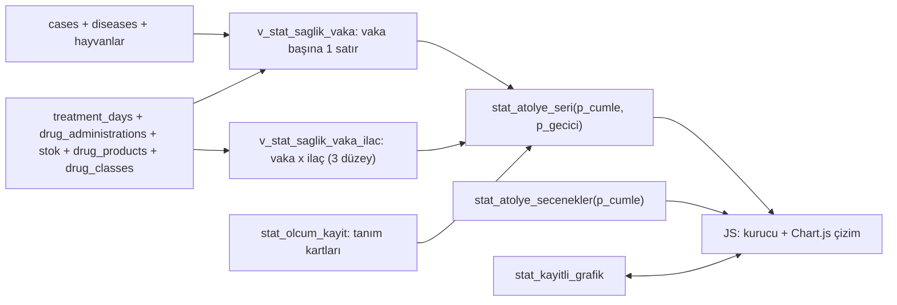

# İstatistik Atölyesi — spec v2 (AP1 Sağlık ayrıntılı, AP2/AP3 roadmap)

**Tarih:** 2026-10-17 · **Yazar:** ss-mimar (opus high) · **Dal:** `istatistik-modülü` (merge YOK) · **Durum:** ONAYLI v2 (2026-10-17)
**Brief:** `runs/2026-10-05-istatistik-modulu/f3-yeniden/spec-v2-brief.md` (sahip onayı 2026-10-17, "TAMAM speci yap")
**Kanıt etiketleri:** CONFIRMED (dosya:satır) · MEASURED (sorgu, tarih) · OBSERVED · INFERRED · SAHİP (tarih) · UNKNOWN

> Domain kuralları okundu (`.harness/references/domain-rules.md` §8, §10, §14, §18.16, §19). Çelişki yok.
> Not (doc-drift, çelişki değil): §8 tablosu `HASTALIK_KAT`'ı "canlıdaki tam liste" diye anar; canlı `diseases`
> tablosu 52 satır, 9 kategori ("Aşı ile Önlenebilir" 16 dahil) içerir (MEASURED prod 2026-10-17). Bu spec hastalık
> listesini DB'den okur (SAHİP 2026-10-06), §8'in form davranışına dokunmaz.

---

## 0. v2 neyi geçersiz kılar

v1 (`docs/2026-10-05-istatistik-modulu-spec.md`) yerinde kalır. Aşağıdaki tablo dışındaki v1 maddeleri geçerlidir.

| v1 § | v1 içeriği | v2 durumu |
|---|---|---|
| §1 "Başarı ölçütü" | hastalık × protokol tablosu + sağkalım eğrisi | **Geçersiz.** Yerine §9 (AP1 kabul). |
| §2 K2, §7 (Python motor) | Python modelleme motoru, timer | **Askıda.** Öneri DONDUR (§11 SK-1). Kod repoda kalır, ekrana bağlı değil. |
| §2 K12, §8.1 | RPC çizime hazır seri | **Geçerli**, zarf genişler (§4.5). |
| §3.4 | mevcut kalıntı tablosu | Genişletildi: F0-F2 nesnelerinin kaderi §4.9. |
| §5.2 `v_stat_vaka` | "protokol" = ürün kümesi; tam küme gruplaması | **Geçersiz.** Yerine §4.2 vaka satırı + vaka×ilaç satırı, "içeren" ekseni. |
| §5.2 `maliyet_tl` | Σ doz × `stok.maliyet` | **Geçersiz.** `stok.maliyet` prod'da 51/51 satırda 0 (MEASURED 2026-10-17). Yerine §4.2.4. |
| §5.3 ölçüm listesi | `stat_tedavi_ozet/protokol/sure_dagilim`, motor sağkalım/fark | **Emekli** (§4.9). Yerine §4.3. |
| §6.3, §12 A1 | ekran sözleşmesi; grafik kütüphanesi açık | Yerine §3 (Stitch envanteri), §4.6 (kütüphane önerisi). |
| §9 F3-F4 | süt + gider | AP2'ye taşındı (§6). F5-F7 sırası değişmedi, AP1-AP3'ten sonra. |

---

## 1. Amaç

### 1.1 Tek cümle
Kullanıcı kendi istatistiğini cümle kurar gibi seçer (alan → ölçü → kırılım → dönem → kıyas), Postgres tek tanımdan hesaplayıp çizime hazır seri döner, ekran anlamlı grafik çizer ve kullanıcı grafiği panosuna kaydeder.

### 1.2 Sahibin cümleleri (birebir)
Kaynak: `runs/2026-10-05-istatistik-modulu/HANDOFF-2026-10-06b.md` § Sahibin cümleleri; kırıntılar `.ss/istatistik-modul-crumbs.jsonl`.
- "F2 demo KIRMIZI (2026-10-06): istatistiklerin hepsi yetersiz görünüyor; enterit yok en çok data olan hastalık; tablolar değil anlamlı görsel grafikler; ui çok karmaşık, db sayımlarını listeliyor gibi"
- "ihtiyaç: x hastalığının ortalama iyileşme süreleri, hangi ilaçlarla daha hızlı iyileşme, hangi ilaçlarla iyileşme skoru yüksek, hangi dozajlarda verim; ham veri tek başına bir şey ifade etmez; protokolden kastım ovsync idi, her şey protokol kabul edilmiş"
- "üçü de olmalı: x etken madde / x preparat / x sınıfı ile başarılı olanlar; aynı etken maddede hangi marka ve kombinasyonlarla başarı; başarı: ölümsüz kapanma, nüksetmeme, kapanma hızı → formül, python hesaplasın, ui'da servis"
- "a hastalığı için hangi ilaç ve kombinasyonlardan kaç paraya verim alabiliyorum net olarak göreceğim aslında amacımız bir fiyat performans analiz katmanı yaratmak" (sahip düzeltmesi: "yalın" = ilacı İÇEREN tüm vakalar, hastalık bazlı da; x+y birlikte kullanılanlar; hız ayrı, başarı sayısı hızdan azade ayrı)
- "üst katman hesaplamalarını js yapacaksa belki pyton katmanı bile gereksiz olabilir şuan bize katkısı nedir pythonun? pg db zaten ayıklanmış istatistik verebiliyor — kullanıcı kendi istatistiğini yaratabilir (x, x+y, x+y'nin a hastalığındaki grafikleri)"
- "türkiye ve dünyadaki kobi çiftliklerinin maliyet kar ve tedavi istatistiklerini bizimkiyle kıyaslamak büyük değer; motor 'bu büyük dünyada biz nerede ne yapıyoruz' sorusuna cevap verebilmeli"
- "dünya, avrupa, türkiye, aydın ili (81 il ayrı) ve biz şeklinde genelden özele kobi çiftlik yorumu; fikir genel spec/roadmap olarak dursun, minör kararlar ona göre"
- "aynı hastalık için 3 günde sonuç almakla 13 gün içerisinde sonuç almak bir değil"

### 1.3 Teşhisin 5 kök nedeni → v2 çözümü
Kaynak: `runs/2026-10-05-istatistik-modulu/f3-yeniden/teshis-report.md`.

| # | Kök neden (kanıt) | v2 çözümü |
|---|---|---|
| 1 | **Adlandırma:** "protokol" = vakadaki ilaç ürünlerinin tam kümesi (CONFIRMED `20261005000005_stat_protokol_disla.sql:41-44`) | "Protokol" kelimesi istatistikte yalnız üreme protokolü (Ovsync) için. İlaç birleşimi = "kombinasyon" / "x + y". Kolon adları da değişir (§4.2). |
| 2 | **Parçalanma:** tam küme gruplaması 118 vakayı 89 hücreye böler, 2'si n≥5 (MEASURED prod) | "İçeren" ekseni: x'i içeren tüm vakalar. Prod'da n≥5 hücre 2 → 14 (MEASURED teşhis q17). Kombinasyon = x+y içeren, karşı grup = x içeren y'siz. |
| 3 | **Statik liste:** hastalık seçici `HASTALIK_KAT` (CONFIRMED `js/ui.js:691`, `js/config.js:23-32`); 45/118 vaka (%38) seçilemez | Seçenekler `diseases` + kapsamdaki vaka sayısından gelir (§4.4). |
| 4 | **Kısmi veri:** etken madde stok fallback ile %100, doz = uygulama başına ml, ağırlık 2/118 (MEASURED) | Etken/preparat/sınıf üç düzey stok fallback ile (§4.2.3). Doz ölçüsü yok, "doz verisi yok" durumu (§4.8). |
| 5 | **Görünmez motor:** motor sonucu var, anlamlı eğri seçilemiyor; "Protokol farkı" 27/27 boş (OBSERVED) | AP1'in tüm ölçüleri SQL'de; motor ekrandan çıkar, dondurulur (SK-1). Kapanma eğrisi SQL'de (§4.3). |

---

## 2. Önceden cevaplanmış kararlar

Sormadan önce buraya bak. v1 K1-K17 geçerli (yukarıdaki §0 istisnalarıyla).

| # | Karar | Kaynak |
|---|---|---|
| V1 | Kavram: kullanıcı kendi grafiğini kurar (cümle kurucu) + "Kaydettiğim grafikler" panosu. Tablo yığını değil anlamlı grafik. | SAHİP 2026-10-06 (kırıntı 19:03) |
| V2 | "İlaç x" = x'i İÇEREN tüm vakalar (hastalık bazlı da). "x + y" = ikisinin birlikte kullanıldığı vakalar. Üç düzey: etken madde / preparat (marka) / sınıf. | SAHİP 2026-10-06 |
| V3 | Hız (kapanma günü) ve başarı **ayrı** ölçüdür, birleştirilmez. Tedavi süresi ≠ vaka süresi. | SAHİP 2026-10-05/06; v1 K9 |
| V4 | Başarı = vaka kapandı + 30 gün içinde ölüm/kesim yok + 30 gün içinde nüks yok. n<5 = yetersiz. | SAHİP; v1 K7, K8 |
| V5 | Üreme protokolü (Ovsync) vakaları tedavi istatistiğinden dışlanır; dışlanan sayı dipnotta. | SAHİP 2026-10-06; domain-rules §8 |
| V6 | Açık (süren) vaka hesap dışı; sayısı ekranda ayrı gösterilir. | SAHİP 2026-10-06 (bölüm 1 onayı) |
| V7 | Toplu kapatılmış vakada kapanma günü vekili = son ilaç tarihi + normal vakalarda ölçülen gecikme; vaka "vekil" işaretli. | SAHİP 2026-10-06 (bölüm 1, seçenek a) |
| V8 | Hastalık listesi DB'den; statik `HASTALIK_KAT` istatistikte kullanılmaz. Etken/sınıf stok fallback ile çözülür. | SAHİP 2026-10-06 |
| V9 | "Protokol" kelimesi ilaç kombinasyonu için kullanılmaz. | SAHİP 2026-10-06 ("protokolden kastım ovsync idi") |
| V10 | Masaüstü öncelikli, telefonda tatmin edici. | SAHİP 2026-10-06 |
| V11 | DB'de olmayan değer hesap için GEÇİCİ elle girilir, "geçici, kaydedilmedi" işaretlenir. Kalıcı fiyat/gider kaydı ayrı konu. | SAHİP 2026-10-06 (kırıntı 19:12) |
| V12 | Kıyas = yayımlanmış istatistiklerdeki KOBİ çiftlik ortalamaları (büyük işletme hariç/ayrı). Diğer ERP çiftlikleri değil. Her sayıda kaynak + tarih; kaynak yoksa "kaynak bekleniyor". | SAHİP 2026-10-06 |
| V13 | Tasarım bütün (19 Stitch PNG'si, sahip hepsini beğendi). Kod üç alt projede: AP1 Sağlık → AP2 Ekonomi → AP3 Dış kıyas. | SAHİP 2026-10-06 E/E; kapı R20 KABUL (`b3463ba`) |
| V14 | Mimari K1: hesap + servis Postgres'te (RPC çizime hazır seri), ayrı API sunucusu yok. | v1 K1; brief bağlayıcı |
| V15 | Enterit'te Enrolen 21/23 vakada var → "Enrolen'siz" karşı grup yok (n=2). Kıyas ek ilaç ekseninde: "+Halocur var/yok", "+NSAİİ var/yok". | MEASURED teşhis §4; brief |
| V16 | Doz = uygulama başına ml (699/704); ağırlık 2/118 → mg/kg yok, "doz verisi yok" durumu. | MEASURED teşhis §4 |

**Mimar kararları (bu spec, gerekçeli; sahip itiraz ederse §11'deki karşılığı açılır):**

| # | Karar | Gerekçe |
|---|---|---|
| M1 | Gruplama, sayma, oran, medyan **Postgres'te**; JS yalnız seçim + çizim. Brainstorming bölüm 1'deki "gruplama ekranda" ifadesinin yerine geçer. | V14 bağlayıcı; n<5 kuralı tek yerde; her sayı tek SQL tanımına izlenir (v1 başarı ölçütü); AP3 kıyası aynı tanımı kullanır. §11 SK-7. |
| M2 | Başarı olgunlaşması: kapanıştan bu yana 30 gün dolmamış ve henüz olay (ölüm/kesim/nüks/tedavi değişti) görülmemiş vaka başarı paydasına girmez ("olgunlaşmamış"), hız hesabına girer. | V4'teki "30 gün içinde yok" ancak 30 gün geçince söylenebilir. Aksi hâlde yeni kapanan vakalar başarıyı şişirir. §11 SK-8. |
| M3 | Vaka aktifken hayvan ölür/kesilirse vaka **sonuçlanmış ve başarısız** sayılır (açık değil). Aktif vaka + satış/kayıp çıkışı = açık (hesap dışı). | v1 §5.2 sıra 1 ile aynı; hayvanı olmayan vaka "süren" değildir. |
| M4 | Gruplar örtüşür ("içeren"): bir vaka birden çok ilaç satırında sayılır; grafiğin altında dipnot. Etiket: "Enrolen içeren", "Enrolen + Halocur içeren", "Enrolen içeren, Halocur'suz". | V2 |
| M5 | Ekrandaki her yorum cümlesi betimseldir ("medyan 1 gün daha kısa"); nedensellik dili ("sağlar", "etkilidir") yazılmaz. Dipnot: "Karşılaştırma gözlemseldir; şiddet/yaş eşleştirmesi yok." | v1 §5.2 sınırlamalar; şiddet alanı yok |

---

## 3. Kavram ve ekran envanteri

Stitch projesi `1403416509252690846`, 8 ekran / 19 PNG: `runs/2026-10-05-istatistik-modulu/f3-yeniden/stitch/png/`. Sekmeler: **Pano · Kurucu · Kıyas · Fiyatlar**.

| Ekran (PNG) | Cevapladığı sahip sorusu | AP | AP1'de görünür kısım |
|---|---|---|---|
| 01 Pano (`01-DESKTOP`, `01-MOBILE`, `01-VA`, `01-VB`, `01-VC`) | "Kurduğum grafikler ve işletmenin ay özeti tek bakışta nerede?" | AP1 (kaydedilenler ızgarası, "+ Yeni grafik kur") · AP2 (maliyet/kâr/süt/et KPI kartları) · AP3 (biz vs AB kartı) | Yalnız kaydedilen grafik ızgarası + "+ Yeni grafik kur". KPI satırı AP2'de gelir. |
| 02 Kurucu · sağlık (`02-DESKTOP`, `02-MOBILE`) | "Enterit'te hangi ilaç/kombinasyon kaç günde, kaç ₺'ye, yüzde kaç başarı?" | **AP1 çekirdek** | Tamamı. |
| 03 Kurucu · ekonomi (`03-*`) | "Aylık maliyet kalemlerim ve net kârım nasıl gidiyor?" | AP2 | Yok. |
| 04 Kıyas · ekonomi (`04-*`) | "Litre başı maliyetim Aydın/TR/AB/dünya KOBİ ortalamasına göre nerede?" | AP3 (Biz değeri AP2'den) | Yok. |
| 05 Sağlık kıyası (`05-*`) | "Ölüm oranım, tedavi başarım, verimim KOBİ ortalamasına göre nerede?" | AP3 (Biz değeri AP1/AP2'den) | Yok. |
| 06 Fiyatlar (`06-*`) | "Süt ve et fiyatı aylık nasıl seyrediyor, AB'ye göre?" | AP2 (AB çizgisi AP3) | Yok. |
| 07 Boş / eksik veri (`07-*`) | "Bu grafik neden boş, ne yaparsam dolar?" | AP1 (yetersiz, doz yok, hesap tarihi) · AP3 (kaynak bekleniyor) | AP1 durumları (§4.8). |
| 08 Geçici elle giriş (`08-*`) | "Kayıtta olmayan değerle hesabı şimdi nasıl görürüm?" | AP2 (süt fiyatı, yem, işçilik) · **AP1 (ilaç birim fiyatı, §4.2.4)** | İlaç fiyatı paneli. |

**Pano düzeni (mimar kararı, SK-9):** temel `01-DESKTOP` (üstte KPI şeridi, altta 2 kolon kaydedilen grafik ızgarası) + `01-VC`'nin sıralama tutamağı. `01-VA`'nın sürekli açık kurucu rayı alınmaz; kurucu ayrı sekmedir. `01-VB` hero grafiği AP2'de "Net kâr" kartı olarak değerlendirilebilir.

**Sekme görünürlüğü:** AP1'de yalnız Pano + Kurucu görünür. Kıyas ve Fiyatlar sekmeleri, "Ekonomi/Üreme/Süt verimi" alan çipleri AP'leri gelene kadar **çizilmez** (ölü düğme yok).

**Giriş noktası:** v1 K10 aynen: ayrı ekran `#pg-istatistik` (CONFIRMED `index.html:1034-1044`, `js/app.js:139`).

---

## 4. AP1 Sağlık — ayrıntı

### 4.1 Kapsam
**İçinde:** sağlık vakası tedavi fiyat-performans keşfi (başarı, hız, tedavi süresi, ₺), üç ilaç düzeyi, kombinasyon paneli, dönemsel kırılım, kaydedilen grafikler panosu, tanım kartları, ilaç birim fiyatı geçici girişi, F0-F2 ekranının emekliliği.
**Dışında:** ekonomi ölçüleri (AP2), dış kıyas (AP3), üreme protokolü sonuç ölçümü (v1 F5 sonrası), Python motoru (SK-1), kayıt iyileştirmeleri (§5, ayrı karar), prod uygulaması (R6 sahip kapısı).

### 4.2 Veri sözleşmesi

**Şekil 1 — AP1 veri akışı**


#### 4.2.1 Kapsam süzgeci
`cases` satırı, `protocol_family IS NULL` ve hastalık adı `NOT ILIKE '%ovsync%'` ise girer (mevcut kural, CONFIRMED `20261005000005_stat_protokol_disla.sql:62`). Dışlanan sayı her zarfın `dipnot`'unda. Kistik Over/Anoestrus (domain-rules §18.16 üreme kategorisi) protocol_family boşsa tedavi vakası olarak kalır.

#### 4.2.2 Vaka satırı — `v_stat_saglik_vaka` (yeni view, `security_invoker`)
| alan | tanım |
|---|---|
| vaka_id, hayvan_id | `cases.id`, `cases.animal_id` |
| hastalik_id, hastalik, kategori | `diseases.id/name/category` (DB; NULL kategori → "Kategorisiz"; prod'da 0 — MEASURED) |
| baslangic | `cases.start_date` (dönem süzgeci bu alana uygulanır) |
| kapanis | `status='closed'` ise `(closed_at AT TIME ZONE 'Europe/Istanbul')::date` |
| toplu_kapanis | aynı `closed_at` değerini (cases geneli) ≥3 vaka paylaşıyor (v1 [F1 ruling] tanımı) |
| ilk_uygulama, son_uygulama | uygulanmış (`uygulanmadi IS NOT TRUE`) ilaç uygulamalarının min/max `treatment_date` |
| tedavi_suresi_gun | `son_uygulama − ilk_uygulama + 1` |
| uygulanan_gun, plan_gun, plan_uyum | v1 tanımı; ad "protokol_uyum" → "plan_uyum" (V9) |
| durum | `acik` / `sonuclandi` (aşağıda) |
| sonuc | `basarili` / `basarisiz_olum_kesim` / `basarisiz_tedavi_degisti` / `basarisiz_nuks` / `olgunlasmamis` / NULL (açık) |
| kapanma_gunu | normal: `kapanis − baslangic`; toplu: vekil (4.2.5); uygulamasız toplu vaka: NULL; tedavi değişti: NULL |
| kapanma_vekil | boolean |
| maliyet_kalemleri | vaka içi (fiyat_anahtari, birim, toplam_miktar) dizisi — ₺ hesap anında (4.2.4) |

**Durum ve sonuç sırası** (ilk eşleşen kazanır; bugün = `(now() AT TIME ZONE 'Europe/Istanbul')::date`, CURRENT_DATE yasak — hafıza TZ dersi):
1. Aktif vaka + hayvan `cikis_tipi IN ('olum','kesim')` → `sonuclandi`, `basarisiz_olum_kesim` (M3).
2. Aktif vaka (diğer) → `acik`, sonuç NULL; hiçbir ölçüye girmez, `acik_n` olarak sayılır (V6).
3. Kapalı + `cikis_tipi IN ('olum','kesim')` ve `cikis_tarihi ≤ kapanis + 30` → `basarisiz_olum_kesim`.
3a. Kapalı + aynı hayvan, aynı `disease_id`, kapsam içi yeni vaka `start_date >= kapanis`, `created_at <= closed_at + 24 saat` (dahil) ve `created_at >` kapanan vakanın `created_at` (kapı F3 Ö2: çift açılmış kaydın kısası sayılmaz; kapanıştan önce ama eski vakadan sonra kaydedilen kalır) → `basarisiz_tedavi_degisti`: `kapanma_gunu` NULL, `kapanma_vekil` false; başarı paydasında, nüks sayacında yok, hız ve eğride yok, tedavi süresi ve ₺'de var, `tedavi_degisti_n` dipnotu (domain §19.7).
4. Kapalı + aynı hayvan, aynı `disease_id`, kapsam içi yeni vaka `start_date ∈ [kapanis, kapanis+30]` (kapanış günü açılan dahil, R2) → `basarisiz_nuks`.
5. Kapalı + `bugun < kapanis + 30` → `olgunlasmamis` (M2).
6. Kapalı → `basarili`.

#### 4.2.3 Vaka × ilaç satırı — `v_stat_saglik_vaka_ilac` (yeni view)
Uygulanmış her ilaç için çözüm zinciri (stok fallback, V8):
- `urun_id = COALESCE(a.drug_product_id, stok.drug_product_id)` (teşhis: 94 uygulamada `a.drug_product_id` NULL, hepsinde `stok.drug_product_id` dolu — MEASURED).
- **preparat** = `COALESCE(dp.brand_name, stok.urun_adi)`; **etken** = `drug_classes.active_ingredient` (`etken_kod` 26/704 dolu, kullanılmaz); **sınıf** = `COALESCE(dc.class_name, dc.group_name)`.
- Satır: `(vaka_id, duzey ∈ {etken, preparat, sinif}, deger)` tekil (DISTINCT). Çözülemeyen değer `(bilinmiyor)` olarak yazılır ve seçeneklerde en sonda görünür; sayısı dipnotta.

#### 4.2.4 Maliyet (₺) — geçici fiyat modeli
MEASURED prod 2026-10-17: `stok.maliyet` 51/51 satırda 0; `stok.birim` = `drug_administrations.unit` her uygulamada (ml 674, gr 2, adet 1); 22 uygulamada `stok_id` NULL. Kalıcı ilaç fiyatı kaydı yok, ekranda maliyet girişi yok (`js/` grep, OBSERVED).

Kural:
- **Fiyat anahtarı** = stok satırı (`a.stok_id`; NULL ise `urun_id`'yi taşıyan tekil stok satırı; yoksa "fiyatsız").
- **Birim fiyat** öncelik: (1) isteğin `p_gecici.ilac_fiyat[stok_id]` değeri (₺ / stok birimi) → "geçici"; (2) `stok.maliyet > 0` → "kayıtlı"; (3) yok → fiyatsız.
- **Vaka maliyeti** = Σ (uygulanan miktar × birim fiyat). Vakadaki tek bir uygulama fiyatsızsa vaka maliyeti NULL (kısmi toplam basılmaz); fiyatsız vaka sayısı dipnotta.
- **Birim uyuşmazlığı** (`a.unit ≠ stok.birim`) → o uygulama fiyatsız (bugün 0 vaka, MEASURED).
- Geçici fiyatlar DB'ye yazılmaz, kaydedilen grafiğe girmez (V11). Zarf `gecici: true` ve kullanılan değerleri geri yansıtır; grafik "geçici, kaydedilmedi" bandı taşır.
- Kalıcı ilaç birim fiyatı kaydı ayrı karardır (§11 SK-2).

#### 4.2.5 Vekil kapanma kuralı (V7)
- `G` = kapsamdaki **normal** (toplu olmayan), kapalı, en az bir uygulanmış ilacı olan vakalarda `kapanis − son_uygulama` medyanı, tam güne yuvarlanır (0,5 yukarı). Tüm geçmişten, her çağrıda canlı hesaplanır; dönem süzgecinden bağımsız. Normal vaka n<5 ise `G = 0` ve dipnot.
- Toplu vakada `kapanma_gunu = LEAST(son_uygulama + G, kapanis) − baslangic`; uygulamasız toplu vaka hız hesabına girmez.
- MEASURED prod 2026-10-17: normal n=70, gecikme Q1 4 · medyan 6,5 · Q3 13 gün (min −2, max 43); toplu n=17, medyan 42 (Q1 24, Q3 56). Bugünkü veriyle `G = 7`. Zarf `vekil_n` ve `G`'yi taşır; dipnot: "N vaka toplu kapatılmış; kapanma günü son ilaç + G gün ile tahmin edildi."

### 4.3 Ölçümler (her biri bir tanım kartı, §4.7)

| Ölçü (kart adı) | Küme | Değer | Belirsizlik/dağılım | Yetersiz |
|---|---|---|---|---|
| **Başarı oranı** `saglik_basari` | `sonuc ∈ {basarili, basarisiz_*}` | basarili / küme, "k/n" ile | Wilson %95 aralığı (bıyık) | n<5 |
| **Kapanma hızı** `saglik_kapanma_gunu` | `kapanma_gunu IS NOT NULL` (kapalı tüm vakalar, başarısız dahil, tedavi değişti hariç; olgunlaşmamış dahil) | medyan | Q1–Q3; ayrıca kümülatif kapanma eğrisi (gün d'de kapanmış oranı, ampirik dağılım) | n<5 |
| **Tedavi süresi** `saglik_tedavi_suresi` | `tedavi_suresi_gun IS NOT NULL` ve sonuçlanmış | medyan | Q1–Q3 | n<5 |
| **Vaka başı ₺** `saglik_vaka_tl` | sonuçlanmış + maliyeti hesaplanabilen | medyan | Q1–Q3 | n<5 |
| **Başarı başına ₺** `saglik_basari_tl` (fiyat-performans) | aynı küme | Σ vaka maliyeti / başarılı sayısı | yok | başarılı <5 |

Kurallar: süreler çıplak ortalama ile basılmaz (v1 §5.2); başarı ve hız aynı grafikte birleştirilmez (V3); açık vaka hiçbir ölçüde yok, `acik_n` her kartta "+N açık vaka hesap dışı" olarak yazar (V6); olgunlaşmamış vaka sayısı başarı kartında "N vaka 30 gün dolmadı" olarak yazar.

Kapanma eğrisi açık vakaları dışladığı için uzun süren vakaları eksik gösterebilir; kart dipnotu `acik_n` ile bunu söyler (risk §10).

### 4.4 Kurucu seçenek uzayı

Cümle (02-DESKTOP düzeni): **Sağlık › [hastalık] vakalarında › ilaç: [x] (+ [y]) içeren › ölçüler: [..] › kırılım: [..] › dönem: [..] › kıyas: [..]**

| Slot | Seçenekler | Kaynak / kural |
|---|---|---|
| Alan | Sağlık (AP1'de tek) | AP2/AP3'te Ekonomi, Fiyat eklenir |
| Hastalık | Tümü · kategori · tek hastalık | `stat_atolye_secenekler`: dönemde kapsam içi vakası olan hastalıklar, vaka sayısıyla, çoktan aza; kategori `diseases.category` |
| İlaç düzeyi | Etken madde · Preparat · Sınıf (varsayılan: Etken) | V2 |
| İlaç | yok · x · x + y | Seçili hastalık+dönemde görülen değerler, "içeren" vaka sayısıyla; y listesi = x vakalarında x ile birlikte görülenler |
| Kıyas grubu | x seçiliyse: "hastalığın tüm vakaları" (varsayılan) · "x içeren, y'siz" (x + y seçiliyse varsayılan) | V15: tümleyen grup ("x'siz") n<5 ise önerilmez |
| Ölçüler | Başarı oranı · Kapanma hızı · Tedavi süresi · Vaka başı ₺ · Başarı başına ₺ (çoklu; varsayılan Başarı oranı + Kapanma hızı + Vaka başı ₺) | Her ölçü **ayrı kart** |
| Kırılım | Yok · İlaç (seçili düzeyde, sıralı) · Ay · Çeyrek · Yıl | Zaman kırılımı vaka başlangıcına göre |
| Dönem | Son 3 / 6 / 12 / 24 ay · Takvim yılı · Özel aralık (varsayılan Son 12 ay) | `stat_donem_dogrula` yeniden kullanılır |
| Kıyas düzeyi | Biz | AP3'te Aydın / il (81) / Türkiye / Avrupa / Dünya |

**Varsayılan açılış:** dönemde en çok vakalı hastalık, ilaç seçilmemiş, kırılım = İlaç (etken), ölçüler başarı + hız + vaka başı ₺. Bu ekran ilk bakışta "bu hastalıkta hangi etken maddeyle kaç vaka, yüzde kaç başarı, kaç günde" sorusunu cevaplar.

**Kombinasyon paneli** (x seçiliyse ölçü kartlarının altında): x vakalarında birlikte görülen her y için iki grup — "x + y içeren" / "x içeren, y'siz" — üç ölçüde (başarı, hız medyanı, vaka başı ₺) yan yana, n'leriyle; satırlar `n(x+y)` çoktan aza. y düzeyi kurucu düzeyiyle aynı; "Sınıf" düzeyinde NSAİİ gibi gruplar çıkar (V15). Herhangi bir grup n<5 ise satır gri, değer yerine "yetersiz (n=k)".

**Cümle şeması** (`cumle` jsonb, sürüm 1; `stat_cumle_dogrula` ile fail-closed doğrulanır, bilinmeyen anahtar/değer → RAISE):
```json
{"v":1,"alan":"saglik",
 "hastalik":{"tip":"tumu|kategori|hastalik","deger":"<kategori adı | disease_id>"},
 "ilac":{"duzey":"etken|preparat|sinif","x":"<değer>|null","y":"<değer>|null"},
 "kiyas_grubu":"tumu|x_y_siz",
 "olculer":["saglik_basari","saglik_kapanma_gunu","saglik_vaka_tl"],
 "kirilim":"yok|ilac|ay|ceyrek|yil",
 "donem":{"tip":"son_ay","n":12} ,
 "kiyas_duzeyi":["biz"]}
```
`donem` alternatifleri: `{"tip":"yil","yil":2026}` · `{"tip":"aralik","bas":"YYYY-MM-DD","bit":"YYYY-MM-DD"}`. Hastalık kimliği ad değil `disease_id` (ad değişirse kayıt kırılmaz).

### 4.5 Servis (RPC)

Hepsi `SECURITY INVOKER`, `STABLE` (yazanlar hariç), `GRANT EXECUTE TO authenticated`, anon YOK (hafıza: anon EXECUTE açığı), `search_path` sabit.

| RPC | Dönüş |
|---|---|
| `stat_atolye_secenekler(p_cumle jsonb)` | slot başına seçenek listesi + vaka sayıları (hastalıklar, x adayları, y adayları) |
| `stat_atolye_seri(p_cumle jsonb, p_gecici jsonb DEFAULT '{}')` | ölçü başına bir zarf dizisi (aşağıda) + kombinasyon paneli |
| `stat_atolye_vakalar(p_cumle jsonb, p_grup text)` | bir grubun vaka listesi (küpe, hastalık, başlangıç, kapanış, sonuç, vekil işareti) — "bu sayıya giren vakalar" izi; en çok 200 satır |
| `stat_olcum_listele()` | mevcut; tanım kartlarını döner (§4.7) |
| `stat_grafik_listele()` · `stat_grafik_kaydet(p_id uuid, p_baslik text, p_cumle jsonb)` · `stat_grafik_sil(p_id uuid)` · `stat_grafik_sirala(p_idler uuid[])` | kaydedilen grafikler (§4.7) |

**Zarf** (v1 §8.1 genişler; mevcut alanlar aynı anlamda):
```json
{"olcum":"saglik_basari","hesap_at":"…","surum":"sql:<migration>","n":21,"yetersiz":false,
 "x":{"ad":"grup","deger":["Enrolen içeren","Tüm Enterit vakaları"]},
 "seriler":[{"ad":"başarı %","n":[21,22],"k":[17,18],"y":[81.0,81.8],"alt":[…],"ust":[…]}],
 "sayac":{"acik_n":3,"olgunlasmamis_n":1,"vekil_n":4,"vekil_G":7,"fiyatsiz_n":0,"dislanan_ovsync_n":35},
 "gecici":{"var":false,"ilac_fiyat":{}},
 "tanim":"saglik_basari",
 "dipnot":["Ovsync üreme protokolü vakaları dahil değil (35).","Gruplar örtüşür: bir vaka birden çok satırda sayılır."]}
```
Kırılım zaman ise `x.deger` dönem etiketleri, her noktanın kendi `n`'i vardır; n<5 nokta `y=null` (çizgi kopar, nokta gri). Sayılar JSON number, ₺ kuruş hassasiyetinde.

**[T16 ruling, vaka listesi]** `stat_atolye_vakalar` açık vakaları da döndürür; satır sayısı kartın n'ine eşit olmak zorunda değildir. Liste başlığı farkı söyler: "20 vaka · 16'sı bu ölçüde · 4'ü açık" (kartın kendi ölçü n'iyle).

### 4.6 Grafik eşlemesi ve kütüphane

**Ölçü → grafik (kullanıcı grafik tipi seçmez; anlam tipi belirler):**
| Ölçü | Kırılımsız / ilaç kırılımı | Zaman kırılımı |
|---|---|---|
| Başarı oranı | yatay çubuk, Wilson bıyığı, çubuk ucunda "k/n" | çizgi + nokta başına n |
| Kapanma hızı | yatay aralık çubuğu Q1–Q3 + medyan işareti; isteğe "kapanma eğrisi" (basamaklı çizgi) | medyan çizgisi + Q1–Q3 bandı |
| Tedavi süresi | Kapanma hızıyla aynı biçim, ayrı kart | aynı |
| Vaka başı ₺ / Başarı başına ₺ | yatay çubuk (medyan; Q1–Q3 bıyığı vaka başı ₺'de) | çizgi |
| Kombinasyon paneli | grup çifti başına küçük üç-ölçü satırı (çubuk + aralık + çubuk) | — |

Renk: tema değişkenlerinden iki ton (seçili grup / kıyas grubu) + gri (yetersiz). Satır zemini/şerit rengi yok, vurgu yazı renginde (hafıza: UI renk minimal). Geçici fiyat içeren ₺ çubukları taralı desen + "geçici" etiketi (08 deseni).

**Kütüphane adayları** (repo kısıtı: vanilla JS, GitHub Pages, bundle/derleme yok, `vendor/` tek dosya deseni — CONFIRMED `index.html:2472` `vendor/cytoscape.min.js`):
| Aday | Artı | Eksi |
|---|---|---|
| **Chart.js 4.x (UMD)** | MIT; tek dosya; çubuk/çizgi/karma doğal; "floating bar" ([q1,q3]) ile aralık ve şelale (AP2) eklentisiz; basamaklı çizgi (`stepped`) ile kapanma eğrisi; dokunmatik ipucu; geniş belge | canvas: metin erişilebilirliği ayrıca verilmeli; boyut ~200 KB min (INFERRED, plan anında ölçülür) |
| Apache ECharts 5.x | boxplot/şelale hazır, zengin etkileşim | tam paket ~1 MB (INFERRED); küçültmek için özel derleme gerekir → "bundle yok" kısıtına ters |
| uPlot | çok küçük (~50 KB, INFERRED), hızlı zaman serisi | çubuk/aralık/şelale için eklenti/elle çizim; kategori eksenli ekranlarımıza uymuyor |

**Öneri: Chart.js 4.x**, sürüm sabitlenmiş tek dosya `vendor/chart.umd.min.js` (lisans dosyasıyla), `?v=` damgası mevcut kalıpla. Her grafik kartında görünür tek cümle betimsel özet (M5) ve `aria-label`; canvas erişilebilirlik açığını bu kapatır. Sahip teyidi §11 SK-6.

**[T16 ruling, ilaç kırılımı]** (root varsayımı; sahip S2 açık; tek sabitle geri alınır: `_GRAFIK_YETERLI_GRUPLAR`, `js/istatistik/grafik.js`.) İlaç kırılımında yalnız yeterli gruplar çizilir ve ölçüye göre sıralanır: başarı yüksekten düşüğe, kapanma, tedavi süresi ve ₺ küçükten büyüğe, eşitlikte n büyük önce; `(bilinmiyor)` ölçüden bağımsız sondadır. n<5 gruplar çizilmez, kart altında metinle yazılır. SQL değerleri ve n<5 kuralı değişmez; JS oran hesaplamaz.

### 4.7 Tanım kartları ve kaydedilen grafik modeli

**Tanım kartı:** `stat_olcum_kayit` (CONFIRMED `20261005000001_stat_iskelet.sql:22`) yeniden kullanılır; satır = bir ölçü tanımı. Eklenecek kolonlar: `birim text`, `tanim text` (tek paragraf, Türkçe), `kume text` (hangi vakalar girer). Eski 5 satır (`stat_tedavi_*`) silinir, §4.3'teki 5 satır eklenir (`alan='saglik'`, `tip='sql'`). Her grafik kartının altında "Tanım" açılır satırı: tanım + küme + sürüm + hesap tarihi. Bu kartlar AP3'te dış kaynağın tanımıyla eşleştirme anahtarıdır.

**[T16 ruling, sadelik]** Yukarıdaki "Tanım" açılır satırı ve hesap tarihi ile dipnotlar, kartta tek kapalı "Ayrıntı" alanının altındadır.

**Kaydedilen grafik:** yeni tablo `stat_kayitli_grafik` (domain-rules §14: tenant-scoped):
| kolon | not |
|---|---|
| id uuid PK default `gen_random_uuid()` | |
| farm_id uuid NOT NULL DEFAULT `'<varsayılan farm_id>'` | + `(farm_id, sira)` index; RLS `USING(true)` |
| baslik text NOT NULL | varsayılan: cümlenin okunur hâli, kullanıcı değiştirebilir |
| cumle jsonb NOT NULL | §4.4 şeması; kayıtta `stat_cumle_dogrula` |
| cumle_surum int NOT NULL | şema sürümü |
| sira int NOT NULL | pano sırası |
| olusturan uuid DEFAULT `auth.uid()` | |
| olusturma_at, guncelleme_at timestamptz | |

Kural: kaydedilen şey **cümledir, sonuç değil**. Pano kartı açılışta `stat_atolye_seri`'yi çağırır, güncel hesap tarihiyle çizer. Geçici fiyatlar saklanmaz; ₺ ölçülü kart fiyatsızsa "Fiyat girilmedi" + "Kurucuda fiyat gir" durumunu gösterir. Bilinmeyen `cumle_surum` → kart "bu grafik eski sürümle kaydedildi, yeniden kur" der, silinmez. Kayıtlar çiftlik geneli (tek tenant), sahip-kullanıcı ayrımı yok.

### 4.8 Boş ve yetersiz durumlar (07 deseni; sakin gri, hata kırmızısı yok)

| Durum | Ne zaman | Kart metni + eylem |
|---|---|---|
| Yetersiz veri | grup n<5 | "Yetersiz veri (n=k) — en az 5 vaka gerekir" + "Dönemi 24 aya çıkar" (zaten 24 ay ise "Tüm zamanlar") |
| Veri yok | küme 0 | "Bu seçimde vaka yok" + son değiştirilen slotu geri al |
| Doz | ölçü listesinde pasif "Doz" maddesi seçilirse | "Doz verisi yok: uygulamalar ml olarak kayıtlı, hayvan ağırlığı yok; doz kıyası yapılamaz." (V16) |
| Fiyat yok | ₺ ölçüsü seçili, fiyatsız vaka var | "N vakanın ilaç fiyatı yok" + geçici fiyat paneli (08 deseni, "Bu değerler kaydedilmez") |
| Kontrast yok | kıyas grubu n<5 (ör. "Enrolen'siz" n=2) | "Karşı grup çok küçük (n=2)" + "Ek ilaç ekseninde kıyasla" (kombinasyon paneline götürür) |
| Çevrimdışı | RPC erişilemez | "İstatistik çevrimiçi hesaplanır" + son çizilen grafik bayat etiketiyle kalır |
| Hesap tarihi | her kart | "Hesap tarihi: GG.AA.YYYY SS:DD" + "Yeniden hesapla" (önbelleği boşaltıp yeniden çağırır) |

**[T16 ruling, U6]** AK-3 ve U6'daki "n≥5 satır ≥4" eşiği yerine "yeterli gruplar çizilir, kalanı metinle" kabul edilir (Enterit'te n≥5 sonuçlanmış grup 2; dönem büyütmek değiştirmiyor, MEASURED; veri sınırı). Hesap tarihi satırı kapalı "Ayrıntı" altındadır (§4.7).

### 4.9 F0-F2 nesnelerinin kaderi

Prod'da istatistik nesnesi yok (OBSERVED teşhis: 0); 8 migration yalnız demo'da. İlke: demo'ya uygulanmış migration dosyası değiştirilmez, **ileri düzeltme** migration'ı yazılır (mevcut uygulama, `20261005000005:3-4`).

| Nesne (yer) | Karar |
|---|---|
| `stat_olcum_kayit` (`20261005000001_stat_iskelet.sql:22`) | **Kalır, değişir:** tanım kartı kolonları eklenir; satırlar yenilenir (§4.7) |
| `stat_analiz_sonuc` (`…000001:35`), `stat_motor_kosum` (`…000001:47`) | **Kalır, dokunulmaz** (motor dondurulmuş; AP3/tahmin işinde kullanılabilir) |
| `v_stat_vaka` (`20261005000005_stat_protokol_disla.sql:20-109`) | **Dondurulur:** yalnız motor ayıklayıcısının girdisi; AP1 okumaz. SK-1 "kalıcı dondur" olursa ayrı temizlikte DROP |
| `stat_tedavi_ozet` (`…000005:179`), `stat_tedavi_protokol` (`…000005:234`), `stat_tedavi_sure_dagilim` (`…000005:299`), `stat_protokol_etiket` (`20261005000004_stat_tedavi_protokol.sql:26`) | **Emekli:** ileri migration'da DROP; kayıt satırları silinir; `tests/sql/stat_tedavi_test.sql` yerine §4.10 testi |
| `stat_tedavi_dislanan_dipnot` (`…000005:124`) | **Değişir:** yeni view'dan beslenecek biçimde yeniden yazılır ya da `stat_atolye_seri` içine alınır (plan seçer) |
| `stat_zarf_bos`, `stat_filtre_dogrula`, `stat_donem_dogrula` (`20261005000003_stat_tedavi_ozet.sql:28,40,63`) | **Kalır**, yeniden kullanılır (`stat_filtre_dogrula` yerine `stat_cumle_dogrula` gelir; eski çağıranı kalmazsa DROP) |
| `stat_olcum_listele` (`…000003:78`) | **Kalır**, tanım kartı kolonlarını da döner |
| `stat_sonuc_oku` (`…000003:91`) | **Kalır**, ekrandan çağrılmaz (motorla birlikte donar) |
| `stat_ayikla_tedavi_vaka`, `_ozet` (`20261006000002_stat_ayikla_tedavi.sql:22,37`) | **Dondurulur** (v_stat_vaka ve `stat_protokol_etiket`'e bağlı — etiket DROP edilirse ayıklayıcı da DROP edilir; plan sırayı kurar) |
| Motor ölçüm kayıtları (`20261006000003_stat_motor_aktif.sql:3`) | `aktif=false` (ekrandan kalkar) |
| `tools/stat-motor/` + `systemd/stat-motor@.timer` | Kod repoda kalır; demo user timer **durdurulur** (`systemctl --user disable --now`) |
| `stat_motor` DB rolü (`20261006000001_stat_motor_rol.sql`) | Kalır (LOGIN yok; prod öncesi `has_function_privilege` ölçümü açık kalem) |
| `js/ui.js:612-759` (`_istatistikTabloHtml@619`, `_istatistikSeriTabloHtml@662`, `_istatistikFiltreHtml@686`, `_istatistikDurum@701`, `loadIstatistik@703`, `_istatistikFiltreYaz@717`, `istatistikSec@722`, `istatistikYenile@729`) | **Emekli**: yeni modül `js/istatistik/` (kurucu, grafik, pano) ile değişir; `loadIstatistik` adı giriş noktası olarak korunur (`js/app.js:139`) |
| `js/api.js:1198-1232` (`_statInvalidate`, `statOlcumListele`, `statOlcumCagir`, `statSonucOku`) | **Değişir:** yeni RPC sarmalayıcıları; `_statInvalidate` senkron sonrası çağrı noktası (`js/api.js:904`) korunur |
| `index.html:1034-1044` `#pg-istatistik` | **Değişir:** başlık "İstatistik Atölyesi", sekmeler Pano/Kurucu |
| `js/config.js:23` `HASTALIK_KAT` | Formlar için kalır; istatistik kullanmaz (V8) |

### 4.10 Test ve doğrulama
- **SQL fixture** (`tests/sql/`): elle hesaplanmış en az 12 vaka: normal başarılı, ölüm ≤30 g, kesim ≤30 g, satış (başarılı kalır), nüks ≤30 g, nüks 31. gün (başarılı), olgunlaşmamış, aktif + ölüm, aktif (açık), toplu kapanış (vekil), uygulamasız toplu, Ovsync (dışlanır); stok fallback'li uygulama; fiyatsız uygulama. Her ölçünün beklenen değeri fixture'da sabit.
- **db-validate:** her migration `scripts/db-validate.sh` PASS (hafıza: db-validation kapısı); anon EXECUTE 0; INVOKER.
- **JS birim testi:** cümle → okunur başlık, cümle doğrulama hataları, zarf → grafik veri dönüşümü (yetersiz nokta null).
- **UI testi kapısı** (proje CLAUDE.md): worker sonnet-medium demo tarayıcı koşumu PASS, sonra sahibe.

---

## 5. Kayıt iyileştirmeleri önerisi (sahip kararına; §11 SK-5)

İstatistiğin kalitesi kayıttan gelir. Dördü de AP1'den bağımsızdır; AP1 bunlarsız çalışır.

| # | Öneri | Çözdüğü sorun | Maliyet | Öneri |
|---|---|---|---|---|
| a | Vaka kapatılırken **iyileşme tarihi** (varsayılan bugün; toplu kapatmada vaka başına son ilaç + G önerisi, düzenlenebilir) | toplu kapanış vekili (V7) gerekmez; hız gerçek olur | `cases` +1 kolon, kapanış formu + toplu kapanış akışı | **Evet** |
| b | **Hayvan ağırlığı** (vaka açılışında opsiyonel tahmini kg) | mg/kg doz analizi; bugün 2/118 dolu | form alanı; tartı yoksa tahmini değer güvenilmez | **Şimdilik hayır**; doz sorusu önemliyse opsiyonel alan |
| c | Kapanış **nedeni** seçimi (iyileşti / iyileşmeden kapandı / kesime sevk) | "kapandı = iyileşti" varsayımı; `close_reason` 117/118 NULL | kapanış formuna zorunlu seçim | Evet, (a) ile aynı turda |
| d | Vaka açılışında **şiddet** (hafif/orta/ağır) | ilaç karşılaştırmasında karıştırıcı etki | +1 alan | Sonra; önce (a)+(c) |

Kapsam notu: bunlar `cases` yazma yollarını değiştirir (vaka formları, toplu kapanış); ayrı spec + plan ister, domain-rules §8'e yeni karar olarak işlenir.

---

## 6. AP2 Ekonomi — roadmap

**Ekranlar:** 01 KPI şeridi, 03 Kurucu · ekonomi, 06 Fiyatlar, 08 Geçici elle giriş.
**Sahip soruları:** aylık/yıllık toplam maliyet, kalem dağılımı, net kâr, süt ve et fiyatı seyri, litre başı maliyet.

**Veri durumu** (MEASURED kırıntı 2026-10-06T19:04, ss-scout; `99999999999999_ground_truth.sql:1962,12604,11865`):
| Gerekli | Var mı |
|---|---|
| Süt geliri / süt miktarı | YOK (fabrika Excel'i v1 F3 yükleme kapısıyla gelecek) |
| Süt fiyatı | YOK (A6 açık) |
| Yem, işçilik, enerji, diğer gider | YOK |
| İlaç maliyeti | `stok.maliyet` kolonu var, değerler 0 (MEASURED 2026-10-17) |
| Et/satış geliri | `hayvanlar.satis_fiyati` yalnız satış çıkışında |

**Geçici giriş modeli (V11, 08 deseni):** kurucu eksik değerleri listeler; kullanıcı ay başına girer; değerler istekle (`p_gecici`) gider, DB'ye yazılmaz, kaydedilen grafikle saklanmaz; geçici değer kullanan çubuklar taralı + "geçici, kaydedilmedi" bandı; kayıtlı değerler düz. AP1'in ilaç fiyatı paneliyle aynı bileşen.
**Kalıcı kayıt:** v1 §4 (`sut_teslimat`, `gider` + ham kapı, K11) AP2'nin kalıcı ayağıdır; geçici girişle karıştırılmaz. Kalıcı fiyat/gider kaydının zamanlaması sahip kararı (V11 "ayrı konu").
**Kurallar:** aktif dönem hayvan başı paydası yalnız aktif hayvanlar (domain-rules §19.2, v1 K17). Ölçüler: aylık maliyet kalemleri, net kâr, litre başı maliyet, süt fiyatı seyri, et fiyatı (karkas) seyri.
**Bağımlılık:** AP1 (kurucu, zarf, geçici giriş bileşeni, tanım kartları) + v1 F3/F4 yükleme kapısı + A6 kararı.
**Açık kararlar:** SK-4 (A6), kalıcı gider kaydı zamanı, et fiyatı kaynağı (satış kaydı mı elle mi).

---

## 7. AP3 Dış kıyas — roadmap

**Ekranlar:** 04 Kıyas · ekonomi, 05 Sağlık kıyası, 01 pano kıyas kartı, 06 AB fiyat çizgisi, 07 "kaynak bekleniyor".
**Sahip sorusu:** "Bu büyük dünyada biz nerede ne yapıyoruz?" — dünya → Avrupa → Türkiye → Aydın / il (81 ayrı) → biz, KOBİ segmenti.

**Model:** yeni referans tablosu `stat_dis_referans` (global katalog → `farm_id` almaz, domain-rules §14): kaynak adı, URL, yayın tarihi, kapsam düzeyi (`dunya|ab|tr|il`), il kodu, segment (kaynağın kendi tanımıyla, ör. "100 inek tipik çiftlik"), ölçü anahtarı (bizim tanım kartımıza eşleme), tanım farkı notu, değer, birim, para birimi, yıl, n, güven. Kıyas grafiği her çubukta "kaynak · tarih" etiketi taşır; satırı olmayan düzey "kaynak bekleniyor" (sayı yok).

**Kaynak durumu** (dış araştırma, güven **medium**, doğrulanmalı — `runs/2026-10-05-istatistik-modulu/f3-yeniden/dis-kiyas-kaynak-ozet.md`):
| Düzey | Ekonomi | Tedavi |
|---|---|---|
| Dünya | USDA ERS (ABD, eyalet × işletme boyutu; "dünya" değil), IFCN (ücretli, €10.000/yıl, tipik çiftlik) | Bernal-Córdoba vd. (buzağı ishali antimikrobiyalleri; ilaç bazlı iyileşme oranı kıyası **vermiyor**) |
| AB | EU FSDN Dairy Report (2008-2023, Excel), AB Süt Piyasası Gözlemevi (aylık fiyat), Eurostat `apri_ap_anouta` (yıllık fiyat) | Brainard vd. (halofuginon, yayın yanlılığı uyarısı) |
| Türkiye | IFCN 15/100 inek örneği (ulusal KOBİ ortalaması değil) | Bulunamadı |
| İl / Aydın | Bulunamadı | Bulunamadı |

TÜİK / USK / TEPGE hedefli ikinci araştırma turu AP3 başında koşulur. Tedavi kıyası için "yayımlanmış KOBİ kıyas kaynağı yok" boş durumu meşrudur (Stitch 10. madde).
**Kurallar:** KOBİ eşiği sahip kararı değildir; Stitch'in "<100 baş" ifadesi uydurmadır (SK-3). Para birimi dönüşümü (EUR/USD → ₺) kur kaynağı ve tarihiyle gösterilir; kur kaynağı AP3 kararıdır. Tanım uyuşmazlığı (ör. maliyete işçilik dahil mi) tanım kartıyla yan yana yazılır; eşleşmeyen tanım kıyas grafiğine girmez.
**Python:** AP3'te kaynak toplama/ayrıştırma (PDF, CSV, Excel) Python'un olası tek gerçek işidir; SK-1 kararıyla birlikte değerlendirilir.
**Bağımlılık:** AP1 (sağlık "biz" değerleri), AP2 (ekonomi "biz" değerleri), SK-3.

---

## 8. Stitch düzeltme listesi → spec kuralı

Kaynak: `stitch/stitch-report.md` § "Domain kuralına aykırı / uydurma KALAN". Uygulamada metin bu kurallara göre yazılır; Stitch'teki metin kopyalanmaz.

| # | Stitch'te kalan | Kural |
|---|---|---|
| 1 | 01-VC başarı tanımında nüks eksik | Başarı tanımı her yerde üç şartla birlikte yazılır (V4); tek kaynak tanım kartı metni |
| 2 | 02-MOBILE "Enterit (Buzağı İshali)" | Hastalık adı DB'deki adıyla, tek başına; iki hastalık birleştirilmez |
| 3 | 04-MOBILE "TÜİK / USK eşleştirmesi" | Var olmayan kaynak süreci yazılmaz; kaynak yoksa yalnız "kaynak bekleniyor" |
| 4 | 04-DESKTOP "Sağmal sürü < 100 baş", "Endüstriyel holding hariç", boş "Biz" çubuğu, çelişen −%9,9 / +1,80 ₺, "Dönüşüm kuru" | KOBİ segmenti kaynağın kendi tanımıyla etiketlenir (SK-3); "Biz" değeri yoksa "veri yok" durumu; fark yüzdesi ve mutlak fark aynı sayılardan tek fonksiyonla hesaplanır; kur notu yalnız kur kaynağı varsa |
| 5 | 05-MOBILE "Metodoloji & Protokol Notu", "Tank ölçümleri ortalaması" | "Protokol" kelimesi yalnız üreme protokolü (V9); kaynağı olmayan ölçüm iddiası yazılmaz |
| 6 | 06 "Çiftlik kapısı brüt faturalanan", "Mezbaha karkas net", "otomatik güncellenir" | Olmayan veri/davranış anlatılmaz; fiyat etiketi yalnız "kayıtlı" ya da "elle girildi · geçici" |
| 7 | 01-VA "Son sevkiyat fiyatı", "Canlı Veri Akışı", "Hedef Kitle" | Canlılık/akış iddiası yok; tek zaman etiketi "Hesap tarihi" |
| 8 | 08-MOBILE "3 personel + SGK tahmini", "Fatura bekleniyor (kaba+kesif)" | Geçici giriş alanı açıklaması yalnız alan adı + birim; varsayım üretilmez |
| 9 | Tüm ekranlar üst barda "KOBİ Süt İşletmesi · Aydın"; kıyas sayıları "taslak değer" | Üst barda çiftlik etiketi yok (mevcut uygulama başlığı); mockup sayıları kodda/fixture'da kullanılmaz, gerçek kaynak değeri AP3'te |
| 10 | 05 tedavi kıyasında "yayımlanmış KOBİ kıyas kaynağı yok" | Meşru boş durum; korunur |

Ek kural (02-DESKTOP gözlemi): Stitch'in "+₺50 ek flunixin maliyeti · 1 gün erken kapanma karşılığı" satırı nedensel okunur → M5 gereği "Medyan maliyet ₺50 yüksek, medyan kapanma 1 gün kısa (gözlemsel)" biçiminde yazılır.

---

## 9. AP1 kabul kriterleri (anlam ölçer; DOM PASS tek başına kabul değildir)

| # | Kriter | Ölçüm |
|---|---|---|
| AK-1 | **Sahibin karar sorusu cevaplanıyor:** demo'da "Sağlık › Enterit › Etken: Enrofloksasin içeren" cümlesi ≤3 seçimle kurulur; ekran başarı %, kapanma medyanı + Q1–Q3, vaka başı ₺ (geçici fiyatla) ve her birinin n'ini **ayrı kartlarda** gösterir; kombinasyon paneli Enrofloksasin ile birlikte görülen etkenleri "+y var / y yok" çiftleriyle listeler | worker tarayıcı koşumu: ekran görüntüsü + kartlardaki sayılar; sayılar aynı demo verisiyle SQL fixture/elle sorgu sonucuna eşit |
| AK-2 | **Hastalık erişimi:** seçicideki hastalık sayısı = dönemde kapsam içi vakası olan hastalık sayısı (SQL); Enterit listede | iki sayı eşit; Enterit görünür |
| AK-3 | **Boş hücre oranı:** varsayılan açılış ekranı "yetersiz" değildir; en çok vakalı 2 hastalıkta (demo) etken düzeyi ilaç kırılımında n≥5 satır sayısı ≥4 (prod referansı: Enterit 5, Buzağı İshali 5 — MEASURED teşhis §4). Eşik §4.8 T16 ruling ile değişti. | RPC çıktısı sayımı |
| AK-4 | **Tanım doğruluğu:** §4.10 fixture'ında her ölçü beklenen değere eşit (başarı, olgunlaşmamış, M3, vekil G, toplu uygulamasız, fiyatsız, Ovsync dışlama) | SQL test PASS |
| AK-5 | **Kelime:** istatistik ekranının görünür metninde ve `js/istatistik/` içinde "protokol" yalnız "Ovsync üreme protokolü" dipnotunda geçer | DOM metni + grep |
| AK-6 | **Ayrı ölçüler:** başarı ve hız hiçbir kartta aynı grafikte değil; süre kartlarında çıplak ortalama yok | DOM + görsel kontrol |
| AK-7 | **Kaydet döngüsü:** kurulan grafik kaydedilir, panoda görünür, yeniden açılınca aynı cümle ve aynı sayılar; sil ve sırala çalışır; geçici fiyat saklanmaz | worker koşumu + DB satırı |
| AK-8 | **Geçici fiyat:** fiyatsız ₺ kartı fiyat panelini açar; girilen fiyat yalnız o hesapta; kart "geçici, kaydedilmedi" bandı taşır; sayfa yenilenince fiyat yok | worker koşumu + `stok.maliyet` değişmedi |
| AK-9 | **Masaüstü + telefon:** 1440 px ve 390 px genişlikte yatay kaydırma yok, grafik etiketleri okunur, cümle kurucu telefonda kullanılabilir | PNG + `scrollWidth ≤ clientWidth` |
| AK-10 | **Durumlar:** §4.8'deki 7 durumun her biri demo'da tetiklenip görüldü | worker koşumu, durum başına PNG |
| AK-11 | **Güvenlik/DB:** db-validate PASS; yeni RPC'lerde anon EXECUTE yok; `stat_kayitli_grafik` farm_id + index + RLS | db-validate raporu + `has_function_privilege` |
| AK-12 | **Sahip demo yürüyüşü:** UI testi kapısı PASS sonrası sahibe link + sahibin cümleleriyle yazılmış soru listesi; sahip YEŞİL | sahip |

---

## 10. Riskler

| Risk | Etki | Önlem |
|---|---|---|
| İlaç fiyatı yok (`stok.maliyet` 0) | "kaç ₺'ye" sorusu her seferinde geçici girişe bağlı; kaydedilen ₺ grafikleri boş açılır | geçici panel (§4.2.4); SK-2 kalıcı fiyat kararı |
| Normal vakalarda kapanış gecikmesi geniş (Q1 4 – Q3 13 gün) | kapanma günü iyileşme gününü değil kayıt alışkanlığını da ölçer; vekil G kaba | dipnot; §5a iyileşme tarihi |
| Açık vakalar hız hesabı dışı | uzun süren vakalar eksik → hız iyimser | `acik_n` her kartta; açık oranı yüksekse uyarı |
| Veri az (118 vaka, ~5 ay) ve gözlemsel | yanlış neden-sonuç okuması | n, Wilson aralığı, M5 dili, "gözlemsel" dipnotu |
| Örtüşen "içeren" grupları | toplamlar vaka sayısını aşar | M4 dipnotu; toplam satırı basılmaz |
| main 50 commit ileride | AP1 kodu eski taban üzerinde çakışır (`js/ui.js`, `index.html`, `js/api.js`) | AP1 planının ilk görevi main'i dala almak (§12) |
| 8 demo migration'ı prod'da yok + AP1 migration'ları | prod penceresi büyür | R6 sahip kapısı: tek pencerede sıralı uygulama, db-validate `--priors` |
| Chart.js canvas erişilebilirliği | ekran okuyucu | kart başına görünür betimsel cümle + `aria-label` |

---

## 11. Açık sahip kararları (öneri ★)

**Sahip kararı 2026-10-17: SK-1..SK-9 ★ seçenekleri kabul; spec onaylı.**

| # | Karar | Seçenekler | Öneri | Ne zaman gerekli |
|---|---|---|---|---|
| SK-1 | Python motoru | (a) ★ DONDUR: timer durur, kod repoda, ekrandan kalkar; tahmin/regresyon/OCR/dış kıyas işinde yeniden açılır · (b) sürdür | (a): AP1'in tüm ölçüleri SQL'de; motorun bugünkü katkısı yok (teşhis §5) | AP1 planından önce |
| SK-2 | İlaç fiyatı | (a) ★ AP1 geçici fiyat girişiyle çıkar; kalıcı ilaç birim fiyatı (stok kaydına ₺/birim) AP1 sonrası küçük ayrı iş olarak öne alınır · (b) kalıcı fiyat AP1'e dahil · (c) ₺ ölçüsü kalıcı fiyat gelene dek gizli | (a): V11 "kalıcı fiyat ayrı konu" ile uyumlu, sahibin ₺ sorusu ilk günden cevaplanır | AP1 planından önce |
| SK-3 | KOBİ eşiği | (a) ★ tek eşik koyma; kaynağın kendi segment tanımı etiketiyle gösterilir, bizim sürü büyüklüğüne en yakın segment seçilir · (b) sahip bir baş sayısı eşiği verir | (a): kaynaklar farklı segmentler kullanıyor (IFCN 15/100 inek, FSDN boyut sınıfları) | AP3 öncesi |
| SK-4 | A6 süt fiyatı kaynağı | (a) fabrika Excel'inde fiyat sütunu varsa oradan · (b) aylık elle (geçici → kalıcı kayıt kararıyla) | ★ önce (a) gerçek dosyada bakılır, yoksa (b) | AP2 öncesi |
| SK-5 | Kayıt iyileştirmeleri (§5) | a iyileşme tarihi · b ağırlık · c kapanış nedeni · d şiddet | ★ a + c evet; b şimdilik hayır; d sonra | AP1 bitince ayrı spec |
| SK-6 | Grafik kütüphanesi | Chart.js · ECharts · uPlot | ★ Chart.js 4.x vendor tek dosya | AP1 planından önce |
| SK-7 | Hesabın yeri | (a) ★ PG toplar, JS çizer (M1) · (b) PG vaka satırı verir, JS toplar (bölüm 1 ifadesi) | (a): V14 bağlayıcı, n<5 tek yerde, AP3 tanım eşleşmesi | AP1 planından önce |
| SK-8 | Olgunlaşmamış vaka (M2) | (a) ★ kapanıştan 30 gün geçmeden başarı paydasına girmez · (b) hemen girer | (a): V4'ün doğrudan sonucu | AP1 planından önce |
| SK-9 | Pano düzeni | (a) ★ 01-DESKTOP + 01-VC sırala tutamağı · (b) VA · (c) VB | (a) | AP1 planından önce (itiraz yoksa a) |

---

## 12. Dal durumu ve sıradaki adım

- Dal `istatistik-modülü` @ `985dd07`: main'in **50 commit gerisinde**, 68 commit önünde (OBSERVED `git rev-list --count`, 2026-10-17). AP1 kodundan önce main dala alınır (merge ya da rebase planda seçilir; çakışma adayları `js/ui.js`, `js/api.js`, `index.html`, `?v=` damgası).
- Prod: istatistik nesnesi yok; 8 demo migration'ı + AP1 migration'ları R6 sahip kapısında tek pencere.
- Sıradaki: sahip spec onayı + SK-1/2/6/7/8 cevapları → AP1 planı (ss-mimar opus high; Muse YOK — sahip 2026-10-17; kod opus high, mekanik işler sonnet; plan kapısı ss-reviewer-kapi).

## 13. Kaynaklar
- v1 spec: `docs/2026-10-05-istatistik-modulu-spec.md`
- Teşhis: `runs/2026-10-05-istatistik-modulu/f3-yeniden/teshis-report.md`
- Stitch: `runs/2026-10-05-istatistik-modulu/f3-yeniden/stitch/stitch-report.md`, `png/`, `istemler/`
- Dış kıyas: `runs/2026-10-05-istatistik-modulu/f3-yeniden/dis-kiyas-kaynak-ozet.md`
- Sahip cümleleri: `runs/2026-10-05-istatistik-modulu/HANDOFF-2026-10-06b.md`, `KAFA-NOTU.md`
- Kırıntılar: `.ss/istatistik-modul-crumbs.jsonl` (2026-10-06T19:03-19:43 kararları)
- Ölçüm 2026-10-17 (ss-scout, prod Mgmt API salt-okuma): `stok.maliyet` 51/51 = 0; birim ml 674 / gr 2 / adet 1; kapanış gecikmesi normal n=70 medyan 6,5, toplu n=17 medyan 42; `diseases` 52 satır, kategori NULL 0
