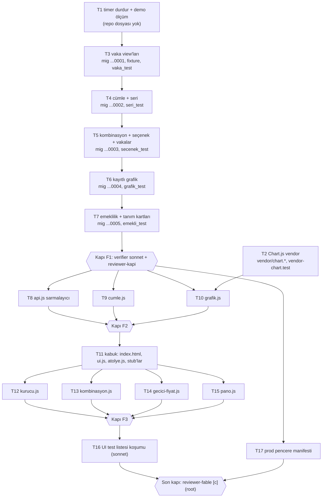

# İstatistik Atölyesi AP1 Sağlık — Uygulama Planı

> **For agentic workers:** REQUIRED SUB-SKILL: superpowers:subagent-driven-development (önerilen) ya da superpowers:executing-plans; görev görev uygulanır. Adımlar `- [ ]` ile izlenir.

**Goal:** Sağlık vakası tedavi fiyat-performansını (başarı, kapanma hızı, tedavi süresi, ₺) kullanıcının kurduğu cümleden Postgres'te hesaplayan, Chart.js ile çizen ve panoya kaydeden "İstatistik Atölyesi" AP1'i demo'da çalışır ve sahip demosuna hazır hâle getirmek.

**Architecture:** Hesap Postgres'te (iki yeni view + cümle doğrulayıcı + `stat_atolye_*` RPC'leri, hepsi `SECURITY INVOKER`); JS yalnız cümle kurar, RPC'yi çağırır, zarfı Chart.js yapılandırmasına çevirip çizer (SK-7). Kaydedilen grafik = cümle (`stat_kayitli_grafik`), sonuç değil. F0-F2 ekranı ve SQL nesneleri ileri migration'la emekli edilir; Python motoru dondurulur (SK-1).

**Tech Stack:** PostgreSQL 17 / Supabase RPC, vanilla JS (global fonksiyon + dual-mode `module.exports`), Chart.js 4.x UMD (vendor tek dosya), `node --test`, psql SQL testleri (demo), `scripts/db-validate.sh`, Playwright (yalnız worker tarayıcı koşumu).

**Spec:** `docs/2026-10-17-istatistik-atolyesi-spec.md` (ONAYLI v2; AP1 = §4, kabul = §9 AK-1..12, Stitch düzeltmeleri §8, nesne kaderi §4.9). Her uygulayıcı spec'in ilgili §'ünü ve `.harness/references/domain-rules.md` §8, §10, §14, §19'u okur.

**Taban:** dal `istatistik-modülü` @ `69346d0` (main 56900c3 birleşik, merge 3d79b58). Birim süit tabanı: tests 1615 · pass 1610 · fail 5 (önceden var olan 5 fail: LUNA-3, EG-7, EG-8, stat-ui varsayılan dönem, bc-tarih ay ‹/›). AP1 sonunda stat-ui fail'i test dosyasıyla birlikte emekli olur; kalan 4 fail kapsam dışı, yeni fail 0 olmalı.

---

## Global Constraints

- Kanıt etiketi her raporda: CONFIRMED / OBSERVED / MEASURED / INFERRED / UNKNOWN.
- Bugün = `(now() AT TIME ZONE 'Europe/Istanbul')::date`. SQL'de `CURRENT_DATE` YASAK. Kapanış günü = `(closed_at AT TIME ZONE 'Europe/Istanbul')::date`.
- Her yeni fonksiyon: `SECURITY INVOKER`, `SET search_path = public, pg_temp`, okuyanlar `STABLE`, `REVOKE ALL ... FROM PUBLIC, anon, authenticated; GRANT EXECUTE ... TO authenticated`. anon GRANT YAZILMAZ. View'lar `WITH (security_invoker = true)` + `REVOKE ALL FROM PUBLIC, anon, authenticated; GRANT SELECT TO authenticated`.
- Migration dosya başlığı mevcut kalıpta (Etkiler / ACL / Idempotent / Geri alma), gövde `BEGIN; SET LOCAL lock_timeout='5s'; SET LOCAL statement_timeout='30s'; … COMMIT;`, idempotent (`CREATE OR REPLACE`, `IF NOT EXISTS`, `DROP … IF EXISTS`).
- Migration damgaları `20261017000001`..`20261017000005` (bu plan sabitler). Demo'ya uygulanmış hiçbir migration dosyası değiştirilmez/yeniden adlandırılmaz (ruling R-MIG).
- Her migration: `bash scripts/db-validate.sh <dosya> --priors <öncekiler>` exit 0 → ardından demo `psql -X -v ON_ERROR_STOP=1 -f <dosya>` (bağlantı `~/tmp/istat-f0f1/demo-env.sh`; ilk bağlantıda ref `vtzqjmazsvurxdeondmi` doğrulanır). Priors sırası: main `20261013000001..005`, istatistik `20261005000001..005`, `20261006000001..003`, sonra bu plandaki önceki AP1 migration'ları.
- Prod'a HİÇBİR şey uygulanmaz (R6 sahip kapısı).
- n<5 = yetersiz (K8). Süre ölçüleri medyan + Q1–Q3; çıplak ortalama basılmaz. Yüzdelik = `percentile_cont`; gün değerleri 1 ondalık, ₺ 2 ondalık, yüzde 1 ondalık.
- Wilson %95: z = 1.96; `merkez=(p+z²/2n)/(1+z²/n)`, `yarı=z·√(p(1−p)/n+z²/4n²)/(1+z²/n)`; alt/üst yüzde, 1 ondalık, [0,100]'e kırpılır.
- Ekran metni: "protokol" kelimesi yalnız SQL dipnotundaki "Ovsync üreme protokolü" cümlesinde; `js/istatistik/` içinde 0 geçiş (yorum dahil). Nedensellik fiili ("sağlar", "etkilidir", "karşılığı") YOK (M5). Stitch metni kopyalanmaz (spec §8); üst barda çiftlik etiketi yok.
- Renk: tema değişkenleri (`--green`, `--ink`, `--ink3`, `--bg3`, `--card`); seçili grup = `--green`, kıyas = `--ink3`, yetersiz = gri. Satır zemini/şerit rengi yok; durum kartları sakin gri, hata kırmızısı yok (07 deseni).
- HTML'e giden her DB değeri `esc()` / `escAttr()` ile kaçırılır.
- `index.html` ve `js/ui.js` tek yazıcı: yalnız Task 11. `js/api.js` tek yazıcı: yalnız Task 8. `?v=` damgası tüm referanslarda TEK değer (`coklu-kaydir-ui` F1-T5-c ve `vaka-toplu-ac` V2.3 testleri).
- Birim test koşumu: `NODE_PATH=<ana-checkout>/node_modules node --test tests/unit/` (worktree'de node_modules yok).
- Görev başına commit; `git add` dosya dosya; `-A`/`.`/`-u` YASAK; push/merge YOK. Commit sonu: `Co-Authored-By: Claude Opus 5.5 <noreply@anthropic.com>`.
- Kod yazan görev bittiğinde (faz sonunda son yazıcı): `gitnexus analyze --index-only .` (bayraksız analyze YASAK).
- `/tmp` yasak; geçici dosya koltuğun scratchpad'i / `~/tmp`. Demo sahip şifresine dokunulmaz.

## Önceden cevaplanmış kararlar (mimar, 2026-10-17)

Sormadan önce buraya bak. Spec §2 V1-V16, M1-M5 ve SK-1..SK-9 ★ geçerli.

| # | Karar | Gerekçe |
|---|---|---|
| P1 | **R-MIG ruling: seçenek (b).** 8 istatistik migration'ı (`20261005*`, `20261006*`) yeniden adlandırılmaz; AP1 emekli nesneleri `20261017000005` ileri migration'ıyla temizler. Prod penceresi (R6) açık sıra listesiyle uygulanır (Task 17 manifesti): 8 eski dosya → 5 AP1 dosyası, `--priors` zinciri aynı sırayla PASS. | (1) Spec §4.9 ilkesi: demo'ya uygulanmış dosya değiştirilmez. (2) Prod uygulaması `deploy.yml`/`db push` ile değil, açık listeli betikle yapılıyor (hafıza: deploy.yml kullanılmıyor; p5b prova/apply betikleri) → damga sırası uygulama sırasını belirlemiyor; `--include-all` gerekmez. (3) (a) seçilirse demo'daki `schema_migrations`/`surum` dizeleri (`sql:20261005000005`), raporlar, plan ve kırıntılardaki dosya:satır atıfları bayatlar (doc-drift) ve yeniden adlandırılan dosyanın demo'da "uygulanmamış" görünüp yeniden koşulması `20261006000003`'ün motor satırlarını yeniden açar. (4) Bedel: prod penceresinde emekli nesneler önce yaratılıp sonra düşürülür (aynı pencere, zararsız). Demo `schema_migrations` durumu Task 1'de ölçülür (kanıt; ruling'i değiştirmez). |
| P2 | Kayıt kartı satırları: 3 SQL satırı (`stat_tedavi_ozet`, `_protokol`, `_sure_dagilim`) **silinir**; 2 motor satırı (`stat_tedavi_sagkalim`, `_protokol_fark`) **`aktif=false`** kalır. | Spec §4.7 "5 satır silinir" ile §4.9 "motor kayıtları aktif=false" arasındaki uzlaşma: dondurulan motorun `stat_sonuc_oku` yolu kayıt satırı ister; ekrandan ikisi de kalkar. |
| P3 | `stat_protokol_etiket` DROP → `stat_ayikla_tedavi_vaka`, `stat_ayikla_tedavi_vaka_ozet` da DROP. `v_stat_vaka`, `stat_analiz_sonuc`, `stat_motor_kosum`, `stat_sonuc_oku`, `stat_motor` rolü kalır. `stat_filtre_dogrula` DROP (tek çağıranı `stat_tedavi_*`). `stat_zarf_bos`, `stat_donem_dogrula` kalır. | Spec §4.9 sırası. Motor yeniden açılırsa yeni view üzerinde yeni ayıklayıcı yazılır. |
| P4 | `kirilim='ilac'` yalnız `ilac.x = null` iken geçerlidir; x seçilince JS kırılımı `yok`'a çeker, ilaç ekseni kombinasyon paneline geçer. `stat_cumle_dogrula` `x≠null ∧ kirilim='ilac'` → RAISE. | "x içeren" grubunu ayrıca ilaçla kırmak kombinasyon paneliyle aynı soruyu iki biçimde sorar; tek yer. |
| P5 | Dönem şemasına `{"tip":"tumu"}` eklenir (cümle sürümü 1 kalır; henüz kayıtlı grafik yok). Anlamı: `[kapsamdaki en eski start_date, bugün]`. | §4.8 "Yetersiz" eylemi 24 aydan sonra "Tüm zamanlar" ister; şema bunu taşımalı. |
| P6 | **Başarı başına ₺**: pay = Σ vaka maliyeti, (başarı kümesi `sonuc ∈ {basarili, basarisiz_*}`) ∩ maliyeti hesaplanabilen; **payda = başarılı ∩ maliyeti hesaplanabilen** vaka sayısı (fiyatsız başarılı vaka paydaya girmez). Yetersiz: payda <5. Vaka başı ₺ kümesi = sonuçlanmış (olgunlaşmamış dahil) ∩ maliyeti hesaplanabilen. | Spec §4.3 "aynı küme" ifadesi olgunlaşmamışı paya sokup paydadan (başarılı) dışlar → oran şişer; M2 gerekçesi burada da geçerli. Raporda ruling olarak bildirilir. |
| P7 | Kapanma günü negatifse (kapanış < başlangıç) NULL. Aktif+ölüm/kesim vakasının kapanışı yok → kapanma günü NULL (hız dışı), başarı kümesinde (başarısız). | v1 `ters_tarih` davranışı; spec §4.2.2 kapanma tanımı yalnız kapanışlı vakada tanımlı. |
| P8 | "Doz" ölçüsü cümleye girmez; kurucu listesinde pasif madde, seçilince istemci V16 durum kartını çizer, RPC çağrılmaz. `stat_cumle_dogrula` `saglik_doz` → RAISE. | Sunucuda hesap yok; ölü RPC dalı yazılmaz. |
| P9 | Pano sıralama: "Sırala" düğmesi sıralama modunu açar; her kartta ⋮⋮ tutamağı + ▲/▼. Sürükle-bırak YOK. | SK-9 tutamağı; dokunmatikte güvenilir, kütüphanesiz. |
| P10 | Pano kartı = başlık + cümlenin **ilk** ölçüsünün grafiği + diğer ölçülerin tek satırlık betimsel özeti + "Kurucuda aç". | Izgara 2 kolon; kart başına tek canvas. |
| P11 | Görev içindeki kırmızı/yeşil test koşumu uygulayıcının işidir (TDD). Bağımsız/tekrar koşumlar (faz sonu tam süit, db-validate zinciri, tarayıcı testi, ölçüm) sonnet koltuklarındadır. | Brief kural 1 ile TDD'nin birlikte işlemesi. |
| P12 | Zaman kırılımında dönem içindeki tüm periyotlar basılır (boş periyot `n=0`, `y=null`). Periyot etiketi: ay `YYYY-MM`, çeyrek `YYYY Ç1..Ç4`, yıl `YYYY`; periyot `baslangic`'a göre. | Spec §4.5 "her noktanın kendi n'i". |
| P13 | Sunucu hata sözleşmesi: doğrulama hataları `RAISE EXCEPTION 'STAT_CUMLE:<yol>:<neden>'` (ör. `STAT_CUMLE:ilac.y:x_yok`); JS bu öneki tanır, kullanıcıya "Seçim geçersiz" + yol gösterir. Diğer hatalar genel hata şeridi. | Fail-closed + okunur hata. |

## Review Focus

1. **TZ sınırı:** `closed_at` TR 00:00–03:00 arası (UTC'de önceki gün) — kapanış TR gününe düşmeli; olgunlaşma ve nüks penceresi TR gününe göre. → Task 3 fixture `tz_gece` vakası.
2. **30. gün sınırları:** ölüm/kesim tam `kapanis+30` (başarısız) ve `kapanis+31` (başarılı); nüks `kapanis+30` (başarısız) ve `+31` (başarılı); olgunlaşma tam `kapanis+30 = bugün` (olgun). → Task 3 fixture `kesim_31`, `nuks_31`, `olgun_sinir`.
3. **Geçici fiyat sızıntısı:** `p_gecici` DB'ye, `stat_kayitli_grafik.cumle`'ye ya da önbellek anahtarı dışındaki bir yere taşınmamalı; sayfa yenilenince yok. → Task 6 testi (`cumle` içinde `gecici` anahtarı → RAISE), Task 8 testi (önbellek anahtarı gecici'yi içerir), Task 14 testi (kaydet yükünde gecici yok).
4. **Örtüşen gruplar ve (bilinmiyor):** bir vaka iki ilaç satırında sayılır; `(bilinmiyor)` değeri seçeneklerde en sonda; seçilebilir ama okunur etiketle. → Task 3 (`bilinmiyor` çözümü), Task 5 (sıralama).
5. **Fail-closed cümle:** bilinmeyen anahtar, yanlış tip, `y` var `x` yok, `x_y_siz` ama `y` yok, ölçü listesi boş, `kiyas_duzeyi ≠ ["biz"]`, ters dönem → RAISE `STAT_CUMLE:*`; sessiz varsayılana düşmez. → Task 4 testi.

---

## Dosya yapısı ve sahiplik

| Dosya | Sorumluluk | Yazan görev |
|---|---|---|
| `vendor/chart.umd.min.js`, `vendor/chart.js.LICENSE.md` | Chart.js 4.x UMD, sabit sürüm | T2 |
| `tests/unit/vendor-chart.test.js` | vendor yüklenir, `Chart` global | T2 |
| `supabase/migrations/20261017000001_stat_saglik_vaka.sql` | iki view + vekil/maliyet yardımcıları | T3 |
| `tests/sql/stat_saglik_fixture.sql` | ortak E2E-ST2 fixture (yaz/temizle) | T3 (T4, T5 sıralı ekleyebilir) |
| `tests/sql/stat_saglik_vaka_test.sql` | view testi | T3 |
| `supabase/migrations/20261017000002_stat_atolye_seri.sql` | cümle doğrulama, dönem, Wilson, grup çözümü, `stat_atolye_seri` | T4 |
| `tests/sql/stat_atolye_seri_test.sql` | seri testi | T4 |
| `supabase/migrations/20261017000003_stat_atolye_secenek.sql` | kombinasyon paneli, `stat_atolye_secenekler`, `stat_atolye_vakalar` | T5 |
| `tests/sql/stat_atolye_secenek_test.sql` | | T5 |
| `supabase/migrations/20261017000004_stat_kayitli_grafik.sql` | tablo + 4 RPC | T6 |
| `tests/sql/stat_kayitli_grafik_test.sql` | | T6 |
| `supabase/migrations/20261017000005_stat_ap1_emekli.sql` | emeklilik + tanım kartları + `stat_olcum_listele` | T7 |
| `tests/sql/stat_ap1_emekli_test.sql`; sil: `tests/sql/stat_tedavi_test.sql`, `tests/sql/stat_ayikla_test.sql` | | T7 |
| `js/api.js` (1268-1303 bölgesi), `tests/unit/stat-api.test.js` | RPC sarmalayıcıları + önbellek | T8 |
| `js/istatistik/cumle.js`, `tests/unit/istatistik-cumle.test.js` | saf cümle mantığı | T9 |
| `js/istatistik/grafik.js`, `tests/unit/istatistik-grafik.test.js` | zarf → durum, özet cümle, Chart.js config, çizim | T10 |
| `index.html`, `js/ui.js`, `js/istatistik/atolye.js`, stub'lar `kurucu.js`/`kombinasyon.js`/`gecici-fiyat.js`/`pano.js`, `tests/unit/istatistik-atolye.test.js`; sil: `tests/unit/stat-ui.test.js` | kabuk, sekmeler, giriş noktası | T11 |
| `js/istatistik/kurucu.js`, `tests/unit/istatistik-kurucu.test.js` | kurucu ekranı | T12 |
| `js/istatistik/kombinasyon.js`, `tests/unit/istatistik-kombinasyon.test.js` | kombinasyon paneli | T13 |
| `js/istatistik/gecici-fiyat.js`, `tests/unit/istatistik-gecici-fiyat.test.js` | geçici fiyat paneli | T14 |
| `js/istatistik/pano.js`, `tests/unit/istatistik-pano.test.js` | pano | T15 |
| `runs/2026-10-05-istatistik-modulu/f3-yeniden/ap1-ui-test-listesi.md` + koşum çıktıları | UI kapısı | T16 |
| `runs/2026-10-05-istatistik-modulu/f3-yeniden/ap1-prod-pencere.md` | R6 sıra manifesti | T17 |

`systemd` timer ve demo `schema_migrations` ölçümü repo dosyası yazmaz (T1).

## Görev DAG'ı (dosya sahipliğiyle)

Paralel: {T1, T2}; {T8, T9, T10}; {T12, T13, T14, T15} (ayrı dosyalar; `index.html`/`js/ui.js`'e yalnız T11 dokunur, script etiketleri ve stub'lar T11'de); T17 F2-F3 ile paralel. SQL zinciri T3→T7 **sıralı** (demo uygulama sırası = damga sırası).

## Ajan / model tablosu

| Görev | Uygulayıcı | Görev review |
|---|---|---|
| T1, T2, T17 | ss-worker-low · sonnet low (mekanik) | — (kapıda okunur) |
| T3, T4, T5, T6, T7 (SQL) | ss-worker-high · **opus high** | ss-reviewer · opus |
| T8, T9, T10, T11, T12, T13, T14, T15 (JS/UI) | ss-worker-high · **opus high** | ss-reviewer · opus |
| Faz sonu tam süit + db-validate zinciri | ss-verifier · sonnet | — |
| T16 UI test listesi (tarayıcı, demo) | ss-worker · sonnet medium (proje UI kapısı) | — |
| Faz kapıları F1, F2, F3 | ss-reviewer-kapi · opus high (root açar) | — |
| Son kapı (AP1 bütünü) | ss-reviewer-fable `[gerekce=c]` (root açar) | — |
| Dağıtım | mimar faz başına `ss-kulvar-lead-opus` açar (root onayından sonra) | — |

Muse YOK (sahip 2026-10-17). Görev review RED → aynı uygulayıcı düzeltir; aynı görevde 2. RED → taze ss-worker-high opus high (devir raporu girdi).

---

## Faz 0 — Hazırlık

### Task 1: Motor timer'ını durdur + demo ölçümleri

**Uygulayıcı:** ss-worker-low · sonnet low. **Yazılabilir:** yok (yalnız rapor).

- [ ] **Step 1:** `systemctl --user disable --now stat-motor@demo.timer`; `systemctl --user list-timers | grep -c stat-motor` → `0`. `tools/stat-motor/` ve `~/.config/systemd/user/stat-motor@.*` bağlantıları SİLİNMEZ.
- [ ] **Step 2 (demo, salt-okuma psql):** (a) `select version from supabase_migrations.schema_migrations where version like '202610%' order by 1` → liste (R-MIG kanıtı); (b) Enterit vakaları: hastalık adı `ILIKE '%enterit%'` olanların adı, `id`, kapsam içi vaka sayısı (son 12 ay ve tüm zamanlar); (c) Enterit vakalarında etken düzeyi (stok fallback'li, spec §4.2.3 zinciri) "içeren" vaka sayıları, ilk 10; (d) en çok vakalı 2 hastalık ve etken düzeyinde n≥5 değer sayısı (AK-3 tabanı); (e) **Ovsync tanım farkı (demo + prod, salt-okuma; prod Mgmt API):** eski süzgeç (`protocol_family IS NULL AND ad NOT ILIKE '%ovsync%'`) içinde kalıp `_vaka_ovsync_mu` mantığına (`supabase/migrations/20261013000003_alt_vaka.sql:66-84`: OVSYNC şablon eşlemli hastalık ya da `TEDAVI_SABLON_TOHUMLAMA:<case>:%` görev logu) göre Ovsync sayılan vaka sayısı, hastalık adına göre kırılımlı; ayrıca `authenticated` rolünün `sablon_hastalik_eslem`, `tedavi_sablonu`, `gorev_log` üzerinde SELECT yetkisi (`has_table_privilege`). Sorgular rapora aynen.
- [ ] **Step 3:** Rapor: timer durumu, (a)-(d) MEASURED. Enterit'te Enrofloksasin etkeni demo'da yoksa ya da n<5 ise rapora `UYARI:` satırı (AK-1 cümlesi T16'da gerçek değerle yeniden yazılır). (e) farkı demo ya da prod'da >0 ise ya da SELECT yetkisi yoksa rapora `SORU:` satırı → mimar T3'ü dağıtmadan önce root'a sorar (dışlanacak vakalar hastalık listesiyle).

### Task 2: Chart.js vendor

**Uygulayıcı:** ss-worker-low · sonnet low.
**Files:** Create `vendor/chart.umd.min.js`, `vendor/chart.js.LICENSE.md`, `tests/unit/vendor-chart.test.js`.
**Interfaces:** Produces: tarayıcıda global `Chart` (Chart.js 4.x; `new Chart(canvas, config)`, `chart.destroy()`).

- [ ] **Step 1: Kırmızı test** `tests/unit/vendor-chart.test.js`: dosya var; ilk 300 baytta `Chart.js v4.` sürüm başlığı; `vm` bağlamında (`window=self=globalThis`, `module` yok) çalıştırınca `typeof Chart === 'function'` ve `Chart.version` `/^4\./`; lisans dosyası `MIT` ve aynı sürümü içerir. Koş → FAIL (dosya yok).
- [ ] **Step 2:** npm registry'den `chart.js` 4.x'in en güncel kararlı sürümünü indir (`npm view chart.js@4 version` → son; `npm pack chart.js@<sürüm>` scratchpad'e). `package/dist/chart.umd.min.js` varsa onu, yoksa `package/dist/chart.umd.js`'i (zaten küçültülmüş UMD) `vendor/chart.umd.min.js` olarak kopyala. `package/LICENSE.md` → `vendor/chart.js.LICENSE.md` (başına tek satır: sürüm + kaynak + sha256).
- [ ] **Step 3:** Test → PASS. Rapora: sürüm, bayt boyutu (MEASURED), sha256.
- [ ] **Step 4: Commit** `git add vendor/chart.umd.min.js vendor/chart.js.LICENSE.md tests/unit/vendor-chart.test.js` → `istatistik(AP1 T2): Chart.js 4.x vendor`.

(Script etiketi T11'de eklenir.)

---

## Faz 1 — SQL

Ortak SQL test sözleşmesi (F1 kalıbı): hedef YALNIZ demo; yazmalar `E2E-ST2-` önekli fixture'la; koşum `psql "$OVS_DEMO_DB_URL" -X -v ON_ERROR_STOP=0 -v stat_fixture_ok=true -f <test>`; sonuç `_stat_durum(kod, PASS|FAIL|UNMEASURED, etiket)` kod başına bir satır; başta ve sonda temizlik; sonda `E2E-ST2-` artık sayımı = 0. Test dosyası fixture'ı `\ir stat_saglik_fixture.sql` ile alır.

### Task 3: Vaka view'ları, vekil gecikme, maliyet yardımcıları

**Uygulayıcı:** ss-worker-high · opus high. **Review:** ss-reviewer opus.
**Files:** Create `supabase/migrations/20261017000001_stat_saglik_vaka.sql`, `tests/sql/stat_saglik_fixture.sql`, `tests/sql/stat_saglik_vaka_test.sql`.

**Interfaces — Produces:**
- `public.stat_bugun() RETURNS date` (STABLE): `(now() AT TIME ZONE 'Europe/Istanbul')::date`. Sonraki tüm görevler bugünü bundan alır.
- `public.stat_vaka_ovsync_mu(p_case_id uuid) RETURNS boolean` (STABLE, INVOKER): istatistiğin **tek** üreme protokolü tanımı = `protocol_family IS NOT NULL` VEYA hastalık adı `ILIKE '%ovsync%'` VEYA main'in `_vaka_ovsync_mu` kolları (OVSYNC-eşlemeli şablonu olan hastalık; `gorev_log.kaynak LIKE 'TEDAVI_SABLON_TOHUMLAMA:<case>:%'`). `_vaka_ovsync_mu` DEFINER ve yalnız `service_role`'e açık olduğundan çağrılmaz; mantığı birebir aynalanır, COMMENT kaynağı (`20261013000003_alt_vaka.sql:66-84`) gösterir. Kapsam süzgeci (iki view), nüks "sonraki vaka" süzgeci ve `dislanan_ovsync_n` bu fonksiyonu kullanır. Spec §4.2.1'deki iki koşul bunun alt kümesidir (T1 (e) farkı ölçer).
- `public.stat_medyan_gecikme(p_gecikmeler int[]) RETURNS int` (IMMUTABLE): eleman sayısı <5 → 0; aksi `round(percentile_cont(0.5))` (numeric round, 0,5 yukarı).
- `public.stat_saglik_vekil() RETURNS TABLE(g int, normal_n int)` (STABLE): kapsam içi, toplu olmayan, kapalı, ≥1 uygulanmış ilaçlı vakaların `kapanis − son_uygulama` dizisi → `stat_medyan_gecikme`; dönem süzgeci yok.
- View `public.v_stat_saglik_vaka` — kolonlar (sıra ve tip sabit): `vaka_id uuid, hayvan_id text, kupe_no text, hastalik_id uuid, hastalik text, kategori text` (NULL → `'Kategorisiz'`), `baslangic date, kapanis date, toplu_kapanis boolean, ilk_uygulama date, son_uygulama date, tedavi_suresi_gun int, uygulanan_gun int, plan_gun int, plan_uyum numeric(5,3), durum text ('acik'|'sonuclandi'), sonuc text ('basarili'|'basarisiz_olum_kesim'|'basarisiz_nuks'|'olgunlasmamis'|NULL), kapanma_gunu int, kapanma_vekil boolean, maliyet_kalemleri jsonb`.
  - Kapsam süzgeci = `NOT stat_vaka_ovsync_mu(id)`; durum/sonuç sırası, vekil kuralı: spec §4.2.2 (1-6 sırası), §4.2.5; P7.
  - `toplu_kapanis` = aynı `closed_at` değerini (cases geneli, protokol vakaları dahil) ≥3 vaka paylaşıyor.
  - `maliyet_kalemleri` = uygulanmış uygulamalardan `[{"stok_id": text|null, "birim": text, "miktar": numeric, "neden": null|"stoksuz"|"birim_uyusmaz"}]`, aynı (stok_id, birim) birleşik toplam. Fiyat anahtarı: `a.stok_id`; NULL ise `urun_id`'yi taşıyan stok satırı **tam bir tane** ise o, değilse `stok_id=null, neden="stoksuz"`. `a.unit ≠ stok.birim` → `neden="birim_uyusmaz"`.
- View `public.v_stat_saglik_vaka_ilac(vaka_id uuid, duzey text, deger text)` — DISTINCT; yalnız uygulanmış uygulamalar; `urun_id = COALESCE(a.drug_product_id, stok.drug_product_id)`; preparat `COALESCE(dp.brand_name, s.urun_adi)`; etken `dc.active_ingredient`; sınıf `COALESCE(dc.class_name, dc.group_name)`; çözülemeyen → `'(bilinmiyor)'`. Kapsam süzgeci aynı (`stat_vaka_ovsync_mu`).
- `public.stat_saglik_vaka_tl(p_kalemler jsonb, p_fiyat jsonb) RETURNS numeric` (STABLE): her kalem için birim fiyat = `p_fiyat->>stok_id` (geçici) yoksa `stok.maliyet > 0` (kayıtlı) yoksa fiyatsız; herhangi bir kalem fiyatsız ya da `neden` dolu → NULL; aksi Σ miktar×fiyat, 2 ondalık. Boş kalem dizisi → 0.
- `public.stat_saglik_fiyat_kaynagi(p_kalemler jsonb, p_fiyat jsonb) RETURNS text` (STABLE): `'gecici'` (en az bir kalem geçici fiyatlı), `'kayitli'`, `'fiyatsiz'`.

**Fixture** (`tests/sql/stat_saglik_fixture.sql`; T = `stat_bugun()`; `closed_at` = gün + 12:00 TR, aksi yazılmadıkça). Hastalıklar `E2E-ST2-Enterit` (kategori `E2E-ST2-Kat`), `E2E-ST2-Pnomoni` (kategori NULL), `E2E-ST2-Inaktif` (kategori `E2E-ST2-Kat`; yalnız `ovsync_sablon` için, E2E-ST2 önekli OVSYNC şablonu + eşlemiyle). Sınıf KA (`active_ingredient 'E2E-ETK-A'`, `class_name 'E2E-SINIF-1'`), KB (`active_ingredient 'E2E-ETK-B'`, class_name NULL, `group_name 'E2E-GRUP-2'`). Ürün PA (`brand 'E2E-PREP-A'`, KA), PB (`'E2E-PREP-B'`, KB), PX (sınıfsız, brand NULL). Stok SA (PA, `ml`, maliyet 0), SB (PB, `ml`, maliyet 0), SK (PB, `ml`, maliyet 20) — PB iki stoklu. Uygulama gösterimi: `ilaç miktar stok` (ör. `A 10 SA` = PA ürünü 10 ml SA stoktan).

| kod | hayvan | hastalık | durum | başlangıç | kapanış | uygulamalar | çıkış | beklenen sonuc / kapanma_gunu / not |
|---|---|---|---|---|---|---|---|---|
| normal | 01 | Enterit | closed | T-100 | T-95 | T-100 A 10 SA; T-99 A 10 SA; T-98 B 5 SB | — | basarili / 5; tedavi 3; tl(SA=2,SB=10)=90.00 |
| olum_30 | 02 | Enterit | closed | T-80 | T-76 | T-80 A 10 SA | olum T-46 | basarisiz_olum_kesim / 4 |
| kesim_31 | 03 | Enterit | closed | T-90 | T-88 | T-90 A 10 SA | kesim T-57 | basarili / 2 |
| satis | 04 | Enterit | closed | T-70 | T-67 | T-70 A 10 SA | satis T-60 | basarili / 3 |
| nuks_30 | 05 | Enterit | closed | T-120 | T-115 | T-120 A 10 SA | — | basarisiz_nuks / 5 |
| nuks_30_b | 05 | Enterit | closed | T-85 | T-80 | T-85 B 5 SB | — | basarili / 5 |
| nuks_31 | 06 | Enterit | closed | T-150 | T-145 | T-150 A 10 SA | — | basarili / 5 |
| nuks_31_b | 06 | Enterit | closed | T-114 | T-110 | T-114 A 10 SA | — | basarili / 4 |
| olgun_degil | 07 | Enterit | closed | T-20 | T-10 | T-20 A 10 SA | — | olgunlasmamis / 10 |
| olgun_sinir | 08 | Enterit | closed | T-33 | T-30 | T-33 A 10 SA | — | basarili / 3 |
| aktif_olum | 09 | Enterit | active | T-40 | — | T-40 A 10 SA | olum T-30 | sonuclandi, basarisiz_olum_kesim / NULL |
| aktif_acik | 10 | Enterit | active | T-30 | — | T-30 A 10 SA | — | acik, NULL / NULL |
| toplu_1 | 11 | Enterit | closed | T-70 | T-50 (15:00, ortak) | T-70, T-69, T-68 A 10 SA | — | basarili / `LEAST(2+G,20)`, vekil |
| toplu_2 | 12 | Enterit | closed | T-65 | T-50 (15:00, ortak) | T-65 A 10 SA | — | basarili / `LEAST(G,15)`, vekil |
| toplu_bos | 13 | Enterit | closed | T-60 | T-50 (15:00, ortak) | yok | — | basarili / NULL, vekil=false, toplu=true |
| ovsync | 14 | Enterit | active, `protocol_family='OVSYNC'` | T-40 | — | T-40 A 10 SA | — | view'da YOK |
| ovsync_log | 21 | Enterit | closed, `protocol_family` NULL + `gorev_log` satırı `kaynak='TEDAVI_SABLON_TOHUMLAMA:<case>:E2E'` | T-60 | T-55 | T-60 A 10 SA | — | view'da YOK; aynı hayvanın nüks adayı da sayılmaz |
| ovsync_sablon | 22 | `E2E-ST2-Inaktif` (E2E şablonu `protokol_ailesi='OVSYNC'` + `sablon_hastalik_eslem`) | closed, `protocol_family` NULL | T-50 | T-45 | T-50 A 10 SA | — | view'da YOK |
| fallback | 15 | Enterit | closed | T-55 | T-51 (09:00) | T-55 drug_product_id NULL, stok SB, 5 ml | — | basarili / 4; ilaç etken E2E-ETK-B, preparat E2E-PREP-B, sinif E2E-GRUP-2 |
| uyusmaz | 16 | Enterit | closed | T-58 | T-54 | T-58 A 2 **gr** SA | — | basarili / 4; tl=NULL (birim_uyusmaz) |
| stoksuz_tekil | 17 | Enterit | closed | T-62 | T-59 | T-62 stok_id NULL, PA 4 ml | — | kalem stok SA (tekil) |
| stoksuz_coklu | 18 | Pnomoni | closed | T-62 | T-59 | T-62 stok_id NULL, PB 4 ml | — | kalem stok_id null, neden stoksuz; tl NULL; kategori 'Kategorisiz' |
| bilinmiyor | 19 | Pnomoni | closed | T-45 | T-41 | T-45 PX 3 ml, stok_id NULL | — | etken/preparat/sınıf `(bilinmiyor)` |
| tz_gece | 20 | Pnomoni | closed | T-35 | **T-31, 01:30 TR** | T-35 A 10 SA | — | kapanis T-31 (UTC'de T-32), basarili / 4 |
| tz_olgun | 23 | Pnomoni | closed | T-33 | **T-29, 01:30 TR** | T-33 A 10 SA | — | kapanis T-29 (UTC'de T-30) → TR'ye göre **olgunlasmamis** / 4 (UTC günüyle hesaplansaydı basarili olurdu) |

G kuralı: test, `stat_saglik_vekil().g` değerini **bağımsız kâhin sorgusuyla** (aynı tanımı test içinde ayrı yazar) karşılaştırır; toplu beklentiler bu G ile hesaplanır (demo verisi G'yi belirler).

- [ ] **Step 1: Kırmızı test.** `tests/sql/stat_saglik_vaka_test.sql` kodları: `vaka_sonuc_<kod>` (tablodaki her satır için sonuc + kapanma_gunu + vekil), `ovsync_yok` (14, 21, 22 view'da yok), `ovsync_dislanan_sayi`, `tz_gece_kapanis`, `tz_olgun_tr`, `ilac_fallback` (3 düzey), `ilac_bilinmiyor`, `kalem_uyusmaz`, `kalem_stoksuz_tekil`, `kalem_stoksuz_coklu`, `tl_normal_gecici` (`stat_saglik_vaka_tl(kalemler, '{"<SA id>":2,"<SB id>":10}')` = 90.00), `tl_kayitli` (SK kalemli ek kontrol: `jsonb` elle kurulmuş tek kalem SK 3 ml, `'{}'` fiyat → 60.00, kaynak `kayitli`), `tl_fiyatsiz` (SA, `'{}'` → NULL, kaynak `fiyatsiz`), `medyan_gecikme_az` (`stat_medyan_gecikme('{1,2,3,4}')` = 0), `medyan_gecikme_yuvarla` (`'{4,6,7,13,20,1}'` → 7: percentile 6.5 → 7), `vekil_kahin`, `acl_anon` (`has_function_privilege('anon', …)` ve `has_table_privilege('anon', view, 'SELECT')` hepsi false), `invoker` (`prosecdef=false`, view `security_invoker=true`). Koş (migration yokken) → FAIL/hata.
- [ ] **Step 2:** Migration'ı yaz (yukarıdaki imzalar; view ve fonksiyon COMMENT'leri spec §4.2 tanımlarını tek cümleyle taşır).
- [ ] **Step 3:** `bash scripts/db-validate.sh supabase/migrations/20261017000001_stat_saglik_vaka.sql --priors <Global Constraints sırası>` → exit 0.
- [ ] **Step 4:** Demo `psql -f` → test koş → tüm kodlar PASS, artık 0. İkinci `psql -f` (idempotent) → hata yok.
- [ ] **Step 5: Commit** üç dosya → `istatistik(AP1 T3): v_stat_saglik_vaka + vaka×ilaç + vekil/maliyet`.

### Task 4: Cümle doğrulama, dönem, Wilson, grup çözümü, `stat_atolye_seri`

**Uygulayıcı:** ss-worker-high · opus high. **Review:** ss-reviewer opus.
**Files:** Create `supabase/migrations/20261017000002_stat_atolye_seri.sql`, `tests/sql/stat_atolye_seri_test.sql`; Modify (gerekirse, yalnız ekleme) `tests/sql/stat_saglik_fixture.sql`.

**Interfaces — Consumes:** T3 view'ları, `stat_bugun`, `stat_saglik_vekil`, `stat_saglik_vaka_tl`, `stat_saglik_fiyat_kaynagi`; mevcut `stat_donem_dogrula(date,date)`.
**Produces:**
- `public.stat_cumle_dogrula(p_cumle jsonb) RETURNS void` (STABLE): spec §4.4 şeması + P4, P5, P8; anahtar kümesi tam `{v, alan, hastalik, ilac, kiyas_grubu, olculer, kirilim, donem, kiyas_duzeyi}`; `v=1`; `alan='saglik'`; `hastalik.tip='hastalik'` ise `deger` var olan `diseases.id` (uuid metni); `kategori` ise metin; `tumu` ise `deger` null/yok; `ilac.y` için `ilac.x` zorunlu ve `y≠x`; `kiyas_grubu='x_y_siz'` için `y` zorunlu; `olculer` boş olmayan, tekrarsız, ⊆ {`saglik_basari`, `saglik_kapanma_gunu`, `saglik_tedavi_suresi`, `saglik_vaka_tl`, `saglik_basari_tl`}; `donem.tip ∈ {son_ay(n∈{3,6,12,24}), yil, aralik, tumu}`; `kiyas_duzeyi = ["biz"]`. Hata: `STAT_CUMLE:<yol>:<neden>` (P13).
- `public.stat_cumle_donem(p_cumle jsonb, OUT bas date, OUT bit date)` (STABLE): `son_ay n` → `[bugün − n ay, bugün]`; `yil` → `[Y-01-01, Y-12-31]`; `aralik` → `stat_donem_dogrula` sonrası; `tumu` → `[kapsamdaki min(baslangic) ya da bugün, bugün]`.
- `public.stat_wilson(p_k int, p_n int, OUT alt numeric, OUT ust numeric)` (IMMUTABLE): Global Constraints formülü; `n=0` → NULL, NULL.
- `public.stat_atolye_gruplar(p_cumle jsonb) RETURNS TABLE(anahtar text, etiket text, sira int, vaka_id uuid)` (STABLE): dönem (`baslangic`) + hastalık süzgeçli kapsam vakaları (açık dahil) → gruplar:
  - x yok, kırılım ≠ ilac: `('tumu', 'Tüm <H> vakaları', 1)`; H = hastalık adı / kategori adı / "Tüm hastalıklar".
  - x yok, kırılım ilac: seçili düzeydeki her değer `('ilac:<deger>', '<deger> içeren', sıra=n azalan, (bilinmiyor) en son)`.
  - x var, y yok: `('x', '<x> içeren', 1)` + `('tumu', 'Tüm <H> vakaları', 2)`.
  - x+y: `('xy', '<x> + <y> içeren', 1)` + kıyas: `kiyas_grubu='tumu'` → `('tumu', …, 2)`, `'x_y_siz'` → `('x_y_siz', '<x> içeren, <y>''siz', 2)`.
- `public.stat_atolye_seri(p_cumle jsonb, p_gecici jsonb DEFAULT '{}') RETURNS jsonb` (STABLE): `p_gecici` şeması `{"ilac_fiyat": {"<stok_id>": number>0}}` (başka anahtar ya da ≤0 değer → `STAT_CUMLE:gecici:…`). Dönüş `{"zarflar":[…], "kombinasyon": null, "fiyat_eksik":[{"stok_id","urun_adi","birim","vaka_n","gecici_deger"}]}` (kombinasyon T5'te dolar).
- `public.stat_atolye_kombinasyon(p_cumle jsonb, p_gecici jsonb) RETURNS jsonb` (STABLE): T4'te gövdesi `SELECT NULL::jsonb`; `stat_atolye_seri` `kombinasyon` alanını bundan alır. T5 yalnız bu fonksiyonu değiştirir, `stat_atolye_seri` gövdesine dokunmaz. `fiyat_eksik` = cümlenin tüm gruplarındaki sonuçlanmış vakaların kalemlerinde geçen, `stok.maliyet > 0` olmayan stok satırları (geçici değeri verilmiş olanlar `gecici_deger` ile dahil), `vaka_n` azalan; `neden` dolu kalemler (stoksuz/uyuşmaz) listelenmez, `fiyatsiz_n`'de sayılır. Ölçü başına zarf, spec §4.5 alanlarıyla: `olcum, hesap_at, surum ('sql:20261017000002'), n, yetersiz, x {ad, deger[], anahtar[]}, seriler[], sayac {acik_n, olgunlasmamis_n, vekil_n, vekil_G, fiyatsiz_n, dislanan_ovsync_n, bilinmiyor_n, kiyas_n}, gecici {var, ilac_fiyat}, tanim (=olcum), dipnot[], fiyat_kaynagi ('gecici'|'kayitli'|'fiyatsiz'|null), egri (yalnız saglik_kapanma_gunu, kırılım yok/ilac)`.
  - Kırılım yok/ilac: `x.deger` = grup etiketleri, `seriler` tek eleman. Zaman kırılımı: `x.deger` = periyot etiketleri (P12), `seriler` grup başına bir eleman (`ad` = grup etiketi).
  - Seri alanları ölçüye göre: başarı `{n[], k[], y[] (%), alt[], ust[]}`; kapanma/tedavi `{n[], y[] (medyan), q1[], q3[]}`; vaka_tl `{n[], y[] (medyan), q1[], q3[]}`; basari_tl `{n[] (payda: başarılı ∩ maliyeti hesaplanabilen), y[]}`. n<5 hücrede `y/alt/ust/q1/q3 = null` (n ve k kalır). `yetersiz` = ilk grubun n'i <5.
  - Kümeler: spec §4.3 + P6 + P7. `kiyas_n` = 2. grubun n'i (yoksa null).
  - `egri`: grup başına `{anahtar, gun:int[], oran:numeric[]}` — kapanma günü küme vakalarının ayrık gün değerleri artan, `oran` = o güne dek kapanan / n, 3 ondalık; n<5 grupta `gun=[]`.
  - Dipnot (sıra sabit, k=0 cümlesi yok): `"Ovsync üreme protokolü vakaları dahil değil (k)."` · `"Gruplar örtüşür: bir vaka birden çok satırda sayılır."` (yalnız ilaç grupları varsa) · `"k vaka toplu kapatılmış; kapanma günü son ilaç + G gün ile tahmin edildi."` · `"Vekil G hesaplanamadı (normal vaka n<5); G=0 kullanıldı."` (normal_n<5) · `"k vakanın ilacı tanınamadı: (bilinmiyor)."` · `"k vakanın ilaç fiyatı yok."` (₺ ölçülerinde) · `"Karşılaştırma gözlemseldir; şiddet/yaş eşleştirmesi yok."` (iki grup varsa).
  - `dislanan_ovsync_n` = dönemde, hastalık süzgecine uyan (tumu → hepsi) `stat_vaka_ovsync_mu` vakası sayısı.

- [ ] **Step 1: Kırmızı test** kodları: `dogrula_red_<durum>` (her biri `STAT_CUMLE:` önekli hata bekler): bilinmeyen anahtar, `v=2`, `alan='ekonomi'`, `y` var `x` yok, `y=x`, `x_y_siz` y'siz, boş ölçü, tekrar ölçü, `saglik_doz`, `x` + `kirilim='ilac'`, `son_ay n=5`, ters aralık, `kiyas_duzeyi=["biz","tr"]`, var olmayan disease_id, gecici negatif fiyat, gecici bilinmeyen anahtar; `dogrula_kabul` (spec örnek cümlesi); `donem_son_ay`, `donem_tumu`; `wilson_17_21` (60.0 / 92.3), `wilson_0_5` (0.0 / 43.4), `wilson_5_5` (56.6 / 100.0); fixture Enterit, etken düzeyi, dönem `tumu`: `basari_x_A` (x=E2E-ETK-A: k/n elle türetilmiş), `basari_tumu`, `olgun_disi` (olgunlasmamis_n=1, başarı paydasında yok), `acik_sayac` (acik_n=1, aktif_olum başarı kümesinde), `hiz_medyan_q`, `hiz_vekil` (vekil_n=2, vekil_G=G), `toplu_bos_hiz_disi`, `tedavi_suresi`, `vaka_tl_gecici` (SA=2, SB=10 ile medyan/Q), `vaka_tl_fiyatsiz` (gecici yok → `fiyatsiz_n` = küme, `fiyat_kaynagi='fiyatsiz'`, y null), `basari_tl` (P6; `uyusmaz` vakası başarılı ama maliyetsiz → paydada YOK; beklenen değer bu vakayı dışlayarak elle türetilir, dahil eden yanlış hesapla eşit olmadığı test başlığında gösterilir), `fiyat_eksik_liste` (gecici yokken SA ve SB listede, SK yok — kayıtlı; SA=2 verilince SA `gecici_deger=2` ile kalır), `xy_grup` (x=A, y=B, `x_y_siz`), `kirilim_ilac_sira` ((bilinmiyor) son), `kirilim_ay` (periyot sayısı = dönem ay sayısı, boş periyot n=0 y=null), `n_lt_5_null`, `dipnot_ovsync` (fixture'da 3: 14, 21, 22 — dönem/hastalık süzgecine göre), `surum_onek` (her zarfta `surum LIKE 'sql:2026101700000%'`; T5 sonrası da geçer), `egri_monoton` (oran artan, son = 1.000), `seri_acl`, `seri_invoker`. Beklenen sayıları uygulayıcı fixture'dan elle türetir ve test başlığına tablo olarak yazar (F1 kalıbı). Koş → FAIL.
- [ ] **Step 2:** Migration'ı yaz.
- [ ] **Step 3:** db-validate (priors + `20261017000001`) exit 0.
- [ ] **Step 4:** Demo uygula; `stat_atolye_seri_test.sql` + `stat_saglik_vaka_test.sql` (regresyon) PASS, artık 0. `EXPLAIN ANALYZE` ile demo'da varsayılan cümle (en çok vakalı hastalık, son 12 ay, 3 ölçü, kırılım ilac) <1500 ms (MEASURED; aşarsa raporda, indeks önerisiyle — kendi başına indeks eklemez).
- [ ] **Step 5: Commit** → `istatistik(AP1 T4): stat_cumle_dogrula + stat_atolye_seri`.

### Task 5: Kombinasyon paneli, seçenekler, vaka listesi

**Uygulayıcı:** ss-worker-high · opus high. **Review:** ss-reviewer opus.
**Files:** Create `supabase/migrations/20261017000003_stat_atolye_secenek.sql`, `tests/sql/stat_atolye_secenek_test.sql`; Modify (yalnız ekleme) `tests/sql/stat_saglik_fixture.sql`.

**Interfaces — Consumes:** T4 `stat_cumle_dogrula`, `stat_cumle_donem`, `stat_atolye_gruplar`, `stat_wilson`.
**Produces:**
- `stat_atolye_kombinasyon(p_cumle, p_gecici)` `CREATE OR REPLACE` — `stat_atolye_seri` gövdesine dokunulmaz (T4 `surum` aynen kalır). Dönüş (x var ise, aksi null): `{"x": "<x>", "duzey": "<düzey>", "satirlar": [{"y", "a": {"n","basari":{"k","n","y"},"hiz":{"n","medyan"},"tl":{"n","medyan"}}, "b": {aynı}, "yetersiz": bool}]}`; a = `x + y içeren`, b = `x içeren, y'siz`; satırlar `a.n` azalan, eşitlikte y alfabetik; `(bilinmiyor)` y olarak listelenmez; `yetersiz` = a.n<5 ∨ b.n<5 (değerler yine dolu gelir, JS gri basar). Kümeler: başarı/hız/₺ T4 ile aynı tanım (tl `p_gecici` kullanır).
- `public.stat_atolye_secenekler(p_cumle jsonb) RETURNS jsonb` (STABLE): cümle doğrulanır; dönem cümleden. Dönüş `{"donem":{"bas","bit"}, "toplam_n", "hastaliklar":[{"id","ad","kategori","n"}], "kategoriler":[{"ad","n"}], "x_adaylari":[{"deger","n"}], "y_adaylari":[{"deger","n"}]}`; hastalıklar = dönemde kapsam içi vakası olan (açık dahil, `count(DISTINCT vaka_id)`), n azalan; x adayları seçili hastalık+dönem+düzeyde "içeren" vaka sayısıyla, n azalan, `(bilinmiyor)` en son; y adayları yalnız x varken, x vakalarında birlikte görülen değerler (x hariç), birlikte-görülme n'iyle.
- `public.stat_atolye_vakalar(p_cumle jsonb, p_grup text) RETURNS jsonb` (STABLE): `p_grup` = zarf `x.anahtar` değeri ya da `komb:<y>:a` / `komb:<y>:b`; bilinmeyen → `STAT_CUMLE:grup:bilinmiyor`. Dönüş `{"toplam": int, "vakalar":[{"vaka_id","kupe_no","hastalik","baslangic","kapanis","durum","sonuc","kapanma_gunu","kapanma_vekil"}]}` en çok 200, `baslangic` azalan.

- [ ] **Step 1: Kırmızı test** kodları: `komb_satir_B` (x=E2E-ETK-A, y=E2E-ETK-B: a.n/b.n, a.basari k/n elle), `komb_sira`, `komb_bilinmiyor_yok`, `komb_yetersiz_bayrak`, `komb_null_x_yok`, `secenek_hastalik_sayisi` (= bağımsız `count(DISTINCT hastalik_id)` sorgusu; AK-2), `secenek_x_sira`, `secenek_y_x_haric`, `vakalar_grup_x` (toplam = zarf n), `vakalar_komb_a`, `vakalar_bilinmeyen_grup_red`, `vakalar_limit_200` (toplam>200 ise 200 satır; demo verisinde tumu+tumu dönemle), `acl`, `invoker`, ve T4 testlerinin tamamı yeniden PASS (kombinasyon yardımcısı değişti, seri regresyonu). Koş → FAIL.
- [ ] **Step 2:** Migration.
- [ ] **Step 3:** db-validate (priors + `…0001`, `…0002`) exit 0.
- [ ] **Step 4:** Demo uygula; üç SQL testi PASS. Demo'da AK-3 ölçümü: en çok vakalı 2 hastalıkta etken düzeyi `kirilim='ilac'` zarfında n≥5 grup sayısı (MEASURED rapora; ≥4 değilse `UYARI:` — kod değişmez, T16'da değerlendirilir).
- [ ] **Step 5: Commit** → `istatistik(AP1 T5): kombinasyon paneli + seçenekler + vaka listesi`.

### Task 6: Kaydedilen grafikler

**Uygulayıcı:** ss-worker-high · opus high. **Review:** ss-reviewer opus.
**Files:** Create `supabase/migrations/20261017000004_stat_kayitli_grafik.sql`, `tests/sql/stat_kayitli_grafik_test.sql`.

**Interfaces — Consumes:** `stat_cumle_dogrula`. **Produces:**
- Tablo `public.stat_kayitli_grafik` — spec §4.7 kolonları birebir (`id uuid PK gen_random_uuid()`, `farm_id uuid NOT NULL DEFAULT '<varsayılan farm_id>'`, `baslik text NOT NULL CHECK (length(btrim(baslik)) BETWEEN 1 AND 120)`, `cumle jsonb NOT NULL`, `cumle_surum int NOT NULL`, `sira int NOT NULL`, `olusturan uuid DEFAULT auth.uid()`, `olusturma_at timestamptz NOT NULL DEFAULT now()`, `guncelleme_at timestamptz NOT NULL DEFAULT now()`); index `(farm_id, sira)`; RLS açık, policy `FOR ALL USING (true) WITH CHECK (true)`; `REVOKE ALL FROM PUBLIC, anon, authenticated; GRANT SELECT, INSERT, UPDATE, DELETE TO authenticated`.
- `stat_grafik_listele() RETURNS jsonb` — `[{"id","baslik","cumle","cumle_surum","sira","guncelleme_at"}]` `sira, olusturma_at` sırasıyla, `farm_id = current_farm_id()`.
- `stat_grafik_kaydet(p_id uuid, p_baslik text, p_cumle jsonb) RETURNS uuid` (VOLATILE): `stat_cumle_dogrula`; `p_cumle ? 'gecici'` zaten bilinmeyen anahtar → RAISE (Review Focus 3); `p_id NULL` → INSERT (`farm_id = current_farm_id()`, `sira = max+1`, `cumle_surum = (p_cumle->>'v')::int`); dolu → UPDATE baslik/cumle/cumle_surum/guncelleme_at, yoksa `STAT_GRAFIK:yok`.
- `stat_grafik_sil(p_id uuid) RETURNS void` — yoksa `STAT_GRAFIK:yok`.
- `stat_grafik_sirala(p_idler uuid[]) RETURNS void` — dizi, çiftliğin tüm kayıtlarının tam ve tekrarsız kümesi olmalı (aksi `STAT_GRAFIK:sira_kumesi`); `sira = dizideki konum (1..n)`.

- [ ] **Step 1: Kırmızı test** (her test kendi `E2E-ST2-` başlıklı satırlarını yazar ve siler): `kaydet_ekle` (sira=max+1, cumle_surum=1, farm_id), `kaydet_guncelle`, `kaydet_gecici_red`, `kaydet_gecersiz_cumle_red`, `kaydet_bos_baslik_red`, `listele_sira`, `sil`, `sil_yok_red`, `sirala` (ters çevir → sıra), `sirala_eksik_red`, `sirala_tekrar_red`, `acl_anon` (tablo + 4 fn), `rls_acik`, `index_var`. Koş → FAIL.
- [ ] **Step 2:** Migration. **Step 3:** db-validate (priors + …0001-0003) exit 0. **Step 4:** Demo uygula; test PASS, `E2E-ST2-` başlıklı artık satır 0.
- [ ] **Step 5: Commit** → `istatistik(AP1 T6): stat_kayitli_grafik + 4 RPC`.

### Task 7: Emeklilik + tanım kartları

**Uygulayıcı:** ss-worker-high · opus high. **Review:** ss-reviewer opus.
**Files:** Create `supabase/migrations/20261017000005_stat_ap1_emekli.sql`, `tests/sql/stat_ap1_emekli_test.sql`; Delete `tests/sql/stat_tedavi_test.sql`, `tests/sql/stat_ayikla_test.sql`. (`tests/sql/stat_vaka_test.sql` kalır — `v_stat_vaka` dondurulmuş, yaşıyor.)

**Interfaces — Produces:**
- DROP (IF EXISTS, imzalı): `stat_tedavi_ozet(date,date,jsonb)`, `stat_tedavi_protokol(date,date,jsonb)`, `stat_tedavi_sure_dagilim(date,date,jsonb)`, `stat_tedavi_dislanan_dipnot(date,date,jsonb)`, `stat_ayikla_tedavi_vaka_ozet()`, `stat_ayikla_tedavi_vaka(uuid[])`, `stat_protokol_etiket(text[],int,text)`, `stat_filtre_dogrula(jsonb,text[])` (P3; sıra: önce çağıranlar).
- `stat_olcum_kayit`: `ADD COLUMN IF NOT EXISTS birim text, tanim text, kume text`; 3 SQL satırı DELETE; 2 motor satırı `aktif=false` (P2); 5 yeni satır `ON CONFLICT (ad) DO UPDATE` — `alan='saglik'`, `tip='sql'`, `surum='sql:20261017000005'`, `aktif=true`, sıra 10..50:

| ad | baslik | birim | kume | tanim |
|---|---|---|---|---|
| saglik_basari | Başarı oranı | % | Sonuçlanmış vakalar; kapanıştan 30 gün dolmamış ve olay görülmemiş vakalar hariç. | Başarı: vaka kapandı, kapanıştan sonra 30 gün içinde hayvan ölmedi ya da kesilmedi ve aynı hastalık 30 gün içinde yeniden açılmadı. Vaka açıkken ölen ya da kesilen hayvanın vakası başarısız sayılır. Oranın yanında %95 Wilson aralığı verilir; 5'ten az vakada sonuç gösterilmez. |
| saglik_kapanma_gunu | Kapanma hızı | gün | Kapanmış tüm vakalar (başarısız ve 30 günü dolmamış dahil). | Vaka açılışından kapanışına kadar geçen gün; medyan ve çeyrekler (Q1–Q3) verilir. Toplu kapatılmış vakada kapanış günü son ilaç günü + normal vakalarda ölçülen gecikme ile tahmin edilir. Açık vakalar hesaba girmez. |
| saglik_tedavi_suresi | Tedavi süresi | gün | İlaç uygulanmış, sonuçlanmış vakalar. | İlk ve son ilaç uygulaması arasındaki gün sayısı (iki uç dahil); vaka süresinden farklıdır. Medyan ve çeyrekler verilir. |
| saglik_vaka_tl | Vaka başı ₺ | ₺ | Sonuçlanmış ve ilaç fiyatı bilinen vakalar. | Vakada uygulanan ilaç miktarı × birim fiyat toplamı; medyan ve çeyrekler verilir. Fiyatı bilinmeyen tek bir uygulama varsa vaka hesaba girmez. Elle girilen fiyat geçicidir, kaydedilmez. |
| saglik_basari_tl | Başarı başına ₺ | ₺ | Başarı oranına giren ve ilaç fiyatı bilinen vakalar. | Bu vakaların toplam ilaç maliyeti bölü ilaç fiyatı bilinen başarılı vaka sayısı. Fiyatı bilinen başarılı vaka 5'ten azsa gösterilmez. |

- `stat_olcum_listele()` `CREATE OR REPLACE`: alanlara `birim, tanim, kume, surum` eklenir; yalnız `aktif` satırlar.

- [ ] **Step 1: Kırmızı test** kodları: `emekli_<ad>_yok` (8 fonksiyon `to_regprocedure` NULL), `kalan_<ad>_var` (`v_stat_vaka`, `stat_sonuc_oku`, `stat_zarf_bos`, `stat_donem_dogrula`, `stat_analiz_sonuc`, `stat_motor_kosum`, rol `stat_motor`), `kayit_5_yeni`, `kayit_sql_eski_yok`, `kayit_motor_pasif`, `listele_alanlar` (5 satır, birim/tanim/kume dolu, sıra), `tanim_uc_sart` (`saglik_basari` tanımı "30 gün", "ölmedi ya da kesilmedi", "yeniden açılmadı" içerir — Stitch #1), `protokol_kelimesi_yok` (5 tanımda "protokol" yok), `idempotent` (migration ikinci kez → hata yok, satır sayısı aynı). Koş → FAIL.
- [ ] **Step 2:** Migration. **Step 3:** db-validate (priors + …0001-0004) exit 0. **Step 4:** Demo uygula; T3-T7 beş SQL testi + `stat_vaka_test.sql` PASS.
- [ ] **Step 5: Commit** (iki silme `git rm`) → `istatistik(AP1 T7): F0-F2 emeklilik + tanım kartları`.

### Kapı F1

- [ ] **ss-verifier · sonnet:** (1) beş AP1 migration'ı için db-validate zinciri (her biri doğru priors'la) — 5/5 exit 0, rapor yolları; (2) beş AP1 SQL testi + `stat_vaka_test.sql` demo'da PASS, `E2E-ST2-` artık 0; (3) demo'da `select p.proname from pg_proc p join pg_namespace n on n.oid=p.pronamespace where n.nspname='public' and p.proname like 'stat\_%' and has_function_privilege('anon', p.oid, 'EXECUTE')` → 0 satır; `prosecdef` true olan `stat_%` → yalnız `stat_ayikla_*` vardı, şimdi 0; (4) birim süit: yeni fail 0 (JS'e dokunulmadı; eski ekran demo'da kırık olması beklenir — kaydedilir, FAIL sayılmaz).
- [ ] **ss-reviewer-kapi · opus high** (root açar): F1 kabul SHA diff'i + verifier raporu.

---

## Faz 2 — JS çekirdek (T8, T9, T10 paralel)

Modül kalıbı (`js/pedigree/*` gibi): dosya başı amaç yorumu, `'use strict'`, global fonksiyonlar, sonda dual-mode `module.exports`. Saf fonksiyonlar DOM'a dokunmaz.

### Task 8: RPC sarmalayıcıları

**Uygulayıcı:** ss-worker-high · opus high. **Review:** ss-reviewer opus.
**Files:** Modify `js/api.js:1268-1303` (istatistik bloğu), `tests/unit/stat-api.test.js` (yeniden yazılır).

**Interfaces — Produces** (hepsi `rpc()` throw sözleşmesini korur, hata yakalanmaz, yalnız başarılı sonuç önbelleğe):
- `_statInvalidate()` — korunur; `window.__statOlcumler=null; window.__statCache={}; window.__statSecenekCache={}`. `js/api.js:974` çağrı noktası değişmez.
- `statOlcumListele()` — korunur (5 dk TTL).
- `statAtolyeSecenekler(cumle) → Promise<object>` — önbellek anahtarı `JSON.stringify(cumle)`.
- `statAtolyeSeri(cumle, gecici = {}) → Promise<{zarflar, kombinasyon, fiyat_eksik}>` — anahtar `JSON.stringify([cumle, gecici])`; `{yenile:true}` 3. argümanı önbelleği atlar ve üzerine yazar.
- `statAtolyeVakalar(cumle, grup)` — önbelleksiz.
- `statGrafikListele()`, `statGrafikKaydet(id, baslik, cumle)`, `statGrafikSil(id)`, `statGrafikSirala(idler)` — önbelleksiz; yazanlar başarıda `_statInvalidate` ÇAĞIRMAZ (hesap verisi değişmedi).
- `statHataKodu(err) → {tip:'cumle'|'grafik'|'cevrimdisi'|'genel', yol?, neden?}` — `STAT_CUMLE:<yol>:<neden>` / `STAT_GRAFIK:<neden>` ayrıştırır; `navigator.onLine === false` ya da ağ hatası → `cevrimdisi`.
- Silinir: `statOlcumCagir`, `statSonucOku`.

- [ ] **Step 1: Kırmızı testler** (`stat-api.test.js`, `rpc` stub'lı vm): `seri_parametre` (rpc adı `stat_atolye_seri`, `{p_cumle, p_gecici}`), `seri_onbellek` (aynı cümle+gecici 1 çağrı), `seri_gecici_anahtar` (farklı gecici → 2 çağrı; Review Focus 3), `seri_yenile`, `seri_hata_onbelleksiz` (reject sonrası tekrar çağrı rpc'ye gider), `invalidate_hepsi`, `grafik_kaydet_parametre` (`{p_id, p_baslik, p_cumle}`), `hata_kodu_cumle`, `hata_kodu_grafik`, `hata_kodu_cevrimdisi`, `eski_api_yok` (`statOlcumCagir`, `statSonucOku` tanımsız). Koş → FAIL.
- [ ] **Step 2:** Uygula. **Step 3:** Test PASS; `node --check js/api.js`.
- [ ] **Step 4: Commit** → `istatistik(AP1 T8): atölye RPC sarmalayıcıları`.

### Task 9: `js/istatistik/cumle.js`

**Uygulayıcı:** ss-worker-high · opus high. **Review:** ss-reviewer opus.
**Files:** Create `js/istatistik/cumle.js`, `tests/unit/istatistik-cumle.test.js`.

**Interfaces — Produces:**
- `ATOLYE_OLCULER` — `[{ad:'saglik_basari', etiket:'Başarı oranı'}, {ad:'saglik_kapanma_gunu', etiket:'Kapanma hızı'}, {ad:'saglik_tedavi_suresi', etiket:'Tedavi süresi'}, {ad:'saglik_vaka_tl', etiket:'Vaka başı ₺'}, {ad:'saglik_basari_tl', etiket:'Başarı başına ₺'}]` + pasif `{ad:'doz', etiket:'Doz', pasif:true}`.
- `cumleVarsayilan(secenekler) → cumle` — spec §4.4 "Varsayılan açılış": en çok vakalı hastalık (`tip:'hastalik'`, yoksa `tumu`), düzey etken, x/y null, `kiyas_grubu:'tumu'`, ölçüler `['saglik_basari','saglik_kapanma_gunu','saglik_vaka_tl']`, kırılım `ilac`, dönem `{tip:'son_ay', n:12}`, `kiyas_duzeyi:['biz']`, `v:1, alan:'saglik'`.
- `cumleGuncelle(cumle, slot, deger) → cumle` (yeni nesne, girdi değişmez). Kurallar: `hastalik` değişince x,y null; `duzey` değişince x,y null; `x` set → `kirilim` `'ilac'` ise `'yok'` (P4), y null, `kiyas_grubu:'tumu'`; `x` null → y null, `kiyas_grubu:'tumu'`; `y` set → `kiyas_grubu:'x_y_siz'`; `y` null → `kiyas_grubu:'tumu'`; `olculer` boş bırakılamaz (son ölçü kaldırılamaz, cümle aynen döner); `kirilim:'ilac'` x varken reddedilir (cümle aynen).
- `cumleBaslik(cumle, secenekler) → string` — `"Sağlık › <H> vakalarında › <x>[ + <y>] içeren › <ölçüler , ile> › <kırılım> › <dönem>"`; H: hastalık adı (`secenekler.hastaliklar` id→ad; bulunamazsa "Seçili hastalık"), kategori adı, "Tüm hastalıklar". x yoksa ilaç parçası yok. Kırılım: `yok`→ parça yok, `ilac`→"etken maddeye göre"/"preparata göre"/"sınıfa göre", `ay`→"aylık", `ceyrek`→"çeyreklik", `yil`→"yıllık". Dönem: "son 12 ay", "2026 yılı", "01.03.2026–30.06.2026", "tüm zamanlar".
- `cumleIstemciDogrula(cumle) → string[]` — sunucu kurallarının istemci aynası (hata yolları, boş = geçerli).
- `cumleAnahtar(cumle) → string` — kararlı JSON (anahtar sıralı).

- [ ] **Step 1: Kırmızı testler:** `varsayilan_en_cok`, `varsayilan_bos_secenek` (tumu), `guncelle_x_kirilim_yok`, `guncelle_y_x_y_siz`, `guncelle_hastalik_xy_sifir`, `guncelle_son_olcu_kalir`, `guncelle_girdi_degismez`, `baslik_tam` (`"Sağlık › Enterit vakalarında › Enrofloksasin + Halocur içeren › Başarı oranı, Kapanma hızı, Vaka başı ₺ › son 12 ay"`), `baslik_kategori`, `baslik_ay_kirilim`, `baslik_aralik_tarih`, `dogrula_y_x_yok`, `anahtar_kararli` (anahtar sırası farklı iki eşit cümle → aynı dize), `protokol_kelimesi_yok` (`js/istatistik/*.js` metninde `/protokol/i` 0 — AK-5; bu test T9'da yazılır, sonraki dosyalar da kapsanır). Koş → FAIL.
- [ ] **Step 2:** Uygula. **Step 3:** PASS. **Step 4: Commit** → `istatistik(AP1 T9): cümle modeli`.

### Task 10: `js/istatistik/grafik.js`

**Uygulayıcı:** ss-worker-high · opus high. **Review:** ss-reviewer opus.
**Files:** Create `js/istatistik/grafik.js`, `tests/unit/istatistik-grafik.test.js`.

**Interfaces — Consumes:** T4/T5 zarf şekli; global `Chart` (T2). **Produces:**
- `zarfDurum(zarf, cumle) → 'veri_yok'|'yetersiz'|'fiyat_yok'|'kontrast_yok'|'tamam'` — sıra: tüm grupların n=0 → `veri_yok`; ilk grup n<5 → `yetersiz`; ₺ ölçüsü ve `fiyat_kaynagi==='fiyatsiz'` ya da ilk grup y null + `sayac.fiyatsiz_n>0` → `fiyat_yok`; `sayac.kiyas_n !== null && kiyas_n < 5` → `kontrast_yok` (grafik yine çizilir, üstte not); aksi `tamam`.
- `durumMetni(durum, zarf, cumle) → {metin, eylem: {etiket, slot, deger}|null}` — spec §4.8 metinleri birebir: yetersiz "Yetersiz veri (n=k) — en az 5 vaka gerekir" + eylem "Dönemi 24 aya çıkar" (`donem {son_ay,24}`) ya da dönem zaten 24 ay ise "Tüm zamanlar" (`{tip:'tumu'}`), dönem `tumu` ise eylem yok; veri_yok "Bu seçimde vaka yok" + eylem "Son seçimi geri al" (slot `geri`); fiyat_yok "N vakanın ilaç fiyatı yok" + eylem "Fiyat gir" (slot `fiyat_panel`); kontrast_yok "Karşı grup çok küçük (n=k)" + "Ek ilaç ekseninde kıyasla" (slot `kombinasyon`); doz (P8) `dozMetni()` = "Doz verisi yok: uygulamalar ml olarak kayıtlı, hayvan ağırlığı yok; doz kıyası yapılamaz."; çevrimdışı `"İstatistik çevrimiçi hesaplanır"`.
- `zarfOzetCumle(zarf) → string` — betimsel tek cümle (M5); iki grup varsa fark: başarı "Başarı <A> %a, <B> %b (fark p puan).", hız "Medyan kapanma <A> X gün, <B> Y gün (Z gün daha kısa/uzun).", ₺ "Medyan vaka maliyeti <A> ₺X, <B> ₺Y (₺Z yüksek/düşük)."; tek grup "…: %a (k/n)". "sağlar/etkili/karşılığı" kelimeleri YOK. Sayı biçimi `tr-TR`.
- `zarfGrafikConfig(zarf, {tema}) → ChartConfiguration` — spec §4.6 eşlemesi: başarı yatay çubuk (`indexAxis:'y'`, değer `y`, Wilson bıyığı ayrı `type:'bar'` floating `[alt,ust]` ince veri kümesi), çubuk etiketi `k/n`; hız/tedavi yatay floating çubuk `[q1,q3]` + medyan `scatter` işareti; ₺ yatay çubuk medyan + `[q1,q3]` bıyığı (basari_tl bıyıksız); zaman kırılımı `type:'line'`, n<5 nokta `null` (çizgi kopar, `spanGaps:false`), hız için Q1–Q3 bandı (`fill`). Renk: 1. grup `tema.vurgu`, diğer `tema.kiyas`, yetersiz (`y===null`) `tema.gri`. Geçici fiyatlı ₺ (`fiyat_kaynagi==='gecici'`) → `backgroundColor` taralı desen işareti `{desen:'tarali'}` (çizim anında CanvasPattern'e çevrilir). Animasyon kapalı (`animation:false`).
- `egriGrafikConfig(zarf, tema)` — `egri` → `type:'line'`, `stepped:true`, x=gün, y=oran %.
- `grafikCiz(canvas, config) → Chart` — mevcut örneği (`canvas.__chart`) `destroy()` eder, `{desen:'tarali'}`'yı 8px çapraz çizgi deseniyle değiştirir, `new Chart` döner; `canvas.setAttribute('aria-label', ozet)`.
- `temaRenkleri() → {vurgu, kiyas, gri, metin, izgara}` — `getComputedStyle(document.documentElement)` üzerinden `--green`, `--ink3`, `--bg3`, `--ink`; testte stub.

- [ ] **Step 1: Kırmızı testler** (zarf fixture'ları test içinde): `durum_veri_yok`, `durum_yetersiz`, `durum_fiyat_yok`, `durum_kontrast_yok`, `durum_tamam`, `metin_yetersiz_12ay_eylem_24`, `metin_yetersiz_24ay_tum`, `metin_yetersiz_tumu_eylemsiz`, `metin_doz`, `ozet_basari_iki_grup` (`"Başarı Enrolen içeren %81,0, Tüm Enterit vakaları %81,8 (fark 0,8 puan)."`), `ozet_hiz_fark`, `ozet_neden_fiili_yok` (`/sağla|etkili|karşılığı/` 0), `config_basari_yatay` (`indexAxis==='y'`, iki veri kümesi), `config_hiz_floating` (`[q1,q3]` çiftleri), `config_null_nokta` (zaman kırılımında `null` korunur, `spanGaps===false`), `config_gecici_desen`, `config_renk_yetersiz_gri`, `egri_stepped`, `ciz_destroy_eski` (sahte `Chart` sınıfıyla: ikinci çizimde önceki örneğin `destroy` çağrılır). Koş → FAIL.
- [ ] **Step 2:** Uygula. **Step 3:** PASS. **Step 4: Commit** → `istatistik(AP1 T10): zarf→grafik`.

### Kapı F2

- [ ] **ss-verifier · sonnet:** tam birim süit (yeni fail 0; bilinen 5 fail, `stat-ui` dahil); `node --check` tüm `js/**/*.js`.
- [ ] **ss-reviewer-kapi · opus high** (root açar).

---

## Faz 3 — Ekranlar

Görsel hedef: Stitch `02-DESKTOP`/`02-MOBILE` (kurucu), `01-DESKTOP` + `01-VC` tutamağı (pano; KPI şeridi YOK — AP2), `07-*` (durumlar), `08-*` (yalnız ilaç fiyatı paneli). Tema uygulamanın kendi tema değişkenleri; Stitch'in koyu paleti ve metni kopyalanmaz (spec §8 1-10 + M5). Sekmeler yalnız **Pano · Kurucu**; Kıyas/Fiyatlar sekmeleri, Üreme/Süt Verimi alan çipleri ÇİZİLMEZ.

### Task 11: Kabuk — `#pg-istatistik`, sekmeler, giriş noktası

**Uygulayıcı:** ss-worker-high · opus high. **Review:** ss-reviewer opus.
**Files:** Modify `index.html` (`:636-648` CSS bloğu → yeni `stat-*`/`atolye-*` kuralları; `:1039-1049` `#pg-istatistik`; script etiketleri; `?v=` tek yeni değer `20261017-02` ya da o günün sıradaki değeri), `js/ui.js` (silinir: `_istatistikTabloHtml`, `_istatistikSeriTabloHtml`, `_istatistikFiltreHtml`, `_istatistikDurum`, `loadIstatistik`, `_istatistikFiltreYaz`, `istatistikSec`, `istatistikYenile` — `:653-794` bölgesi; `_ovsyncBayatEtiket` ve dashboard `goTo('istatistik')` hücresi KALIR); Create `js/istatistik/atolye.js`, stub'lar `js/istatistik/kurucu.js`, `js/istatistik/kombinasyon.js`, `js/istatistik/gecici-fiyat.js`, `js/istatistik/pano.js` (dosya başı yorum + `'use strict'` + T12-T15 Interfaces'teki genel fonksiyonların imzalı boş gövdeleri — HTML üreticileri `''` döner, diğerleri no-op — + dual export; T12-T15 bu stub'ları doldurur), `tests/unit/istatistik-atolye.test.js`; Delete `tests/unit/stat-ui.test.js`.

Script sırası (`js/ui.js` sonrası, `js/app.js` öncesi): `vendor/chart.umd.min.js`, `js/istatistik/cumle.js`, `grafik.js`, `kombinasyon.js`, `gecici-fiyat.js`, `kurucu.js`, `pano.js`, `atolye.js`.

**Interfaces — Produces:**
- `loadIstatistik()` (giriş; `js/app.js:139` değişmez) — `window._atolye` durumunu kurar (`{sekme:'pano'|'kurucu', cumle:null, secenekler:null, gecici:{ilac_fiyat:{}}, sonZarflar:null, onceki:[], jeton:0}`), `statOlcumListele()` ile tanım kartlarını yükler, sekme çubuğunu çizer, `pano`yu açar.
- `atolyeSekme(sekme)` — `'pano'` → `panoYukle()`, `'kurucu'` → `kurucuAc(cumle|null)`. Sekme butonları `data-action` değil, `onclick="atolyeSekme('kurucu')"` (mevcut istatistik kalıbı).
- `atolyeHataSeridi(err, kok)` — `statHataKodu` → cümle hatası "Seçim geçersiz (<yol>)", çevrimdışı §4.8 metni (son grafik `bayat` etiketiyle kalır), genel "İstatistik alınamadı: <mesaj>"; kırmızı değil gri (07).
- `atolyeHesapTarihi(iso) → 'Hesap tarihi: GG.AA.YYYY SS:DD'` (TR saati).
- Kurucu/pano/kombinasyon/fiyat modüllerinin imzaları T12-T15'te; atolye.js yalnız onları çağırır: `kurucuAc(cumle)`, `panoYukle()`.
- `index.html` başlık: "📊 İstatistik Atölyesi", alt satır yok; `#istatistik-root` altında `#atolye-sekmeler` + `#atolye-icerik`.
- CSS: masaüstü ≥1024 px kurucu iki kolon (cümle paneli 360 px + kartlar), pano ızgarası 2 kolon; ≤600 px tek kolon. `html,body` yatay taşma yok (`#pg-istatistik` içinde `min-width:0`, canvas sarmalayıcı `position:relative; width:100%`).

- [ ] **Step 1: Kırmızı testler** (`istatistik-atolye.test.js`): `html_sekmeler_iki` (index.html `#pg-istatistik` içinde "Pano" ve "Kurucu" var, "Kıyas"/"Fiyatlar" yok), `html_baslik`, `html_script_sirasi` (8 etiket yukarıdaki sırada, `js/ui.js` ile `js/app.js` arasında), `html_damga_tek` (tüm `?v=` tek değer), `ui_eski_fn_yok` (8 eski ad `js/ui.js`'te tanımsız), `ui_dashboard_hucre_kalir`, `hesap_tarihi_bicim` (`'2026-10-17T06:05:00Z'` → `'Hesap tarihi: 17.10.2026 09:05'`), `hata_seridi_cumle`, `hata_seridi_cevrimdisi_bayat`. Koş → FAIL.
- [ ] **Step 2:** Uygula. **Step 3:** Testler PASS; tam birim süit: yeni fail 0 (stat-ui fail'i dosyayla gider → taban 4 bilinen fail).
- [ ] **Step 4: Commit** → `istatistik(AP1 T11): atölye kabuğu + eski ekran emekli`.

### Task 12: Kurucu ekranı

**Uygulayıcı:** ss-worker-high · opus high. **Review:** ss-reviewer opus.
**Files:** Modify `js/istatistik/kurucu.js` (stub'ı doldurur); Create `tests/unit/istatistik-kurucu.test.js`.

**Interfaces — Consumes:** T8 sarmalayıcıları, T9 cümle, T10 grafik, T13 `kombinasyonHtml`/`kombinasyonBagla`, T14 `geciciFiyatPanelHtml`/`geciciFiyatBagla`, T11 `atolyeHataSeridi`, `atolyeHesapTarihi`. **Produces:**
- `kurucuAc(cumle|null)` — `cumle` null ise `statAtolyeSecenekler(tumu/son 12 ay)` → `cumleVarsayilan`; sonra `kurucuYenile()`.
- `kurucuSlotDegis(slot, deger)` — `onceki` yığınına mevcut cümleyi iter, `cumleGuncelle`, `kurucuYenile()`. Slot `geri` → yığından geri al. Durum eylemlerindeki cümle dışı slotlar (`durumMetni`): `fiyat_panel` → geçici fiyat panelini açar ve ona kaydırır; `kombinasyon` → kombinasyon paneline kaydırır (x yoksa önce "İlaç seçin" ipucu); bunlar yığına girmez.
- `kurucuYenile({yenile=false}={})` — jeton ile yarış önleme (eski yanıt yazılmaz); `statAtolyeSecenekler` + `statAtolyeSeri(cumle, gecici, {yenile})` paralel; cümle paneli + kartlar + kombinasyon + fiyat paneli çizilir.
- `kurucuCumlePanelHtml(cumle, secenekler) → string` — slotlar (spec §4.4 sırası): 1 Alan (yalnız "Sağlık" çipi), 2 Hastalık (`<select>`: "Tüm hastalıklar", kategoriler "<kategori> (tümü) · n", hastalıklar "<ad> · n"), 3 İlaç düzeyi (Etken madde / Preparat / Sınıf çipleri), 4 İlaç x (`<select>` "yok" + adaylar "<değer> · n"), y (x varsa: "+ ekle" `<select>` y adayları), 4b Kıyas grubu (x varsa: "Hastalığın tüm vakaları" / "<x> içeren, <y>'siz" — y yoksa ikincisi yok), 5 Ölçüler (çoklu onay kutusu, `ATOLYE_OLCULER`, Doz pasif — seçilince doz kartı), 6 Kırılım (Yok / İlaç (x yokken) / Ay / Çeyrek / Yıl), 7 Dönem (Son 3/6/12/24 ay / Takvim yılı / Özel aralık → mevcut `tarihAlaniTakvimAc` kanonik seçicisi), 8 Kıyas düzeyi (yalnız "Biz", pasif bilgi). Üstte okunur cümle `cumleBaslik` (büyük yazı). Alt satır: "Kaydettiğim grafiklere kaydet" + "Yeniden hesapla".
- `kurucuKartHtml(zarf, tanimKarti, idx) → string` — kart: ölçü başlığı + `n` rozeti, durum (`zarfDurum`) `tamam`/`kontrast_yok` ise `<canvas>` + özet cümle (`zarfOzetCumle`, görünür), aksi durum metni + eylem düğmesi (`durumMetni`); hız kartında "Kapanma eğrisini göster" anahtarı; sayaç satırı: "+N açık vaka hesap dışı" (acik_n>0), başarı kartında "N vaka 30 gün dolmadı" (olgunlasmamis_n>0), geçici fiyat bandı "geçici, kaydedilmedi"; dipnotlar küçük gri liste; "Tanım" açılır satırı (tanım + küme + sürüm + hesap tarihi); "Bu sayıya giren vakalar" bağlantısı → `kurucuVakalarAc(grupAnahtari)` (liste: küpe, hastalık, başlangıç, kapanış, sonuç Türkçe, vekil işareti "≈"; 200 üstü "ilk 200 / toplam").
- `kurucuKaydet()` — `prompt` YOK; satır içi başlık alanı (varsayılan `cumleBaslik`) + Kaydet; `statGrafikKaydet(null, baslik, cumle)` — `gecici` asla gönderilmez; başarıda "Panoya kaydedildi" toast + pano önbelleği tazelenir.
- Telefon (≤600 px): cümle paneli üstte, "Cümleyi düzenle" ile katlanır/açılır; kartlar tek kolon.

- [ ] **Step 1: Kırmızı testler** (saf HTML üreticileri vm'de, `esc/escAttr` gerçek davranış stub'ı): `panel_slot_sirasi`, `panel_alan_tek_saglik` (Üreme/Süt yok), `panel_hastalik_db_listesi` (seçenekler `hastaliklar` sayısı kadar `<option>` + Tümü + kategoriler; `HASTALIK_KAT` referansı yok — `kurucu.js` metninde `HASTALIK_KAT` 0), `panel_y_yalniz_x_varken`, `panel_kirilim_ilac_x_varken_yok`, `panel_doz_pasif`, `kart_tamam_canvas_ozet`, `kart_yetersiz_metin_eylem`, `kart_acik_sayac`, `kart_olgunlasmamis_sayac`, `kart_gecici_bant`, `kart_tanim_satiri`, `kart_kacis` (hastalık adı `<b>` kaçışlı), `kart_basari_hiz_ayri` (bir kart tek ölçü — AK-6), `kaydet_yuku_gecicisiz`, `yaris_eski_yanit_yazilmaz` (jeton). Koş → FAIL.
- [ ] **Step 2:** Uygula. **Step 3:** PASS + tam süit yeni fail 0.
- [ ] **Step 4: Yerel duman:** yerel sunucu `?demo`, kurucu açılır, 1 png (`runs/2026-10-05-istatistik-modulu/f3-yeniden/ap1/t12-kurucu.png`, `git add -f`). Kapsamlı tarayıcı testi T16'da.
- [ ] **Step 5: Commit** → `istatistik(AP1 T12): kurucu ekranı`.

### Task 13: Kombinasyon paneli

**Uygulayıcı:** ss-worker-high · opus high. **Review:** ss-reviewer opus.
**Files:** Modify `js/istatistik/kombinasyon.js`; Create `tests/unit/istatistik-kombinasyon.test.js`.

**Interfaces — Produces:**
- `kombinasyonHtml(komb, {gecici}) → string` — `komb` null → `''`. Başlık "<x> içeren vakalarda birlikte kullanılan ilaçlar"; satır başına iki alt satır "<x> + <y> içeren" / "<x> içeren, <y>'siz": n, başarı "%a (k/n)", hız "medyan X gün", ₺ "₺X" (fiyatsızsa "fiyat yok"); `yetersiz` satır gri, n<5 hücrede değer yerine "yetersiz (n=k)"; her satırda "Cümleye ekle" düğmesi → `kurucuSlotDegis('y', y)`. Dipnot "Gruplar örtüşür; karşılaştırma gözlemseldir." Satır içi mini görsel: başarı ve ₺ için CSS genişlikli çubuk (`width:%`), canvas YOK (satır başına Chart örneği açılmaz).
- `kombinasyonBagla(kok)` — düğme olayları.

- [ ] **Step 1: Kırmızı testler:** `bos_null`, `satir_sira_korunur`, `yetersiz_gri_metin`, `fiyatsiz_metin`, `cumleye_ekle_y`, `kacis`, `neden_fiili_yok`. **Step 2-3:** Uygula, PASS. **Step 4: Commit** → `istatistik(AP1 T13): kombinasyon paneli`.

### Task 14: Geçici ilaç fiyatı paneli

**Uygulayıcı:** ss-worker-high · opus high. **Review:** ss-reviewer opus.
**Files:** Modify `js/istatistik/gecici-fiyat.js`; Create `tests/unit/istatistik-gecici-fiyat.test.js`.

**Interfaces — Consumes:** `statAtolyeSeri` dönüşündeki `fiyat_eksik` dizisi (T4). **Produces:**
- `geciciFiyatPanelHtml(fiyatEksik, degerler) → string` — yalnız `fiyat_eksik` satırları (seçimde gerçekten geçen stoklar), `vaka_n` sırasıyla; dizi boşsa `''`; `gecici_deger` varsa alan dolu gelir. — 08 deseni: başlık "İlaç birim fiyatı (geçici)", açıklama "Bu değerler kaydedilmez; yalnız bu hesapta kullanılır.", satır "<urun_adi> · ₺ / <birim>" + sayı girişi (`inputmode="decimal"`, `min` 0), "Hesapla" ve "Temizle". Varsayım/açıklama metni yok (spec §8 #8).
- `geciciFiyatOku(kok) → {ilac_fiyat:{<stok_id>: number}}` — boş/0/negatif/NaN alanlar atlanır; virgüllü ondalık (`12,5`) kabul.
- `geciciFiyatBagla(kok)` — "Hesapla": `window._atolye.gecici = geciciFiyatOku(kok)` → `kurucuYenile()`; "Temizle": `{ilac_fiyat:{}}`. Değerler yalnız bellekte; localStorage/IndexedDB'ye YAZILMAZ.

- [ ] **Step 1: Kırmızı testler:** `oku_virgul`, `oku_bos_sifir_negatif_atla`, `panel_kaydedilmez_metni`, `panel_kacis`, `depolama_yok` (dosya metninde `localStorage`/`indexedDB` 0), `temizle_bos`. **Step 2-3:** Uygula, PASS. **Step 4: Commit** → `istatistik(AP1 T14): geçici ilaç fiyatı paneli`.

### Task 15: Pano

**Uygulayıcı:** ss-worker-high · opus high. **Review:** ss-reviewer opus.
**Files:** Modify `js/istatistik/pano.js`; Create `tests/unit/istatistik-pano.test.js`.

**Interfaces — Consumes:** T8, T9, T10, T12 `kurucuAc`. **Produces:**
- `panoYukle()` — `statGrafikListele()`; boşsa boş durum "Henüz kaydedilmiş grafik yok." + "+ Yeni grafik kur" (→ `atolyeSekme('kurucu')`); doluysa ızgara (P10); her kart için `statAtolyeSeri(cumle, {})` (geçici fiyat YOK — spec §4.7) sırayla, kart kendi yükleyicisiyle; bilinmeyen `cumle_surum` (≠1) → "Bu grafik eski sürümle kaydedildi, yeniden kur." (silinmez).
- `panoKartHtml(kayit, zarflar|null, durum) → string` — başlık, cümle (küçük), hesap tarihi, ilk ölçünün canvas'ı ya da durum metni (₺ ilk ölçü ve fiyatsız → "Fiyat girilmedi — hesapla": "Kurucuda aç"), diğer ölçülerin özet cümleleri, eylemler: "Kurucuda aç", "Sil" (onay `confirm` değil satır içi "Emin misiniz? Sil / Vazgeç").
- `panoSiralaModu(acik)` — P9: ⋮⋮ tutamağı + ▲/▼; her taşımada `statGrafikSirala(yeniDizi)`; hata → eski sıraya dön + hata şeridi.
- `panoTasi(idler, id, yon) → idler` (saf).

- [ ] **Step 1: Kırmızı testler:** `tasi_yukari`, `tasi_ilk_yukari_degismez`, `tasi_son_asagi_degismez`, `kart_eski_surum`, `kart_fiyatsiz_hesapla`, `kart_ilk_olcu_canvas`, `kart_kacis`, `bos_durum`, `seri_gecicisiz_cagri` (stub: `statAtolyeSeri` 2. argümanı `{}`), `sil_onay_satir_ici`. **Step 2-3:** Uygula, PASS + tam süit yeni fail 0.
- [ ] **Step 4: Commit** → `istatistik(AP1 T15): pano`.

### Kapı F3

- [ ] **ss-verifier · sonnet:** tam birim süit (yeni fail 0; taban 4 bilinen), `node --check js/**/*.js`, AK-5 grep (`grep -ri protokol js/istatistik/` → 0), `index.html` `?v=` tek değer, `HASTALIK_KAT` `js/istatistik/` içinde 0.
- [ ] Son kod yazıcısı (T15 uygulayıcısı) `gitnexus analyze --index-only` koşmuş olmalı; verifier `gitnexus status` → up-to-date.
- [ ] **ss-reviewer-kapi · opus high** (root açar).

---

## Faz 4 — Anlam kapısı ve teslim

### Task 16: UI test listesi (worker sonnet, demo tarayıcı)

**Uygulayıcı:** ss-worker · sonnet medium (proje CLAUDE.md UI testi kapısı). **Yazılabilir:** `runs/2026-10-05-istatistik-modulu/f3-yeniden/ap1-ui-test-listesi.md` (liste + sonuç tablosu), `runs/2026-10-05-istatistik-modulu/f3-yeniden/ap1/ui/*.png` (`git add -f`). Betik scratchpad'de (L4 tarifi: `EGESUT_DEMO` initScript, IDB pull bekleme). Demo sahip şifresine dokunulmaz. Playwright belgeli koşum tekrarlanmaz; FAIL maddeleri düzeltme sonrası yalnız onlar yeniden koşulur (önce `sonuclar.json` yedeklenir).

Her madde: PASS/FAIL + kanıt (png + DOM sayıları); sayı içeren maddelerde **demo'ya bağımsız SQL sorgusu** (verifier yazar, uygulama RPC'sini kullanmaz) ile karşılaştırma. Genişlikler 1440×900 ve 390×844.

| # | Madde | Beklenen | AK |
|---|---|---|---|
| U1 | İstatistik ekranı açılır | Başlık "İstatistik Atölyesi"; sekmeler yalnız Pano, Kurucu | — |
| U2 | Kurucu varsayılan açılış | En çok vakalı hastalık seçili, kırılım etken, 3 kart (Başarı, Kapanma, Vaka başı ₺); kartların hiçbiri "Yetersiz" değil | AK-3 |
| U3 | Hastalık seçici | Seçenek sayısı (Tümü ve kategori satırları hariç) = dönemde kapsam içi vakası olan hastalık sayısı (SQL); "Enterit" listede | AK-2 |
| U4 | **Sahibin karar sorusu** | "Sağlık › Enterit › Etken: Enrofloksasin içeren" ≤3 seçimle kurulur; kartlar başarı %, kapanma medyanı + Q1–Q3, vaka başı ₺ ve her birinin n'ini **ayrı kartlarda** gösterir; sayılar SQL ile eşit | AK-1 |
| U5 | **Enterit · Enrolen içeren · +Halocur var/yok** | Preparat düzeyi, x=Enrolen; kombinasyon panelinde "Enrolen + Halocur içeren" / "Enrolen içeren, Halocur'suz" satırı: başarı % (k/n), kapanma medyan gün, vaka başı ₺ — geçici fiyat (Enrolen ve Halocur stoklarına elle değer) girildikten sonra ₺ dolu; satır ekranda okunur (png'de üç değer ve n'ler görünür); sayılar SQL ile eşit. Herhangi bir grup n<5 ise satır gri ve "yetersiz (n=k)" | AK-1 |
| U6 | Boş hücre oranı | **PASS eşiği: U2'de n≥5 olan satırlarda boş hücre ("—"/null) 0**; ayrıca en çok vakalı 2 hastalıkta etken kırılımında n≥5 satır ≥4; U2 ve U4'te toplam boş hücre oranı raporlanır (bilgi) | AK-3 |
| U7 | n<5 durumu | Az vakalı bir hastalık/ilaç seçilir → "Yetersiz veri (n=k) — en az 5 vaka gerekir" + "Dönemi 24 aya çıkar"; tıklanınca dönem 24 ay | AK-10 |
| U8 | Veri yok | Vakasız dönem (Özel aralık, geçmiş boş ay) → "Bu seçimde vaka yok" + geri al çalışır | AK-10 |
| U9 | Doz | "Doz" seçilir → V16 metni; RPC çağrısı yok (ağ sekmesi) | AK-10 |
| U10 | Fiyat yok → geçici fiyat | ₺ kartı "N vakanın ilaç fiyatı yok"; panel açılır; değer girilip Hesapla → ₺ dolu, "geçici, kaydedilmedi" bandı + taralı çubuk; sayfa yenilenince fiyat yok; demo `select count(*) from stok where maliyet<>0` önce/sonra aynı | AK-8, AK-10 |
| U11 | Kontrast yok | Kıyas grubu n<5 seçimi → "Karşı grup çok küçük (n=k)" + kombinasyona götüren eylem | AK-10 |
| U12 | Çevrimdışı | Ağ kesilir (context offline) → "İstatistik çevrimiçi hesaplanır", son grafik "bayat" etiketiyle kalır | AK-10 |
| U13 | Hesap tarihi | Her kartta "Hesap tarihi: GG.AA.YYYY SS:DD"; "Yeniden hesapla" yeni tarih basar | AK-10 |
| U14 | Ayrı ölçüler | Hiçbir kartta başarı ve hız aynı canvas'ta değil; süre kartlarında "ortalama" kelimesi yok | AK-6 |
| U15 | Kelime | Ekranın görünür metninde "protokol" yalnız "Ovsync üreme protokolü" dipnotunda | AK-5 |
| U16 | Kaydet döngüsü | U5 cümlesi kaydedilir → panoda kart; sayfa yenilenir → aynı cümle, aynı sayılar (₺ kartı fiyatsız durumda — geçici saklanmadı); DB satırında `cumle` içinde `gecici` yok | AK-7 |
| U17 | Sırala + sil | İkinci kart kaydedilir; Sırala modu ▲ ile ilk sıraya alınır → yenilemede sıra korunur; biri silinir → panoda yok, DB'de yok | AK-7 |
| U18 | Masaüstü 1440 | Kurucu ve pano: `document.documentElement.scrollWidth ≤ clientWidth`; grafik etiketleri kırpılmadan okunur | AK-9 |
| U19 | Telefon 390 | Aynı ölçüm; cümle paneli katlanır/açılır; seçiciler dokunmatik boyutta; kartlar tek kolon | AK-9 |
| U20 | Tanım satırı | Başarı kartında "Tanım" açılır: üç şart (30 gün ölüm/kesim yok, 30 gün nüks yok) yazılı | AK-4 (ekran yüzü) |
| U21 | Vaka listesi | "Bu sayıya giren vakalar" → liste satır sayısı = kart n'i (≤200) | — |

- [ ] **Step 1:** T1 ölçümüne göre U4/U5'teki adları demo'daki gerçek değerlerle sabitle (Enrofloksasin/Enrolen/Halocur demo'da yoksa en yakın eşdeğer + `UYARI:`; madde metni sahibin sorusunu korur). Listeyi dosyaya yaz.
- [ ] **Step 2:** Koş; madde başına PASS/FAIL + kanıt.
- [ ] **Step 3:** FAIL → mimar, ilgili görevin dosya sahibi ss-worker-high (opus high) için düzeltme brief'i yazar; düzeltme + görev review; T16 yalnız FAIL maddeleri yeniden koşar. Hepsi PASS olmadan son kapıya ve sahibe gidilmez.

### Task 17: Prod pencere manifesti (R6 hazırlığı, uygulama YOK)

**Uygulayıcı:** ss-worker-low · sonnet low. **Yazılabilir:** `runs/2026-10-05-istatistik-modulu/f3-yeniden/ap1-prod-pencere.md`.

- [ ] **Step 1:** Manifest: (1) sıra listesi — `20261005000001` … `20261006000003` (8), ardından `20261017000001` … `20261017000005` (5), her biri tam yol + sha256; (2) her dosyanın db-validate rapor yolu (Kapı F1); (3) prod öncesi açık kalemler: `stat_motor` rolü için `has_function_privilege` ölçümü (spec §4.9), prod'da motor/timer KURULMAZ (SK-1), `stat_olcum_kayit` prod'da ilk kez oluşacağı için emekli satırlarının yaratılıp silinmesi beklenir; (4) uygulama sonrası kontrol sorguları (anon EXECUTE 0, `stat_%` fonksiyon listesi, `stat_kayitli_grafik` RLS+index) ve `scripts/veri-eslesme-kontrol.py hepsi` hatırlatması. Prod'a bağlanılmaz.
- [ ] **Step 2: Commit** `git add -f` → `istatistik(AP1 T17): prod pencere manifesti (R6)`.

### Son kapı

- [ ] **ss-reviewer-fable `[gerekce=c]`** (root açar): AP1 kabul SHA diff'i (F1-F3 + T16 raporu) — AK-1..AK-11 eşlemesi aşağıdaki tabloya göre.
- [ ] Root: AK-12 — sahibe demo linki + sahibin cümleleriyle soru listesi (U4, U5, U10, U16, U19 sorularından). Sahip YEŞİL → AP1 kabul. Merge/push/prod ayrı sahip kararları.

## Kabul kriteri eşlemesi

| AK | Kanıtlayan |
|---|---|
| AK-1 | T4/T5 SQL testleri (sayı tanımı) + T16 U4, U5 (ekran = SQL) |
| AK-2 | T5 `secenek_hastalik_sayisi` + T16 U3 |
| AK-3 | T5 Step 4 ölçümü + T16 U2, U6 |
| AK-4 | T3, T4, T5 fixture testleri + T7 `tanim_uc_sart` + U20 |
| AK-5 | T7 `protokol_kelimesi_yok`, T9 grep testi, Kapı F3 grep, U15 |
| AK-6 | T12 `kart_basari_hiz_ayri`, T10 config testleri, U14 |
| AK-7 | T6 SQL testi, T12/T15 testleri, U16, U17 |
| AK-8 | T8 `seri_gecici_anahtar`, T14 `depolama_yok`, T6 `kaydet_gecici_red`, U10 |
| AK-9 | T11 CSS, U18, U19 |
| AK-10 | T10 durum testleri, U7-U13 |
| AK-11 | Kapı F1 (db-validate 5/5, anon 0, INVOKER), T6 `rls_acik`/`index_var` |
| AK-12 | Son kapı sonrası sahip demosu |

## Tahmin (kaba, INFERRED — taban F0-F2: 12,0M taze token, ~5,9 saat aktif)

| Faz | Görevler | Token (taze) | Aktif süre |
|---|---|---|---|
| F0 | T1, T2 (sonnet low, paralel) | ~0,3M | ~0,3 sa |
| F1 SQL | T3-T7 (opus high, sıralı) + 5 review + verifier + kapı | ~6,5M | ~3,0 sa |
| F2 JS çekirdek | T8-T10 (paralel) + 3 review + verifier + kapı | ~3,0M | ~1,2 sa |
| F3 Ekranlar | T11, sonra T12-T15 (paralel) + 5 review + verifier + kapı | ~6,5M | ~2,8 sa |
| F4 | T16 (+1-2 düzeltme turu), T17, fable kapısı | ~4,0M | ~2,0 sa |
| Lead/dağıtım payı | faz başına lead | ~1,5M | — |
| **Toplam** | 17 görev | **~21,8M** | **~9,3 sa** |

Gerekçe: F0-F2 SQL ağırlıklı ~12M'di; AP1 SQL'i benzer büyüklükte (5 migration), buna ek olarak tam UI (5 ekran modülü + vendor) ve anlam kapısı var. En büyük belirsizlik T16 düzeltme turu sayısı (2 kez KIRMIZI geçmişi).

## Riskler (plan düzeyi)

| Risk | Önlem |
|---|---|
| Demo'da Enterit/Enrofloksasin/Halocur adları farklı ya da n<5 | T1 ölçer; T16 Step 1 gerçek değerle sabitler, sahibin sorusu korunur |
| `stat_atolye_seri` demo'da yavaş (view üstüne view, çok ölçü) | T4 Step 4 EXPLAIN ölçümü; eşik aşılırsa ruling (indeks/materyalize değil, önce sorgu) |
| Eski ekran F1-F3 arasında yerel dalda kırık | Beklenen; main'in demo UI'ı istatistik çağırmaz (dal birleşik değil) |
| T12-T15 paralel yazıcılar ortak sözleşmede kayma | Interfaces blokları tek kaynak; T11 stub'ları imzaları yorum olarak taşır; kapı F3 tip/ad tutarlılığını denetler |
| Chart.js canvas erişilebilirliği | her kartta görünür özet cümle + `aria-label` (T10/T12) |
