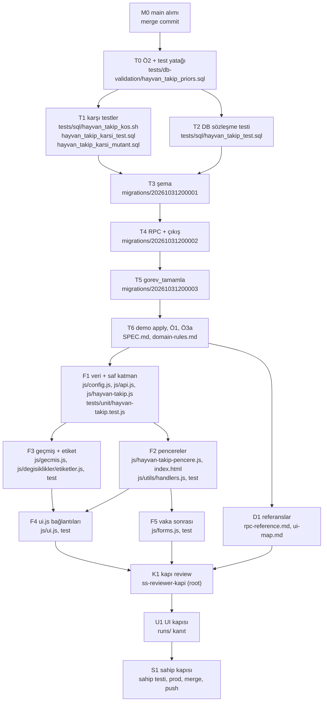
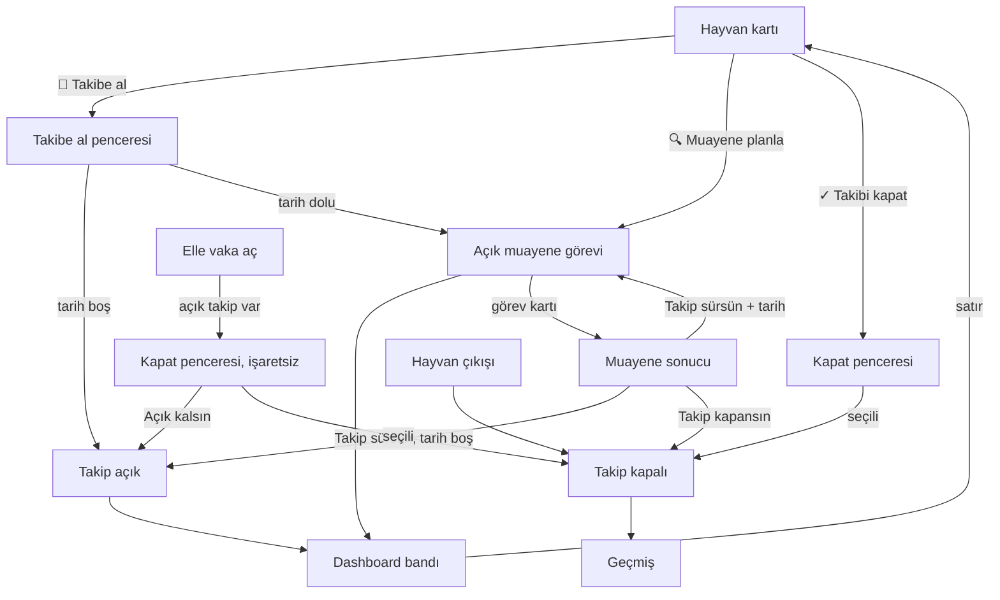

# Hayvan Takip (📌 Takipte) Implementation Plan

> **Uygulayıcı ajanlar için:** Görevler kulvar brief'ine doğrudan dönüşür. Adımlar `- [ ]` ile izlenir. Spec ile birlikte okunur.

**Goal:** Sahibin elle takibe aldığı hayvanı dashboard'un en başında gösteren, takibe bağlı muayene planlayan ve muayene sonucuna göre takibi sürdüren ya da kapatan özelliği kurmak.

**Architecture:** İş kuralları `hayvan_takip` tablosu ve dört `SECURITY DEFINER` RPC'dedir. Frontend saf katman (`js/hayvan-takip.js`), pencere katmanı (`js/hayvan-takip-pencere.js`) ve mevcut dosyalara ince bağlantılardan oluşur. Üreme akışları dokunulmaz; karşı testler bunu erken kilitler.

**Tech Stack:** PostgreSQL/Supabase, Vanilla JS, IndexedDB, node:test, psql test betikleri, Playwright (demo).

**Spec:** `docs/plans/2026-10-31-hayvan-takip-SPEC.md` (commit `db46032`). **Goal:** `.harness/goals/2026/G-20261031-HAYVAN-TAKIP.md`. Taban: `db46032`; M0 main'i alır (aşağıda). Plan düzeltmesi tabanı `5abe587` (§20.7-8).

## Global Constraints

Her görevin gereksinimlerine dahildir.

- Worker: `ss-worker-high`, `model=opus`, effort high. Muse ve sonnet yok (sahip 2026-10-31).
- Prod apply, merge, push planın dışındadır; yalnız S1 sahip kapısında görünür.
- `reports/` ve `docs/plans/` gitignore'dadır; yeni tracked dosya `git add -f <dosya>` ile eklenir. `git add` dosya dosya; `-A`, `.`, `-u` yasak.
- Tracked dosyada mutlak yol yazılmaz (repo public). Komutlar `$WT` ve `$MAIN` kullanır:
  `WT=$(git rev-parse --show-toplevel)`; `MAIN=$(dirname "$(git rev-parse --path-format=absolute --git-common-dir)")`.
- Worktree'de `node_modules` ve `.env` yoktur. `NODE_PATH=$MAIN/node_modules`; `db-validate`, `db-build-baseline`, `kabul-db/build.sh` `$MAIN`'den koşulur.
- `/tmp` yasak (`TMPDIR` ya da `~/tmp`). Bash aracı zsh'tır: `for x in $var` bölmez, `${=var}` yazılır; eşleşmeyen glob hata verir.
- Ağır test komutu `ram-ultracode exec --class test --sh '<ifade>'` ile koşulur (ifadede tek tırnak yok; aksi halde betik dosyası).
- Birim tabanı (db46032, MEASURED): 1598 test, 1592 pass, 5 fail, 1 skip. Taban kırmızıları: `LUNA-3`, `EG-7`, `EG-8`, bc-tarih takvim altındaki iki test. `some-fixes` test eklediğinden M0 tabanı yeniden ölçer; kabul sayısı M0 ölçümüdür. Yeni kırmızı kabul edilmez.
- Yeni migration'da `anon` GRANT yok. RPC: `REVOKE ALL ... FROM PUBLIC, anon, authenticated`, `GRANT EXECUTE ... TO authenticated, service_role`. Tablo ve fonksiyon için Supabase default-privilege tuzağı nedeniyle REVOKE'a `authenticated` dahildir.
- Migration damga bloğu `202610312000xx` (main'in son damgası `20261031000001`, `a0b2327` ile girdi; MEASURED). Merge öncesi en güncel damga ve `DB_VER` yeniden kontrol edilir (S1.4).
- Migration dosyası kendi `BEGIN/COMMIT`'ini taşımaz: runbook adım 4 ve test sarmalayıcısı dışarıdan sarar. İçinde `SET LOCAL lock_timeout='5s'; SET LOCAL statement_timeout='30s';` bulunur. Başlığa rollback notu yazılır.
- Tarih: `(now() AT TIME ZONE 'Europe/Istanbul')::date`; `CURRENT_DATE` yasak. Renk: vurgu yalnız yazı rengi; satır zemini ve şerit yok.
- Sebep kodları: `TOPALLIK`, `SUT_DUSUSU`, `ZAYIFLAMA`, `ISTAHSIZLIK`, `DIGER`. Etiketler: Topallık, Süt düşüşü, Zayıflama, İştahsızlık, Diğer. Sabitler: görev tipi `HAYVAN_TAKIP_MUAYENE`, kolon `ref_takip_id`, `kaynak='HAYVAN_TAKIP:<takip_id>'`, `kapatan_ref='hayvan-takip-kapandi'`, islem tipleri `HAYVAN_TAKIP_ACILDI|KAPANDI|MUAYENE`.
- JS sembolü değiştirmeden önce atlas `etki` (`code-change-precheck`). Her iş sonunda kod yazan rol `gitnexus analyze --index-only` koşar; bayraksız analyze yasak.
- Her görev raporu: `runs/2026-10-31-hayvan-takip/<görev-id>-report.md`. Kanıt: `runs/2026-10-31-hayvan-takip/kanit/`.
- Demo sahip şifresi okunmaz, yazılmaz, değiştirilmez. Kimlikler `$MAIN/.env`'den okunur, dosyaya kopyalanmaz.
- `harness.py docs-update` ve `commit-gate` bugün üç eski goal'ün frontmatter'ı yüzünden `ok:false` döner (MEASURED; G-20260929, G-20260930, G-20261002). Worker gate'i koşar; `G-20261031-HAYVAN-TAKIP` ya da staged kapsamıyla ilgili bulgu yoksa commit eder ve raporlar. Eski goal'ler bu işte düzeltilmez.

## Önceden cevaplanmış kararlar

Spec §3 (K1-K9), §4, §5 yeniden sorulmaz. Görev tipi, kolon ve RPC adları spec'teki gibidir. Aşağıdaki Ruling'ler mimar kararıdır; alt katman yeniden sormaz. Spec'in davranışını değiştiren yeni çelişkide `SORU:` ile durulur.

| No | Ruling | Gerekçe |
|---|---|---|
| R1 | Kısmi unique koşulu `tamamlandi IS NOT TRUE AND iptal IS NOT TRUE`. | Ayna kolonları nullable gösteriyor (MEASURED). `NOT x` NULL satırı indeksten kaçırır. Davranış spec'le aynı. T0 canlıda doğrular. |
| R2 | `db-validate` `--priors tests/db-validation/hayvan_takip_priors.sql` ile koşulur. Fixture yalnız izole baseline'a `hayvanlar` PK ekler. | Baseline constraint'sizdir; `REFERENCES hayvanlar(id)` 42830 ile FAIL oldu, fixture ile C1 PASS oldu (MEASURED, kazıma migration). Fixture prod'a gitmez. |
| R3 | Görev açıklaması RPC'de `_hayvan_takip_sebep_etiket(kod)` CASE ile üretilir; CASE'de olmayan kod görev açıklamasında ham kalır. Parite tek yönlü: CASE kodları ⊆ config ve etiketleri eş. | RPC imzası etiket almıyor, `gorev_log.aciklama` DB'de yazılıyor. Config'e migration'sız sebep eklenebilir; spec §4.1 korunur. |
| R4 | Rozet iki yüzeye eklenir: kart `_detChipsHtml`, liste `_animalTagsHtml`. | Spec başlığı kartı, satır atfı (`5107-5112`) listeyi gösteriyor. |
| R5 | `HAYVAN_TAKIP_MUAYENE` jenerik görev detayını hiç açmaz: `openTaskDet` sonuç penceresine gider ve döner. Çevrimdışıysa toast. | Spec §6. Detay modalı açılmayınca `detayIptal`, `openTaskEdit`, rapel tarihi yolları kapanır. |
| R6 | **Sahip kararı 2026-10-31, `domain-rules.md` §20.7.** Yeni tip için tamamlanmış görev detayında `↩️ Geri Al` kapalı (`Muayene sonucu geri alınamaz`); üç islem tipinde Geçmiş geri-al düğmesi yok (`_gmUndoRef` null). | Görevi geri açmak kapalı takibe açık görev bırakır. Spec'te boşluktu. Değişiklikler sayfası parolalı motor olarak kalır; davranışı T6'da ölçülür. |
| R7 | **Sahip kararı 2026-10-31, `domain-rules.md` §20.8.** Geçmiş tarihli muayene `HT_GECMIS_TARIH` ile reddedilir (bugün serbest); tarih alanları alt sınır `bugun` taşır. | Emsal `gorev_ertele` `GECMIS_TARIH`, §17 alan sözleşmesi. |
| R8 | `trg_degisim_log` yeni migration'da `CREATE TRIGGER` ile bağlanır; `20260913000001`'e dokunulmaz. | Eski migration dosyası değiştirilmez. |
| R9 | `kapatan_vaka_id uuid`, FK yok. RPC vakanın aynı hayvana ait olduğunu doğrular (`HT_VAKA_UYUMSUZ`). | Spec "`cases.id` tipi" der. FK `case_geri_al` silmesini bloklardı. |
| R10 | **Sahip onaylı spec sapması (2026-10-31; spec §7 Ö3).** Ö3 iki parça: Ö3a demo fazında, Ö3b prod apply sonrası S1'de. | FDW içe aktarması prod'da tablo olmadan ölçülemez. |
| R11 | `islem_log` `HAYVAN_TAKIP_MUAYENE` yalnız sonuç girişinde yazılır; planlama yazmaz. | Spec §5.6 "not metni görünür" sonuç notunu hedefler. |
| R12 | `DIGER` satırı, rozeti ve listesi sebep olarak `aciklama` gösterir; görev açıklaması `Diğer takibi muayenesi` kalır. | "Neden" sorusu tek başına "Diğer" ile cevaplanmaz; görev metni spec §5.4. Tasarım ayrıntısıdır; §20'ye yazılmaz. |
| R13 | `hayvan_takip_ac` kilit sırası: `hayvanlar` → `hayvan_takip` → `gorev_log`. Dört RPC de bu sırayı izler. | Çıkış tetikleyicisi aynı sırada çalışır; kilitlenme önlenir. |
| R14 | Demo yazma yetkisi: sahibin açık talimatı (2026-10-31), kapsam yalnız T6: demo'ya migration apply + ROLLBACK'li `demo_klonla`. Prod, başka TRUNCATE ve kapsam dışı demo yazımı bu yetkiye girmez. | `.harness/contract.md:115-116` canlı yazma için açık talimat, TRUNCATE için son özel onay ister. `demo_klonla` işlem içinde TRUNCATE eder (`demo/02_demo_klonla.sql:115`). |

Hata kodları (`RAISE EXCEPTION '<KOD>'`, `TAKIP_ACIK` eşleşmesinden kaçınmak için `HT_` önekli): `HT_HAYVAN_AKTIF_DEGIL`, `HT_SEBEP_BOS`, `HT_SEBEP_ZATEN_ACIK`, `HT_ACIKLAMA_GEREKLI`, `HT_TARIH_GEREKLI`, `HT_GECMIS_TARIH`, `HT_BOS_LISTE`, `HT_FARKLI_HAYVAN`, `HT_VAKA_UYUMSUZ`, `HT_TAKIP_YOK`, `HT_TAKIP_KAPALI`, `HT_GOREV_YOK`, `HT_GOREV_TIP_UYUMSUZ`, `HT_GOREV_KAPALI`, `HT_SONUC_GECERSIZ`.

## Review Focus

Spec'in sezdirdiği ama kendi testlerinde geçmeyen, kullanıcıyı en olası ısıracak durumlar. Her satırın testi sahip göreve eklidir.

1. `cikis_yap` zaten `SECURITY DEFINER` (`20260706000003:181-184`); uygulama yolu tetikleyici DEFINER olmasa da çalışır. DEFINER savunmadır: `authenticated` `hayvan_takip`'e yazamaz, `hayvanlar.durum`'a doğrudan `UPDATE` (kabul DB'de yetki var, JS kullanmıyor; prod T0'da ölçülür) çıkışı kırardı. Beklenen: iki yolda takipler kapalı. (T2 `C02`, `C04`, `P03`.)
2. Tamamlanmış muayene görevinde `↩️ Geri Al`: kapalı takibe açık görev kalır. Beklenen: geri alma kapalı. (F4 `HT-UI-07`, F3 `HT-GM-03`, U1 #22.)
3. Vaka sonrası pencere vaka detayının üstünde açılır (`openCaseDet` beklenir; `openM` `js/ui.js:12414`'te await'lerden sonradır); Android geri tuşu yalnız üst pencereyi kapatır. Beklenen: vaka detayı açık kalır, vaka kayıtlı. (F5 `HT-V-01`, U1 #17, #18.)
4. İstanbul gece yarısı: `2026-10-30T21:30:00Z` 31 Ekim'dir. Beklenen: gün sayısı UTC'ye kaymaz. (F1 `HT-S-01`.)
5. Serbest açıklamada HTML: band, rozet, liste kaçışsız basarsa XSS olur. Beklenen: `esc` ile metin. (F1 `HT-S-07`, F4 `HT-UI-11`.)

## Dosya sahipliği ve DAG

Her dosya tek düğümdedir. Aynı düğüm içi sıralıdır; ok bağımlılıktır.



Paralel gidebilir: T1 ile T2; F2 ile F3; F4 ile F5 (F2 ve F3 sonrası); D1 frontend ile. FAIL düzeltmesi o dosyanın sahibi düğümün kapsamındadır; taze worker açılır.

## HAYVAN_TAKIP_MUAYENE görevini kapatabilen yollar

Tarama: atlas (`rpc gorev_tamamla`, `tablo gorev_log`, `etki`, sha `5d3f6a3`; `js/` db46032'de aynı [MEASURED `git diff --stat`]), yerel ayna `prosrc` taraması, grep. gitnexus indeksi `5d3f6a3`'te, HEAD'den yalnız doküman farkı var. Satırlar db46032'dir; `js/ui.js`, `js/api.js` ve `index.html` M0 ile değişir, her görev satırı M0 sonrası yeniden doğrular. Atlas'ın dinamik kör alanı için `TAKIP_MUAYENE` ve `write('gorev_log'` grep'iyle ayrıca taranmıştır.

| # | Yol | Giriş noktası | Durum | Eylem |
|---|---|---|---|---|
| 1 | Toplu tamamlama (FAB) | `renderTask` ✓ `ui.js:4649` → `togglePendingDone` → `flushPendingDone:2413` | AÇIK | ✓ çizilmez (F4) |
| 2 | Görev kartı tıklama | `renderTask` → `openTaskDet:11561` | AÇIK | Sonuç penceresi (F4) |
| 3 | Detay `✅ Tamamlandı` | `detayTamamla:11818`, buton `11611` | AÇIK | Guard + gizleme (F4; R5 ile ulaşılmaz, savunma) |
| 4 | Genel Ertele | `_erteleBtnHtml:4254` | Fail-closed (kural satırı yok) | Açık dal eklenir (F4) |
| 5 | `detayIptal`, `openTaskEdit`, rapel tarihi | `m-task-det` (`handlers.js:408-409`, `ui.js:12125`) | Yalnız detaydan | R5 kapatır; test `HT-UI-04` |
| 6 | `grupTamamla`, `toggleSub`, `toggleSubDet` | `ui.js:4744,4844,4863` | Alt görev gerekir | RPC `parent_id` yazmaz; eylem yok |
| 7 | `_gorevStokTamamlaSubmit`, `takipRetry` | `ui.js:11892,11909` | `detayTamamla` altında, `etken_kod` NULL | Eylem yok |
| 8 | `_tedaviGunExecute`, `asiUygulaVeTamamla`, `topluTekUygula`, `topluHepsiniUygula` | `ui.js:11996,12052,2821,2838` | Başka tipler | Eylem yok |
| 9 | `ovsyncIptal`, `caseTohumlamaIptal` | `ui.js:4328,14182` | `OVSYNC_BASLAT`, `TOHUMLAMA_PLANLI` | Eylem yok |
| 10 | `_protokolDismiss` | `ui.js:6347` | `etken_kod` eşleşmesi; yeni tipte NULL | Eylem yok |
| 11 | Çevrimdışı kuyruk | `RPC_MAP.gorev_log.PATCH` (`api.js:516`), `buildRpcParams:15783` | Yalnız `write` PATCH | UI yazmaz; DB guard (T5) |
| 12 | Yapay zekâ asistanı | `_asistan_step_calistir('gorev_kapat')` → `gorev_tamamla` | DB'den geçer | Guard RAISE, plan atomik geri döner; test `G05` |
| 13 | Doğrudan RPC | `gorev_tamamla` | AÇIK | `MUAYENE_SONUC_GEREKLI` (T5); `p_iptal=true` değişmez |
| 14 | Ters yön: görevi geri açma | `openDoneTaskDet`, `gorevGeriAl:12211` | AÇIK | R6 (F4) |
| 15 | Ters yön: Geçmiş geri al | `_gmUndoRef` → `_gmGeriAlHedef` (`gecmis.js:205,797`) | AÇIK (ref dolu her islem) | R6 (F3) |
| 16 | Sistem iptali | `_trg_hayvan_cikis_gorev_iptal`, `cikis_yap`, `gorev_orphan_temizle` | İstenen davranış | Dokunulmaz; test `C01` |
| 17 | Geniş `UPDATE gorev_log` | Ayna `prosrc` taraması: filtresiz yalnız 16. satır, `protokol_gorev_bol`, `seans_tamamla` | Yeni tipi etkilemez | Eylem yok |
| 18 | `LIKE ... TAKIP` deseni | Ayna `prosrc` ve JS grep: 0 eşleşme | `kaynak` çakışması yok | T1 kilitler |

Sonuç: sonuç penceresini atlayan yol kalmaz. 1-4, 13-15 eylem ister; diğerleri tarama kanıtıyla kapalıdır. Ayna trigger taşımaz; trigger kapsamı T0'da canlıdan doğrulanır.

---

### Task M0: main'i dala alma

**Karar:** `merge` (rebase değil): `db46032`, `7363121`, `5abe587` kapı ve rapor kayıtlarında geçiyor, SHA'lar korunur. `git merge-tree` çakışmasız (MEASURED, 5abe587 + main `b4253e1`). Push yok.

- [ ] **Adım 1:** `git fetch` yok; yerel `main` ucunu raporla, `git merge --no-ff main -m "hayvan-takip: main alındı"`. Çakışmada dur, lead'e sor. Main'den gelen dosyalar merge commit'ine aittir, manifest ihlali sayılmaz.
- [ ] **Adım 2:** Birim tabanını yeniden ölç, sayıyı ve kırmızıları raporla. Yeni kırmızı main kaynaklıysa listele, düzeltme.
- [ ] **Adım 3:** Satır atıflarını doğrula: yol matrisi ve F4 tablosu için `js/ui.js`, spec'in `js/forms.js` atıfları. Kayan satırları rapora tablo olarak yaz; görev worker'ları bunu kullanır. `gorev_tamamla` main'de değişmedi (son gövde `20261013000004`, MEASURED); yeniden doğrula. Atlas ve `gitnexus analyze --index-only` tazele.

**## Yazılabilir dosyalar:** merge commit, `runs/2026-10-31-hayvan-takip/M0-report.md`
**## Boyut bütçesi:** Rapor ≤40 satır.
**## Review: T0**
**## Run:** `git merge-base --is-ancestor main HEAD`

### Task T0: Ö2 canlı şema okuması ve test yatağı

**Files:** Create `tests/db-validation/hayvan_takip_priors.sql`; kanıt `runs/2026-10-31-hayvan-takip/kanit/o2-{prod,demo}.txt`.

**Interfaces:** Produces: priors fixture; taze `egesut_ovsync_kabul` DB'si; T3-T5'in dayandığı ölçüm tablosu.

- [ ] **Adım 1:** Prod ve demo'ya yalnız `SELECT` (Mgmt API). Okunacak: `gorev_log` kolon sırası ve nullable; `cases.id`, `hayvanlar.id` tipi ve PK; `pg_get_functiondef(gorev_tamamla)`, `pg_get_viewdef(v_gorev_log_sync)`, `_trg_hayvan_cikis_gorev_iptal` gövdesi; `hayvanlar` trigger listesi; `pg_publication_tables` `supabase_realtime`; `gorev_ertele_kural` yeni tip satırı; `to_regclass('public.hayvan_takip')`; `ref_takip_id` kolonu; `has_table_privilege('authenticated','public.hayvanlar','UPDATE')` ve `gorev_log` için aynısı (C04 yolu; prod'da yetki yoksa C04 kalır, raporda yalnız savunma diye yazılır).
- [ ] **Adım 2:** Beklenenle karşılaştır, raporda tablo yaz. Beklenen: `tamamlandi`, `iptal` nullable; `gorev_log` kolonları `... hedef_saat, takip_kapanis_nedeni` ile biter; görünüm `hedef_saat` ile biter (`SELECT *` genişlemesi `takip_kapanis_nedeni`'ni de ekleyecek); `cases.id=uuid`, `hayvanlar.id=text`; guard `IN ('GEBELIK_KONTROL','TAKIP_MUAYENE')`; yeni nesne yok; yeni tip kural satırı yok; `gorev_tamamla` gövdesi `20261013000004` ile eş. Prod ve demo ayrışırsa ya da beklenenden sapma varsa: uyarlanabiliyorsa `Ruling:` önerisi, davranış değişiyorsa `SORU:`.
- [ ] **Adım 3:** Fixture yaz: `ALTER TABLE public.hayvanlar ADD CONSTRAINT hayvanlar_pkey PRIMARY KEY (id);` ve "yalnız izole baseline" başlığı.
- [ ] **Adım 4:** `cd "$MAIN" && bash scripts/kabul-db/build.sh`. DB paylaşımlıdır: `pg_stat_activity`'de başka bağlantı varsa dur, lead'e sor. Yerel ayna bayatsa `scripts/refresh_lsp_schema.sh`.
- [ ] **Adım 5:** Commit: `git add -f tests/db-validation/hayvan_takip_priors.sql`.

**## Yazılabilir dosyalar:** `tests/db-validation/hayvan_takip_priors.sql`, `runs/2026-10-31-hayvan-takip/kanit/*`, `runs/2026-10-31-hayvan-takip/T0-report.md`
**## Boyut bütçesi:** Fixture ≤5 satır; rapor ≤40 satır.
**## Review: T1**
**## Run:**
```
psql -h 127.0.0.1 -U lsp_user -d egesut_ovsync_kabul -X -tAc "SELECT count(*)>70 FROM pg_trigger WHERE NOT tgisinternal; SELECT prosrc ~ 'MUAYENE_SONUC_GEREKLI' FROM pg_proc WHERE proname='gorev_tamamla';"   # t, t
test -s runs/2026-10-31-hayvan-takip/kanit/o2-prod.txt && test -s runs/2026-10-31-hayvan-takip/kanit/o2-demo.txt
```

### Task T1: Karşı testler (spec §8.3, erken)

**Files:** Create `tests/sql/hayvan_takip_kos.sh`, `tests/sql/hayvan_takip_karsi_test.sql`, `tests/sql/hayvan_takip_karsi_mutant.sql`.

**Interfaces:** Produces: `[BOLUM=sema|rpc|guard] bash tests/sql/hayvan_takip_kos.sh <sql...>` — dosyaları `BEGIN; ...; ROLLBACK;` içinde `egesut_ovsync_kabul`'a verir, `ON_ERROR_STOP=1`, `-v bolum=${BOLUM:-hepsi}`, rc psql'in. Test dosyaları `BEGIN/ROLLBACK` taşımaz; her senaryo `DO $t$...$t$`, FAIL'de `RAISE EXCEPTION`, başarıda `<id> PASS`, sonda `OZET: N PASS` (emsal `supabase/tests/ovsync_pg_kabul.sql`).

`KOS_MOD=topla` kipi: `-v ON_ERROR_STOP=0 -v ON_ERROR_ROLLBACK=on`; sonda `DUSEN: KR.. KR..` (sıralı) basar. `KR*` bloğu `SAVEPOINT kr; DO ...; ROLLBACK TO kr;` biçimindedir, kendi fixture'ını kurar, her hatayı `EXCEPTION WHEN OTHERS THEN RAISE EXCEPTION 'KRnn FAIL: %', SQLERRM` ile etiketler, OZET her iki test dosyasında `NOTICE '<id> PASS'` satırlarından `kos.sh` tarafından sayılır (geri sarılan sayaç kullanılmaz). Etiketsiz `ERROR` (mutant ya da betik hatası) rc=2.

**Tasarım:** `gorev_tipi` serbest metin olduğundan test şemaya bağımlı değildir: fixture satırı `gorev_tipi='HAYVAN_TAKIP_MUAYENE'`, `kaynak='HAYVAN_TAKIP:<sabit uuid>'`, `ref_takip_id` yazmaz. Bu yüzden migration'dan önce YEŞİL koşar ve kırmızı kanıtı mutantla üretilir. Fixture: `E2E-HT-K-A` (açık yeni tip görev) ve `E2E-HT-K-B` (ikiz, görevsiz).

- [ ] **Adım 1:** Senaryoları yaz. Gerçek imzaları kabul DB'sinden al.

| Id | Senaryo | Assert |
|---|---|---|
| `KR01` | A'da Ovsync hastalığıyla `create_case` | `TAKIP_ACIK` yok, vaka açılır |
| `KR02` | A'da `pg_application_event` eklenir | `TAKIP_ACIK` yok |
| `KR03` | A'da tohumlama | Yeni tip görev açık kalır, `takip_kapanis_nedeni` NULL |
| `KR04` | A ve B'de `_ovsync_baslat_gorev_kur` ve `_acik_disi_hedef_ic` | İkisinde aynı sonuç: `OVSYNC_BASLAT` sayısı, `hedef_tarih` ve `_acik_disi_hedef_ic` eşit, NULL değil (takip muafiyeti `_ovsync_baslat_gorev_kur`'da değil, burada) |
| `KR05` | `sessiz_hayvanlar_listele` | A ve B eşit bulunur, `sessiz_gun` eşit |
| `KR06` | `ovsync_takip_listele` takipteki kümesi | A yok |
| `KR07` | A'da `_takip_gorev_kur` | `ZATEN_ACIK` yok, `TAKIP_MUAYENE` açılır |
| `KR08` | `TAKIP_MUAYENE` akışı: açıkken Ovsync `create_case` | Hâlâ `TAKIP_ACIK` |
| `KR09` | `TAKIP_MUAYENE` açıkken tohumlama; aynı hayvanda yeni tip görev, `hedef_tarih` daha ileri | Kapanır, `takip_kapanis_nedeni='YENI_TOHUMLAMA'`; yeni tip görev etkilenmez |
| `KR10` | `gorev_tamamla(TAKIP_MUAYENE)` | `MUAYENE_SONUC_GEREKLI:TAKIP_MUAYENE` |
| `KR11` | T5 sonrası: `hayvan_takip_ac` ile gerçek görev (`ref_takip_id` dolu); üstünde `KR01`, `KR05`, `KR06`, `KR07` assert'leri, `gorev_tamamla` guard'ı | Sonuçlar görevsiz ikizle eş; `MUAYENE_SONUC_GEREKLI:HAYVAN_TAKIP_MUAYENE`. `gorev_tamamla` gövdesi yeni tipi içermiyorsa `NOTICE 'KR11 ATLANDI'`, sayılmaz |

- [ ] **Adım 2:** Yeşil: `bash tests/sql/hayvan_takip_kos.sh tests/sql/hayvan_takip_karsi_test.sql`. Beklenen rc=0, `OZET: 10 PASS`.
- [ ] **Adım 3:** Mutant yaz: `DO` bloğu `gorev_tipi = 'TAKIP_MUAYENE'` içeren bütün `public` fonksiyonlarını `pg_get_functiondef` + `replace` ile `gorev_tipi IN ('TAKIP_MUAYENE','HAYVAN_TAKIP_MUAYENE')` yapıp `EXECUTE` eder. `sessiz_hayvanlar_listele` bu metni taşımaz (`20261013000001`, INFERRED: gövde taraması); `KR05` için mutant ayrıca bu fonksiyona açık yeni tip görevli hayvanı eleyen `AND NOT EXISTS` ekler.
- [ ] **Adım 4:** Kırmızı kanıt: Run'daki `KOS_MOD=topla` komutu. Beklenen düşen küme tam olarak `KR01-KR07` ve `KR09` (`KR09` mutantta en ileri görevi, yani yeni tipi kapatır); `KR08`, `KR10` düşmez. Sapma varsa fixture ya da mutant düzeltilir; küme gevşetilmez, açıklanamıyorsa lead'e sor. Çıktıyı kanıta yaz.
- [ ] **Adım 5:** Commit.

**## Yazılabilir dosyalar:** yukarıdaki üç dosya, `runs/2026-10-31-hayvan-takip/T1-report.md`, `runs/2026-10-31-hayvan-takip/kanit/t1-*`
**## Boyut bütçesi:** Üç dosya toplam ≤320 satır.
**## Review: T2**
**## Run:**
```
bash tests/sql/hayvan_takip_kos.sh tests/sql/hayvan_takip_karsi_test.sql                      # rc=0
test "$(KOS_MOD=topla bash tests/sql/hayvan_takip_kos.sh tests/sql/hayvan_takip_karsi_mutant.sql tests/sql/hayvan_takip_karsi_test.sql | sed -n 's/^DUSEN: //p')" = "KR01 KR02 KR03 KR04 KR05 KR06 KR07 KR09"
```

### Task T2: DB sözleşme testleri (kırmızı)

**Files:** Create `tests/sql/hayvan_takip_test.sql`.

**Interfaces:** Consumes: T1 `hayvan_takip_kos.sh`. Produces: T3-T5 kabul paketi. Henüz olmayan nesneler dinamik `EXECUTE` ile çağrılır; dosya psql `\if` ile bölümlere ayrılır, seçim `BOLUM` ortam değişkeniyle (T1): `sema` = `P01`, `P02`, `L01` (yalnız T3 nesneleri); `rpc` = `P03`, `A*`, `K*`, `M*`, `S*`, `C*`; `guard` = `G*`. Fixture: `E2E-HT-T-*`. Sabit uuid yardımcısı `pg_temp.ht_id`.

- [ ] **Adım 1:** Senaryoları yaz. Kodlar ve sabitler bu plandaki listededir.

| Id | Senaryo | Assert |
|---|---|---|
| `P01` | Tablo ACL | `has_table_privilege`: authenticated yalnız SELECT, anon yok |
| `P02` | Şema | RLS açık; `trg_degisim_log` var; `v_gorev_log_sync` `ref_takip_id` içerir, açık ve kapalı kolları doğru; `hayvan_takip` kısıtları (kapanış çifti, neden CHECK, boş sebep, `DIGER` açıklama) `check_violation` |
| `P03` | RPC ACL ve DEFINER | `has_function_privilege`: anon dört RPC'de yok; authenticated ve service_role var; `_hayvan_takip_*` ve `_trg_hayvan_cikis_takip_kapat`'ta authenticated yok. `pg_proc.prosecdef=true`: dört RPC ve `_trg_hayvan_cikis_takip_kapat` |
| `A01` | `hayvan_takip_ac` tarihsiz | `ok`, `takip_id`; `farm_id=current_farm_id()`, `acan` dolu, kapanış NULL; `HAYVAN_TAKIP_ACILDI` 1 satır; görev 0 |
| `A02` | Tarih+saatle aç | Görev: tip, `kaynak`, `ref_takip_id`, tarih, saat; `aciklama='Topallık takibi muayenesi'`; `parent_id` NULL, `etken_kod` NULL |
| `A03` | Aktif değil | `HT_HAYVAN_AKTIF_DEGIL` |
| `A04` | Aynı sebep | `HT_SEBEP_ZATEN_ACIK`; kapanınca aynı sebep yeniden açılır |
| `A05` | `DIGER` NULL ve `'   '` | `HT_ACIKLAMA_GEREKLI` |
| `A06` | İki `DIGER` | İkisi açık |
| `A07` | `YENI_KOD` | Kabul; `aciklama='YENI_KOD takibi muayenesi'` |
| `A08` | Geçmiş tarih, saat-tarihsiz | `HT_GECMIS_TARIH`, `HT_TARIH_GEREKLI`; bugün kabul |
| `K01` | İki takip kapat + not | `kapanan=2`, `ELLE`, not, `kapatan` dolu; `HAYVAN_TAKIP_KAPANDI` 2 satır |
| `K02` | Açık görevli kapat | Görev `iptal=true`, `kapatan_ref='hayvan-takip-kapandi'` |
| `K03` | Boş dizi ve NULL | `HT_BOS_LISTE` |
| `K04` | Farklı hayvanlar | `HT_FARKLI_HAYVAN`, satır değişmez |
| `K05` | Kapalı satır karışık | Hata yok, `kapanan` yalnız açıklar; kapalı için yeni log yok |
| `K06` | Vaka parametresi | `VAKA`, `kapatan_vaka_id` dolu |
| `K07` | Başka hayvanın vakası | `HT_VAKA_UYUMSUZ` |
| `M01` | Planla, açık görev yok | Görev açılır |
| `M02` | İkinci planla | Aynı satır güncellenir, açık görev 1 |
| `M03` | Kapalı takip, aktif olmayan hayvan | `HT_TAKIP_KAPALI`, `HT_HAYVAN_AKTIF_DEGIL` |
| `M04` | Aynı takibe doğrudan ikinci açık görev | `unique_violation`; `tamamlandi` NULL satırda da |
| `M05` | NULL ve geçmiş tarih | `HT_TARIH_GEREKLI`, `HT_GECMIS_TARIH` |
| `S01` | `SURSUN` + sonraki | Eski görev tamam (iptal değil); yeni görev tarih/saatle; takip açık; `HAYVAN_TAKIP_MUAYENE` 1 satır, not ve `snapshot.sonuc='SURSUN'` |
| `S02` | `SURSUN` tarihsiz | Görev yok, takip açık |
| `S03` | `KAPANSIN` + not | Görev tamam; takip `MUAYENE`, not; MUAYENE + KAPANDI loglu |
| `S04` | Başka tip görev | `HT_GOREV_TIP_UYUMSUZ` |
| `S05` | Kapalı görev, iptal görev | `HT_GOREV_KAPALI` |
| `S06` | Görev açık, takip kapalı (elle kurulan) | `HT_TAKIP_KAPALI` |
| `S07` | Geçersiz `p_sonuc` | `HT_SONUC_GECERSIZ` |
| `C01` | `cikis_yap` | Açıklar `CIKIS`, `kapatan='sistem'`; takip başına KAPANDI log; görev iptal; kapalı takip değişmez |
| `C02` | `SET LOCAL ROLE authenticated` + JWT claim ile `cikis_yap` | Yetki hatası yok, takip kapalı (DEFINER'ı sınamaz; `cikis_yap` kendisi DEFINER) |
| `C03` | `durum` Aktif→Aktif güncellemesi | Takip değişmez |
| `C04` | `SET LOCAL ROLE authenticated` + doğrudan `UPDATE hayvanlar SET durum='Ölü'` | Yetki hatası yok, takip kapalı; tetikleyici DEFINER değilse düşer |
| `G01` | `gorev_tamamla(yeni tip)` | `MUAYENE_SONUC_GEREKLI:HAYVAN_TAKIP_MUAYENE` |
| `G02` | `p_iptal=true` | İptal olur (dal değişmez) |
| `G03` | `TAKIP_MUAYENE`, `GEBELIK_KONTROL` | Guard aynı |
| `G04` | Düz görev | Tamamlanır |
| `G05` | `_asistan_step_calistir('gorev_kapat', ...)` yeni tipte | RAISE, görev açık |
| `G06` | `gorev_ertele(yeni tip)` | `TIP_ERTELENEMEZ` |
| `L01` | Doğrudan `INSERT` + `UPDATE` (RPC'siz, T3'te koşar) | `degisim_log`'da `hayvan_takip` I ve U |

- [ ] **Adım 2:** Kırmızı: `bash tests/sql/hayvan_takip_kos.sh tests/sql/hayvan_takip_test.sql`. Beklenen rc≠0, ilk hata `P01` nesne yok. Çıktıyı kanıta yaz.
- [ ] **Adım 3:** Commit. Test dosyasında sonraki değişiklik yalnız bu düğümden; test hatası çıkarsa T2 kapsamında taze worker.

**## Yazılabilir dosyalar:** `tests/sql/hayvan_takip_test.sql`, `runs/2026-10-31-hayvan-takip/T2-report.md`, `runs/2026-10-31-hayvan-takip/kanit/t2-*`
**## Boyut bütçesi:** ≤500 satır.
**## Review: T2**
**## Run:**
```
! bash tests/sql/hayvan_takip_kos.sh tests/sql/hayvan_takip_test.sql   # kırmızı; T5 sonunda yeşile döner
```

### Task T3: Şema migration'ı

**Files:** Create `supabase/migrations/20261031200001_hayvan_takip_sema.sql`.

**Interfaces:** Consumes: T0 fixture, T2 `bolum=sema`. Produces: tablo, kolon, indeks, görünüm.

- [ ] **Adım 1:** Kırmızıyı doğrula: `BOLUM=sema bash tests/sql/hayvan_takip_kos.sh tests/sql/hayvan_takip_test.sql` FAIL.
- [ ] **Adım 2:** Taslakta `db-validate` çalıştır (Run). Hata erken yakalanır.
- [ ] **Adım 3:** Yaz:
  - `hayvan_takip`: spec §4.1 birebir; `kapatan_vaka_id uuid` (R9). CHECK: kapanış çifti, neden listesi, `btrim(sebep_kodu)<>''`, `sebep_kodu<>'DIGER' OR btrim(COALESCE(aciklama,''))<>''`, `kapanis_nedeni IS DISTINCT FROM 'VAKA' OR kapatan_vaka_id IS NOT NULL`.
  - İndeks: `hayvan_takip_acik_sebep_uq` (spec §4.1), `hayvan_takip_farm_hayvan_idx`.
  - `ENABLE ROW LEVEL SECURITY`; `CREATE POLICY hayvan_takip_select ... FOR SELECT TO authenticated USING (true)`.
  - `REVOKE ALL ON public.hayvan_takip FROM PUBLIC, anon, authenticated; GRANT SELECT ... TO authenticated; GRANT ALL ... TO service_role;`
  - `trg_degisim_log`: `AFTER INSERT OR UPDATE OR DELETE ... EXECUTE FUNCTION public._degisim_log_yaz('id')` (R8).
  - Realtime: emsal `20260401000033` deseni, `pg_publication` yoksa atlayan `DO`.
  - `gorev_log`: `ADD COLUMN IF NOT EXISTS ref_takip_id uuid`; FK `NOT VALID` + `VALIDATE`; `gorev_log_ref_takip_acik_uq` (R1).
  - `CREATE OR REPLACE VIEW public.v_gorev_log_sync` (`20260626000010` gövdesi, `SELECT *`). Sırada sapma varsa 42P16 ile düşer; T0 ölçümüne göre davran.
  - Başlıkta rollback: `DROP VIEW`/yeniden kurma sırası, kolon ve tablo düşürme.
- [ ] **Adım 4:** Final dosyada `db-validate` PASS, sonra `BOLUM=sema bash tests/sql/hayvan_takip_kos.sh <bu migration> tests/sql/hayvan_takip_test.sql` yeşil. Raporu kanıta kopyala. INCONCLUSIVE'da dur, lead üzerinden sahibe sor.
- [ ] **Adım 5:** Commit: `git add -f` gerekmez (`supabase/` tracked), dosya dosya.

**## Yazılabilir dosyalar:** bu migration, `runs/2026-10-31-hayvan-takip/T3-report.md`, `runs/2026-10-31-hayvan-takip/kanit/t3-*`
**## Boyut bütçesi:** ≤130 satır.
**## Review: T2**
**## Run:**
```
cd "$MAIN" && bash scripts/db-validate.sh "$WT/supabase/migrations/20261031200001_hayvan_takip_sema.sql" --priors "$WT/tests/db-validation/hayvan_takip_priors.sql"   # PASS
cd "$WT" && bash tests/sql/hayvan_takip_kos.sh supabase/migrations/20261031200001_hayvan_takip_sema.sql tests/sql/hayvan_takip_karsi_test.sql   # rc=0
```
`egesut_val_tmp` paylaşımlıdır; ortam FAIL'inde bir kez yeniden dene (emsal 2026-10-17).

### Task T4: RPC'ler ve çıkış tetikleyicisi

**Files:** Create `supabase/migrations/20261031200002_hayvan_takip_rpc.sql`.

**Interfaces:** Produces (dönüşler jsonb):
- `hayvan_takip_ac(p_hayvan_id text, p_sebep_kodu text, p_aciklama text DEFAULT NULL, p_muayene_tarihi date DEFAULT NULL, p_muayene_saati time DEFAULT NULL)` → `{ok,takip_id,gorev_id}`
- `hayvan_takip_kapat(p_takip_ids uuid[], p_not text DEFAULT NULL, p_kapatan_vaka_id uuid DEFAULT NULL)` → `{ok,kapanan,hayvan_id}`
- `hayvan_takip_muayene_planla(p_takip_id uuid, p_tarih date, p_saat time DEFAULT NULL)` → `{ok,gorev_id,yeni}`
- `hayvan_takip_muayene_sonuc(p_gorev_id uuid, p_sonuc text, p_not text DEFAULT NULL, p_sonraki_tarih date DEFAULT NULL, p_sonraki_saat time DEFAULT NULL)` → `{ok,sonuc,takip_id,yeni_gorev_id,kapandi}`

- [ ] **Adım 1:** Kırmızıyı doğrula: `BOLUM=rpc` ile T3 migration + test dosyası FAIL. Taslakta `db-validate`.
- [ ] **Adım 2:** İç yardımcılar (`SECURITY DEFINER`, `SET search_path TO 'public','pg_temp'`, EXECUTE yok):
  - `_hayvan_takip_kullanici()`: `request.jwt.claims` `email`, yoksa `sub`, yoksa `session_user` (emsal `surum_gizli._cagiran` hata korumasıyla).
  - `_hayvan_takip_sebep_etiket(text)`: R3 CASE, `IMMUTABLE`.
  - `_hayvan_takip_gorev_yaz(p_takip uuid, p_hayvan text, p_sebep text, p_tarih date, p_saat time)` görev INSERT'i. Sabitler Global Constraints'te.
  - `_hayvan_takip_kapat_ic(p_takip_id uuid, p_neden text, p_kapatan text, p_not text, p_vaka uuid) -> boolean` (açıksa kapatıp true): kapanış + açık görev iptali + `HAYVAN_TAKIP_KAPANDI` logu; RPC ve tetikleyici ortak kullanır.
- [ ] **Adım 3:** Dört RPC. Kilit R13. Davranış spec §4.4, ret kodları plandaki liste, sıra: parametre → varlık → durum. `INSERT` `unique_violation` da `HT_SEBEP_ZATEN_ACIK`'e çevrilir. `islem_log` kalıbı: `(tip, ana_hayvan_id, ref_id, ref_tablo, snapshot, kullanici_notu)`, `ref_tablo='hayvan_takip'`, `snapshot={sebep_kodu,aciklama,...}`. `muayene_sonuc` görevi doğrudan `UPDATE` ile tamamlar (`tamamlandi=true`, `tamamlanma_tarihi=now()`), `gorev_tamamla` çağırmaz.
- [ ] **Adım 4:** Tetikleyici: `_trg_hayvan_cikis_takip_kapat()` `SECURITY DEFINER` + `search_path`; `CREATE TRIGGER trg_hayvan_cikis_takip_kapat AFTER UPDATE OF durum ON public.hayvanlar FOR EACH ROW WHEN (OLD.durum='Aktif' AND NEW.durum IS DISTINCT FROM 'Aktif')`. Mevcut `_trg_hayvan_cikis_gorev_iptal`'e dokunulmaz.
- [ ] **Adım 5:** ACL (Global Constraints). `db-validate` PASS; `BOLUM=rpc` ile iki migration + test dosyası yeşil. Mutant kanıtı (repoya girmez, `ROLLBACK`'li tek işlem): iki migration + `ALTER FUNCTION public._trg_hayvan_cikis_takip_kapat() SECURITY INVOKER` + `C04` adımları → `insufficient_privilege` (42501). Çıktı kanıta.
- [ ] **Adım 6:** Commit.

**## Yazılabilir dosyalar:** bu migration, `runs/2026-10-31-hayvan-takip/T4-report.md`, `runs/2026-10-31-hayvan-takip/kanit/t4-*`
**## Boyut bütçesi:** ≤420 satır.
**## Review: T2**
**## Run:**
```
M=supabase/migrations
cd "$MAIN" && bash scripts/db-validate.sh "$WT/$M/20261031200002_hayvan_takip_rpc.sql" --priors "$WT/tests/db-validation/hayvan_takip_priors.sql" "$WT/$M/20261031200001_hayvan_takip_sema.sql"   # PASS
cd "$WT" && bash tests/sql/hayvan_takip_kos.sh $M/20261031200001_hayvan_takip_sema.sql $M/20261031200002_hayvan_takip_rpc.sql tests/sql/hayvan_takip_karsi_test.sql   # rc=0
```

### Task T5: `gorev_tamamla` koruması

**Files:** Create `supabase/migrations/20261031200003_gorev_tamamla_hayvan_takip.sql`.

**Interfaces:** Consumes: T0 canlı gövde. Produces: `MUAYENE_SONUC_GEREKLI:HAYVAN_TAKIP_MUAYENE`.

- [ ] **Adım 1:** Kırmızıyı doğrula: `BOLUM=guard` ile iki migration + test dosyası, `G01` FAIL.
- [ ] **Adım 2:** Canlı gövdeyi yeniden oku (T0'dan sonra değişmiş olabilir); `CREATE OR REPLACE` ile tek fark: guard listesine `'HAYVAN_TAKIP_MUAYENE'`. `p_iptal=true` dalı aynen. Fark kanıtı: `diff` tam 1 satır.
- [ ] **Adım 3:** `REVOKE ALL ... FROM PUBLIC, anon, authenticated; GRANT EXECUTE ... TO authenticated, service_role`. T0 ACL'iyle çelişirse canlıyı koru ve raporla.
- [ ] **Adım 4:** `db-validate` PASS; bütün DB paketi yeşil.
- [ ] **Adım 5:** Commit.

**## Yazılabilir dosyalar:** bu migration, `runs/2026-10-31-hayvan-takip/T5-report.md`, `runs/2026-10-31-hayvan-takip/kanit/t5-*`
**## Boyut bütçesi:** Gövde hariç ≤30 satır.
**## Review: T2**
**## Run:**
```
M=supabase/migrations; P1=$M/20261031200001_hayvan_takip_sema.sql; P2=$M/20261031200002_hayvan_takip_rpc.sql; P3=$M/20261031200003_gorev_tamamla_hayvan_takip.sql
cd "$MAIN" && bash scripts/db-validate.sh "$WT/$P3" --priors "$WT/tests/db-validation/hayvan_takip_priors.sql" "$WT/$P1" "$WT/$P2"   # PASS
cd "$WT" && bash tests/sql/hayvan_takip_kos.sh $P1 $P2 $P3 tests/sql/hayvan_takip_test.sql       # rc=0, OZET tümü
bash tests/sql/hayvan_takip_kos.sh $P1 $P2 $P3 tests/sql/hayvan_takip_karsi_test.sql              # rc=0, OZET: 11 PASS (KR11 dahil)
```

### Task T6: Demo uygulaması, Ö1, Ö3a

**Files:** Modify `docs/plans/2026-10-31-hayvan-takip-SPEC.md` (§7 sonuçları), `.harness/references/domain-rules.md` (§11, §12, §20). Kanıt `runs/2026-10-31-hayvan-takip/kanit/o1-*`, `o3a-*`.

**Interfaces:** Consumes: üç migration ve PASS raporları. Produces: demo'da özellik şeması; §20 ölçümleri.

- [ ] **Adım 1:** Yetki R14. Runbook (`.harness/runbooks/db-migration.md`) demo uygulaması: yedek (`gorev_log`, repo dışı), `scripts/db-dry-run.sh`, tek işlemde üç migration, `schema_migrations` kaydı, geri okuma. GT yenilemesi prod işidir, S1 bakiyesi olarak yazılır. `hayvan_takip_test.sql` demoya koşulmaz.
- [ ] **Adım 2: Ö1.** COMMIT'li fixture R14 kapsamında değildir; root yetkiyi genişletmeden koşulmaz (goal, açık soru). Fixture `E2E-HT-O1` ile ayrı işlemlerde: takip ve açık görev aç (COMMIT); `cikis_yap` (COMMIT); çıkış `txid`'sini `degisim_log`'dan al. Sonra `degisim_onizle` çıktısını `islem` ve `satir` seviyesinde kaydet. Uygulamayı parola gerektirmeden ölç: `BEGIN; SELECT surum_gizli._degisim_uygula(surum_gizli._degisim_plan(<hedef>,<seviye>)); SELECT durum, kapanis_tarihi, kapanis_nedeni, iptal ...; ROLLBACK;`. Şifreye dokunulmaz. Kayıt tablosu:

| Seviye | `hayvanlar.durum` | `hayvan_takip` | `gorev_log.iptal` | Çakışma/uyarı |
|---|---|---|---|---|

  Karar: `islem` seviyesi takibi ve görevi geri açıyorsa bu davranış yazılır. Açmıyorsa spec kuralı geçerli: "takip kapalı kalır, karttan yeniden açılır". Ayrıca `satir` seviyesinde kapalı takibin (`hayvan_takip` satırı) geri alınması da aynı tabloya yazılır. Ek geliştirme bu görevde açılmaz; davranış değişikliği gerekiyorsa `SORU:`. Fixture temizlenir.
- [ ] **Adım 3: Ö3a.** `demo/01_fdw_bridge.sql` ve `demo/03_sema_diff.sql` bu aşamada değişmez. Ölçüm: `SELECT public.demo_sema_diff();` → `hayvan_takip` ve `gorev_log.ref_takip_id` demo-tarafı drift. `BEGIN; SELECT public.demo_klonla(); SELECT count(*) FROM hayvan_takip; ROLLBACK;` → `ok=true`, 2BP01 yok, `ekstra_bosalan` `hayvan_takip` içerir. ROLLBACK demo verisini korur. Süre ve kilit notu raporlanır; paralel demo oturumu varsa önce lead'e sor.
- [ ] **Adım 4:** Spec §7'ye Ö1, Ö2, Ö3a sonuç ve tarih; §20'ye Ö1 davranışı, "demo'da uygulandı; prod bekliyor". §11'e üç islem tipi; §12'ye `HAYVAN_TAKIP_MUAYENE`; §17 "gelecek meşru" satırına üç `ht-*` alanı (`min: bugun`). R6 ve R7 §20.7-8'de zaten yazılı (`5abe587`), yeniden yazılmaz; R12 §20'ye girmez.
- [ ] **Adım 5:** Commit: `git add -f docs/plans/2026-10-31-hayvan-takip-SPEC.md`, `git add .harness/references/domain-rules.md`.

**## Yazılabilir dosyalar:** spec, `domain-rules.md`, `runs/2026-10-31-hayvan-takip/T6-report.md`, `runs/2026-10-31-hayvan-takip/kanit/*`. Demo DB yazımı yalnız bu görevde.
**## Boyut bütçesi:** Spec ≤25, domain-rules ≤25 satır değişiklik.
**## Review: T2**
**## Run:**
```
# Demo (salt okuma, kimlik .env'den): üç sürüm schema_migrations'ta; to_regclass('public.hayvan_takip') dolu; md5(prosrc) dört RPC + gorev_tamamla kabul DB'siyle eş
test -s runs/2026-10-31-hayvan-takip/kanit/o1-tablo.md && test -s runs/2026-10-31-hayvan-takip/kanit/o3a-klon.txt
```

### Task F1: Veri ve saf katman

**Files:** Modify `js/config.js`, `js/api.js`; Create `js/hayvan-takip.js`, `tests/unit/hayvan-takip.test.js`.

**Interfaces:** Produces:
- `js/config.js`: `HAYVAN_TAKIP_GOREV_TIPI='HAYVAN_TAKIP_MUAYENE'`; `HAYVAN_TAKIP_SEBEPLER=[{kod,ad}]` beş satır.
- `js/hayvan-takip.js` (saf, DOM yok; `helpers.js:_istanbulGunNo`, `esc`, `band` global):
  - `htSebepEtiket(takip) -> string` — R12, bilinmeyen kod ham.
  - `htGunSayisi(acilisIso, bugunIso?) -> number` — İstanbul takvim günü.
  - `htAcikTakipler(takipler, hayvanId?) -> takip[]` — yalnız `kapanis_tarihi` boş.
  - `htDashSatirlari(takipler, animals) -> [{hayvan_id,kupe,sebepler:[{takip_id,etiket,gun}]}]`.
  - `htBandHtml(satirlar) -> string`.
  - `htKartBlokHtml(acikTakipler, gorevler) -> string`.
  - `htKapatOnSecim(acikTakipler, baglam:'kart'|'vaka') -> string[]`.
  - `htVarsayilanSonrakiTarih(bugunIso) -> 'YYYY-MM-DD'` (+3).
  - `htHataMetni(err) -> string` — mesajdaki `HT_[A-Z_]+` `HT_HATA_METINLERI`'nden çevrilir, `getUserMessage`'dan önce (`HT_GECMIS_TARIH`, `errorHandler.js:64-82` adım 2'de `config.js:225` `GECMIS_TARIH` metnine düşerdi; noktasız kodlar jenerik olurdu). Haritada olmayan `HT_` kodu `İşlem reddedildi: <KOD>`. `HT_` olmayanlar `getUserMessage`.
  - `HT_HATA_METINLERI`: `HAYVAN_AKTIF_DEGIL` Hayvan aktif değil. · `SEBEP_BOS` Sebep seçilmedi. · `SEBEP_ZATEN_ACIK` Bu sebeple zaten takipte · `ACIKLAMA_GEREKLI` Diğer için açıklama gerekli. · `TARIH_GEREKLI` Muayene tarihi gerekli. · `GECMIS_TARIH` Muayene tarihi geçmişte olamaz. · `BOS_LISTE` Kapatılacak takip seçilmedi. · `FARKLI_HAYVAN` Takipler aynı hayvana ait olmalı. · `VAKA_UYUMSUZ` Vaka bu hayvana ait değil. · `TAKIP_YOK` Takip bulunamadı. · `TAKIP_KAPALI` Bu takip kapanmış. · `GOREV_YOK` Muayene görevi bulunamadı. · `GOREV_TIP_UYUMSUZ` Bu görev takip muayenesi değil. · `GOREV_KAPALI` Bu muayene görevi kapanmış. · `SONUC_GECERSIZ` Geçersiz muayene sonucu.

- [ ] **Adım 1: Test (kırmızı).** `loadBrowserModule`/`loadExtractedFunction`.

| Id | Assert |
|---|---|
| `HT-S-01` | `htGunSayisi('2026-10-30T21:30:00Z','2026-10-31')===0`; `'2026-10-30T20:59:00Z'`→1 |
| `HT-S-02` | `htDashSatirlari`: en eski açık takibi olan hayvan üstte; satır içi eski önce; eşitlikte küpe |
| `HT-S-03` | Aktif olmayan hayvan ve kapalı takip yok; boş girdi `[]` |
| `HT-S-04` | `YENI_KOD` ham görünür, satır gizlenmez; `DIGER` `aciklama` gösterir |
| `HT-S-05` | `htBandHtml([])===''`; başlık `📌 Takipteki hayvanlar (2)` (hayvan sayısı); satır `Topallık · 3 gün \| Zayıflama · 1 gün`; `openDet` |
| `HT-S-06` | Band satırında `background` yok, `aband-hdr takip` sınıfı |
| `HT-S-07` | `` açıklaması kaçışlı |
| `HT-S-08` | `htKapatOnSecim`: kart+tek → o id; kart+çok → `[]`; vaka → `[]` |
| `HT-S-09` | `htVarsayilanSonrakiTarih('2026-10-31')==='2026-11-03'` |
| `HT-S-10` | Tek yönlü parite: migration CASE kodları (dosyadan okunur) ⊆ `HAYVAN_TAKIP_SEBEPLER`, etiketleri eş; config'e CASE'de olmayan kod eklemek testi bozmaz |
| `HT-S-12` | `htHataMetni`: T4 migration'ındaki her `HT_[A-Z_]+` kodu haritada; `HT_GECMIS_TARIH` → `Muayene tarihi geçmişte olamaz.` (`erteleme` içermez); `HT_HAYVAN_AKTIF_DEGIL` jenerik değil; bilinmeyen `HT_X` → `İşlem reddedildi: HT_X`; `TAKIP_ACIK` gibi `HT_`siz metin `getUserMessage` |
| `HT-S-11` | `api.js`: `TABLES` içerir, `DB_VER>=25`, dört RPC `RPC_TABLES`'ta `['hayvan_takip','gorev_log','islem_log']`, `REALTIME_TABLES` içerir, `RPC_MAP`'te yeni RPC yok |

- [ ] **Adım 2:** Kırmızı koş.
- [ ] **Adım 3:** Uygula. `js/api.js`: `TABLES`, `DB_VER=25`, `FETCHERS.hayvan_takip=()=>db.from('hayvan_takip').select('*')` (tarih aralığı yok, spec §5.7), `RPC_TABLES`, `REALTIME_TABLES`, `initRealtime` `.on(...hayvan_takip...)`. Çevrimdışı kuyruk bilinçli yok.
- [ ] **Adım 4:** Yeşil; `node --check`. Commit.

**## Yazılabilir dosyalar:** yukarıdaki dört dosya, `runs/2026-10-31-hayvan-takip/F1-report.md`
**## Boyut bütçesi:** `hayvan-takip.js` ≤180 satır; `api.js` ≤15 satır fark.
**## Review: T1**
**## Run:**
```
NODE_PATH=$MAIN/node_modules node --test tests/unit/hayvan-takip.test.js
node --check js/hayvan-takip.js && node --check js/api.js && node --check js/config.js
```

### Task F2: Pencereler

**Files:** Create `js/hayvan-takip-pencere.js`, `tests/unit/hayvan-takip-pencere.test.js`; Modify `index.html`, `js/utils/handlers.js`.

**Interfaces:** Consumes: F1. Produces (global):
`htAcPencere(hayvanId)`, `htAcGonder(btn)`, `htMuayenePencere(hayvanId)`, `htMuayeneGonder(btn)`, `htKapatPencere(hayvanId, {baglam:'kart'|'vaka', caseId?})`, `htKapatGonder(btn)`, `htAcikKalsin()`, `htSonucAc(gorevId) -> Promise<boolean>`, `htSonucGonder(btn)`, `htVakaSonrasi(hayvanId, caseId) -> Promise<void>`.

Router modalları: `m-ht-ac`, `m-ht-muayene`, `m-ht-kapat`, `m-ht-sonuc`; `MODAL-ROUTER-01` iskeleti (`openNotModal`); statik HTML, `data-action="ht-*"`. `m-ht-kapat` ve `m-ht-sonuc` `z-index:9998` (vaka detayının üstü). Tarih alanı id'leri `ht-ac-tarih`, `ht-mu-tarih`, `ht-so-tarih`; saat `type="time"`. CSS: `.aband-hdr.takip{color:var(--blue);text-transform:none}` (zemin yok).

- [ ] **Adım 1: Test (kırmızı).** DOM stub, `rpc` sahte.

| Id | Assert |
|---|---|
| `HT-P-01` | `navigator.onLine=false`: dört gönderim `rpc` çağırmaz, toast `İnternet` |
| `HT-P-02` | `DIGER` boş açıklama: `rpc` yok |
| `HT-P-03` | `htAcGonder` parametreleri `p_hayvan_id,p_sebep_kodu,p_aciklama,p_muayene_tarihi,p_muayene_saati`; boş → null |
| `HT-P-04` | `HT_SEBEP_ZATEN_ACIK` → toast `Bu sebeple zaten takipte`, pencere açık |
| `HT-P-05` | `htMuayenePencere`: çok takipte seçici görünür; tek takipte seçili; seçimsiz gönderim yok |
| `HT-P-06` | `htKapatPencere(baglam:'vaka')`: hiçbiri işaretli değil, `Açık kalsın` görünür; `kart`: düğme gizli, tek takip işaretli |
| `HT-P-07` | `Tümünü seç` hepsini işaretler; seçimsiz gönderim `rpc` yok |
| `HT-P-08` | Vaka bağlamı `p_kapatan_vaka_id=caseId`; kart `null`; `kapanan=0` hatasız liste tazeler |
| `HT-P-09` | `htSonucAc` sonraki tarih `+3` dolu; kapalı görevde `false` + toast + `pullTables`; çevrimdışı `false` + toast |
| `HT-P-10` | `htSonucGonder`: `SURSUN` boş tarih → `p_sonraki_tarih:null`; `KAPANSIN` tarih göndermez; `HT_TAKIP_KAPALI` → toast + tazeleme |
| `HT-P-11` | `htVakaSonrasi`: açık takip yoksa pencere yok; `pullTables` reddi vaka akışını bozmaz, yalnız uyarı |
| `HT-P-13` | Spec §6 çıkmış hayvan: `HT_HAYVAN_AKTIF_DEGIL` → toast `htHataMetni`, `pullTables` + açık kart tazelenir (`openDet` sahte, bir kez) |
| `HT-P-14` | Spec §6 başka biri kapatmış: `HT_TAKIP_KAPALI` (`htMuayeneGonder`) toast + liste tazelenir; `kapanan=0` (`htKapatGonder`) toast yok, tazeleme var |
| `HT-P-15` | Spec §6 vaka sonrası kapatma reddi: `baglam:'vaka'` `htKapatGonder` RPC hatası uyarı toast'u verir, vaka yazma ya da `closeM('m-case-det')` çağrısı yok |
| `HT-P-16` | Pencere açılışında üç tarih alanı boş kalır (`openM` otomatik doldurmaz); `htSonucAc` yalnız `+3` yazar |
| `HT-P-12` | `index.html`: dört modal id, iki yeni `<script>`; `handlers.js` her `data-action="ht-*"` kayıtlı |

- [ ] **Adım 2:** Kırmızı koş.
- [ ] **Adım 3:** Uygula. Başarıda: `pullTables(['hayvan_takip','gorev_log','islem_log'])`, `loadDash()`, görev sekmesi açıksa `loadTasks`. Kart `_DET_TABLOLAR` üzerinden tazelenir (F4). Bütün RPC hataları `htHataMetni` ile. `utils/modal.js:26` `openM` boş `input[type=date]`'i bugünle doldurur; pencereler `openM` kullanıyorsa açılışta üç alan temizlenir. `index.html`: `js/hayvan-takip.js` ve `js/hayvan-takip-pencere.js` `forms.js`'den sonra; bütün `?v=` tek değer `20261031-02` (main `20261031-01` kullanıyor, MEASURED).
- [ ] **Adım 4:** Mevcut damga testleri (`coklu-kaydir-ui`, `ileri-gebe-duve-siralama`, `vaka-toplu-ac`) dahil yeşil. Commit.

**## Yazılabilir dosyalar:** yukarıdaki dört dosya, `runs/2026-10-31-hayvan-takip/F2-report.md`
**## Boyut bütçesi:** `pencere.js` ≤320 satır; `index.html` ≤90 satır yeni + damga.
**## Review: T1**
**## Run:**
```
NODE_PATH=$MAIN/node_modules node --test tests/unit/hayvan-takip-pencere.test.js tests/unit/coklu-kaydir-ui.test.js tests/unit/ileri-gebe-duve-siralama.test.js tests/unit/vaka-toplu-ac.test.js
node --check js/hayvan-takip-pencere.js && node --check js/utils/handlers.js
```

### Task F3: Geçmiş ve değişiklik etiketleri

**Files:** Modify `js/gecmis.js`, `js/degisiklikler/etiketler.js`; Create `tests/unit/hayvan-takip-gecmis.test.js`.

**Interfaces:** Produces: `gmHtIslemAlt(data) -> string` (`js/gecmis.js`, kaçışsız ham metin; `kullanici_notu`, sebep etiketi, `snapshot.sonuc`). F4 çağırır. `kullanici_notu` bugün JS'te hiçbir yerde okunmuyor (MEASURED); not görünürlüğü bu fonksiyonla sağlanır.

- [ ] **Adım 1: Test (kırmızı).**

| Id | Assert |
|---|---|
| `HT-GM-01` | Üç tip `_GM_ISLEM_TIPLERI`'nde; `_gmPolicyRow` kabul; `geri_alindi` red |
| `HT-GM-02` | Etiket: `Takibe Alındı`, `Takip Kapandı`, `Takip Muayenesi`; emoji `📌`, `✓`, `🔍` |
| `HT-GM-03` | `_gmUndoRef('islem', {tip:'HAYVAN_TAKIP_KAPANDI',id,ref_tablo,ref_id})===null`; üç tipte de; `ABORT_KAYDI` değişmez |
| `HT-GM-04` | `gmHtIslemAlt`: not varsa içerir; `SURSUN` → `Takip sürsün`, `KAPANSIN` → `Takip kapansın` |
| `HT-GM-05` | `gmKodDegerEtiketi('gorev_tipi','HAYVAN_TAKIP_MUAYENE')==='Hayvan Takip Muayenesi'` |
| `HT-GM-06` | `etiketler.js`: `DG_TABLO_ETIKETLERI.hayvan_takip='Hayvan takibi'`; `gorev_log.ref_takip_id` etiketli; `hayvan_takip` alanları etiketli |

- [ ] **Adım 2:** Kırmızı, uygula, yeşil. `LUNA-3` taban kırmızısına yeni kolon eklenmediğini doğrula. Commit.

**## Yazılabilir dosyalar:** yukarıdaki üç dosya, `runs/2026-10-31-hayvan-takip/F3-report.md`
**## Boyut bütçesi:** ≤40 satır üretim kodu.
**## Review: T1**
**## Run:**
```
NODE_PATH=$MAIN/node_modules node --test tests/unit/hayvan-takip-gecmis.test.js tests/unit/degisiklikler-etiketler.test.js
node --check js/gecmis.js && node --check js/degisiklikler/etiketler.js
```

### Task F4: `js/ui.js` bağlantıları

**Files:** Modify `js/ui.js`; Create `tests/unit/hayvan-takip-ui.test.js`.

**Interfaces:** Consumes: F1, F2, F3. Dokunulacak semboller (satırları taban commit'te yeniden doğrula, atlas `etki` koş):

| Sembol | Satır | Değişiklik |
|---|---|---|
| `_katTipMap.muayene` | 66 | Yeni tip |
| `_erteleBtnHtml` | 4254 | Yeni tip `''` döner |
| `renderTask` | 4649 | ✓ çizilmez |
| `openTaskDet` | 11561 | `_curTaskDet=t` sonrası `await htSonucAc(t.id); return;` (R5) |
| `openTaskDet` | 11611 | `tamamBtn` gizli (savunma) |
| `detayTamamla` | 11818 | `return htSonucAc(id)` (savunma) |
| `openDoneTaskDet` | ~12200 | R6: `geriBtn` kapalı, metin `Muayene sonucu geri alınamaz` |
| `_dashBands` | 546, 562 | Yeni son parametre `takipSatirlari`; `let h=''` sonrası `h+=htBandHtml(takipSatirlari\|\|[])` |
| `loadDash` | 2022, 2122 | `getData('hayvan_takip',t=>!t.kapanis_tarihi)`; `htDashSatirlari` |
| `_animalTagsHtml`, `loadAnimals` | 5108, 5026 | `globalThis._htAcikMap`; `📌 <sebep>` rozeti (R4) |
| `_detChipsHtml` | 7168 | 5. parametre `acikTakipler=[]` |
| `_detOzetHtml` | 7190, 7225-7240 | 10. parametre; kart bloğu + `📌 Takibe al` (aktif hayvan), `🔍 Muayene planla`, `✓ Takibi kapat` (açık takipte); `data-hid` + `onclick="htAcPencere(this.dataset.hid)"` |
| `openDet` | 7588, 7652 | `hayvan_takip` okuması, pull listesi |
| `_DET_TABLOLAR` | 6873 | `hayvan_takip` |
| Geçmiş kartı | ~9009-9134 | `islem` üç tipinde `sub=esc(gmHtIslemAlt(data))` |
| Arama metni | 9163 | `gmHtIslemAlt` aramaya eklenir |
| `TARIH_ALANLARI` | 13953 | `ht-ac-tarih`, `ht-mu-tarih`, `ht-so-tarih`: `{min:'bugun',temizlenebilir:true}`, `max` yok; `min:'bugun'` `tarihAlaniTakvimAc:13921`'de destekli (§17, §20.8) |

- [ ] **Adım 1: Test (kırmızı).**

| Id | Assert |
|---|---|
| `HT-UI-01` | `_erteleBtnHtml({gorev_tipi:yeni})===''` |
| `HT-UI-02` | `renderTask(yeni)` `togglePendingDone` içermez; düz görev içerir |
| `HT-UI-03` | `openTaskDet(yeni)` `htSonucAc`'ı çağırır, `td-hayvan`'a yazmaz |
| `HT-UI-04` | `openTaskDet` çevrimdışı/`false` dönüşünde `m-task-det` açılmaz |
| `HT-UI-05` | `detayTamamla` yeni tipte `doneTask` çağırmaz |
| `HT-UI-06` | Regresyon: `TAKIP_MUAYENE` ve `GEBELIK_KONTROL` eski yoldan `_muayeneSonucAc` |
| `HT-UI-07` | `openDoneTaskDet(yeni)`: geri al `disabled`; düz görev açık |
| `HT-UI-08` | `_dashBands` band `Negatif Stok`'tan önce; boş listede yok; eski 13-15 argümanlı çağrılar çalışır |
| `HT-UI-09` | `_katTipMap.muayene` yeni tipi içerir, `ureme` içermez |
| `HT-UI-10` | `_detOzetHtml`: takipsiz yalnız `Takibe al`; açık takipte üçü; çıkmış hayvanda hiçbiri |
| `HT-UI-11` | Rozetlerde açıklama kaçışlı; `_detChipsHtml` eski çağrı çalışır (`det-kisir-chip`) |
| `HT-UI-12` | `TARIH_ALANLARI` üç alan `min:'bugun'` taşır, `max` taşımaz; `_DET_TABLOLAR` içerir |

- [ ] **Adım 2:** Kırmızı, uygula, yeşil.
- [ ] **Adım 3:** Bütün birim süiti: yeni kırmızı yok. Commit.

**## Yazılabilir dosyalar:** `js/ui.js`, `tests/unit/hayvan-takip-ui.test.js`, `runs/2026-10-31-hayvan-takip/F4-report.md`
**## Boyut bütçesi:** `ui.js` ≤70 satır fark.
**## Review: T2** (görev kapanış akışı)
**## Run:**
```
NODE_PATH=$MAIN/node_modules node --test tests/unit/hayvan-takip-ui.test.js tests/unit/det-kisir-chip.test.js tests/unit/cikis-filtre.test.js tests/unit/ui-pure.test.js
node --check js/ui.js
ram-ultracode exec --class test --sh "cd $WT && NODE_PATH=$MAIN/node_modules node --test tests/unit/*.test.js 2>&1 | tail -30"   # fail yalnız M0 taban kırmızıları
```

### Task F5: Vaka sonrası pencere

**Files:** Modify `js/forms.js`; Create `tests/unit/hayvan-takip-vaka.test.js`.

**Interfaces:** Consumes: F2 `htVakaSonrasi(hayvanId, caseId)`.

- [ ] **Adım 1: Test (kırmızı).** `submitCase` çıkarılır, `rpc`, `pullTables`, `openDet`, `openCaseDet` sahte.

| Id | Assert |
|---|---|
| `HT-V-01` | Başarı kolu: sahte `openCaseDet` gecikmeli Promise; olay sırası `openCaseDet başladı`, `openCaseDet bitti`, `htVakaSonrasi` ve bir kez. `await` silinince düşer |
| `HT-V-02` | `caseTakipRetry` kolu: aynı sıra |
| `HT-V-03` | `htVakaSonrasi` reddederse vaka toast'u korunur, istisna dışarı çıkmaz |
| `HT-V-04` | `TAKIP_ACIK` onayı vaka öncesinde kalır: `_takipAcikHata` sırası değişmez; `caseTakipRetry` onaydan sonra çalışır |
| `HT-V-05` | Kaynak taraması: `submitBulkCase`, `gonder`, `kizginlik` gövdelerinde `htVakaSonrasi` yok |

- [ ] **Adım 2:** Kırmızı, uygula: `if(res?.case_id){ ...; await openCaseDet(res.case_id); await _htVakaSonrasiGuvenli(hayvan.id,res.case_id); }`. `openCaseDet` modalı await'lerden sonra açar (`js/ui.js:12354-12414`); beklenmezse pencere altta kalır. `caseTakipRetry` (`forms.js:869`, `res2`) aynı. `_htVakaSonrasiGuvenli` hata yakalar, `toast` uyarır.
- [ ] **Adım 3:** Yeşil, commit.

**## Yazılabilir dosyalar:** `js/forms.js`, `tests/unit/hayvan-takip-vaka.test.js`, `runs/2026-10-31-hayvan-takip/F5-report.md`
**## Boyut bütçesi:** `forms.js` ≤20 satır fark.
**## Review: T2** (vaka akışı)
**## Run:**
```
NODE_PATH=$MAIN/node_modules node --test tests/unit/hayvan-takip-vaka.test.js tests/unit/vaka-toplu-ac.test.js
node --check js/forms.js
```

### Task D1: Referans dokümanları

**Files:** Modify `.harness/references/rpc-reference.md`, `.harness/references/ui-map.md`.

- [ ] **Adım 1:** Dört RPC imza, ret kodu; `gorev_tamamla` guard notu. `ui-map`: dört modal, band, kart düğmeleri.
- [ ] **Adım 2:** Commit.

**## Yazılabilir dosyalar:** iki dosya, `runs/2026-10-31-hayvan-takip/D1-report.md`
**## Boyut bütçesi:** ≤60 satır.
**## Review: T0**
**## Run:** `git diff --check -- .harness/references/rpc-reference.md .harness/references/ui-map.md`

### Task K1: Kapı review'u

Root `ss-reviewer-kapi` (opus high) açar; spec §9. Girdi: kabul SHA diff'i, görev raporları, bu planın yol matrisi. 6 boyut × 1-5, KABUL = ort ≥ 4.0 ve hiçbir boyut < 3. Bulgular dosya sahibi düğüme taze worker olarak döner. Kod yazmaz.

### Task U1: UI kapısı

Koltuk: `ss-worker-high`, `model=opus` (spec §8.5; sahip talimatı proje `CLAUDE.md` sonnet koltuğunu bu işte geçersiz kılar). Kod yazmaz; FAIL sahibi düğüme döner, koltuk yalnız FAIL maddelerini yeniden koşar. PASS olmadan sahibe verilmez.

**Ortam:** Dal kodu `python3 -m http.server 8137 --bind 127.0.0.1` ile worktree kökünden, `?demo`. Playwright Docker `mcr.microsoft.com/playwright:v1.58.2-noble --network host`, viewport 390×844. Demo sahip şifresi kullanılmaz. `E2E-HT-UI-` fixture yazımı R14 kapsamında değildir; root yetkiyi genişletmeden koşulmaz (goal, açık soru). Oracle üçlü: DOM + ekran görüntüsü + demo DB `SELECT`. Fixture: `E2E-HT-UI-A/B/C` küpeli aktif dişi; C'nin takibi `acilis_tarihi=now()-5 gün`. Bitişte fixture temizlenir (önce `gorev_log`, sonra `hayvan_takip`, `hayvanlar`). Belgelenmiş koşum tekrarlanmaz.



**Test listesi.** Her madde PASS/FAIL + kanıt. Raporda satır biçimi: `| <no> | PASS | <kanıt> |`.

| # | Adım | Beklenen |
|---|---|---|
| 1 | Takipsiz A kartı | `📌 Takibe al` var; `🔍`, `✓` ve rozet yok |
| 2 | Topallık aç, tarih boş | Rozet `📌 Topallık`; kartta `Topallık · 0 gün`; DB satırı `acan` dolu |
| 3 | Topallık yeniden | Toast `Bu sebeple zaten takipte`; DB satır 1 |
| 4 | Diğer, açıklama boş | RPC isteği yok, form uyarısı |
| 5 | Diğer + `kulak şişliği` + yarın 08:30 | Kart açıklama ve tarih gösterir; görev `Diğer takibi muayenesi`, 🩺 Muayene filtresinde |
| 6 | Dashboard | Band bütün bantların üstünde; `📌 Takipteki hayvanlar (N)`, N hayvan sayısı; `Topallık · 0 gün \| kulak şişliği · 0 gün`; başlık ve satır `background-color` saydam |
| 7 | C satırı | En üstte, `5 gün` |
| 8 | Satıra bas | `openDet` doğru hayvan |
| 9 | Görev kartı | ✓ yok, Ertele yok; basınca sonuç penceresi, jenerik detay yok |
| 10 | Takip sürsün, +3 hazır, not | Eski görev tamam; yeni görev +3; takip açık; Geçmiş'te not |
| 11 | Sonuç: tarih boş | Görev yok; takip açık |
| 12 | Takip kapansın + not | Rozet gider; DB `MUAYENE`; Geçmiş'te iki satır |
| 13 | İki takipli karttan Muayene planla | Önce takip seçimi; ikinci plan aynı görevi günceller, açık görev 1 |
| 14 | Karttan kapat, iki takipten biri | Biri açık; kapanan `ELLE`; görevi `iptal`, `kapatan_ref` doğru |
| 15 | Tümünü seç + not | Hepsi kapalı; band satırı gider; başlık sayısı düşer |
| 16 | Tek takipli kartta Kapat | Takip işaretli gelir, `Açık kalsın` yok |
| 17 | İki takipli hayvana elle vaka, `Açık kalsın` | Pencere vaka detayının üstünde, hiçbiri işaretsiz; kapanınca vaka detayı görünür; takipler açık; vaka kayıtlı |
| 18 | Vaka sonrası biri seçili, geri tuşu ayrı denemede | DB `VAKA`, `kapatan_vaka_id`; geri tuşu yalnız pencereyi kapatır |
| 19 | Açık `TAKIP_MUAYENE` + Ovsync vaka | `#takip-acik-bs` önce; onay sonrası `caseTakipRetry` kolunda aynı pencere |
| 20 | Toplu vaka, kızgınlıktan vaka | Pencere açılmaz |
| 21 | Takipli hayvanda çıkış | Band'dan düşer; DB `CIKIS`, `sistem`; görev iptal |
| 22 | Geçmiş sekmesi ve kart geçmişi | Üç tip etiket/emoji, not metni; geri-al düğmesi yok; tamamlanan muayene detayında `Muayene sonucu geri alınamaz` |
| 23 | `context.setOffline(true)`: açma, sonuç | Toast; RPC yok |
| 24 | Takipli hayvan Ovsync ekranı ve sessiz liste | `🔍 takipte` yok; listelerde takip öncesiyle aynı |
| 25 | DB'de `YENI_KOD` takibi | Satırda ham `YENI_KOD`; satır gizlenmez |
| 26 | Konsol | Yeni kodda hata 0 |

**Anlam ölçümü (DOM PASS tek başına yetmez).** Dashboard'un ilk ekran görüntüsü (kaydırmasız, 390×844) kaydedilir.
- Karar sorusu: "Hangi hayvan, hangi sebeple, kaç gündür takipte?" Koltuk her satırın cevabını yalnız PNG'den okuyup yazar, sonra DB ile karşılaştırır.
- Ölçüt: band ilk ekranda; satır başına kim/neden/kaç gündür dolu; boş hücre oranı 0; eşleşmeyen satır 0; satır başına okunamayan ya da kesilen metin 0.
- En uzun açıklama (40 karakter) ve üç takipli hayvanla tekrarlanır; satır taşarsa FAIL.

**## Yazılabilir dosyalar:** `runs/2026-10-31-hayvan-takip/U1-report.md`, `runs/2026-10-31-hayvan-takip/kanit/ui-*`. Demo'da yalnız `E2E-HT-UI-` fixture.
**## Boyut bütçesi:** Rapor ≤80 satır; betik kanıt klasöründe.
**## Review: T1**
**## Run:** `test "$(grep -c '^| [0-9]* | PASS' runs/2026-10-31-hayvan-takip/U1-report.md)" = 26`

### Sahip kapısı S1 (plan dışı işler)

Bu adımlar sahibin ayrı talimatıyla, ayrı zarfla yürür. Plan bunları koşmaz.

1. Sahip testi: link ve U1 listesi. Karar soruları sahibin cümleleriyle.
2. Prod apply: `.harness/runbooks/db-migration.md` yedi adım; apply, kayıt, GT yenilemesi birlikte; `scripts/veri-eslesme-kontrol.py hepsi`.
3. Ö3b (R10, sahip onaylı spec sapması): `demo/01_fdw_bridge.sql` ile `IMPORT FOREIGN SCHEMA` yenile, `demo_sema_diff()` temiz; `demo_klonla()` `hayvan_takip` satırlarını prod ile eş kopyalar, `ekstra_bosalan`'da yok. Sonuç spec §7 ve §20'ye.
4. Merge öncesi: en güncel migration damgası; `DB_VER`: main ≥25 ise main+1 (`istatistik-modülü` dalı dahil; `HT-S-11` bunu yakalamaz); `?v=` tek değer ve main'den farklı; dal ucu = kapı commit'i. `git merge --no-commit --no-ff`.
5. Push: `harness.py push-gate --goal`. Dal kapanışı.

## Kapsam kontrolü (self-review)

| Spec | Görev |
|---|---|
| §4.1 tablo | T3 |
| §4.2 kolon, unique, görünüm, guard, ertele | T3, T5, T2 `G06` |
| §4.3 çıkış, değişiklik geçmişi, islem tipleri | T4, T3, T2 `C*`, `L01` |
| §4.4 RPC ve ACL | T4, T2 |
| §5.1 kart | F4 |
| §5.2 pencereler, tarih | F2, F4 |
| §5.3 band | F1, F4 |
| §5.4 görev akışı, yol taraması | F4, yol matrisi |
| §5.5 vaka sonrası | F2, F5 |
| §5.6 geçmiş | F3, F4 |
| §5.7 istemci verisi | F1 |
| §6 hata durumları | T2, F1, F2 |
| §7 Ö1, Ö2, Ö3 | T6, T0, T6 + S1 |
| §8.1-8.5 | T3-T5, T2, T1, F1-F5, U1 |
| §9 sıra | M0, DAG, K1, U1, S1 |
