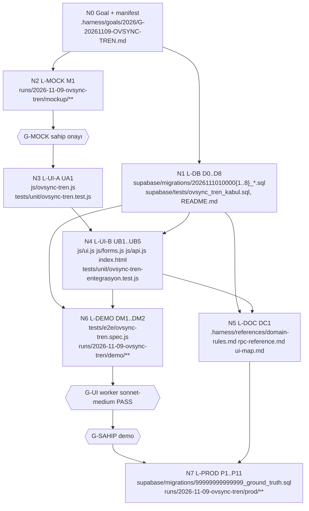

# Ovsync Treni — Uygulama Planı

> **Ajan yürütücüler için:** Görevleri sırayla ve görev görev uygula (superpowers:subagent-driven-development
> ya da executing-plans). Adımlar `- [ ]` işaretlidir. Her görev kendi kırmızı→yeşil test döngüsünü taşır.

**Amaç:** Ovsync başlangıçlarını haftalık sabit bir **tren gününde** toplamak; aşama kuralları (K4–K6), toptan
erteleme (K7), elle başlatma sorusu (K8), hastalık → bağımsız (K9), Ovsync ekranı sahipliği (K10) ve geç
tamamlama (K11) dahil. Faz 0: doğum sonrası PG görevleri → hatırlatma.

**Mimari:** Tüm iş kuralı PostgreSQL'de. Tek hesap noktası `_ovsync_tren_gunu`. Davranış `protokol_ayar.ovsync_tren_aktif`
bayrağı arkasında; bayrak 0 iken eski davranış birebir (regresyon eşitliği). Tren üyeliği `cases.ovsync_tren`
kolonunda (Ruling R3). İç Ovsync RPC'leri K10 kilidini işlem-yerel `app.ovsync_tren_ic` GUC'u ile aşar (R5).
UI yeni modül `js/ovsync-tren.js` (saf HTML/karar yardımcıları) + `ui.js`/`forms.js`/`api.js` çağrı kancaları.

**Teknoloji:** Supabase/PostgreSQL (plpgsql, SECURITY DEFINER), Vanilla JS, `node --test`, Playwright (demo).

**Spec (bağlayıcı):** `~/.herdr/worktrees/egesut-erp1/ovsync-tren/docs/plans/2026-11-09-ovsync-tren/design.md`
(K1–K11, Faz 0, §5–§9). Domain: `.harness/references/domain-rules.md` §5, §18 (18.19 dahil).
Keşif kanıtı (prod gövdeleri = taban): `~/.herdr/worktrees/egesut-erp1/tedavi-arge/runs/2026-11-09-ovsync-toplu-gun/`
(`tren-kesif-report.md`, `ovsync-hafta-report.md`, `kanit/fn/*.sql`).

**Review kademeleri:** **T0** = görev sahibi kendi `## Run` komutları + lead kontrolü · **T1** = `ss-reviewer`
(sonnet) bağımsız diff review · **T2** = `ss-reviewer-kapi` (opus high) kapı review'u (DB/RPC/kilit/göç).
Plan kapısı: T2, 6 boyut × 1-5, KABUL = ort ≥ 4.0 ve hiçbir boyut < 3.

**Model:** DB/RPC/migration ve UI görevleri **opus high** (`ss-worker-high`, sahip 2026-10-02 "UI/UX+DB opus");
mekanik görevler **sonnet medium** (`ss-worker`). Muse YOK (sahip 2026-11-07, tedavi-arge ve halefleri).

## Global Constraints

- Tarih hesabı yalnız TR: `(now() AT TIME ZONE 'Europe/Istanbul')::date`. Yeni/değişen gövdede `CURRENT_DATE` yok.
- Varsayılanlar (spec §5, birebir): `ovsync_tren_aktif`=0, `ovsync_tren_capa`=2026-11-12 (Per), `ovsync_tren_one_cekme_gun`=2,
  `ovsync_pg_erteleme_tolerans_gun`=1, `dogum_sonrasi_pg_gorev_aktif`=0.
- Toptan erteleme N ∈ 1..7; kısmi başarı YOK (tek transaction, tek hayvan düşerse hepsi geri + düşen liste).
- Bayrak açıkken ayar eksik/geçersiz → `OVSYNC_TREN_AYAR` hatası; eski davranışa sessiz düşüş YOK (spec §7).
- Kısır hayvan hiçbir tren yolundan Ovsync'e girmez (§18.5, `trg_cases_kisir_ovsync` aynen).
- Ovsync şablonu (D0/D7/D8/D9 18:00/D10), §18.6 PG+48 s TAI kuralı, Ovsync dışı erteleme DEĞİŞMEZ.
- Yeni tablo YOK. Tek DDL: `cases.ovsync_tren date NULL` (R3).
- Her yeni/yeniden yaratılan fonksiyon: `REVOKE ALL ON FUNCTION … FROM PUBLIC, anon;` dışa açık RPC'ye
  `GRANT EXECUTE … TO authenticated;` iç yardımcıya ayrıca `REVOKE … FROM authenticated` (Supabase varsayılan
  yetkisi anon'a EXECUTE verir — hafıza anon-execute-acigi). `CREATE OR REPLACE` ile değişen mevcut RPC'lerde de
  aynı satırlar dosya sonunda tekrarlanır.
- Gövdesi değişen her mevcut fonksiyon prod gövdesinden (kanit/fn) türetilir ve migration başında `md5(prosrc)`
  koruması taşır (`20261031200007` kalıbı): fark varsa `<FN>_GOVDE_FARKLI` RAISE, seri geri sarılır.
- İmza değişikliği = `DROP FUNCTION <eski imza>; CREATE FUNCTION …` aynı dosyada (default'lu ek parametre
  `CREATE OR REPLACE` ile yeni overload doğurur → belirsiz çağrı).
- UI renk: vurgu yalnız yazı renginde; satır zemini/şerit YOK. Çevrimdışıyken tren erteleme/baştan başlat/ayar
  butonları gizli; K8 yolları online şartlı ("İnternet yok" toast'ı, kuyruğa yazılmaz).
- Migration'lar append-only, dosya adları `20261110100001..008` (R2). Her biri `scripts/db-validate.sh` PASS
  (seri `--priors`). Prod uygulama ayrı sahip kapısı.
- JS değişikliğinde `index.html` `?v=` damgası güncellenir; `js/ui.js|api.js|forms.js` düzenlemesinden önce
  atlas `etki` (code-change-precheck).

## Review Focus

1. **Tren gününde kısmi iş sonrası toptan erteleme** (ör. 4 hayvandan 2'sine GnRH1 verildi, sonra +N): yapılanlar
   aşama 1'e geçer; birikimli kayma + N ≤ tolerans → kayar (etiket += N), aksi → baştan başlar. Önizleme bunu hayvan başına
   açıkça göstermeli; ertesi haftanın toptan ertelemesi 4 hayvanın hepsini görmeli. Test: D7 `TR-K7-KISMI`, `TR-K7-HAFTA2`, `TR-K7-TOL`.
2. **Gece 00:00–03:00 TR**: "bugün" ve tren günü TR ile hesaplanmalı; UTC bir gün geride. Test: D2 `TR-TZ-1`
   (`_ovsync_tren_gunu_ic` bugün parametresiyle), D4 `TR-TZ-2` (`_vaka_ac_tek`), U-A `bugunIso` parametreli saf testler.
3. **Bayrak açık + ayar bozuk** (çapa satırı silinmiş ya da `protokol_ayar_guncelle` ile 20261131 yazılmış):
   cron dahil her yol `OVSYNC_TREN_AYAR` ile düşer, sessiz başarı yok. Test: D2 `TR-AYAR-N1/N2`, D8 `TR-AYAR-CRON`.
4. **Anahtar biçimi değişikliğinin ilk cron'u**: eski `ACIK-DISI-<h>-<kural>` çakışması yüzünden takılı kalmış hayvanlara
   ertesi sabah görev doğar. Apply öncesi liste sahibe gider. Test: D3 `TR-ANAH-GOC`; runbook P1(c).
5. **Çevrimdışı Vaka Aç + Ovsync şablonu**: `create_case` offline POST kuyruğuna girer. Bayrak açıkken Ovsync
   şablonu/hastalığı seçiliyse kuyruğa yazılmamalı. Test: U-B2 `offline Ovsync Vaka Aç kuyruğa yazmaz`.

---

## Önceden cevaplanmış kararlar (worker bunlar için soru SORMAZ)

Spec "Kararlar" tablosu aynen geçerli:

| # | Karar |
|---|---|
| S1 | A yolu: haftalık sabit tren günü (C esnek havuz REDDEDİLDİ). |
| S2 | Öne çekme ≤ 2 gün, ayarlanabilir, varsayılan tren günü Perşembe (çapa 2026-11-12). |
| S3 | Toptan erteleme ritmi kalıcı kaydırır (çapa += N). |
| S4 | Aşama 1 PG toleransı 1 gün; fazlası baştan başlat + yeni tren. |
| S5 | Aşama 2'de erteleme YOK: (a) PG1+48 s tohumla ya da (b) baştan başlat. |
| S6 | Hastalık günü girilen hayvan bağımsız devam eder, tren kuralları ona dokunmaz. |
| S7 | Ovsync görevleri yalnız Ovsync ekranından düzenlenir; Görevler ekranı yalnız yapıldı/yapılmadı. |
| S8 | Doğum sonrası PG → d2/d25 hatırlatma; PG görev kodu silinmez, bayrak arkasında arşivlenir. |
| S9 | Düveler 13 ay beklemez (kural günü 12 ay 21 gün aynen). Kod değişikliği yok. |
| S10 | Çevrimdışı K8 yolları online şartlı; toptan erteleme ya-hep-ya-hiç. |
| S11 | §18.4 aynen: elle Vaka Aç'ta yaş/kural kapısı yok; K8 sorusu kapı değildir. |

## Ruling'ler (plan kararları, gerekçeli)

| # | Ruling | Gerekçe |
|---|---|---|
| R1 | Çapa `protokol_ayar.ovsync_tren_capa` içinde **YYYYMMDD sayı** (20261112), `birim='YYYYMMDD'`, min 20260101 max 20991231. Okuma `_ovsync_tren_ayar()`: `d <> trunc(d)` ise ya da `to_char(to_date(d::bigint::text,'YYYYMMDD'),'YYYYMMDD') <> d::bigint::text` ise `OVSYNC_TREN_AYAR`; `to_date` çağrısı `BEGIN … EXCEPTION WHEN others` içinde (PG ≥10 `20261131`'de 22008 atar) → yakalanan hata da `OVSYNC_TREN_AYAR` (ham hata dışarı çıkmaz). | numeric tablo; okunabilir; tek doğrulama noktası. Ritim çapa+7k olduğundan geçmiş çapa geçerlidir. |
| R2 | Migration adları `20261110100001`…`20261110100008` (son repo migration `20261031200007`; açık dallarda en büyük `20261106000001`, çakışma yok — MEASURED `ls supabase/migrations` tüm worktree'ler). | append-only, benzersiz. |
| R3 | Tren üyeliği `cases.ovsync_tren date NULL` (NULL = bağımsız/eski). Değer = vakanın D0 günü, yalnız bayrak açık ve D0 bir tren günüyse yazılır (`tedavi_sablon_uygula`). **Etiket = ritim sınıfı:** vakanın günleri hangi yoldan olursa olsun (toptan ya da tek hayvan, aşama 0 ya da 1) k gün kaydırılınca aynı işlemde `ovsync_tren += k`; böylece `ovsync_tren + 7` her zaman PG1'in, `ovsync_tren` GnRH1'in planlı günüdür. Baştan başlatılan vakanın etiketi değişmez (vaka kapanır). Hastalık günü (K9) NULL yapar. | Spec "yeni tablo yok" der, kolonu yasaklamaz. `start_date` V3'te D0'dan farklı olabilir ve toptan erteleme ritmi kaydırdığı için ritimden türetme bozulur. |
| R4 | **Tren günü = bugün ise K8 sorusu tek seçenektir** ("🚆 Bugün tren günü — başlat"); modal açılmaz, doğrudan trene binilir. Bağımsız seçeneği yalnız tren günü ≠ bugün iken çıkar. Üyelik sunucuda yalnız D0 tarihinden belirlenir; bağımsız parametresi yalnız `start_first_service_protocol`/`ovsync_bastan_baslat`'ta (başlangıcı bugüne çeker). | Spec §3 "tren = start_date"; aynı gün başlayan hayvan tanım gereği o trendedir. `vaka_toplu_ac` (522 satır) ve `tedavi_sablon_uygula` imzası değişmez. |
| R5 | K10 kilidi: bayrak açık ve `current_setting('app.ovsync_tren_ic', true) <> '1'` iken `gorev_ertele` ve `tohumlama_gorev_ertele` yalnız **Ovsync görevi** için, `vaka_kalan_gunleri_kaydir` yalnız `protocol_family='OVSYNC'` aktif vaka için `OVSYNC_TREN_EKRANI:{…}` RAISE eder. **Ovsync görevi (SQL ve JS tek tanım, spec K10):** (a) `gorev_tipi='OVSYNC_BASLAT'`; (b) `gorev_tipi='TOHUMLAMA_PLANLI'` ve hayvanın aktif (`status='active'`, `protocol_family='OVSYNC'`) vakası var (şablon TAI'si ya da `PG_TOHUMLAMA:*` farketmez); (c) `gorev_tipi IN ('TEDAVI_GUN','TEDAVI_SEANS')` ve `aciklama::jsonb->>'day_id'` aktif OVSYNC vakanın günü. Aynı hayvanın `ILAC`, `ASI`, `DIGER`, Ovsync dışı vakanın `TEDAVI_*` vb. görevleri kilit dışıdır. Ovsync ekranı RPC'leri ve `ovsync_hastalik_gunu_ekle` başta `set_config('app.ovsync_tren_ic','1',true)` çağırır. `protokol_iptal` kilitlenmez (spec §5 listesinde yok). | İç zincirler (`vaka_kalan_gunleri_kaydir`→`tohumlama_gorev_ertele`, hastalık günü → TAI ötele) kırılmaz; `app.*` GUC precedent'i `app.geri_alma_aktif`. |
| R6 | Aşama türetimi `_ovsync_asama(case)`: vakanın hastalık-dışı (`disease_id IS NULL`) günleri `(treatment_date, day_no)` sırasıyla; gün#1 = GnRH1, gün#2 = PG1. Bir gün "yapıldı" = `tamamlandi` ve tüm seansları `uygulama_tamamlandi_at IS NOT NULL`; "yapılmadı" = `tamamlandi=false` ve hiç seansı tamamlanmamış; başka her durum (uygulanmadı işaretli, gün sayısı ≠ 4, sıra tutarsız) → NULL (belirsiz). 0/1/2 spec §5 tanımı. | Kolonsuz; spec §7 "belirsiz → reddet, baştan başlat öner". |
| R7 | Toptan erteleme kümesi (X tarihi): (i) açık `OVSYNC_BASLAT` hedefi X; (ii) aktif OVSYNC vaka `ovsync_tren = X`; (iii) aktif OVSYNC vaka `ovsync_tren = X−7`. Her üye aşamasına göre: 0 → +N (görev hedefi / `vaka_kalan_gunleri_kaydir`, `ovsync_tren` += N); 1 → `_ovsync_pg1_kayma(case) + N ≤ tolerans` (R18, birikimli) ise kayar ve `ovsync_tren` += N, aksi baştan başlat (yeni tren X+N); 2 → `p_secimler` zorunlu (`PG48`/`BASTAN`). Bağımsızlar dokunulmaz. R3 etiket kuralı sayesinde kayan aşama 1 hayvanı (ii)/(iii) sınıfına yeni ritimle birlikte taşınır; tek hayvan kaydırmasıyla ritimden çıkmış vaka (etiket ≢ çapa mod 7) toptan kümesine girmez, Ovsync ekranında "ritim dışı" etiketli kendi başlığında görünür ve kendi satırından düzenlenir. Toptan erteleme yalnız ritim gününde çağrılır. Hedefi X'ten büyük diğer açık `OVSYNC_BASLAT`'lar yeni çapaya yeniden hedeflenir (R9 formülü). | "O tarihteki işler" = X'te GnRH1 (D0 treni) ve PG1 (D7 treni); X'in aşama 2'si D7 treninden gelir. |
| R8 | Görev doğumu: bayrak açıkken `_ovsync_baslat_gorev_kur` hedefi `_ovsync_tren_gunu(kural)`; satır `tren−2 ≤ bugün` olunca doğar. Kullanıcının açık iradesiyle çağrılan yollar (G7 Boş sonrası, G9 yeniden başlat, `ovsync_bastan_baslat`) yeni `p_hemen => true` ile doğum kapısını atlar (hedef yine tren günü). | §18.2 değişikliği (spec §5); G7/G9'da kapı görevi sessizce düşürürdü. |
| R9 | Yeniden hedefleme formülü (göç, ayar değişikliği, K7 ileri görevler): `yeni = _ovsync_tren_gunu_ic(GREATEST(kural, eski_hedef), capa, one_cekme, bugun)`. Kural çözülemezse görev dokunulmaz, listede `kural_yok`. Yazma `gorev_ertele` üzerinden (iç bayrakla) → `GOREV_ERTELE` soyu korunur. | Elle ileri ertelenmiş görevi (ör. 156 → 11-23) öne çekip kullanıcı kararını ezmez; ≤2 gün öne çekme yine geçerli. |
| R10 | `ACIK-DISI` anahtarı: `'ACIK-DISI-' || hayvan || '-' || kural || '-' || COALESCE(<son tohumlama id>::text,'0')` (son = `tarih DESC, created_at DESC`). Bayraktan bağımsız (hata düzeltmesi). G7'de `_acik_disi_gorev_kur` NULL dönerse: açık `OVSYNC_BASLAT` varsa onun id'si kullanılır, yoksa `OVSYNC_GOREV_ACILAMADI:{hayvan_id,sebep}` RAISE (Boş ataması dahil geri sarılır). | Spec §5 yan düzeltme; fail-closed. |
| R11 | Yeni RPC adları: `ovsync_tren_onizle(p_hayvan_id text DEFAULT NULL)` (K8 modal verisi), `ovsync_tren_listele()`, `ovsync_tren_ertele_onizle(p_tarih date, p_n int)`, `ovsync_tren_ertele(p_tarih date, p_n int, p_secimler jsonb DEFAULT '{}')`, `ovsync_hayvan_ertele(p_hayvan_id text, p_gun int)` (tek hayvan, Ovsync ekranı), `ovsync_pg48_tohumla(p_case_id uuid)`, `ovsync_bastan_baslat(p_case_id uuid, p_bagimsiz boolean DEFAULT false, p_not text DEFAULT NULL)`, `ovsync_tren_yeniden_hedefle(p_kuru boolean DEFAULT true, p_capa date DEFAULT NULL)`, `ovsync_tren_ayar_guncelle(p_aktif boolean, p_capa date)`, `dogum_sonrasi_pg_hatirlatma()`. | Spec §5 adları plan kararına bıraktı; mevcut `ovsync_*` önekine uyum. |
| R12 | K6(a) `ovsync_pg48_tohumla`: hayvanın açık `PG_TOHUMLAMA:*` TAI'si zorunlu (yoksa `OVSYNC_PG48_TAI_YOK`), hedef anı < now() ise `OVSYNC_PG48_GECMIS`; kalan açık Ovsync seansları `seans_tamamla(p_uygulanmadi => true)` ile kapanır (stok iadesi mevcut yoldan). | Mevcut iptal semantiğini yeniden kullanır; §18.6 "son PG kazanır" bozulmaz. |
| R13 | K11: bayrak açık + OVSYNC vaka seansında `_pg_olay_isle` olay anı `now()`. PG1 seansı (R6 gün#2) tamamlandığında `gecikme_gun = tamamlanma_günü_TR − (GnRH1_günü + 7)` (R18 ile aynı çapa) `> tolerans` ise dönüşe `ovsync_uyari:{kod:'PG1_TOLERANS_ASILDI', gecikme_gun, oneri:'BASTAN_BASLAT', case_id}` eklenir; işlem yine başarılıdır. | Spec K11 "karar kullanıcının". |
| R14 | Tren ayarı değişince (aktif=1 ya da yeni çapa) aynı transaction'da `ovsync_tren_yeniden_hedefle(false)` koşar; ayrıca `ovsync_tren` boş, hastalık günsüz, D0'ı yeni ritimde olan aktif OVSYNC vakalarına üyelik yazılır. Tüm yazma RPC'leri `pg_advisory_xact_lock(hashtext('ovsync_tren'))` ile seri. | K1 "ayarla değişir"; çift toptan erteleme yarışı. |
| R15 | Hatırlatma (Faz 0): bayrak 0 iken Aktif dişide `bugün_TR − son doğum ∈ {2, 25}` günü 🔔 panelde satır; rozet sayısına dahil; kapatma aksiyonu yok. | Spec §4 "2. ve 25. gün bildirim". |
| R16 | Tren listesi `bugün+28` gününe kadarki trenleri gösterir; ötesindeki açık `OVSYNC_BASLAT` sayısı `ileri_sayisi` olarak döner. | Göç kalıntısı 2027 görevleri onlarca boş-benzeri başlık üretmesin (K3). |
| R17 | Mockup: statik HTML (gerçek `index.html` CSS'i) → Playwright PNG; tüm ekranlar tek sahip onay kapısında. Figma/Stitch yok. | tedavi-arge Anthropic-only; tek kapı sahip zamanını korur. |
| R18 | **K5 toleransı birikimli (TOPLAM kayma):** `_ovsync_pg1_kayma(p_case_id uuid) RETURNS integer` = PG1 gününün (R6 gün#2) şimdiki `treatment_date` − (GnRH1 gününün gerçek tamamlanma günü TR + 7). GnRH1 yapılmamışsa NULL (aşama 0). Aşama 1'de her erteleme yolu (tek hayvan, toptan) `kayma + istenen ≤ tolerans` şartını arar; aşılırsa tek hayvanda `OVSYNC_ASAMA1_TOLERANS`, toptanda `BASTAN`. GnRH1 geç yapıldıysa (PG1 planı GnRH1+7'den önce kalmışsa) kayma negatiftir ve o kadar pay doğar. | Spec K5 "PG1 en fazla 1 gün ertelenir" ve §18.19 "aşama 1 PG ≤1 gün" çağrı başına değil hayvan başına sınırdır; çapa biyolojik olay (GnRH1) olmalı. |
| R19 | Hızlı geri (bayrak kapatma) ile **geri dönmeyen** değişiklikler bilinçli kabul: R10 anahtar biçimi + G7 fail-closed, `_vaka_ac_tek` TR tarihi, K10 dışındaki imza değişiklikleri (`p_hemen`, `p_bagimsiz` default'lu; eski çağrılar aynı sonucu verir). Bunlar hata düzeltmesi; geri dönüşleri yalnız tam geri (P11) ile. | Bayrak yalnız tren davranışını yönetir; düzeltmeleri bayrağa bağlamak hatayı geri getirirdi. |
| R20 | Mockup README ve G-MOCK sunumunda R4 ("tren günü = bugün → modal yok") **spec §6 sapması** olarak açıkça etiketlenir; sahip reddederse UB2'de iki düğmeli modal tren=bugün'de de açılır (sunucu tarafı değişmez). | Spec izlenebilirliği; sapma sahip gözünden geçer. |

**Açık sahip sorusu: yok.** R3/R4/R7/R10 spec'i değiştirmez, yorumlar; kapı review'unda itiraz olursa root'a ruling sorusu olarak döner.

---

## Dosya haritası ve DAG

| Düğüm | Sahip | Dosyalar (yalnız bu düğüm yazar) |
|---|---|---|
| N0 Goal | root | `.harness/goals/2026/G-20261109-OVSYNC-TREN.md` |
| N1 L-DB (D0–D8, sıralı) | opus high | `supabase/migrations/20261110100001_dogum_pg_hatirlatma.sql` … `20261110100008_ovsync_tren_ayar_goc.sql`, `supabase/tests/ovsync_tren_kabul.sql`, `supabase/tests/README.md`, `runs/2026-11-09-ovsync-tren/db/**` |
| N2 L-MOCK (M1) | opus high | `runs/2026-11-09-ovsync-tren/mockup/**` |
| G-MOCK | sahip (root iletir) | — |
| N3 L-UI-A (UA1) | opus high | `js/ovsync-tren.js` (yeni), `tests/unit/ovsync-tren.test.js` (yeni) |
| N4 L-UI-B (UB1–UB5, sıralı) | opus high | `js/ui.js`, `js/forms.js`, `js/api.js`, `index.html`, `tests/unit/ovsync-tren-entegrasyon.test.js` (yeni) |
| N5 L-DOC (DC1) | sonnet medium | `.harness/references/domain-rules.md`, `.harness/references/rpc-reference.md`, `.harness/references/ui-map.md` |
| N6 L-DEMO (DM1–DM2) | opus high + sonnet medium (yürüyüş) | `tests/e2e/ovsync-tren.spec.js` (yeni), `runs/2026-11-09-ovsync-tren/demo/**` |
| G-UI / G-SAHIP | worker sonnet-medium / sahip | — |
| N7 L-PROD (P1–P11) | root + opus high | `supabase/migrations/99999999999999_ground_truth.sql`, `runs/2026-11-09-ovsync-tren/prod/**` |



N1 ile N2 paralel koşar. N3 yalnız G-MOCK'a bağlıdır (RPC sözleşmesi bu plandadır, sahte `rpc` ile test eder).
N4, N1'in bitmiş arayüzüne (D8 sonrası) ve N3'e bağlıdır.

---

## N0 — Goal ve manifest (root)

- **Model/Effort:** root opus high · **Boyut:** S · **Review:** T0
- **Yazılabilir:** `.harness/goals/2026/G-20261109-OVSYNC-TREN.md`
- [ ] Full mode goal kaydı (`.harness/task-modes.md`): manifest = bu plandaki tüm düğüm dosyaları; demo DB yazma izni
  (sahipten, goal'e yazılır); prod yazma ayrı kapı (N7). Dal `ovsync-tren`, worktree
  `~/.herdr/worktrees/egesut-erp1/ovsync-tren`, taban SHA = bu planın commit'i.
- **Kabul:** goal dosyası `git add -f` + commit; manifest bu tablodaki yolları birebir içerir.

---

## N1 — L-DB (opus high, sıralı; her görev T2)

Ortak kabul koşumu (her D görevinin `## Run`'ı bunu kullanır; `$S` = o göreve kadarki seri dosyaları sırayla):

```bash
cd ~/.herdr/worktrees/egesut-erp1/ovsync-tren
EGESUT_REPO=$PWD bash scripts/kabul-db/build.sh          # egesut_ovsync_kabul: prod şeması verisiz + katalog (görev başına bir kez)
( echo 'BEGIN;'; cat $S supabase/tests/ovsync_tren_kabul.sql; echo 'ROLLBACK;' ) \
  | psql -h 127.0.0.1 -U lsp_user -d egesut_ovsync_kabul -X -v ON_ERROR_STOP=1 2>&1 | tail -3
# Beklenen son satır: NOTICE:  OZET: <n> PASS   (ilk FAIL koşumu durdurur: "FAIL <id>: beklenen … gerçek …")
bash scripts/db-validate.sh supabase/migrations/<bu görevin dosyası> --priors <önceki seri dosyaları>
# Beklenen: exit 0, reports/db-validation-<sha8>.md "PASS"
grep -n "CURRENT_DATE" supabase/migrations/2026111010000*.sql   # Beklenen: çıktı yok
```

Kabul betiği sözleşmesi `supabase/tests/ovsync_pg_kabul.sql` ile aynı: `pg_temp.kb_*` yardımcıları
(`kb_bugun()` TR, `kb_ok(kosul,test,beklenen,gercek)`, `kb_hayvan(...)`, `kb_yerel(gun,saat)`), migration
uygulamaz, BEGIN/ROLLBACK taşımaz, her test bir `DO $t$…$t$` bloğu. **Senaryo izolasyonu (zorunlu, D1'de kurulur):**
- Her senaryo `SAVEPOINT kb_s;` → `DO $t$…$t$;` → `ROLLBACK TO SAVEPOINT kb_s;` üçlüsüyle yazılır. Fixture'lar, `protokol_ayar`
  değişiklikleri ve `set_config(…, true)` GUC'ları (`app.ovsync_tren_ic` dahil) savepoint geri sarımıyla sıfırlanır; bir sonraki
  senaryo temiz başlar. Yardımcılar ve sayaç ilk savepoint'ten ÖNCE yaratılır.
- PASS sayacı geri sarımdan etkilenmesin diye `CREATE TEMP SEQUENCE kb_gecti_seq` (sequence transaction dışıdır); `kb_ok`
  başarıda `nextval`, sonda `OZET: <currval> PASS`. FAIL `RAISE EXCEPTION` ile koşumu durdurur (ON_ERROR_STOP).
- Kilidi sınayan her senaryo ilk satırda `PERFORM set_config('app.ovsync_tren_ic','',true)` çağırır (savunma).
- Toplam/sayı assert'leri (`uye_sayisi`, `ileri_sayisi`, tren üye listeleri, K3) sorguyu senaryonun kendi `KB-` hayvan kümesine
  süzer ve çapayı senaryoya özgü kurar (`kb_tren_ac(kb_bugun() + <senaryo ofseti>)`); kabul DB'si verisizdir ama seri
  kendi seed'ini taşıyabilir.
- `TR-IZOL-1` (D1): bir senaryoda `protokol_ayar` + GUC değiştirilir, sonraki senaryo ikisini de varsayılan görür. Bölüm başında bayrak/çapa
`UPDATE protokol_ayar` ile kurulur; çapa testlerde **`kb_bugun()`'e göre** kurulur (deterministik).
Ek yardımcılar (D2'de yazılır): `pg_temp.kb_tren_ac(p_capa date)` (aktif=1 + çapa), `pg_temp.kb_tren_kapat()`,
`pg_temp.kb_ovsync_vaka(p_hayvan text, p_d0 date) RETURNS uuid` (create_case + OVSYNC şablon `p_baslangic_tarihi`),
`pg_temp.kb_seans_yap(p_case uuid, p_gun_sira int)` (gün#k'nın seanslarını `seans_tamamla`).

Gövde değişikliği kuralı: her mevcut fonksiyon `kanit/fn/<ad>.sql` gövdesinden kopyalanır, yalnız belirtilen
satırlar değişir; dosya başında md5 koruması (D0 tablosundaki değer).

### D0 — Gövde tabanı ve regresyon tabanı ölçümü

- **Model/Effort:** opus high · **Boyut:** S · **Review:** T0 · **Bağımlılık:** N0
- **Yazılabilir:** `runs/2026-11-09-ovsync-tren/db/govde-taban.md`
- [ ] Prod ve demo için salt-okuma `SELECT p.oid::regprocedure, md5(p.prosrc) FROM pg_proc p WHERE p.proname = ANY(…)`
  (16 fonksiyon: `dogum_kaydet, _ovsync_baslat_gorev_kur, _acik_disi_gorev_kur, _acik_disi_hedef_ic, ovsync_baslat_uyarilari,
  protokol_iptal, tohumlama_bos_ve_devam, start_first_service_protocol, tedavi_sablon_uygula, _vaka_ac_tek, gorev_ertele,
  tohumlama_gorev_ertele, vaka_kalan_gunleri_kaydir, vaka_kalan_gunleri_kaydir_coklu, ovsync_hastalik_gunu_ekle, seans_tamamla`).
  Prod okuması Management API `read_only:true` (2026-11-09 keşif izni kapsamı; yoksa root'tan SORU).
- [ ] Her fonksiyon için prod md5 = demo md5 mi; `kanit/fn` gövdesi güncel mi (fark → o gövde yeniden çekilir).
- [ ] Regresyon tabanı: `supabase/tests/ovsync_pg_kabul.sql`'i serisiz koş (README komutu, migration listesi boş) →
  sonucu (OZET n PASS ya da ilk FAIL id) kaydet. D8 sonunda aynı koşum seriyle aynı sonucu vermeli.
- **Kabul:** tablo 16 satır, prod/demo eşit (fark varsa satırda "DRIFT" + root'a bulgu); regresyon taban satırı.

### D1 — Faz 0: doğum sonrası PG → hatırlatma (`20261110100001_dogum_pg_hatirlatma.sql`)

- **Model/Effort:** opus high · **Boyut:** S (~120 satır SQL) · **Review:** T2 · **Bağımlılık:** D0
- **Yazılabilir:** migration dosyası, `supabase/tests/ovsync_tren_kabul.sql` (ilk sürüm: yardımcılar + F0 bölümü), `supabase/tests/README.md`
- **Interfaces — Produces:** ayar `dogum_sonrasi_pg_gorev_aktif` (0, min 0, max 1);
  `public.dogum_sonrasi_pg_hatirlatma() RETURNS jsonb` STABLE SECDEF → `{ok, aktif:boolean, satirlar:[{hayvan_id, kupe_no, dogum_tarihi, gun:2|25}]}`
  (`aktif` = bayrak 0 iken true). GRANT authenticated.
- [ ] **Test yaz** (`TR-F0-*`): `TR-F0-1` bayrak 0 → `dogum_kaydet` sonrası annede `aciklama IN ('2. Gün PG','25. Gün PG','39. Gün PG (Presynch-14 senkron)')` açık görev sayısı 0, diğer anne görevleri (Oksitosin/Ademin/Kalsiyum/E Vitamini) var;
  `TR-F0-2` bayrak 1 → üç PG görevi açılır (arşiv kodu canlı); `TR-F0-3` doğum `kb_bugun()-2` ve `-25` olan iki hayvan
  hatırlatmada `gun` 2 ve 25 ile görünür, `-3` olan görünmez; `TR-F0-4` bayrak 1 → `satirlar` boş;
  `TR-IZOL-1` (senaryo izolasyonu, bkz. sözleşme); `TR-F0-ACL` `has_function_privilege('anon','public.dogum_sonrasi_pg_hatirlatma()','EXECUTE') = false`.
- [ ] Koş → `FAIL TR-F0-1` beklenir.
- [ ] Uygula: `dogum_kaydet` gövdesinde 3 PG satırı ayrı `INSERT`'e alınır, `IF public._ayar('dogum_sonrasi_pg_gorev_aktif', 0) = 1`
  koşuluna bağlanır (kod silinmez, yorum: "arşiv — sahip 2026-11-09"); ayar seed `ON CONFLICT (anahtar) DO NOTHING`; hatırlatma RPC.
- [ ] Koş → `OZET … PASS`; `db-validate` PASS.
- [ ] Commit: `git add supabase/migrations/20261110100001_dogum_pg_hatirlatma.sql supabase/tests/ovsync_tren_kabul.sql supabase/tests/README.md`.

### D2 — Tren çekirdeği (`20261110100002_ovsync_tren_cekirdek.sql`)

- **Model/Effort:** opus high · **Boyut:** M (~220 satır) · **Review:** T2 · **Bağımlılık:** D1
- **Yazılabilir:** migration, kabul betiği (TR-K1/K2/AYAR/ASAMA/ACL bölümü)
- **Interfaces — Produces:**
  - Seed: `ovsync_tren_aktif` 0 (0..1), `ovsync_tren_capa` 20261112 (R1), `ovsync_tren_one_cekme_gun` 2 (0..2), `ovsync_pg_erteleme_tolerans_gun` 1 (0..2).
  - `ALTER TABLE public.cases ADD COLUMN IF NOT EXISTS ovsync_tren date;` + COMMENT (R3).
  - `_ovsync_tren_aktif() RETURNS boolean` STABLE — `_ovsync_pg_aktif()` ve ayar = 1.
  - `_ovsync_tren_ayar() RETURNS jsonb` STABLE — `{capa date, one_cekme int, tolerans int}`; eksik/geçersiz → `OVSYNC_TREN_AYAR:{anahtar, deger, sebep}`.
  - `_ovsync_tren_gunu_ic(p_kural date, p_capa date, p_one_cekme int, p_bugun date) RETURNS date` IMMUTABLE —
    `alt := GREATEST(p_kural - p_one_cekme, p_bugun)`; dönüş `alt + (((p_capa - alt) % 7) + 7) % 7`; NULL girdi → NULL.
  - `_ovsync_tren_gunu(p_kural date) RETURNS date` STABLE — kapalı: `GREATEST(p_kural, bugün_TR)`; açık: `_ic(p_kural, ayar.capa, ayar.one_cekme, bugün_TR)`.
  - `_ovsync_tren_gunu_mu(p_tarih date) RETURNS boolean` STABLE — açık ve `((p_tarih - capa) % 7 + 7) % 7 = 0`.
  - `_ovsync_asama(p_case_id uuid) RETURNS smallint` STABLE (R6; aktif OVSYNC vaka değilse NULL).
  - `_ovsync_pg1_kayma(p_case_id uuid) RETURNS integer` STABLE (R18; GnRH1 yapılmamışsa NULL).
  - `_ovsync_ic_ac() RETURNS void` (`set_config('app.ovsync_tren_ic','1',true)`), `_ovsync_ic_mi() RETURNS boolean`.
  - `_ovsync_gorev_mu(p_gorev_id uuid) RETURNS boolean` STABLE — R5 "Ovsync görevi" tanımı (a)/(b)/(c), bayraktan bağımsız.
  - `_ovsync_kilit_gorev(p_gorev_id uuid) RETURNS void` = `_ovsync_tren_aktif() AND NOT _ovsync_ic_mi() AND _ovsync_gorev_mu(p_gorev_id)` ise RAISE;
    `_ovsync_kilit_vaka(p_case_id uuid) RETURNS void` = aktif, iç değil ve vaka `protocol_family='OVSYNC'`, `status='active'` ise RAISE —
    `OVSYNC_TREN_EKRANI:{gorev_id|case_id, hayvan_id, tren_gunu}`.
  - Hepsi iç yardımcı: `REVOKE ALL … FROM PUBLIC, anon, authenticated`.
- [ ] **Test yaz:** `TR-K1-1` çapa 2026-11-12: `_ic('2026-11-14','2026-11-12',2,'2026-11-09') = '2026-11-12'`; `_ic('2026-11-15',…) = '2026-11-19'`;
  `_ic('2026-11-19',…) = '2026-11-19'`; `_ic('2026-11-01',…,'2026-11-13') = '2026-11-19'`; `TR-K2-N1` `_ic('2026-11-15',…)` ≠ `'2026-11-12'` (3 gün öne çekme yok);
  `TR-K1-2` sonuç her zaman çapadan 7'nin katı uzakta (10 rastgele kural, `generate_series`); `TR-TZ-1` `_ic(k,c,2,b)` yalnız `p_bugun`'a bağlı (aynı girdi iki `p_bugun` → farklı/eşit beklenen);
  `TR-REG-1` bayrak 0 → `_ovsync_tren_gunu(kb_bugun()+5) = kb_bugun()+5`, `(kb_bugun()-3) → kb_bugun()`;
  `TR-AYAR-N1` bayrak 1 + çapa satırı silinmiş → `_ovsync_tren_gunu(...)` `OVSYNC_TREN_AYAR` ile düşer; `TR-AYAR-N2` çapa 20261131 → aynı (ham 22008 değil); `TR-AYAR-N4` çapa 20261112.5 → `OVSYNC_TREN_AYAR`;
  `TR-KAYMA-1` GnRH1 planlı günde yapılmış → `_ovsync_pg1_kayma` 0; GnRH1 1 gün geç yapılmış → −1; aşama 0 → NULL; `TR-ASAMA-0/1/2/N` dört fixture (`kb_ovsync_vaka` + `kb_seans_yap`): hiç → 0, gün#1 → 1, gün#1+#2 → 2, gün#1 seansı `p_uygulanmadi=>true` → NULL;
  `TR-K10-GUC` `_ovsync_ic_mi()` false → `_ovsync_ic_ac()` → true (kendi savepoint'inde; sonraki senaryoda yine false — `TR-IZOL-1` ile birlikte);
  `TR-ACL-1` yeni iç yardımcıların hiçbiri anon/authenticated tarafından çalıştırılamaz (`has_function_privilege` döngüsü).
- [ ] Koş → FAIL (fonksiyon yok). Uygula. Koş → PASS; `db-validate --priors 001` PASS.
- [ ] Commit (2 dosya, dosya dosya).

### D3 — Görev doğumu, anahtar, G7/G9 (`20261110100003_ovsync_tren_gorev_dogumu.sql`)

- **Model/Effort:** opus high · **Boyut:** L (~520 satır; `tohumlama_bos_ve_devam` 487 satır kopyalanır) · **Review:** T2 · **Bağımlılık:** D2
- **Yazılabilir:** migration, kabul betiği (TR-DOGUM/ANAH/G7/G9/UYARI)
- **Interfaces — Consumes:** D2 yardımcıları. **Produces:**
  - `DROP FUNCTION public._ovsync_baslat_gorev_kur(text, date, text, date);`
    `CREATE FUNCTION public._ovsync_baslat_gorev_kur(p_hayvan_id text, p_baslangic date, p_kaynak_ref text, p_kural_tarihi date, p_hemen boolean DEFAULT false) RETURNS uuid` —
    kapalı: eski gövde birebir (`p_hemen` yok sayılır). Açık: `v_tren := _ovsync_tren_gunu(p_kural_tarihi)`; `IF NOT p_hemen AND v_tren - 2 > bugün THEN RETURN NULL`; hedef `v_tren`; `islem_log` payload'a `tren_gunu`.
  - `DROP FUNCTION public._acik_disi_gorev_kur(text);` `CREATE FUNCTION public._acik_disi_gorev_kur(p_hayvan_id text, p_hemen boolean DEFAULT false) RETURNS uuid` — anahtar R10.
  - `_acik_disi_hedef_ic` son satırı `RETURN public._ovsync_tren_gunu(v_k);` (imza aynı).
  - `ovsync_baslat_uyarilari()` (imza aynı): görevsiz kol açıkken `_ovsync_tren_gunu(kural) - 2 BETWEEN bugün AND bugün+2`, `hedef_tarih` = tren, `tai_tarihi` = tren+10; her satıra `tren_gunu`, `kural_tarihi` alanı. Kapalı: eski sonuç birebir (+ iki yeni alan).
  - `protokol_iptal` (imza aynı): çekirdeğe `p_hemen => true`.
  - `tohumlama_bos_ve_devam` (imza aynı): OVSYNC dalı `_acik_disi_gorev_kur(v_hayvan_id, p_hemen => true)`; NULL → R10.
- [ ] **Test yaz:** `TR-DOGUM-1` açık, çapa `kb_bugun()+2`, düve kural `kb_bugun()+3` → `_acik_disi_gorev_kur` görev açar, hedef `kb_bugun()+2` (öne çekme);
  `TR-DOGUM-N1` çapa `kb_bugun()+4`, kural `kb_bugun()+5` → NULL (tren−2 > bugün); `TR-REG-DOGUM` bayrak 0 aynı fixture → NULL, kural geçmiş fixture → hedef = `GREATEST(kural,bugün)`;
  `TR-ANAH-1` hayvanda eski biçim `ACIK-DISI-<h>-<k>` instance (durum tamamlandi) + Boş tohumlama → `tohumlama_bos_ve_devam(secim=>'OVSYNC')` dönüşünde `ovsync_gorev_id` NOT NULL, kaynak yeni biçim;
  `TR-ANAH-N1` aynı ama açık "senkron" ILAC görevi var → `OVSYNC_GOREV_ACILAMADI` ve tohumlama sonucu değişmemiş (geri sarıldı);
  `TR-ANAH-GOC` eski anahtar çakışmasıyla takılı (eski instance var, açık görev yok, uygun) hayvanda `_acik_disi_gorev_kur` artık görev açar (bilinen göç etkisi, runbook P1(c) listesiyle eşleşir);
  `TR-G9-1` açık + kural geçmiş vaka `protokol_iptal(p_yeniden_baslat=>true)` → yeni görev hedefi `_ovsync_tren_gunu(kural)` (iptal günü değil, T4); `TR-G9-REG` bayrak 0 → hedef iptal günü (eski);
  `TR-UYARI-1` açık: görevsiz satır yalnız `tren−2 ∈ [bugün, bugün+2]` iken, `hedef_tarih` = tren; `TR-UYARI-REG` bayrak 0: görevsiz satır kural ∈ [bugün,bugün+2] (eski);
  `TR-K5-KISIR` kısır hayvan `_ovsync_baslat_gorev_kur(..., p_hemen=>true)` → NULL.
- [ ] Koş → FAIL. Uygula (md5 korumaları 6 fonksiyon). Koş → PASS; `db-validate --priors 001 002` PASS.
- [ ] **Etki (code-change-precheck):** `_ovsync_baslat_gorev_kur` ← `_ilk_tohumlama_rota_kur` (4 arg, değişmez), `_acik_disi_gorev_kur`, `protokol_iptal`;
  `_acik_disi_gorev_kur` ← `hayvan_ekle`, `ilk_tohumlama_zamanlayici`, `tohumlama_sonuc_bos`, `tohumlama_bos_ve_devam`, `tedavi_sablon_bos_ata_uygula` (1 arg çağrılar default ile çalışır);
  `_acik_disi_hedef_ic` ← `_acik_disi_ovsync_hedef`, `ilk_tohumlama_zamanlayici`; JS: `ovsync_baslat_uyarilari` ← `ui.js` rozet (2139), `ovsyncAcilisOzeti` (4461), panel (5560); `tohumlama_bos_ve_devam` ← `api.js:tohumlamaBosVeDevam` (1391).
- [ ] Commit.

### D4 — Başlatma yolları ve K8 sunucu tarafı (`20261110100004_ovsync_tren_baslatma.sql`)

- **Model/Effort:** opus high · **Boyut:** M (~450 satır; iki büyük gövde) · **Review:** T2 · **Bağımlılık:** D3
- **Yazılabilir:** migration, kabul betiği (TR-K8/TZ-2/UYE)
- **Interfaces — Produces:**
  - `DROP FUNCTION public.start_first_service_protocol(uuid, boolean);`
    `CREATE FUNCTION public.start_first_service_protocol(p_gorev_id uuid, p_takip_onay boolean DEFAULT false, p_bagimsiz boolean DEFAULT false) RETURNS jsonb` —
    açık ve `p_bagimsiz`: `OVSYNC_ERKEN` kapısı atlanır, `v_s := bugün_TR`. Diğer her durum eski gövde. Dönüşe `ovsync_tren` alanı.
    GRANT authenticated (cron `postgres` ile çağırır).
  - `tedavi_sablon_uygula` (imza aynı): OVSYNC ailesi şablonda son UPDATE'ten sonra
    `UPDATE cases SET ovsync_tren = CASE WHEN _ovsync_tren_aktif() AND _ovsync_tren_gunu_mu(v_bas) THEN v_bas END WHERE id = p_case_id`
    (`v_bas = COALESCE(p_baslangic_tarihi, v_case.start_date)`).
  - `_vaka_ac_tek`: `COALESCE(p_tarih, CURRENT_DATE)` → `COALESCE(p_tarih, (now() AT TIME ZONE 'Europe/Istanbul')::date)`.
  - `ovsync_tren_onizle(p_hayvan_id text DEFAULT NULL) RETURNS jsonb` STABLE SECDEF — kapalı `{ok:true, aktif:false}`; açık
    `{ok, aktif:true, bugun, tren_gunu, tren_bugun_mu, uye_sayisi, gorev:{id, hedef_tarih}|null}`; `tren_gunu` = hayvanın açık
    `OVSYNC_BASLAT` hedefi varsa o, yoksa `_ovsync_tren_gunu_ic(bugun, capa, 0, bugun)`; `uye_sayisi` = o güne `ovsync_tren`'i olan aktif vaka + o güne hedefli açık görev.
- [ ] **Test yaz:** `TR-K8-1` açık, görev hedefi = tren (bugün+3, pencere dışı) → `start_first_service_protocol(g)` `OVSYNC_ERKEN`;
  `TR-K8-2` aynı görev `p_bagimsiz=>true` → vaka D0 = bugün, `ovsync_tren` NULL (bugün tren günü değilken);
  `TR-K8-3` görev hedefi bugün ve bugün tren günü → `ovsync_tren` = bugün; `TR-K8-REG` bayrak 0 + `p_bagimsiz=>true` → eski davranış (`OVSYNC_ERKEN`);
  `TR-K8-V3` `create_case` + `tedavi_sablon_uygula(p_baslangic_tarihi => tren)` → gün#1 tarihi = tren, `ovsync_tren` = tren; tren olmayan tarih → NULL;
  `TR-K8-V4` `vaka_toplu_ac(p_tarih => tren)` (Ovsync şablonlu) → tüm vakalarda `ovsync_tren` = tren;
  `TR-K8-KISIR` kısır hayvanda `tedavi_sablon_uygula` (OVSYNC) → `KISIR_HAYVAN_OVSYNC_YASAK` (§18.5);
  `TR-TZ-2` `_vaka_ac_tek(.., NULL)` → `start_date = kb_bugun()`; `TR-ONIZLE-1` açık → `tren_gunu` çapa ritminde ve ≥ bugün, `uye_sayisi` fixture sayısı; `TR-ONIZLE-2` kapalı → `aktif:false`;
  `TR-ACL-2` `ovsync_tren_onizle`, `start_first_service_protocol` anon EXECUTE false, authenticated true.
- [ ] Koş → FAIL. Uygula. Koş → PASS; `db-validate --priors 001..003` PASS.
- [ ] **Etki:** `start_first_service_protocol` ← `ilk_tohumlama_zamanlayici` (`(r.id)` tek arg, çalışır), JS `ovsyncBaslat`/`takipRetry` (ui.js 4324/4330, adlandırılmış);
  `tedavi_sablon_uygula` ← `start_first_service_protocol`, `vaka_toplu_ac`, `tedavi_sablon_bos_ata_uygula`, JS `submitCase` (forms 827/882), `caseSablonUygula`;
  `_vaka_ac_tek` ← `create_case`, `start_first_service_protocol`, `vaka_toplu_ac` (p_tarih dolu çağrılar etkilenmez).
- [ ] Commit.

### D5 — K10 sunucu kilidi + K9 (`20261110100005_ovsync_tren_kilit.sql`)

- **Model/Effort:** opus high · **Boyut:** L (~600 satır; 5 gövde) · **Review:** T2 · **Bağımlılık:** D4
- **Yazılabilir:** migration, kabul betiği (TR-K10/K9)
- **Interfaces — Produces (imzalar aynı):**
  - `gorev_ertele`: adım 3'ten sonra `PERFORM public._ovsync_kilit_gorev(p_gorev_id);`
  - `tohumlama_gorev_ertele`: açık-görev kontrolünden sonra aynı.
  - `vaka_kalan_gunleri_kaydir`: vaka kilidinden sonra `PERFORM public._ovsync_kilit_vaka(p_case_id);`
  - `vaka_kalan_gunleri_kaydir_coklu`: döngü öncesi, açık + iç değil iken OVSYNC vakalarının görevleri ayrılır; dönüş ve
    `islem_log` payload'ına `ovsync_atlanan:[{gorev_id, case_id, hayvan_id, kupe_no}]`; bu satırlar `toplam/atlanan/hatalar`'a girmez.
  - `ovsync_hastalik_gunu_ekle`: başta `PERFORM public._ovsync_ic_ac();`, gün yazıldıktan sonra `UPDATE cases SET ovsync_tren = NULL WHERE id = p_case_id`, dönüşe `tren_ayrildi:boolean`.
- [ ] **Test yaz:** `TR-K10-1` açık: Ovsync şablon TAI'sine `gorev_ertele` → `OVSYNC_TREN_EKRANI`; `TR-K10-2` `OVSYNC_BASLAT`'a `gorev_ertele` → aynı;
  `TR-K10-3` `tohumlama_gorev_ertele` (Ovsync TAI) → aynı; `TR-K10-4` `vaka_kalan_gunleri_kaydir` (OVSYNC vaka) → aynı;
  `TR-K10-5` `vaka_kalan_gunleri_kaydir_coklu([ovsync_gorev, mastit_gorev], 1)` → mastit kaydı kayar, `ovsync_atlanan` 1 satır, `hatalar` boş;
  `TR-K10-6` Ovsync olmayan hayvanın `TOHUMLAMA_PLANLI`'sı `gorev_ertele` ile ertelenir (kilit dışı); `TR-K10-7` aktif OVSYNC vakalı hayvanın `ILAC` görevi (ör. E Vitamini) `gorev_ertele` ile ertelenir (kilit dışı); `TR-K10-8` aynı hayvanın Ovsync dışı aktif vakası (Mastit) `vaka_kalan_gunleri_kaydir` ile kayar; `TR-K10-9` `_ovsync_gorev_mu` tablo testi: OVSYNC_BASLAT true, Ovsync hayvanı PG_TOHUMLAMA TAI true, Ovsync vakası TEDAVI_SEANS true, Mastit TEDAVI_GUN false, ILAC false;
  `TR-K10-REG` bayrak 0 → 1–4 eski davranış (ertelenir/kayar); `TR-K10-IC` `_ovsync_ic_ac()` sonrası `vaka_kalan_gunleri_kaydir` OVSYNC vakada çalışır ve TAI'yi taşır;
  `TR-K9-1` açık: `ovsync_hastalik_gunu_ekle` → `ovsync_tren` NULL, açık TAI +7 (iç bayrakla kilit aşıldı); `TR-K9-N1` K9 sonrası hayvan `ovsync_tren_listele` (D7) trenlerinde değil (D7'de eklenecek assert, burada `ovsync_tren IS NULL`).
- [ ] Koş → FAIL. Uygula. Koş → PASS; `db-validate --priors 001..004` PASS.
- [ ] **Etki:** `gorev_ertele` ← JS `_erteleKaydet` (ui 3793); `tohumlama_gorev_ertele` ← `vaka_kalan_gunleri_kaydir`, `ovsync_hastalik_gunu_ekle` (ikisi de iç bayrakla korunur);
  `vaka_kalan_gunleri_kaydir` ← `_coklu`, JS `caseKalanGunleriKaydir` (ui 13194); `_coklu` ← JS `apiCokluKaydir` (api 1237) ← `cokluKaydirOnayla` (forms 5696).
- [ ] Commit.

### D6 — Aşama RPC'leri + K11 (`20261110100006_ovsync_tren_asama.sql`)

- **Model/Effort:** opus high · **Boyut:** L (~450 satır; `seans_tamamla` 192 satır kopya) · **Review:** T2 · **Bağımlılık:** D5
- **Yazılabilir:** migration, kabul betiği (TR-K4/K5/K6/K11)
- **Interfaces — Produces** (hepsi SECDEF, `_ovsync_ic_ac()` ile başlar, `pg_advisory_xact_lock(hashtext('ovsync_tren'))`, bayrak kapalı → `OVSYNC_TREN_KAPALI`; GRANT authenticated):
  - `ovsync_hayvan_ertele(p_hayvan_id text, p_gun integer) RETURNS jsonb` → `{ok, asama, sonuc:'KAYDI'|'SONRAKI_TREN', yeni_tarih}`.
    Açık `OVSYNC_BASLAT` (aşama 0): `p_gun` 1..7, yeni hedef = `_ovsync_tren_gunu_ic(hedef + p_gun, capa, 0, bugün)` (= sonraki tren), `gorev_ertele` ile.
    Aktif OVSYNC vaka aşama 0: trende ise D0 sonraki trene (`vaka_kalan_gunleri_kaydir` farkı kadar, `ovsync_tren` += fark); bağımsızsa `p_gun` 1..7 serbest.
    Aşama 1: `_ovsync_pg1_kayma(case) + p_gun ≤ tolerans` (R18) → `vaka_kalan_gunleri_kaydir(case, p_gun)` ve trendeyse `ovsync_tren += p_gun` (R3);
    aksi `OVSYNC_ASAMA1_TOLERANS:{tolerans, mevcut_kayma, istenen, oneri:'BASTAN_BASLAT', case_id}`.
    Aşama 2 → `OVSYNC_ASAMA2_ERTELEME_YOK:{case_id, secenekler:['PG48','BASTAN']}`; NULL → `OVSYNC_ASAMA_BELIRSIZ:{case_id, oneri:'BASTAN_BASLAT'}`; Ovsync yok → `OVSYNC_VAKA_YOK`.
  - `ovsync_pg48_tohumla(p_case_id uuid) RETURNS jsonb` → `{ok, tai_gorev_id, tai_hedef, kapanan_seans}` (R12; aşama ≠ 2 → `OVSYNC_ASAMA2_DEGIL`).
  - `ovsync_bastan_baslat(p_case_id uuid, p_bagimsiz boolean DEFAULT false, p_not text DEFAULT NULL) RETURNS jsonb` →
    `{ok, kapanan_case_id, yeni_gorev_id, hedef_tarih, basladi:boolean, yeni_case_id|null}`: `protokol_iptal(p_case_id, true, p_not)`;
    yeni görev NULL → `OVSYNC_BASTAN_BASLATILAMADI:{yeniden_not}`; `p_bagimsiz` ya da hedef = bugün → aynı işlemde
    `start_first_service_protocol(yeni_gorev, false, p_bagimsiz)` (T4 içeride çözülür). Aşama kısıtı yok (K5/K6b ve K8 G9 yolu).
  - `seans_tamamla` (imza aynı): R13.
- [ ] **Test yaz:** `TR-K4-1` aşama 0 görev `ovsync_hayvan_ertele(h,1)` → hedef +7 (sonraki tren); `TR-K4-2` aşama 0 trende vaka → gün#1 +7, `ovsync_tren` +7;
  `TR-K5-1` aşama 1 `p_gun=1` → kalan günler +1, `ovsync_tren` +1 (R3); `TR-K5-N1` `p_gun=2` → `OVSYNC_ASAMA1_TOLERANS`;
  `TR-K5-N2` ardışık iki `p_gun=1` çağrısı → ilki başarılı, ikincisi `OVSYNC_ASAMA1_TOLERANS` (`mevcut_kayma=1`) ve PG1 tarihi ilk çağrıdan sonraki halinde;
  `TR-K5-2` GnRH1 1 gün geç yapılmış vaka (kayma −1) → `p_gun=2` başarılı (toplam +1), sonra `p_gun=1` red;
  `TR-K6-N1` aşama 2 `ovsync_hayvan_ertele` → `OVSYNC_ASAMA2_ERTELEME_YOK`; `TR-K6-A1` aşama 2 (PG1 bugün tamamlandı, VWP dışı fixture) `ovsync_pg48_tohumla` → kalan 2 gün `tamamlandi`, seanslar `uygulanmadi`, açık `PG_TOHUMLAMA` TAI duruyor;
  `TR-K6-A-N1` PG_TOHUMLAMA yok (VWP içi fixture) → `OVSYNC_PG48_TAI_YOK`; `TR-K6-A-N2` TAI anı geçmiş (fixture `occurred_at` 3 gün önce) → `OVSYNC_PG48_GECMIS`;
  `TR-K6-B1` `ovsync_bastan_baslat(case)` → eski vaka `IPTAL`, yeni görev hedefi tren günü, `basladi` = (tren = bugün); `TR-K6-B2` `p_bagimsiz=>true` → yeni vaka D0 bugün, `ovsync_tren` NULL (bugün tren değilken);
  `TR-ASAMA-N` belirsiz vaka → `OVSYNC_ASAMA_BELIRSIZ`; `TR-K11-1` açık: PG1 seansı planlanan günden 2 gün sonra tamamlanınca (`planned_date` geriye fixture) `pg_application_event.occurred_at` ≈ now() (±1 dk) ve dönüşte `ovsync_uyari.kod = 'PG1_TOLERANS_ASILDI'`, `gecikme_gun = 2`;
  `TR-K11-2` 1 gün gecikme → `ovsync_uyari` yok; `TR-K11-3` önce `ovsync_hayvan_ertele(h,1)` (kayma 1), sonra PG1 yeni planlı gününden 1 gün geç tamamlanır → `gecikme_gun = 2`, uyarı var (birikimli); `TR-K11-REG` bayrak 0 → `occurred_at = planlanan an` (LEAST, eski); `TR-KAPALI` bayrak 0 → üç yeni RPC `OVSYNC_TREN_KAPALI`; `TR-ACL-3`.
- [ ] Koş → FAIL. Uygula. Koş → PASS; `db-validate --priors 001..005` PASS.
- [ ] **Etki:** `seans_tamamla` ← JS `api.js` seans (1131), `ui.js` 2922, `forms.js` 5336 (dönüşe alan eklenir, kırıcı değil); `protokol_iptal` iç çağrı imzası değişmez.
- [ ] Commit.

### D7 — Tren listesi ve toptan erteleme (`20261110100007_ovsync_tren_toptan.sql`)

- **Model/Effort:** opus high · **Boyut:** L (~400 satır yeni) · **Review:** T2 · **Bağımlılık:** D6
- **Yazılabilir:** migration, kabul betiği (TR-K3/K7/LISTE)
- **Interfaces — Produces:**
  - `_ovsync_tren_ertele_plan(p_tarih date, p_n integer) RETURNS jsonb` (iç; R7, aşama 1 kararı R18 birikimli) →
    `{tren, yeni_tren, uyeler:[{hayvan_id, kupe_no, case_id|null, gorev_id|null, asama, sonuc:'KAYAR'|'BASTAN'|'SECIM', yeni_tarih|null}], ileri_gorevler:[{gorev_id, hayvan_id, eski, yeni}]}`.
    Doğrulama: açık değil → `OVSYNC_TREN_KAPALI`; `p_n` ∉ 1..7 → `OVSYNC_TREN_N_GECERSIZ`; `p_tarih < bugün` → `GECMIS_TARIH`; ritimde değil → `OVSYNC_TREN_GUNU_DEGIL`; üye yok → `OVSYNC_TREN_BOS`.
  - `ovsync_tren_listele() RETURNS jsonb` STABLE → `{ok, aktif, capa, bugun, trenler:[{tren_gunu, ritim_disi:boolean, uyeler:[{hayvan_id, kupe_no, case_id, gorev_id, asama, sonraki_is:{tarih, saat, tur:'GNRH1'|'PG1'|'PG2'|'GNRH2'|'TAI'}}]}], bagimsizlar:[…aynı biçim…], ileri_sayisi}` (R16; boş tren yok, K3).
  - `ovsync_tren_ertele_onizle(p_tarih date, p_n integer) RETURNS jsonb` = plan, yazma yok.
  - `ovsync_tren_ertele(p_tarih date, p_n integer, p_secimler jsonb DEFAULT '{}'::jsonb) RETURNS jsonb` → `{ok, tren, yeni_tren, islenen:[…], ileri_gorevler:[…]}`;
    aşama 2 üye için `p_secimler->>case_id ∈ ('PG48','BASTAN')` yoksa `OVSYNC_TREN_SECIM_EKSIK:{eksik:[case_id]}`; her üye bir alt-bloğa
    (`BEGIN … EXCEPTION WHEN OTHERS`) girer, hata listesi doluysa sonda `OVSYNC_TREN_ERTELE_DUSTU:{dusenler:[{hayvan_id, kupe_no, sebep}]}` RAISE (hepsi geri);
    başarıda çapa `ovsync_tren_capa := to_char(p_tarih + p_n,'YYYYMMDD')::numeric`, ileri görevler R9, `islem_log` `OVSYNC_TREN_ERTELE`.
- [ ] **Test yaz:** `TR-K3-1` listede üyesiz tren yok; `TR-LISTE-1` 3 trende (D0, D7, bağımsız) üyeler ve `sonraki_is.tur` doğru; `TR-LISTE-2` ileri (bugün+40) görev → `ileri_sayisi` 1, tren listesinde değil;
  `TR-K7-1` X = tren, üyeler: 2 açık görev (aşama 0) + 1 D7 vaka (aşama 1) → `ertele(X,1)` sonrası görev hedefleri X+1, D7 vakanın kalan günleri +1, çapa X+1;
  `TR-K7-2` aynı fixture `ertele(X,3)` → aşama 1 vaka `IPTAL` + yeni görev hedefi X+3; `TR-K7-3` aşama 2 üye seçimsiz → `OVSYNC_TREN_SECIM_EKSIK`, hiçbir şey değişmemiş;
  `TR-K7-4` seçim `PG48`/`BASTAN` ile başarı; `TR-K7-5` bir üye düşürülür (fixture: aşama 1 vakanın TAI'si kilitli/iptal tutarsız → kaydır hata) → `OVSYNC_TREN_ERTELE_DUSTU` ve tüm üyeler + çapa önceki halinde;
  `TR-K7-KISMI` X'te D0 trenindeki 2 vakadan birinin gün#1'i yapılmış → `onizle(X,1)`: yapılan `asama 1, KAYAR`; `onizle(X,3)`: `BASTAN`;
  `TR-K7-HAFTA2` X treni 4 vaka, ikisinin GnRH1'i X'te yapılmış → `ertele(X,1)`: dördünün `ovsync_tren` = X+1; ardından (zamanı ilerletmeden, X+8 için) `onizle(X+8,1)` kümesi dört vakanın hepsini içerir (yapılmış 2'si aşama 1, `ovsync_tren = X+1 = (X+8)−7`), `ovsync_tren_listele` dördünü tek başlık X+1 altında gösterir;
  `TR-K7-TOL` aşama 1 vaka tek hayvan `ovsync_hayvan_ertele(h,1)` (kayma 1, etiket ritim dışı) → `onizle(X)` kümesinde YOK (ritim dışı); ayrı fixture: aşama 1 vaka tek hayvan +1 (kayma 1, etiket X+1), sonra başka bir ritim gününde toptan `+1` ritmi X+1 sınıfına taşır (etiket yeniden ritimde) → bu vakanın PG1 gününde `onizle(…,1)` sonucu `BASTAN` (birikimli 1+1 = 2 > 1);
  `TR-K7-RITIM` ritim dışı etiketli vaka `ovsync_tren_listele`'de `ritim_disi:true` ile kendi başlığında;
  `TR-K7-6` bağımsız vaka (ovsync_tren NULL) dokunulmaz; `TR-K7-7` hedefi X+7 olan ileri görev yeni çapaya taşınır (R9);
  `TR-K7-N1` `p_n=8` → `OVSYNC_TREN_N_GECERSIZ`; `TR-K7-N2` ritim dışı tarih → `OVSYNC_TREN_GUNU_DEGIL`; `TR-K7-ONIZLE` önizleme sonrası `gorev_log`/`treatment_days` satır özeti md5 değişmemiş; `TR-K9-N1` hastalık günlü hayvan listede `bagimsizlar`'da; `TR-ACL-4`.
- [ ] Koş → FAIL. Uygula. Koş → PASS; `db-validate --priors 001..006` PASS.
- [ ] Commit.

### D8 — Ayar ve göç (`20261110100008_ovsync_tren_ayar_goc.sql`)

- **Model/Effort:** opus high · **Boyut:** M (~200 satır) · **Review:** T2 · **Bağımlılık:** D7
- **Yazılabilir:** migration, kabul betiği (TR-GOC/AYAR), `runs/2026-11-09-ovsync-tren/db/d8-regresyon.md`
- **Interfaces — Produces:**
  - `ovsync_tren_yeniden_hedefle(p_kuru boolean DEFAULT true, p_capa date DEFAULT NULL) RETURNS jsonb` →
    `{ok, kuru, capa, gorevler:[{gorev_id, hayvan_id, kupe_no, eski, yeni, durum:'TASINIR'|'AYNI'|'KURAL_YOK'}], uyelik:[{case_id, hayvan_id, tren}]}`.
    Kuru: bayraktan bağımsız, `p_capa` yoksa ayar çapası; yazma yok. Kuru değil: açık değilse `OVSYNC_TREN_KAPALI`; R9 + R14 üyelik.
  - `ovsync_tren_ayar_guncelle(p_aktif boolean, p_capa date) RETURNS jsonb` → `{ok, aktif, capa, yeniden_hedef:<yukarıdaki dönüş>|null}`;
    `p_aktif` ve `p_capa IS NULL` → `OVSYNC_TREN_AYAR`; ayar satırları güncellenir (`islem_log` `PROTOKOL_AYAR` kalıbı, `protokol_ayar_guncelle` ile aynı snapshot), açılış/çapa değişikliğinde `yeniden_hedefle(false)`.
- [ ] **Test yaz:** `TR-GOC-1` 3 ileri tarihli görev (biri tren dışı gün, biri kural geçmiş, biri elle ileri ertelenmiş) → kuru liste beklenen `yeni` (R9) ve yazma yok;
  `TR-GOC-2` `ayar_guncelle(true, X)` → `gorev_log.hedef_tarih` kuru listedeki `yeni` ile birebir, `GOREV_ERTELE` soyu var; `TR-GOC-3` ikinci çağrı → tüm satırlar `AYNI` (idempotent);
  `TR-GOC-4` D0'ı ritimde aktif OVSYNC vaka (ovsync_tren NULL) → `uyelik`'te ve kolon dolu; hastalık günlü olan dolmaz;
  `TR-AYAR-P1` `ayar_guncelle(false, NULL)` → bayrak 0, görev hedefleri değişmez; `TR-AYAR-N3` `ayar_guncelle(true, NULL)` → `OVSYNC_TREN_AYAR`;
  `TR-AYAR-CRON` bayrak 1 + çapa bozuk → `ilk_tohumlama_zamanlayici()` hata verir (sessiz başarı yok); `TR-ACL-5`.
- [ ] Koş → FAIL. Uygula. Koş → PASS; `db-validate --priors 001..007` PASS.
- [ ] **Regresyon eşitliği:** D0'daki `ovsync_pg_kabul.sql` koşumunu seri uygulanmış (bayrak 0) halde tekrarla → sonuç D0 tabanıyla aynı. `d8-regresyon.md`'ye iki çıktı.
- [ ] **Seri bütün:** `( echo BEGIN; cat supabase/migrations/2026111010000{1..8}_*.sql supabase/tests/ovsync_tren_kabul.sql; echo ROLLBACK; ) | psql … egesut_ovsync_kabul` → `OZET … PASS`.
- [ ] **Geri alma provası:** `runs/2026-11-09-ovsync-tren/db/geri-al.sql` taslağı (N7-P11 içeriği) seri sonrası koşulur → 16 fonksiyonun `md5(prosrc)` D0 tablosuyla aynı, yeni fonksiyonlar yok, `cases.ovsync_tren` yok.
- [ ] Commit.

---

## N2 — L-MOCK

### M1 — Ekran mockup'ları (7 ekran, tek sahip kapısı)

- **Model/Effort:** opus high · **Boyut:** M · **Review:** sahip onayı (G-MOCK) · **Bağımlılık:** N0 (N1 ile paralel)
- **Yazılabilir:** `runs/2026-11-09-ovsync-tren/mockup/**`
- [ ] `index.html` CSS'ini kullanan statik HTML'ler, 390×844 mobil; Playwright ile PNG (`mockup/<no>-<ad>.png`). Örnek veri: 2026-11-19 treni (36, 38, 169, 5708).
  1. K8 "Trene bin" modalı (iki düğme, "🚆 Trene bin — Per 19 Kas (4 hayvan)" ön seçili, "Bağımsız başlat — bugün"); tren günü = bugün varyantı (R4).
  2. Ovsync takip ekranı S1: "Tren · Per 19 Kas · 4 hayvan · bugün: PG günü" başlığı + "Tren gününü ertele…" + bağımsızlar bloğu.
  3. Toptan erteleme modalı: N seçici 1–7, hayvan başına önizleme satırları ("kayar → Cum 20 Kas" / "baştan başlar → Per 26 Kas" / "PG yapıldı: (a) PG1+48 s tohumla · (b) baştan başlat"), seçim yokken onay pasif.
  4. Vaka kartı aşama 2: "Kalan günleri kaydır" yok; "PG1 + 48 s'te tohumla" ve "Baştan başlat → trene bin".
  5. Görevler ekranı: Ovsync görevinde "Ovsync ekranında düzenle →"; çoklu kaydırma sonucunda "2 Ovsync görevi atlandı → Ovsync ekranı".
  6. Tren ayarı paneli (aktif/kapalı, tren günü tarih seçici, kuru önizleme listesi).
  7. 🔔 panel: "Doğum sonrası PG hatırlatma" bölümü (d2/d25 satırları) + geç tamamlama uyarı sheet'i ("PG1 2 gün geç — baştan başlat önerilir").
- [ ] Renk denetimi: zemin/şerit yok, vurgu yalnız yazı rengi (UI renk minimal).
- **Kabul:** 7+ PNG ve `mockup/README.md` (ekran → spec maddesi eşlemesi; mockup 1'in tren=bugün varyantı "R4 — spec §6 sapması, onayınız gerekli" etiketli, R20). Root sahibe tam yollarla sunar; G-MOCK = sahip "onay".

---

## N3 — L-UI-A

### UA1 — `js/ovsync-tren.js` saf modül

- **Model/Effort:** opus high · **Boyut:** M (~400 satır + ~350 satır test) · **Review:** T1 · **Bağımlılık:** G-MOCK
- **Yazılabilir:** `js/ovsync-tren.js`, `tests/unit/ovsync-tren.test.js`
- **Interfaces — Produces** (global fonksiyonlar, tarayıcı + `loadBrowserModule` uyumlu; DOM/rpc'ye dokunanlar argümanla sahte alır):
  - `ovsyncTrenAktif(ayarlar) → boolean` (`protokol_ayar` satır dizisi; `ovsync_tren_aktif`=1 ve `ovsync_pg_kurallari_aktif`=1).
  - `ovsyncTrenSoruGerekli(onizleme, bugunIso) → boolean` (aktif ve `tren_gunu !== bugunIso`; R4).
  - `ovsyncTrenSoruHtml(onizleme) → string` (mockup 1; `data-secim="TREN"` ön seçili, `data-secim="BAGIMSIZ"`).
  - `ovsyncTrenSor({hayvanId, online, rpc, toast, acModal}) → Promise<{secim:'TREN'|'BAGIMSIZ', tarih:string}|null>` — offline → `toast('İnternet yok')`, `null`, rpc çağrısı yok; kapalı → `{secim:'TREN', tarih:null}` (eski yol).
  - `ovsyncTrenBaslikHtml(tren, bugunIso) → string` ("Tren · Per 19 Kas · 4 hayvan · bugün: PG günü"; bugün iş yoksa son parça yok).
  - `ovsyncTrenGrupla(satirlar, trenVeri) → {gruplar:Array<[trenGunu, satirlar[], tren]>, bagimsiz:satirlar[], tekil:satirlar[]}` (eşleme `hayvan_id`).
  - `ovsyncToptanOnizlemeHtml(plan, secimler) → string`, `ovsyncToptanOnayAcikMi(plan, secimler) → boolean`.
  - `ovsyncTrenGorevMu(t, {hayvanIdSet, gunIdSet}) → boolean` — R5 tanımının birebir JS eşi: `OVSYNC_BASLAT`; `TOHUMLAMA_PLANLI` ve `hayvanIdSet.has(t.hayvan_id)` (aktif OVSYNC vakalı hayvanlar); `TEDAVI_GUN`/`TEDAVI_SEANS` ve `gunIdSet.has(JSON.parse(t.aciklama).day_id)` (aktif OVSYNC vakaların gün id'leri, IDB `treatment_days`). Diğer her tip false.
  - `ovsyncDuzenleLinkHtml(t) → string`, `ovsyncCokluAtlananNot(sonuc) → string` (boş liste → '').
  - `ovsyncGecTamamlamaUyariHtml(uyari) → string`, `ovsyncAsamaAksiyonHtml(uye, online) → string` (aşama 0/1/2 düğmeleri; offline → '').
  - `dogumPgHatirlatmaHtml(satirlar) → string`.
  - `ovsyncTrenHataMetni(e) → string` (kodlar: `OVSYNC_TREN_EKRANI`, `OVSYNC_ASAMA1_TOLERANS`, `OVSYNC_ASAMA2_ERTELEME_YOK`, `OVSYNC_ASAMA_BELIRSIZ`, `OVSYNC_TREN_SECIM_EKSIK`, `OVSYNC_TREN_ERTELE_DUSTU` (düşen küpe listesiyle), `OVSYNC_TREN_AYAR`, `OVSYNC_PG48_TAI_YOK`, `OVSYNC_PG48_GECMIS`, `OVSYNC_GOREV_ACILAMADI`; bilinmeyen → ham mesaj, sessiz yok).
- [ ] **Test yaz** (`node:test`, `escMirror` kalıbı): `soru gerekli değil: tren bugün`; `soru html: TREN ön seçili, iki düğme, küpe/sayı escape`;
  `ovsyncTrenSor offline: toast "İnternet yok", rpc çağrılmaz, null`; `başlık: "Tren · Per 19 Kas · 4 hayvan · bugün: PG günü"`; `başlık: bugün iş yok → son parça yok`;
  `grupla: bağımsız ayrı, tren sırası artan`; `toptan: SECIM satırı seçimsiz → onay kapalı; seçilince açık`; `toptan html: KAYAR/BASTAN/SECIM metinleri`;
  `görev mu: OVSYNC_BASLAT true; Ovsync hayvanı TAI true; diğer TAI false; Ovsync hayvanının ILAC'ı false; Mastit TEDAVI_GUN false; Ovsync günü TEDAVI_SEANS true` (SQL `TR-K10-9` ile aynı tablo); `çoklu not: 2 → "2 Ovsync görevi atlandı → Ovsync ekranı"`;
  `aşama aksiyon: 2 → kaydır yok, PG48+BASTAN var; offline → ''`; `renk: üretilen HTML'de background/border-left şerit yok` (regex);
  `hata metni: OVSYNC_TREN_ERTELE_DUSTU düşen küpeleri listeler`; `bugunIso UTC gece: '2026-11-12' parametresiyle başlık bugün PG günü` (TZ).
- [ ] `node --test tests/unit/ovsync-tren.test.js` → FAIL (modül yok). Uygula. → PASS.
- [ ] Commit: `git add js/ovsync-tren.js tests/unit/ovsync-tren.test.js`.

---

## N4 — L-UI-B (opus high, sıralı; T1)

Her UB görevi öncesi değişecek her sembol için atlas `etki` koşulur (sonuçlar aşağıda; tazelik: atlas `b9542b1`, gitnexus
indeksi `b9542b1` = main; dal HEAD `11b48bc` yalnız docs farkı → JS için taze, OBSERVED).

### UB1 — API sarmalayıcıları + RPC_TABLES + modül yükleme

- **Boyut:** S · **Bağımlılık:** UA1, D8
- **Dosyalar:** `js/api.js`, `index.html` (script etiketi), `tests/unit/ovsync-tren-entegrasyon.test.js` (ilk sürüm)
- **Interfaces — Produces:** `apiOvsyncTren(rpcAd, params) → Promise<jsonb>` (online şartı; offline → `Error('İnternet yok')`, kuyruk yok);
  `RPC_TABLES` girdileri: `ovsync_tren_ertele`, `ovsync_hayvan_ertele`, `ovsync_bastan_baslat`, `ovsync_pg48_tohumla`, `ovsync_tren_ayar_guncelle` →
  `['cases','treatment_days','treatment_day_uygulamalar','gorev_log','protokol_ayar','protokol_instance','islem_log','stok','stok_hareket']`; salt-okuma
  (`ovsync_tren_listele`, `ovsync_tren_onizle`, `ovsync_tren_ertele_onizle`, `dogum_sonrasi_pg_hatirlatma`, `ovsync_tren_yeniden_hedefle` kuru) haritada DEĞİL
  (mevcut `ovsync_takip_listele` yorumu kalıbı); yazmalardan sonra `_ovsyncTakipInvalidate()`. `index.html`: `js/ovsync-tren.js` `ui.js`'ten önce.
- [ ] Test: `RPC_TABLES yazma girdileri var, salt-okuma yok`; `apiOvsyncTren offline → rpc yok`; `index.html ovsync-tren.js ui.js'ten önce` → FAIL → uygula → PASS.

### UB2 — K8 kancaları (V2, V3, V4, V5, V6, G7, G9)

- **Boyut:** M · **Bağımlılık:** UB1
- **Dosyalar:** `js/ui.js`, `js/forms.js`, test dosyası
- **Etki (atlas):** `ovsyncBaslat` ← `_ovsyncBaslatKilitHtml` (inline) ← `_ovUyariSatirHtml`, `_ovsyncBaslatBtnHtml`, `_ovsyncS3SatirHtml`;
  `submitCase` ← `handlers.js:submit-case`; `submitBulkCase` ← `handlers.js:submit-bulk-case`; `caseSablonUygula` ← `handlers.js:cd-sablon-uygula`;
  `_protokolIptalAkisi` ← `cdProtokolIptal`, `ovsyncIptal` (index.html:2364 inline); `_devamSeciciAc` ← `tohSonuc`, `_muayeneSonucAc` (8 geçişli çağıran).
- Davranış (bayrak açıkken; kapalıyken hiçbir yol değişmez):
  - V2 `ovsyncBaslat(gorevId, hayvanId)`: `ovsyncTrenSor` → `TREN` mevcut çağrı; `BAGIMSIZ` → `p_bagimsiz:true`; tren bugün → soru yok.
  - V3 `submitCase`: Ovsync şablonu/hastalığı seçiliyse önce soru; `TREN` → `tedavi_sablon_uygula(p_baslangic_tarihi: tarih)`; `BAGIMSIZ` → mevcut (null). Offline + Ovsync → toast, kuyruk yok.
  - V4 `submitBulkCase`: Ovsync şablonluysa soru; `TREN` → `p_tarih = tarih`; `BAGIMSIZ` → kullanıcının seçtiği tarih (mevcut).
  - V5 `caseSablonUygula` ve V6 `_vakaBosAtaKanca`: OVSYNC şablonunda soru; `TREN` → `p_baslangic_tarihi = tarih`.
  - G7 `_devamSeciciAc` → Ovsync uygula: `TREN` → mevcut `tohumlama_bos_ve_devam` (sunucu hedefi tren yapar); `BAGIMSIZ` → dönüşteki `ovsync_gorev_id` ile `start_first_service_protocol({p_gorev_id, p_bagimsiz:true})` (hata → görev açık kalır, toast "Görev açıldı, başlatılamadı: …").
  - G9 `_protokolIptalAkisi` "yeniden başlat: Evet" → `TREN` → `ovsync_bastan_baslat(case)`; `BAGIMSIZ` → `ovsync_bastan_baslat(case, true)`.
- [ ] Test (sahte `rpc`/`openConfirm`, `loadExtractedFunction`): her yol için `TREN` ve `BAGIMSIZ` çağrı parametreleri; `bayrak kapalı → soru açılmaz, eski parametreler`;
  `offline Ovsync Vaka Aç kuyruğa yazmaz` (Review Focus 5); `tren bugün → modal yok`; `G7 BAGIMSIZ başlatma hatası → toast, throw yok`. FAIL → uygula → PASS.

### UB3 — Ovsync takip ekranı: tren başlıkları, toptan erteleme, aşama aksiyonları, ayar

- **Boyut:** L · **Bağımlılık:** UB2
- **Dosyalar:** `js/ui.js`, test dosyası
- **Etki (atlas):** `renderOvsyncSayfa` ← `loadOvsyncDash` ← `app.js:goTo`, `_ovsyncS3Tumu`, `_ovsyncS4Katla`, `_ovsyncBaglamHataHtml` (inline).
- Davranış: `loadOvsyncDash` bayrak açıkken `ovsync_tren_listele` ile `ovsync_takip_listele`'yi paralel çeker; `renderOvsyncSayfa(veri, bugunIso, trenVeri)`
  (3. parametre opsiyonel; yoksa eski dalga gruplaması) S1'de `ovsyncTrenGrupla` + `ovsyncTrenBaslikHtml`; başlıkta "Tren gününü ertele…" →
  `ovsyncToptanAc(trenGunu)` (N seçici → `ovsync_tren_ertele_onizle` → `ovsyncToptanOnizlemeHtml` → onay → `ovsync_tren_ertele`; hata → `ovsyncTrenHataMetni`);
  satırlarda `ovsyncAsamaAksiyonHtml` (`ovsync_hayvan_ertele`, `ovsync_pg48_tohumla`, `ovsync_bastan_baslat`); ekran üstünde "Tren ayarı" paneli
  (`ovsync_tren_yeniden_hedefle` kuru önizleme → `ovsync_tren_ayar_guncelle`). Offline → bu düğmeler yok (`_ertelemeOnline()`).
- [ ] Test: `renderOvsyncSayfa trenVeri yok → eski "Dalga:" başlığı (regresyon)`; `trenVeri var → "Tren ·" başlığı, bağımsızlar bloğu`;
  `toptan onay: SECIM seçilmeden rpc çağrılmaz`; `ERTELE_DUSTU → modal açık kalır, düşen küpeler görünür`; `offline → ertele/ayar düğmesi yok`. FAIL → uygula → PASS.

### UB4 — Görevler ekranı K10, vaka kartı, K11 uyarısı

- **Boyut:** M · **Bağımlılık:** UB3
- **Dosyalar:** `js/ui.js`, `js/forms.js`, `js/api.js`, test dosyası
- **Etki (atlas):** `_erteleBtnHtml` ← `_ovsyncS3SatirHtml`, `renderTask` ← `_dashBands`, `_detGorevHtml`, `_ovsyncSatirHtml`, `_rt`, `loadTasks` (7);
  `_erteleKaydet` ← `_erteleModal` (inline); `caseKalanGunleriKaydir` ← `cdKaydirOzelUygula`, `cdKaydirSheetHtml` ← `cdKaydirAc`;
  `apiCokluKaydir` ← `cokluKaydirOnayla`.
- Davranış (bayrak açık): `_erteleBtnHtml(t)` → `ovsyncTrenGorevMu` ise `ovsyncDuzenleLinkHtml(t)` (Ovsync ekranına, ilgili trene kaydırır);
  `cokluKaydirOnayla` sonuç bandına `ovsyncCokluAtlananNot(sonuc)`; `cdKaydirAc` OVSYNC vakada aşamaya göre: 0 → "Sonraki trene aktar",
  1 → yalnız "+1" (`ovsync_hayvan_ertele`), 2 → kaydır yok + (a)/(b), belirsiz → "Baştan başlat"; `seans_tamamla` dönüşünde `ovsync_uyari` varsa
  `ovsyncGecTamamlamaUyariHtml` sheet'i (api.js 1131, ui.js 2922, forms.js 5336 çağrı yerleri). `OVSYNC_TREN_EKRANI` hatası toast + Ovsync ekranı bağlantısı.
- [ ] Test: `Ovsync TAI satırında "Ertele" yok, "Ovsync ekranında düzenle →" var`; `Ovsync olmayan TAI'de Ertele aynen`; `bayrak kapalı → eski buton`;
  `çoklu sonuç notu`; `aşama 2 vaka kartı kaydır düğmesi yok`; `seans dönüşü ovsync_uyari → sheet açılır, işlem başarılı toast'ı korunur`. FAIL → uygula → PASS.

### UB5 — 🔔 panel (Faz 0) + cache-bust

- **Boyut:** S · **Bağımlılık:** UB4 · **Model:** sonnet medium (mekanik) · **Review:** T0
- **Dosyalar:** `js/ui.js`, `index.html`, test dosyası
- [ ] Panel (ui.js ~5560 `🌱 İlk Tohumlama` bloğunun yanında) `dogum_sonrasi_pg_hatirlatma` → `dogumPgHatirlatmaHtml`; rozet (ui.js ~2136 `_rozetTopla`) satır sayısını ekler (R15).
- [ ] `index.html` tüm `?v=` damgaları `20261110-1` (yeni `ovsync-tren.js` dahil); `manifest.json?v=` aynı.
- [ ] Test: `panel hatırlatma bölümü yalnız satır varken`; `rozet += hatırlatma`; `index.html tek ?v= değeri`.
- **N4 ortak `## Run`:**
```bash
cd ~/.herdr/worktrees/egesut-erp1/ovsync-tren
NODE_PATH=~/egesut-erp1/node_modules node --test tests/unit/*.test.js 2>&1 | tail -5   # Beklenen: fail 0
node scripts/etiket-tazelik.mjs                                                                  # Beklenen: exit 0
```

---

## N5 — L-DOC

### DC1 — domain-rules / rpc-reference / ui-map

- **Model/Effort:** sonnet medium · **Boyut:** S · **Review:** T1 · **Bağımlılık:** D8, UB5
- **Yazılabilir:** `.harness/references/domain-rules.md`, `.harness/references/rpc-reference.md`, `.harness/references/ui-map.md`
- [ ] domain-rules (spec §9 birebir): §5.6 PG maddesi "UYGULAMA BEKLİYOR" → uygulandı (bayrak `dogum_sonrasi_pg_gorev_aktif`=0; ilk yavru anne görevi 5);
  §18.2 görev doğumu tren−2 (bayrak açıkken); §18.3 başlangıç = tren günü, öne çekme ≤2 gün; §18.10 Ovsync görevleri genel ertelemenin dışında, K4–K7, K10;
  §18.15 "Ovsync uygula" → K8 sorusu (Trene bin ön seçili; R4); §18.18 hastalık günü → bağımsız (K9); §18.19 "UYGULAMA BEKLİYOR" → R1–R20 özet + plan bağlantısı.
- [ ] rpc-reference: 10 yeni RPC + 3 imza değişikliği (`start_first_service_protocol`, `_ovsync_baslat_gorev_kur`, `_acik_disi_gorev_kur`) + hata kodları.
- [ ] ui-map: `js/ovsync-tren.js`, tren başlığı, toptan modal, K8 modal, görev ekranı bağlantısı.
- **Kabul:** `node --test tests/unit/domain-rules-karar7.test.js` PASS; `git diff --stat` yalnız 3 dosya.

---

## N6 — L-DEMO

### DM1 — Demo DB uygulaması + gerçek demo e2e

- **Model/Effort:** opus high · **Boyut:** M · **Review:** T2 · **Bağımlılık:** D8, UB5 (+ goal'de demo yazma izni)
- **Yazılabilir:** `tests/e2e/ovsync-tren.spec.js`, `runs/2026-11-09-ovsync-tren/demo/**`
- [ ] Demo (ref `vtzqjmazsvurxdeondmi`; prod ref yasak) runbook adımları: D0 md5 korumaları demo'da eşleşir; 8 dosya tek transaction Management API;
  `schema_migrations` 8 satır; `SELECT public.demo_sema_diff()` (kolon eklendi: demo tarafı fazla — beklenen, rapora). Demo klonu protokol_ayar'ı prod'dan ezer →
  testten önce `ovsync_tren_ayar_guncelle(true, <bu haftanın Perşembesi>)`.
- [ ] **Bayrak kapalı regresyon:** bayrak açılmadan ÖNCE dal kodu + yeni seri ile mevcut `tests/e2e/ovsync-takip.spec.js` koşulur → taban
  (main kodu, aynı demo) ile aynı PASS/FAIL kümesi; çıktı `demo/e2e-regresyon-bayrak0.txt`.
- [ ] `tests/e2e/ovsync-tren.spec.js` (stub yok; `tests/e2e/ovsync-takip.spec.js` kalıbı: `E2E-TREN-PW-` işaretli seed, afterAll temizlik):
  `trene bin: ▶ Başlat modalında Trene bin → vaka D0 = tren`; `bağımsız başlat → D0 bugün, listede bağımsızlar`;
  `toptan +1: önizleme KAYAR, onay sonrası görev hedefleri +1, başlık yeni gün`; `toptan +3: aşama 1 BASTAN → eski vaka IPTAL`;
  `aşama 2 (a): PG48 → kalan günler kapandı, TAI durur`; `aşama 2 (b): baştan başlat → yeni görev tren günü`;
  `geç tamamlama: PG1 seansı 2 gün geç → uyarı sheet'i`; `görevler ekranı: Ovsync TAI'de Ertele yok`;
  `V3 Vaka Aç + Ovsync şablonu: Trene bin → gün#1 = tren`; `G7 Boş sonrası Ovsync uygula: Trene bin → görev hedefi tren; Bağımsız → vaka bugün`.
- [ ] Koşum (dal kodu yerel sunucudan; komut `tests/e2e/ovsync-takip.spec.js` başlığındaki docker satırı, dosya adı `ovsync-tren.spec.js`) → hepsi PASS; çıktı `demo/e2e-cikti.txt`.

### DM2 — UI kapısı test listesi (G-UI)

- **Model/Effort:** worker sonnet-medium (`ss-worker-sonnet-medium` koltuğu, tarayıcı) · **Boyut:** S · **Review:** root · **Bağımlılık:** DM1
- **Yazılabilir:** `runs/2026-11-09-ovsync-tren/demo/ui-kapisi-*.md`, ekran görüntüleri
- Madde başına PASS/FAIL + kanıt (PNG + DOM + konsol). Ölçüt sahibin karar sorusunu karşılamalı (DOM varlığı yetmez):

| # | Adım | Beklenen görünüm | Sahibin karar sorusu (ölçüt) |
|---|---|---|---|
| 1 | Ovsync ekranı aç | "Tren · <gün> · N hayvan · bugün: <iş>" başlıkları, tarih sırasıyla; bağımsızlar ayrı | "Bu hafta hangi gün kaç hayvanla iş var?" tek bakışta okunuyor mu |
| 2 | Başlatma bekleyen hayvanda ▶ Başlat | Modal: "🚆 Trene bin — <gün> (<n> hayvan)" ön seçili + "Bağımsız başlat — bugün" | "Bu hayvan hangi güne biner?" gün ve sayı yazıyor mu |
| 3 | Trene bin → onay | Hayvan o trenin başlığı altında; görev kartında D0 tren günü | Hayvan doğru trende mi |
| 4 | "Tren gününü ertele…" N=1 | Önizlemede her hayvan için "kayar → <yeni gün>"; tek onay | "Ertelersem kim ne olur?" her hayvan için yazıyor mu |
| 5 | N=3 önizleme | GnRH1 yapılmış hayvan "baştan başlar → <tren>" | Tolerans aşımı açıkça görünüyor mu |
| 6 | Aşama 2 hayvanlı trende önizleme | "(a)/(b) seçin" satırı; seçmeden Onay pasif | Seçim zorunluluğu anlaşılıyor mu |
| 7 | Görevler ekranında Ovsync TAI | "Ertele" yok, "Ovsync ekranında düzenle →" var; tıklayınca ilgili tren | Nereden düzenleyeceğim belli mi |
| 8 | Çoklu kaydır (Ovsync + mastit seçili) | Mastit kaydı, "1 Ovsync görevi atlandı → Ovsync ekranı" | Atlanan görev sessiz kalmıyor mu |
| 9 | Aşama 2 vaka kartı | "Kalan günleri kaydır" yok; (a) ve (b) düğmeleri | Doğru seçenekler mi |
| 10 | Çevrimdışı (DevTools offline) | Ertele/ayar/baştan başlat düğmeleri yok; ▶ Başlat → "İnternet yok" toast'ı, kuyruk boş | Çevrimdışı yanlış iş yazılabiliyor mu |
| 11 | 🔔 panel (d2/d25 fixture) | "Doğum sonrası PG hatırlatma" satırları, kapatma düğmesi yok | Hatırlatma görülüyor mu, görev listesini kirletiyor mu |
| 12 | Renk taraması | Satır zemini/şerit yok; vurgu yalnız yazı rengi | UI renk minimal kuralı |
| 13 | Vaka Aç → Ovsync şablonu (V3) | Kaydet öncesi K8 modalı; Trene bin → vaka kartında ilk gün tren günü | Elle açtığım Ovsync hangi gün başlar, açıkça yazıyor mu |
| 14 | Tohumlama sonucu Boş → Ovsync uygula (G7, §18.15) | K8 modalı "Trene bin" ön seçili; seçince görev tren gününde; Bağımsız → bugün başlar | Boş sonrası hayvan treni bekliyor mu, bekleyecekse kaç gün |

- **Kabul:** 14/14 PASS (FAIL → ilgili UB görevine düzeltme → yalnız FAIL maddeleri tekrar). PASS olmadan sahibe demo yok (CLAUDE.md UI kapısı).
- **G-SAHIP:** root sahibe link (`?demo`) + bu liste; sahip yürüyüşü. KIRMIZI → bulgu ilgili göreve.

---

## N7 — L-PROD runbook (sahip kapısı; `.harness/runbooks/db-migration.md` 7 adım)

- **Model/Effort:** root opus high + opus high worker (P1–P7) · **Review:** T2 (P4 öncesi kapı) · **Bağımlılık:** G-SAHIP, DC1
- **Yazılabilir:** `supabase/migrations/99999999999999_ground_truth.sql`, `runs/2026-11-09-ovsync-tren/prod/**`

| Adım | İş | Kanıt |
|---|---|---|
| P1 | **Kuru ölçüm (salt-okuma prod):** (a) 16 fonksiyon md5 = D0 tablosu; (b) 2026-11-09'dan sonra açılmış açık d2/d25/d39 PG görevleri listesi; (c) eski `ACIK-DISI` çakışmasıyla takılı, apply sonrası görev doğacak hayvanlar (`TR-ANAH-GOC` sorgusu); (d) aktif OVSYNC vakaları + D0 tarihleri | `prod/p1-kuru.md` → sahibe |
| P2 | **Yedek:** `git tag backup/2026-11-1x-ovsync-tren-oncesi` (main); satır yedeği `protokol_ayar`, açık `gorev_log`, aktif `protokol_instance`, aktif `cases` + `treatment_days` + `treatment_day_uygulamalar`; 16 fonksiyon `pg_get_functiondef` | yedek dizini + sha256 manifest (repo dışı `~/tmp`) |
| P3 | **Dry run:** her dosya `scripts/db-dry-run.sh`; 42703/42P01/42710 = 0 | çıktı |
| P4 | **Apply:** 8 dosya sırayla tek transaction (Management API); md5 koruması tutmazsa tümü geri | ham yanıt |
| P5 | **Kayıt:** `schema_migrations` 8 satır aynı oturumda, SELECT ile geri oku | satırlar |
| P6 | **Ground truth:** `99999999999999_ground_truth.sql` dosya sonu bölümü (kolon, 10 yeni + 16 değişen fonksiyon, `Tarih:` başlığı) | GT diff + commit |
| P7 | **Doğrulama:** `scripts/ground-truth-audit.sh`; `python3 scripts/veri-eslesme-kontrol.py hepsi` (SIZINTI/YETIM 0); yeni gövdelerin `md5(prosrc)` = repo dosyaları; `ovsync_tren_onizle()` → `aktif:false` | çıktılar |
| P8 | **Faz 0 veri:** P1(b) listesi sahip onayıyla `gorev_tamamla(p_gorev_id, p_iptal => true)` (2026-11-09 prod-uygula yöntemi) | önce/sonra |
| P9 | **Göç kuru:** `ovsync_tren_yeniden_hedefle(true, '2026-11-12')` → önce/sonra listesi (22 ileri görev + üyelik) sahibe | `prod/p9-goc-kuru.json` |
| P10 | **Bayrak aç:** sahip onayıyla `ovsync_tren_ayar_guncelle(true, '2026-11-12')`; dönen liste P9 ile birebir; `ovsync_tren_listele()` → 11-12 4'lü grup (36, 38, 169, 5708) ilk tren; demo köprüsü `01_fdw_bridge.sql` yenile, `demo_sema_diff()` `{}` | çıktılar |
| P11 | **Geri alma (hazır, koşulmaz):** `prod/geri-al.sql` = D8 provasındaki dosya: hızlı geri = `ovsync_tren_ayar_guncelle(false, NULL)` + `UPDATE protokol_ayar SET deger=1 WHERE anahtar='dogum_sonrasi_pg_gorev_aktif'`; tam geri = P2 gövdeleri `CREATE OR REPLACE` + yeni imzaları `DROP` + eski imzaları yeniden yarat (ACL dahil) + yeni fonksiyonları `DROP` + `ALTER TABLE cases DROP COLUMN ovsync_tren` (**DROP: sahip son onayı**) + 5 ayar satırını `DELETE`. **Hızlı geriyle dönmeyenler (R19):** R10 anahtar biçimi + G7 fail-closed, `_vaka_ac_tek` TR tarihi, yeni imzalar — yalnız tam geriyle | dosya + D8 prova kanıtı |

Merge: P7 sonrası root `merge-gate` (ana checkout'ta), dal kapanışı kendiliğinden (hafıza).

---

## Öz denetim (writing-plans)

- **Spec kapsamı:** K1 D2/D8 · K2 D2/D3 · K3 D7 · K4 D6/D7 · K5 D6/D7 · K6 D6/D7/UB3/UB4 · K7 D7/UB3 · K8 D4/UB2 · K9 D5 · K10 D5/UB4 · K11 D6/UB4 ·
  Faz 0 D1/UB5/P8 · §5 tek hesap D2–D4 · göç D8/P9 · anahtar D3 · §6 ekranlar M1/UA1/UB2–UB5 · §7 hata D2/D7/D8 · §8 test D1–D8/UA1–UB5/DM1/DM2 · §9 DC1. Boşluk yok.
- **Düzeltme 1 (kapı tur 1):** üyelik etiketi her kaymada güncellenir (R3/R7), K5 birikimli (R18), senaryo izolasyonu (savepoint + sequence sayaç), Ovsync görevi tek tanım (R5, `_ovsync_gorev_mu` ↔ `ovsyncTrenGorevMu`), R1 istisna yakalama, R19 hızlı geri sınırı, UI kapısı V3/G7, bayrak-0 e2e regresyonu, R20 sapma etiketi.
- **Tip tutarlılığı:** `_ovsync_tren_gunu(date)→date`, `_ovsync_pg1_kayma(uuid)→integer`, `_ovsync_gorev_mu(uuid)→boolean`, `_ovsync_tren_gunu_ic(date,date,int,date)→date`, `ovsync_bastan_baslat(uuid,boolean,text)` UB2/UB3/UB4'te aynı adlarla.
- **Oran:** spec 194 satır; plan kod gövdesi yazmaz, yalnız imza, değer ve assert.

## Kapı tur 2 ekleri (root, 2026-11-09 — KABUL 4.33; bağlayıcı, ilgili brief'e aynen taşınır)
- **M1/UA1/UI kapısı:** "ritim dışı" tren başlığı (SQL döner) için mockup + UA1 ekranı + UI kapısı maddesi eklenir (PLAN.md:98, :385).
- **D1:** :196'daki bölüm kurulumu cümlesi senaryo izolasyonuna (savepoint) uydurulur; kurulum senaryo içinde.
- **D6/D7:** tren etiketi güncellemesi `vaka_kalan_gunleri_kaydir` içinde yapılır (çağıran tarafta değil).
- **UA1/UB*:** :460 `JSON.parse` try/catch ile sarılır; bozuk veri sessiz geçmez, hata gösterilir.
Kaynak: runs/2026-11-09-ovsync-tren/PLAN-KAPI-2-report.md
