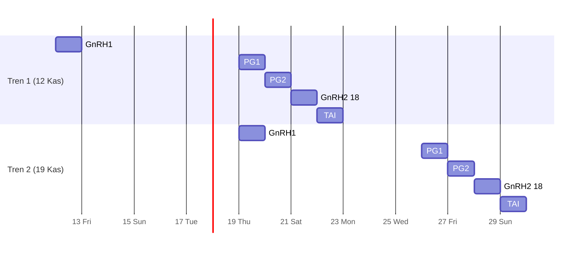
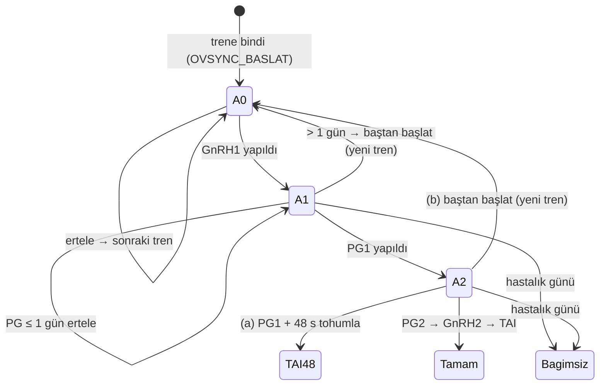

# Ovsync Treni — Tasarım (spec)

- Tarih: 2026-11-09 · Durum: **sahip incelemesinde** · Oturum: tedavi-arge (root, brainstorm)
- Kanıt (yerel, repoya girmez): `runs/2026-11-09-ovsync-toplu-gun/ovsync-hafta-report.md`,
  `runs/2026-11-09-ovsync-toplu-gun/tren-kesif-report.md` (giriş noktaları G1–G9 / V1–V7,
  prod fonksiyon gövdeleri `kanit/fn/*.sql`), `prod-uygula-report.md` (11-12 toplama, uygulandı).
- Bağlayıcı alan kuralları: `.harness/references/domain-rules.md` §5, §18. Bu spec §18'in
  2, 3, 10, 15 ve 18. maddelerini değiştirir (bkz. §9).

## 1. Amaç

Sahibin zamanı. Ovsync başlangıçları tek tek ve dağınık günlerde değil, **haftalık sabit bir
tren gününde** toplu başlar. Sahibin değer sırası (birebir, 2026-11-09):

1. "aynı günde olabildiğince iş yığmak böylece ertelemem gerekirse tek kalemde hepsini ertelerim"
2. "aynı günde aynı işleri denk getirmeye çalışmak … ama bu şart değil"

Başarı ölçütü: Ovsync işi her hafta aynı 4 ardışık güne düşer (tren günü D0/D7, +1 PG2,
+2 18:00 GnRH2, +3 TAI); erteleme tek işlemdir; hayvan başına ek bekleme ≤ 4 gün (ort. ~2).

Reddedilen alternatif: **C — esnek havuz** (her pencerede tren gününü yeniden hesapla).
Gerekçe: GnRH1'den sonra takvimi biyoloji kilitler; C'nin yeniden kurma faydası yalnız
başlamamış hayvanlara gider, onlar A'da zaten sonraki trene geçer. C yığılmayı bozar, günler
öngörülemez, tarih dondurma kuralları ister. Sahip: "a ile devam edelim … kod da bilinen
önkabuller ile çalışmayı daha çok seviyor süpriz sevmiyor".

## Kararlar

| Tarih | Karar | Sahip (birebir / özet) |
|---|---|---|
| 2026-11-09 | A yolu: haftalık sabit tren günü | "a uygun ya ben de hangi gün işim olduğunu statik bilirim" |
| 2026-11-09 | Öne çekme ≤ 2 gün, gün ayarlanabilir, varsayılan Perşembe | önerinin ekleri, itiraz yok; 5708 için onaylandı |
| 2026-11-09 | Erteleme ritmi kaydırır | önerilen A, itiraz yok |
| 2026-11-09 | Aşama 1 PG toleransı 1 gün | "öneri makul" |
| 2026-11-09 | Aşama 2'de erteleme yok; PG1+48 tohumla ya da baştan başlat | "pg yapıldıktan sonra erteleme yapılamaması lazım gerekirse döndü baştan başlatılmalı" |
| 2026-11-09 | Hastalık günü → bağımsız | "hastalık günü girilirse hasta bağımsız devam eder" |
| 2026-11-09 | Ovsync düzenleme yalnız Ovsync ekranından | "en temizi ovsych görevleri ovsych ekranından düzenlenir görevler sadece done undone girişi yapar" |
| 2026-11-09 | C (esnek havuz) reddedildi | "onayladım a ile devam edelim" |
| 2026-11-09 | Doğum sonrası PG → hatırlatma, kod arşiv | "kodu silmeyelim arşivleyelim" |
| 2026-11-09 | Düveler 13 ay beklemez | "devlet girişini zamanı gelince de yapabiliriz geriden" |

Haftalık ritim (çapa Perşembe; iki tren üst üste biner, D0 = önceki trenin D7'si):

Aşamaya göre erteleme (K4–K6):

## 2. Kurallar (sahip onaylı)

| # | Kural |
|---|---|
| K1 | Ovsync'ler haftalık **tren günü**nde başlar. Ritim bir **çapa tarihi** + 7k gündür; varsayılan çapa 2026-11-12 (Perşembe). Ayarla değişir. |
| K2 | Hayvan, `tren_gunu ≥ kural_gunu − 2` olan **en yakın** trene biner (öne çekme ≤ 2 gün, ayar). Kural günü değişmez (§18.1: inek doğum/abort + 51, düve 12 ay + 21 gün). Düveler 13 ay (devlet kaydı) beklemez. |
| K3 | Binen hayvanı olmayan tren yoktur (tren = o gün başlayan Ovsync kümesi; boş küme görünmez). |
| K4 | **Aşama 0** (GnRH1 yapılmadı): erteleme serbest; hayvan sonraki trene geçer. |
| K5 | **Aşama 1** (GnRH1 yapıldı, PG1 yapılmadı): PG1 en fazla **1 gün** ertelenir (ayar `ovsync_pg_erteleme_tolerans_gun`=1). Fazlası = Ovsync baştan başlar (`protokol_iptal` + yeniden başlat) ve hayvan yeni trene biner. |
| K6 | **Aşama 2** (PG1 yapıldı): **erteleme yok.** Seçenekler: **(a)** PG1 + 48 saatte tohumla (kalan PG2/GnRH2 günleri iptal, PG+48 TAI kalır; PG1+48 geçmişse çıkmaz) · **(b)** baştan başlat → trene bin. Bu aşamada `vaka_kalan_gunleri_kaydir`, `tohumlama_gorev_ertele` Ovsync vakasına KİLİTLİ. |
| K7 | **Toptan erteleme:** "Tren gününü N gün ertele" (N 1..7) tek işlem. O tarihteki tüm Ovsync işleri K4–K6'ya göre işlenir; **ritim kalıcı N gün kayar** (çapa += N). Önizleme zorunlu (hayvan başına sonuç). |
| K8 | **Elle başlatma sorusu:** "🚆 Trene bin — <gün> (<n> hayvan)" (ön seçili) / "Bağımsız başlat — bugün". Yollar: ▶ Başlat (V2), Vaka Aç + Ovsync şablonu (V3), Toplu Vaka Aç (V4), Şablon uygula (V5), Boş ata ve uygula (V6), Boş sonrası "Ovsync uygula" (G7), `protokol_iptal` yeniden başlat (G9). Bağımsız hayvan trene sayılmaz; K4–K6 ona da uygulanır. §18.4 (elle vaka aç'ta yaş/kural kapısı yok) aynen kalır: soru kapı değildir. |
| K9 | **Hastalık günü** (`ovsync_hastalik_gunu_ekle`, §18.18) girilen hayvan trenden ayrılır, **bağımsız** devam eder; tren kuralları ona dokunmaz (sahip: "hastalık günü girilirse hasta bağımsız devam eder"). |
| K10 | **Düzenleme sahipliği:** Ovsync görevleri (OVSYNC_BASLAT, Ovsync vakasının TEDAVI_GUN/SEANS'ı ve TAI'si) **yalnız Ovsync ekranından** ertelenir/kaydırılır/sıfırlanır. Görevler ekranı Ovsync için yalnız yapıldı/yapılmadı girer. |
| K11 | **Geç tamamlama:** Ovsync seansı planlanan günden sonra tamamlanırsa PG olay zamanı **gerçek tamamlama anı**dır (bugünkü `LEAST(now(), planlanan)` Ovsync'te kalkar — T1 tuzağı). PG1 toleransı (K5) aşılmışsa "baştan başlat önerilir" uyarısı; karar kullanıcının. |

## 3. Kapsam dışı

- Ovsync şablonunun kendisi (gün dizilimi D0/D7/D8/D9 18:00/D10) değişmez.
- §18.6 PG +48 s TAI kuralı (global, son PG kazanır) değişmez.
- Ovsync dışı görevlerin ertelemesi (`gorev_ertele`, kurallar tablosu) değişmez.
- Tren kimliği için yeni tablo açılmaz (YAGNI): tren = `start_date` / OVSYNC_BASLAT hedefi.

## 4. Faz 0 — Doğum sonrası PG → hatırlatma (önkoşul)

Sahip 2026-11-09: "zorunluluk değil sadece 2. ve 25. gün … bildirim olarak gelse yeter … kodu
silmeyelim arşivleyelim".
- `dogum_kaydet` doğum zinciri PG görevleri (d2, d25, d39 Presynch) yeni bayrak
  `dogum_sonrasi_pg_gorev_aktif` = 0 iken **görev açmaz**; d2 ve d25 için 🔔 panelde
  hatırlatma satırı (görev değil, kapatılması gerekmez) çıkar. Kod silinmez, bayrak arkasında kalır.
- Sonuç: 39. gün "senkron" PG'nin `OVSYNC_BASLAT` doğumunu bloklaması (`_acik_disi_hedef_ic`
  senkron damgası) yeni doğumlarda oluşmaz. Kapı, eski açık görevler için kod olarak kalır.
- Prod'daki 18 açık PG görevi 2026-11-09'da iptal edildi (veri adımı tamam).

## 5. Hesap ve veri

- **Tek hesap noktası** `_ovsync_tren_gunu(kural date) → date`: bayrak kapalıysa
  `GREATEST(kural, bugün_TR)` (bugünkü davranış); açıksa `GREATEST(kural − öne_çekme, bugün_TR)`
  değerinden büyük-eşit ilk `çapa + 7k` günü. Tarihler **TR** saat dilimiyle (UTC `CURRENT_DATE` yok).
- Bağlanacak yerler (bugün dağınık 4 nokta): `_ovsync_baslat_gorev_kur` hedef satırı,
  `_acik_disi_hedef_ic` hedef satırı, `ovsync_baslat_uyarilari` görevsiz kol,
  `start_first_service_protocol` başlangıç (hedef zaten tren günü; `GREATEST(hedef, bugün)` korunur).
- **Görev doğumu** (§18.2 değişir): `OVSYNC_BASLAT` kural günü yerine **tren günü − 2**'de doğar
  (öne çekme payı uyarıdan önce görünür). Başlatma penceresi (§18.3: hedef − 2) aynen.
- **Ayarlar** (`protokol_ayar`, seed): `ovsync_tren_aktif` (0/1, varsayılan 0),
  `ovsync_tren_capa` (tarih; numeric tabloda nasıl tutulacağı plan kararı), `ovsync_tren_one_cekme_gun` (2),
  `ovsync_pg_erteleme_tolerans_gun` (1), `dogum_sonrasi_pg_gorev_aktif` (0).
- **Aşama** vaka başına türetilir (kolon yok): GnRH1 seansı tamamlanmamış → 0; GnRH1 tamam, PG1 değil → 1; PG1 tamam → 2.
- **Yeni RPC'ler** (adlar plan kararı): `ovsync_tren_listele` (tren başlıkları + üyeler + aşama),
  `ovsync_tren_ertele_onizle(tarih, n)` (yazmaz), `ovsync_tren_ertele(tarih, n)` (tek transaction,
  K4–K7; kısmi başarı YOK — biri düşerse hepsi geri), `ovsync_pg48_tohumla(case)` (K6a),
  `ovsync_bastan_baslat(case)` (K5/K6b, `protokol_iptal` + yeniden başlat + hedef = tren günü;
  T4 cron tuzağı içeride çözülür).
- **Sunucu kilidi** (K10): bayrak açıkken `gorev_ertele`, `vaka_kalan_gunleri_kaydir(_coklu)`,
  `tohumlama_gorev_ertele` Ovsync görev/vakasına `OVSYNC_TREN_EKRANI` hatası verir. Çoklu kaydırma
  Ovsync satırlarını atlar ve atlananları döner.
- **Göç (tek seferlik):** açık 22 ileri tarihli eski `OVSYNC_BASLAT` (göç artığı, 2027'ye kadar)
  bayrak açılırken `_ovsync_tren_gunu`'ne yeniden hedeflenir; önce/sonra listesi rapora.
- **Yan düzeltme:** `ACIK-DISI-<hayvan>-<kural>` anahtarı, ilk Ovsync'i aynı anahtarla açılmış
  hayvanda Boş sonrası "Ovsync uygula"yı sessizce düşürebilir (`ON CONFLICT DO NOTHING`).
  Anahtar olay kimliğini içerecek biçimde değişir; sessiz NULL dönüş hata olur (fail-closed).

## 6. Ekranlar

Renk: vurgu yalnız yazı renginde, satır zemini/şerit yok. **Kod öncesi her ekranın PNG mockup'ı
sahip onayına** gider.

| Ekran | Değişiklik |
|---|---|
| Trene bin sorusu (K8) | Elle başlatma yollarında küçük modal, iki düğme, "Trene bin" ön seçili. Bayrak kapalıysa çıkmaz. |
| Ovsync takip ekranı | "Dalga" başlığı → "Tren · Per 19 Kas · 4 hayvan · bugün: PG günü"; başlıkta "Tren gününü ertele…". |
| Toptan erteleme modalı (K7) | N (1–7) seçimi → hayvan başına önizleme ("kayar" / "baştan başlar → <tren>" / "PG yapıldı: (a)/(b) seçin") → tek onay. Aşama 2 hayvan için seçim yapılmadan onay açılmaz. |
| Vaka kartı (aşama 2) | "Kalan günleri kaydır" yok; "PG1 + 48 s'te tohumla" ve "Baştan başlat → trene bin". |
| Görevler ekranı (K10) | Ovsync görevinde "Ertele" yerine "Ovsync ekranında düzenle →" (o trene derin bağlantı). Çoklu ertelemede Ovsync satırları atlanır + "N Ovsync görevi atlandı → Ovsync ekranı" notu. Yapıldı/yapılmadı aynen. |
| Tren ayarı | Takip ekranında: tren açık/kapalı, tren günü (çapayı değiştirir). |
| 🔔 panel (Faz 0) | Doğum sonrası d2/d25 PG hatırlatma satırı. |

Çevrimdışı: tren erteleme/baştan başlat/ayar butonları gizli (§18.10 kalıbı). Bayrak açıkken
elle Ovsync başlatma yolları (K8) online şartlıdır: çevrimdışıyken soru modalı açılmaz, "İnternet
yok" toast'ı çıkar, kuyruğa yazılmaz (tren günü sunucuda hesaplanır).

## 7. Hata durumları (fail-closed)

- Bayrak açıkken ayar eksik/geçersiz (çapa yok, tolerans negatif) → sessizce eski davranışa düşülmez, **hata**: `OVSYNC_TREN_AYAR`.
- Toptan ertelemede tek hayvan bile işlenemezse işlem bütünüyle geri alınır, hangi hayvanın neden düştüğü döner.
- Kısır hayvan hiçbir tren yolundan Ovsync'e girmez (§18.5 aynen).
- Aşama tespiti belirsizse (seans kaydı tutarsız) erteleme reddedilir, "baştan başlat" önerilir.

## 8. Test ve kabul

- **SQL kabul betiği** (`supabase/tests/ovsync_tren_kabul.sql`): K1–K11 her biri en az bir
  pozitif + bir negatif assert; bayrak kapalıyken eski davranış eşitliği (regresyon); göç
  önce/sonra; anahtar çakışması senaryosu.
- Her yeni migration `scripts/db-validate.sh` (seri için `--priors`) ile doğrulanır.
- JS birim testleri: soru modalı, görevler ekranı Ovsync satırı, çoklu erteleme atlama.
- **Demo e2e** (stub değil, gerçek demo DB): trene bin, toptan erteleme +1 / +3, aşama 2 (a)/(b), geç tamamlama.
- **UI kapısı** (CLAUDE.md): worker sonnet-medium demo tarayıcı yürüyüşü, madde başına PASS +
  kanıt; ölçüt sahibin karar sorusunu karşılamalı (DOM varlığı yetmez). PASS'siz sahibe demo yok.
- Prod: yedek + migration + `scripts/veri-eslesme-kontrol.py hepsi` (SIZINTI/YETIM 0); bayrak
  açılınca çapa 2026-11-12, mevcut 4'lü grup ilk tren.

## 9. domain-rules güncellemeleri (uygulama ile aynı dalda)

- §5 madde 6: doğum sonrası PG → hatırlatma (not 2026-11-09'da eklendi; uygulanınca kesinleşir).
- §18.2: görev doğumu tren günü − 2 (bayrak açıkken).
- §18.3: başlangıç = tren günü; öne çekme ≤ 2 gün kural günü istisnası.
- §18.10: Ovsync görevleri genel ertelemenin dışında; aşama kuralları K4–K7; sahiplik K10.
- §18.15: Boş sonrası "Ovsync uygula" varsayılanı "hemen" → K8 sorusu ("Trene bin" ön seçili).
- §18.18: hastalık günü → hayvan bağımsız (K9).
- Yeni §18.19: Ovsync treni (K1–K11 özet + bu spec'e bağlantı).

## 10. Yürütme notları

- Tedavi-arge kuralı (sahip 2026-11-07): yalnız Anthropic alt ajanları (+ ask-codex); Muse yok.
- Uygulama ayrı dal/worktree'de; Faz 0 → Faz 1 (DB) → Faz 2 (UI, mockup onayı önce) → demo kapısı → sahip demo → prod.
- Sıradaki adım: bu spec sahip onayından sonra writing-plans ile uygulama planı.
